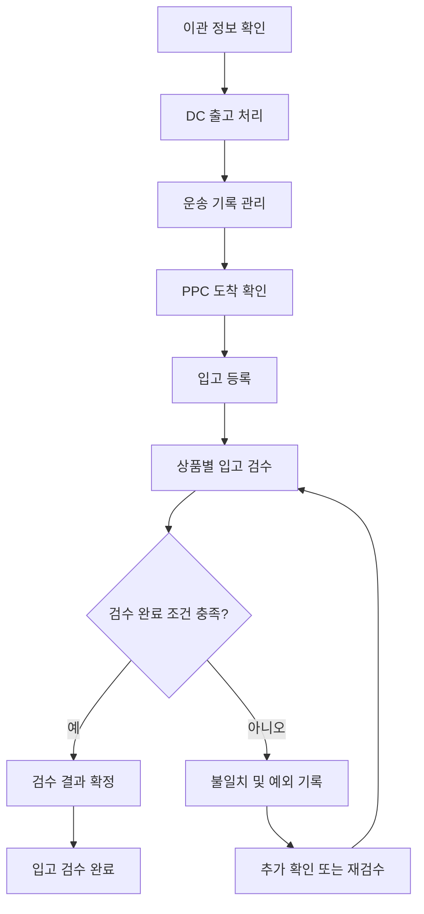
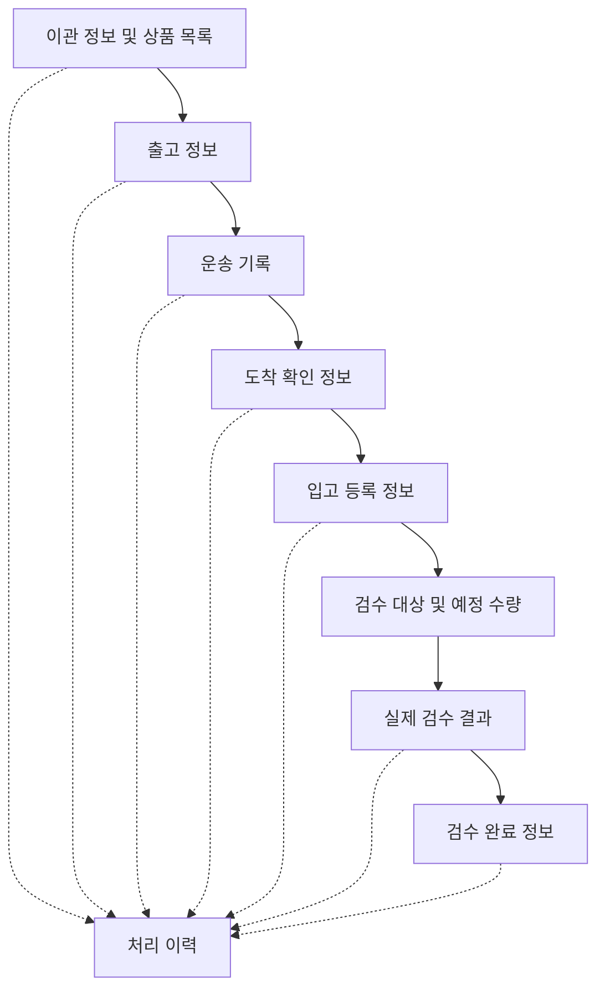
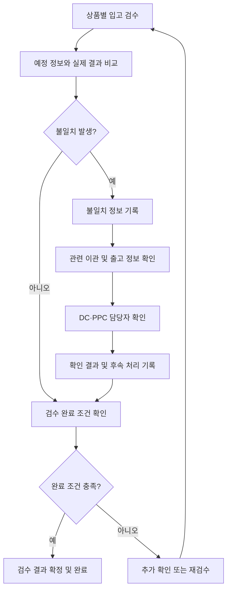

# DC → PPC 입고·검수 시스템 정의서

- **문서 유형:** 업무 흐름 및 기능 정의서
- **문서 상태:** 초안
- **목적:** DC 출고부터 PPC 입고 검수 완료까지의 업무 흐름, 기능, 데이터 및 처리 규칙을 정의한다.
- **작성 기준:** 현재까지 논의한 프로젝트 범위와 설계 방향을 기준으로 한다.
- **주의 사항:** 실제 B마트 내부 시스템의 세부 구현으로 확인되지 않은 내용은 설계안으로 구분하며, 확정되지 않은 업무 규칙은 미정으로 표시한다.
또한, 외부 운송 업체와 연동이 되는가? 에 대한 부분은 생략한다. 

---

# 1. 프로젝트 개요

## 1.1. 시스템 목적

DC에서 출고되는 이관 상품을 식별하고, PPC 도착 확인, 입고 등록, 입고 검수 및 검수 완료까지의 과정을 관리한다.

각 단계의 처리 결과와 데이터를 기록하여 출고부터 검수 완료까지의 진행 상황을 확인하고, 출고 정보와 실제 입고 결과의 차이 및 예외 상황을 추적할 수 있도록 한다.

## 1.2. 시스템 범위

### 포함 범위

1. 이관 건 및 상품 정보 관리
2. DC 출고 정보 확인 및 기록
3. 운송 관련 기록 관리
4. PPC 도착 확인
5. 입고 등록
6. 상품별 입고 검수 및 결과 기록
7. 검수 완료 처리
8. 불일치 및 예외 처리
9. 상태 변경 및 업무 처리 이력 관리

### 제외 범위

- 실제 운송 수단의 운행 및 배차 수행
- 운송 기사 위치 추적 시스템 자체 구현
- 입고 검수 완료 이후의 상품 적치 및 진열
- 판매 가능 재고 전환
- 고객 상품 주문·결제 및 고객 배송

> 실제 운송 행위는 구현 범위에서 제외한다. 다만 입고 업무에 필요한 운송 식별 정보, 운송 상태, 출발·도착 시각 등의 기록은 관리 대상으로 둔다. 외부 운송 업체와의 실제 연동은 후속 단계에서 검토한다.

---

# 2. 전체 업무 흐름

## 2.1. 기본 흐름

## 2.2. 단계별 업무 및 기능

| 단계 | 담당 주체 | 주요 기능 | 처리 결과 |
|---|---|---|---|
| 1. 이관 정보 확인 | DC팀 및 시스템 | 이관 건과 상품별 예정 수량 확인 | 이관 대상 정보 |
| 2. DC 출고 처리 | DC팀 | 출고 대상·수량 확인, 출고 확정 및 시각 기록 | 출고 정보 |
| 3. 운송 기록 관리 | 시스템 및 관련 담당자 | 이관 건과 운송 기록 연결, 운송 상태·시각 관리 | 운송 기록 |
| 4. PPC 도착 확인 | PPC팀 | 도착 여부 확인 및 도착 시각 기록 | 도착 확인 정보 |
| 5. 입고 등록 | PPC팀 | 입고 대상 생성 및 검수 대상 상품 구성 | 입고 등록 정보 |
| 6. 입고 검수 | PPC팀 | 실제 상품·수량 확인 및 예정 정보와 비교 | 상품별 검수 결과 |
| 7. 검수 완료 | PPC팀 및 시스템 | 완료 조건 검증, 결과 확정 및 상태 변경 | 검수 완료 정보 |

※ 위 표는 프로젝트의 기본 설계안이다. 담당자별 세부 권한과 단계별 필수 조건은 실제 업무 규칙을 확인한 뒤 확정한다.

## 2.3. 단계별 상태 구분

다음 상태는 서로 구분하여 관리한다.

- **출고 완료:** DC 출고 처리가 완료된 상태
- **도착 확인 완료:** PPC 도착 사실이 확인된 상태
- **입고 등록 완료:** 입고 검수 대상으로 등록된 상태
- **검수 완료:** 검수 결과가 확정된 상태

앞 단계가 완료되었다고 다음 단계까지 자동으로 완료되는 것은 아니다. 각 단계는 해당 업무의 처리 결과와 완료 조건을 기준으로 상태를 변경한다.

---

# 3. 단계별 기능 명세

## 3.1. 이관 정보 확인 및 DC 출고 처리

**기능 목적:** PPC로 이관할 상품과 예정 수량을 확인하고 DC 출고 정보를 기록한다.

**주요 입력 데이터**
- 이관 ID
- 출발 DC 및 도착 PPC
- 상품 코드 및 상품명
- 상품별 예정 수량
- 실제 출고 수량

**처리 로직**
1. 이관 대상 정보를 조회한다.
2. 이관 ID, 출발지 및 도착지를 확인한다.
3. 상품별 예정 수량과 실제 출고 수량을 확인한다.
4. 출고 확정 조건을 검증한다.
5. 출고 상태, 출고 시각 및 처리 주체를 기록한다.
6. 이후 운송 및 입고 업무에서 출고 정보를 조회할 수 있도록 한다.

**처리 결과**
- 이관 및 출고 정보
- 상품별 예정 수량과 실제 출고 수량
- 출고 상태 및 출고 확정 시각
- 출고 처리 이력

**담당자 요구사항**
- DC팀은 출고 대상과 수량을 확인하고 출고 처리를 수행할 수 있어야 한다.
- DC팀은 출고 완료 건과 이후 PPC 입고 진행 상황을 조회할 수 있어야 한다.
- PPC팀은 입고 업무에 필요한 출고 정보를 조회할 수 있어야 한다.

**예외 상황**
- 이관 정보 또는 상품 정보 누락
- 상품 코드나 수량 정보 오류
- 중복 출고 처리 요청
- 출고 확정 후 수정 또는 취소 요청
- 예정 수량과 실제 출고 수량의 차이

**미정 사항**
- 이관 정보 생성 시점과 생성 주체
- 출고 확정 조건 및 권한
- 출고 확정 후 수정·취소 가능 여부
- 예정 수량과 실제 출고 수량이 다른 경우의 처리 방식

---

## 3.2. 운송 기록 관리

**기능 목적:** DC 출고 건과 운송 관련 기록을 연결하여 운송 진행 상황 및 PPC 도착 정보를 확인할 수 있도록 한다.

**주요 입력 데이터**
- 이관 ID
- 운송 건 식별자
- 출고 확정 시각
- 운송 상태
- 운송 출발 및 도착 시각
- 외부 운송 식별자(향후 연동 시)

**처리 로직**
1. 출고가 확정된 이관 건을 조회한다.
2. 해당 이관 건에 연결할 운송 기록을 등록한다.
3. 운송 상태 및 관련 시각을 기록한다.
4. 이관 건을 기준으로 운송 기록을 조회할 수 있도록 한다.
5. 운송 기록의 변경 사항을 이력으로 관리한다.

**처리 결과**
- 이관 건과 운송 기록의 연결 정보
- 운송 상태 및 관련 시각
- 운송 정보 변경 이력

**담당자 요구사항**
- DC팀과 PPC팀은 업무에 필요한 운송 기록 및 진행 상황을 조회할 수 있어야 한다.
- 시스템은 운송 기록을 내부 이관 건과 연결할 수 있어야 한다.

**예외 상황**
- 운송 정보 누락
- 이관 건과 운송 기록의 연결 오류
- 운송 기록 중복 등록
- 운송 상태 및 시각 정보의 누락 또는 순서 오류

**설계 원칙**
- 실제 운송 행위와 운송 기록 관리를 구분한다.
- 내부 이관 ID와 외부 운송 식별자를 별도로 관리한다.
- 외부 운송 업체가 결정되지 않은 현재 단계에서는 연동 업체와 API 규격을 확정하지 않는다.

---

## 3.3. PPC 도착 확인 및 입고 등록

**기능 목적:** PPC 도착 여부를 확인하고, 도착한 이관 건을 입고 검수 대상으로 등록한다.

**주요 입력 데이터**
- 이관 ID
- 출발 DC 및 도착 PPC
- 상품별 예정 수량
- 운송 기록
- 도착 확인 정보

**처리 로직**
1. 도착 예정 이관 건을 조회한다.
2. 이관 ID와 도착 PPC를 확인한다.
3. 실제 도착 여부를 확인하고 도착 시각 및 확인 정보를 기록한다.
4. 도착 확인 결과를 기준으로 입고 등록 가능 여부를 확인한다.
5. 입고 등록 정보를 생성한다.
6. 상품별 검수 대상 목록과 예정 수량을 구성한다.
7. 입고 등록 상태를 기록한다.

**처리 결과**
- 도착 확인 결과 및 도착 시각
- 도착 확인자
- 입고 등록 ID
- 연결된 이관 ID
- 입고 대상 상품 및 예정 수량
- 입고 등록 상태

**담당자 요구사항**
- PPC팀은 도착 예정 건과 입고 대상 상품을 조회할 수 있어야 한다.
- PPC팀은 도착 확인과 입고 등록을 구분하여 처리할 수 있어야 한다.
- DC팀은 이관 건의 도착 및 입고 등록 진행 상황을 조회할 수 있어야 한다.

**예외 상황**
- 이관 정보 조회 불가
- 도착 확인 정보 누락
- 이미 도착 처리된 건의 중복 등록
- 도착 확인 전 입고 등록 요청
- 이미 입고 등록된 건의 중복 등록
- 운송 기록과 실제 도착 확인 결과의 불일치

**미정 사항**
- 도착 확인 방법 및 처리 권한
- 운송 기록과 실제 도착 확인 결과가 다를 때의 처리 기준
- 입고 등록 가능 조건
- 하나의 이관 건에 여러 입고 등록을 허용할지 여부

---

## 3.4. PPC 입고 검수

**기능 목적:** 입고 예정 정보를 기준으로 실제 상품과 수량을 확인하고 상품별 검수 결과를 기록한다.

**주요 입력 데이터**
- 입고 등록 ID
- 이관 ID
- 상품 코드 및 상품명
- 상품별 예정 수량
- 실제 확인 수량
- 검수자 정보

**처리 로직**
1. 검수 대상 입고 건을 조회한다.
2. 검수 대상 상품과 예정 수량을 확인한다.
3. 실제 도착한 상품과 수량을 확인한다.
4. 예정 수량과 실제 확인 수량을 비교한다.
5. 상품별 검수 결과를 기록한다.
6. 불일치가 발생하면 유형, 수량 차이 및 사유를 기록한다.
7. 검수 결과를 기준으로 완료 가능 여부를 판단한다.

**처리 결과**
- 상품별 예정 수량 및 실제 확인 수량
- 수량 차이
- 상품별 검수 결과
- 검수자 및 검수 시각
- 불일치 및 예외 정보

**담당자 요구사항**
- PPC팀은 상품별 예정 수량과 실제 입고 수량을 비교할 수 있어야 한다.
- PPC팀은 미검수 상품과 불일치 상품을 구분하여 조회할 수 있어야 한다.
- DC팀은 출고 건과 연결된 검수 결과 및 불일치 정보를 조회할 수 있어야 한다.

**예외 상황**
- 실제 상품이 예정 목록에 없음
- 예정 상품이 도착하지 않음
- 예정 수량과 실제 수량의 불일치
- 상품 코드 확인 불가
- 검수 결과 누락
- 검수 중복 입력 또는 완료 후 수정 요청

**미정 사항**
- 파손 및 불량 상품 분류 방식
- 부족·초과 입고 및 예정 외 상품 처리 방식
- 검수 결과 수정 권한
- 재검수 허용 조건
- 불일치가 있는 경우 검수 완료를 허용할지 여부

---

## 3.5. 검수 완료 처리

**기능 목적:** 입고 검수 결과를 확정하고 해당 입고 건의 검수 완료 상태를 기록한다.

**처리 로직**
1. 해당 입고 건의 검수 결과를 조회한다.
2. 미검수 상품 및 미확정 결과가 있는지 확인한다.
3. 정의된 검수 완료 조건을 검증한다.
4. 완료 조건을 충족하면 검수 결과를 확정한다.
5. 검수 완료 상태, 완료 시각 및 처리 주체를 기록한다.
6. 검수 완료 이력을 보존한다.

**처리 결과**
- 확정된 검수 결과
- 검수 완료 상태 및 시각
- 완료 처리자
- 완료 이력

**예외 상황**
- 일부 상품의 검수가 완료되지 않음
- 검수 결과 미확정
- 해결되지 않은 불일치 존재
- 중복 완료 처리 요청
- 완료된 건에 대한 수정 요청

**미정 사항**
- 검수 완료 조건
- 모든 상품의 검수 결과 확정이 필수인지 여부
- 불일치가 있는 건의 예외 승인 방식
- 완료 이후 수정 및 재검수 허용 범위

> 본 시스템의 최종 완료 지점은 PPC 입고 검수 완료다. 이후 상품 적치, 진열 및 판매 가능 재고 전환은 처리 범위에 포함하지 않는다.

---

# 4. 데이터 구조 및 데이터 흐름

## 4.1. 주요 데이터 영역

| 데이터 영역 | 주요 항목 | 관리 목적 |
|---|---|---|
| 이관 정보 | 이관 ID, 출발 DC, 도착 PPC, 생성 시각 | 이관 건 식별 |
| 이관 상품 정보 | 상품 코드, 상품명, 예정 수량 | 이관 대상 확인 |
| 출고 정보 | 출고 상태, 실제 출고 수량, 출고 시각, 처리자 | 출고 결과 기록 |
| 운송 정보 | 운송 건 ID, 외부 운송 식별자, 운송 상태, 관련 시각 | 운송 기록 연결 |
| 도착 정보 | 도착 여부, 도착 시각, 확인자 | PPC 도착 확인 |
| 입고 정보 | 입고 등록 ID, 등록 시각, 입고 상태 | 검수 대상 관리 |
| 검수 정보 | 예정 수량, 실제 수량, 검수 결과, 검수자, 검수 시각 | 검수 결과 기록 |
| 불일치 정보 | 불일치 유형, 수량 차이, 사유, 확인 결과 | 예외 관리 |
| 처리 이력 | 대상 ID, 변경 전후 상태, 변경 시각, 처리 주체, 사유 | 업무 처리 추적 |

※ 위 항목은 논리적인 데이터 영역이며, 실제 DB 테이블 분리 방식과 필수 필드는 별도 설계에서 확정한다.

## 4.2. 데이터 흐름

각 단계는 이전 단계의 데이터를 참조하되, 자신의 처리 결과를 별도로 기록한다. 처리 이력은 상태 변경과 주요 업무 처리 내용을 추적하기 위한 공통 관리 대상이다.

## 4.3. 식별자 및 데이터 관리 원칙

### 주요 식별자

- **이관 ID:** DC 출고와 PPC 입고를 연결하는 기본 식별자
- **운송 건 ID:** 이관 건과 연결되는 운송 기록 식별자
- **입고 등록 ID:** PPC에서 생성한 입고 처리 건 식별자
- **검수 ID:** 검수 작업 또는 검수 결과 식별자

각 식별자의 생성 주체와 데이터 간 일대일·일대다 관계는 미정이다.

### 데이터 관리 원칙

1. 예정 수량, 실제 출고 수량, 실제 입고 수량을 구분하여 관리한다.
2. 출고 기록과 입고 검수 기록을 동일한 이관 ID 기준으로 연결한다.
3. 출고 수량을 실제 입고 수량으로 덮어쓰지 않는다.
4. 검수 결과와 불일치 정보를 별도로 기록한다.
5. 상태 변경 시 변경 시각과 처리 주체를 기록한다.
6. 수정된 데이터는 변경 이력을 확인할 수 있도록 한다.
7. 외부 운송 정보가 추가되어도 내부 이관 ID를 기준으로 관련 기록을 연결할 수 있도록 한다.

---

# 5. 상태 관리 및 처리 이력

## 5.1. 상태 정의 초안

| 상태 영역 | 상태 예시 | 의미 |
|---|---|---|
| 출고 상태 | 출고 전, 출고 완료 | DC 출고 처리 진행 상황 |
| 운송 상태 | 운송 정보 등록, 운송 중, 도착 기록 | 운송 관련 기록의 진행 상황 |
| 도착 상태 | 도착 확인 전, 도착 확인 완료 | PPC 도착 확인 진행 상황 |
| 입고 상태 | 미등록, 입고 등록 완료 | 입고 검수 대상 등록 여부 |
| 검수 상태 | 검수 전, 검수 중, 검수 결과 기록, 검수 완료 | 검수 진행 상황 |
| 예외 상태 | 불일치 확인 필요, 재검수 필요 | 추가 처리가 필요한 상황 |

※ 상태명은 설계 예시이며 실제 상태 코드와 전환 규칙은 확정되지 않았다. 서로 다른 업무의 상태를 하나의 상태값으로 무리하게 통합하지 않고 영역별로 구분한다.

## 5.2. 상태 변경 원칙

1. 해당 업무의 처리 결과를 기준으로 상태를 변경한다.
2. 이전 단계의 완료 여부를 확인한 후 다음 단계의 처리 가능 여부를 판단한다.
3. 중복 요청으로 중복 등록 또는 중복 완료가 발생하지 않도록 검증한다.
4. 예외가 발생하면 정상 완료로 임의 전환하지 않고 예외 정보를 기록한다.
5. 완료된 데이터의 수정은 권한 및 이력 관리 규칙에 따라 처리한다.

## 5.3. 처리 이력 관리

**주요 기록 항목**
- 이관 ID 및 관련 업무 식별자
- 변경 대상 데이터
- 변경 전 상태 및 변경 후 상태
- 처리 시각
- 처리 주체
- 처리 사유 또는 예외 사유

처리 이력은 오류 원인을 추적하고, 중복 처리 및 완료 이후 수정 여부를 확인하기 위해 사용한다.

---

# 6. 불일치 및 예외 처리

## 6.1. 주요 예외 유형

| 예외 유형 | 발생 단계 | 시스템 처리 방향 |
|---|---|---|
| 이관 또는 출고 정보 누락 | 이관·출고 | 누락 정보 확인 및 처리 가능 여부 검증 |
| 운송 정보 누락 | 운송 기록 관리 | 운송 기록 미등록 상태 기록 |
| 도착 정보 누락 또는 불일치 | 도착 확인 | 실제 도착 여부 및 관련 기록 확인 |
| 입고 등록 중복 | 입고 등록 | 기존 입고 건 확인 및 중복 생성 방지 |
| 수량 부족·초과 | 입고 검수 | 차이 및 불일치 유형 기록 |
| 예정 외 상품 발견 | 입고 검수 | 예정 목록과 분리하여 예외 기록 |
| 검수 결과 누락 | 검수 완료 | 완료 조건 미충족 처리 |
| 완료 후 수정 요청 | 검수 완료 | 권한 확인 및 변경 이력 기록 |

## 6.2. 불일치 처리 흐름

※ 불일치 유형별 세부 처리 절차와 완료 가능 조건은 별도 확정이 필요하다.

## 6.3. 불일치 기록 항목

- 이관 ID 및 입고 등록 ID
- 상품 코드
- 예정 수량 및 실제 입고 수량
- 수량 차이
- 불일치 유형 및 사유
- 확인 시각 및 확인 담당자
- 확인 결과 및 후속 처리 내용
- 후속 처리 상태

## 6.4. 예외 처리 원칙

1. 불일치 발생 사실과 원인을 확인할 수 있는 정보를 기록한다.
2. DC 출고 정보와 PPC 입고 정보를 연결하여 비교할 수 있도록 한다.
3. 관련 담당자가 동일한 이관 건의 정보를 조회할 수 있도록 한다.
4. 확인 결과 및 후속 처리 내용을 기록한다.
5. 검수 완료 여부는 확정된 완료 조건을 기준으로 판단한다.
6. 미해결 예외의 완료 처리 가능 여부를 임의로 결정하지 않는다.

---

# 7. 권한 및 업무 주체별 요구사항

## 7.1. 담당자별 주요 업무

| 업무 | DC팀 | PPC팀 |
|---|---|---|
| 이관 정보 확인 | 출고 대상 및 수량 확인 | 입고 예정 정보 조회 |
| 출고 처리 | 출고 정보 입력 및 확정 | 출고 정보 조회 |
| 운송 기록 | 관련 기록 조회 및 확인 | 관련 기록 조회 및 확인 |
| 도착 확인 | 도착 진행 상황 조회 | 도착 여부 확인 및 기록 |
| 입고 등록 | 입고 진행 상황 조회 | 입고 대상 등록 |
| 검수 | 출고 정보 및 검수 결과 조회 | 실제 수량 확인 및 결과 입력 |
| 불일치 처리 | 출고 기록 확인 및 관련 정보 제공 | 불일치 기록 및 검수 결과 확인 |
| 검수 완료 | 완료 상태 조회 | 완료 조건 확인 및 결과 확정 |

※ 실제 담당자별 등록·수정·확정 권한은 현장 업무 규칙을 확인한 뒤 확정한다.

## 7.2. 권한 설계 원칙

- DC팀은 출고 업무에 필요한 정보의 등록 및 확정 권한을 중심으로 설계한다.
- PPC팀은 도착 확인, 입고 등록, 검수 및 검수 완료 권한을 중심으로 설계한다.
- 양쪽 담당자는 업무상 필요한 출고·입고 진행 정보와 불일치 내역을 조회할 수 있도록 한다.
- 데이터 수정 및 검수 결과 확정 권한은 별도로 정의한다.
- 권한이 제한된 작업의 수행 여부와 주요 처리 이력을 확인할 수 있도록 한다.

---

# 8. 구현 범위 및 후속 검토 사항

## 8.1. 현재 구현 대상

- 이관 건 및 상품 정보 관리
- DC 출고 정보 기록
- 운송 기록 관리 구조
- PPC 도착 확인
- 입고 등록
- 상품별 입고 검수
- 검수 결과 및 불일치 기록
- 검수 완료 처리
- 단계별 상태 및 처리 이력 관리
- DC·PPC 간 업무 정보 조회 및 연계

## 8.2. 후속 단계 검토 항목

- 외부 운송 업체 및 API 연동
- 운송 기록의 수신 방식
- 외부 운송 식별자와 내부 이관 ID의 매핑
- 실제 DB 테이블 및 관계
- 화면 및 API 명세
- 사용자별 세부 권한
- 검수 완료 및 예외 승인 정책

## 8.3. 우선 확정해야 할 업무 규칙

| 검토 항목 | 확인할 내용 |
|---|---|
| 이관 건 생성 | 생성 시점, 생성 주체, 필수 정보 |
| 출고 확정 | 출고 완료 조건 및 수정 규칙 |
| 도착 확인 | 확인 방법 및 처리 권한 |
| 입고 등록 | 등록 조건 및 중복 방지 기준 |
| 검수 단위 | 이관 건 단위 또는 상품별 검수 |
| 수량 불일치 | 부족·초과 및 예정 외 상품 처리 방식 |
| 검수 완료 | 완료 조건 및 예외 승인 방식 |
| 수정·재검수 | 결과 확정 후 수정 및 재검수 허용 범위 |
| 데이터 관계 | 이관·운송·입고·검수 데이터의 연결 관계 |
| 권한 | 조회·등록·수정·확정 권한 |

---

# 9. 최종 설계 원칙

본 시스템은 DC 출고부터 PPC 입고 검수 완료까지의 업무를 단계별로 관리한다.

각 단계에서 입력 데이터를 확인하고, 업무 조건에 따라 처리한 후 결과와 상태를 기록한다. 단계별 데이터는 내부 이관 ID를 기준으로 연결하며, 출고 정보와 실제 입고 검수 정보는 구분하여 보존한다.

설계 시 다음 원칙을 유지한다.

1. **업무 흐름과 기능 연결:** 각 기능의 시작 조건, 처리 내용 및 완료 조건을 명확히 정의한다.
2. **데이터 구분 및 연계:** 예정 수량, 실제 출고 수량, 실제 입고 수량을 구분하고 관련 업무 데이터를 연결한다.
3. **상태 및 예외 관리:** 정상 처리와 예외 처리를 구분하고 처리 결과를 기록한다.
4. **담당자별 업무 구분:** DC팀과 PPC팀의 업무 및 권한을 구분하되, 양쪽에서 필요한 정보를 조회할 수 있도록 한다.
5. **이력 추적:** 상태 변경, 주요 처리 및 예외 내역을 추적할 수 있도록 한다.
6. **미확정 규칙 분리:** 실제 업무 확인이 필요한 사항은 미정으로 관리하고 임의로 필수 정책을 확정하지 않는다.

본 정의서를 기준으로 업무 규칙을 확정한 뒤 기능 명세, DB 설계, API 설계 및 화면 설계를 진행한다.

---

## 10. 후속 기능 검토: 검수 완료 상품 적치 및 보관 위치 관리

### 10.1 기능 목적

- **기능 목적:** 입고 검수가 완료된 상품을 PPC 내부의 적절한 보관 위치에 배정하고, 위치별 보관 수량 및 공간 사용 현황을 관리한다.
- **현재 범위:** DC 출고부터 PPC 입고·검수 완료까지
- **후속 확장 범위:** 검수 완료 상품의 적치 위치 배정, 보관 공간 관리, 위치별 재고 관리
- **주의 사항:** 본 항목은 향후 확장을 위한 검토 사항이며, 현재 시스템의 필수 구현 범위에는 포함하지 않는다.

### 10.2 주요 관리 정보

| 구분 | 관리 항목 | 목적 |
|---|---|---|
| 시설 정보 | 시설 ID, 시설명, 시설 유형(DC/PPC) | 시설 구분 및 입출고 데이터 연결 |
| 보관 구역 | 구역 ID, 구역명, 구역 유형 | 창고 내부의 보관 영역 구분 |
| 보관 위치 | 위치 ID, 위치명, 소속 구역 | 상품별 적치 위치 식별 |
| 위치별 수용량 | 최대 보관 가능 수량 또는 용량 | 적치 가능 여부 판단 |
| 위치별 사용 현황 | 현재 점유 수량 또는 사용 용량 | 잔여 보관 공간 확인 |
| 상품 보관 정보 | 상품 코드, 보관 조건, 적치 수량 | 적합한 보관 위치 배정 |
| 적치 처리 이력 | 적치 대상, 적치 위치, 수량, 처리 시각, 담당자 | 적치 결과 및 변경 이력 추적 |

※ 창고 전체 면적, 높이, 랙 규격 등의 물리적 정보는 공간 활용률이나 적재 효율을 계산할 필요가 있을 때 추가로 검토한다. 단순한 적치 관리만 구현한다면 위치별 수용량과 사용 현황을 우선적으로 관리할 수 있다.

### 10.3 예상 업무 흐름

1. **검수 완료 확인:** 입고·검수 시스템에서 해당 상품의 검수 완료 여부를 확인한다.
2. **적치 대상 확인:** 적치할 상품과 수량을 확인한다.
3. **보관 위치 확인:** 상품의 보관 조건과 각 위치의 잔여 수용량을 확인한다.
4. **적치 위치 배정:** 적치 가능한 위치를 선택하거나 시스템이 위치를 추천한다.
5. **적치 결과 등록:** 실제 적치 위치, 수량, 담당자 및 처리 시각을 기록한다.
6. **보관 현황 갱신:** 위치별 보관 수량 및 잔여 용량을 갱신한다.
7. **예외 처리:** 적치 가능한 위치가 없거나 수량이 일치하지 않는 경우 별도 확인 대상으로 처리한다.

### 10.4 후속 검토가 필요한 규칙

- 검수 완료 상품만 적치 대상으로 허용할 것인지
- 상품의 보관 조건에 따라 적치 가능한 위치를 제한할 것인지
- 위치별 수용량을 수량 기준으로 관리할지, 부피·중량 등의 용량 기준으로 관리할지
- 하나의 상품을 여러 위치에 나누어 적치할 수 있도록 할 것인지
- 적치 위치를 담당자가 직접 선택할지, 시스템이 자동 추천할지
- 적치 완료 시점에 재고 수량을 증가시킬지
- 적치 후 위치 변경 및 이동 이력을 어떻게 관리할지
- 보관 공간이 부족하거나 적치가 불가능한 경우 어떤 절차로 처리할지

### 10.5 기존 시스템과의 연결

- **입고·검수 시스템:** 검수 완료 결과와 실제 입고 수량을 적치 시스템에 전달한다.
- **적치·보관 관리 기능:** 적치 위치를 배정하고 실제 적치 결과를 기록한다.
- **재고 관리 시스템:** 적치 결과를 기준으로 위치별 재고 및 보관 현황을 관리한다.

단, 검수 완료와 적치 완료는 서로 다른 업무 상태로 관리한다. 검수가 완료되었다고 해서 상품이 이미 지정된 위치에 보관되었다고 간주하지 않는다.

---

# 11. API 연동 관련 추가 검토 사항

**기능 목적**

- 자체 또는 외부 운송 시스템과 운송 정보를 주고받고, 전달받은 정보를 내부 이관 건과 연결하여 관리한다.

**추가 검토 기능**

- 출고 및 운송 관련 정보의 API 전달
- 운송 상태 및 출발·도착 정보 수신
- 내부 이관 ID와 외부 운송 식별자의 매핑
- 외부 상태 코드와 내부 운송 상태 간 변환
- API 요청·응답 결과 및 연동 이력 관리
- 통신 오류, 전달 실패 및 중복 정보 처리
- API 인증 및 접근 권한 관리

**추가 검토 정보**

- 연동 대상 시스템 및 API 제공 주체
- API 요청·응답 데이터 형식
- 운송 상태 코드 및 상태 변경 기준
- 운송 정보 전달 시점과 전달 방식
- 외부 운송 식별자 발급 및 매핑 규칙
- 인증 방식, 오류 코드 및 재시도 기준

**설계 원칙**

- 실제 운송 행위와 운송 정보 연동 및 기록 관리를 구분한다.
- 내부 이관 ID와 외부 운송 식별자를 별도로 관리한다.
- 외부 운송 업체 또는 자체 시스템의 연동 방식이 확정되기 전까지 API 규격과 세부 처리 규칙은 확정하지 않는다.
- 운송 상태의 전달 여부와 실제 PPC 도착 확인 및 입고 검수 완료 여부를 구분한다.

---

# 출처 및 참고 

- 우아한형제들 기술블로그
    - WMS 재고 이관을 위한 분산 락 사용기
    DC → PPC 이관 구조, WMS 역할, 이관요청서 항목 및 할당 상태 확인에 가장 직접적인 자료.
    https://techblog.woowahan.com/17416/
    - 운송 관리 시스템(TMS)의 탄생부터 현장에서 사용하기까지
    TMS의 역할, 배차, 출고 물량, 차량 관제, 입출차 이력 확인. https://techblog.woowahan.com/17466/
    - B마트 OMS의 물류주문관리를 통한 출고 최적화
    OMS, 주문부터 출고·배송까지의 흐름, PPC 운영 및 출고 최적화 확인. https://techblog.woowahan.com/22263/
