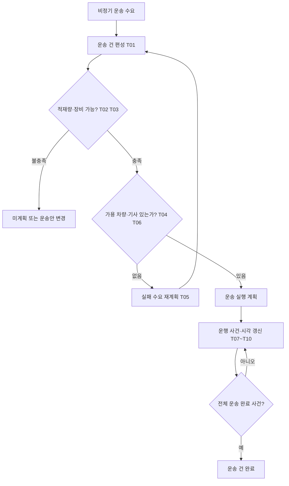
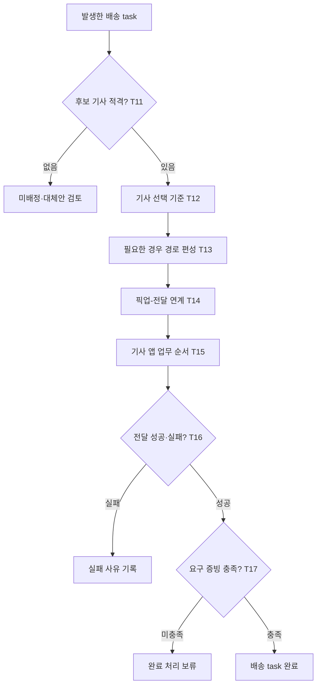

# 바로픽(BARO-PICK) TMS 비즈니스 로직 공식 근거 조사·분석서 — 최종 제출본

> 수정일: 2026-10-18  |  제출본: v3 최종 점검 반영  |  성격: 공식 제품 도움말 기반 **TMS 업무 판단 로직 조사본**  |  상태: 팀 정책·개발 구현 미확정 / 실제품 실행 테스트 미수행
> **범위 변경:** 정기배송·정기편·고정 반복 노선 매칭 로직은 분석에서 제외. 비정기 운송과 주문 발생 기반 배송은 포함.

## 1. 목적·범위·검증 원칙

### 1.1 문서 목적

TMS가 운송 수요에 대해 **어떤 입력을 받고 → 어떤 조건을 검사·계산·비교하며 → 어떤 운송 계획·기사 배정·실행 결과를 결정하는지** 분석. 기능 목록이나 화면 설계, 도메인 간 통합관제 연계 문서가 아님.

| 범위 | 조사 대상 | 범위 밖 |
|---|---|---|
| **비정기 센터 간 운송** | DC→PPC 물량의 운송 건 편성·적재안·차량 대수·기사 가용성·재계획·실행 상태 | SCM 발주·재고 보충량 결정, WMS 입출고/적치 확정 |
| **주문 발생형 라스트마일** | PPC→고객 라이더의 적격성·자동배차 기준·픽업/전달 의존성·경로·실행 실패·증빙 | OMS 결제·고객 주문 상태·환불/교환 결정 |
| **공통 운송 판단** | 시간창·용량·운송 이벤트·계획 변경 가능 여부 | 회계·운임 정산, 외부 운송사 계약, 관제 UI·알림, API·DB 설계 |
| **명시적 제외** | 정기배송·예약 반복 배송·정기 노선의 주소/요일/날짜 매칭 규칙 | 제거한 규칙은 아래 상세 로직에 재도입하지 않음 |

**용어 주의:** 정기배송을 제외해도, 일회성 주문의 *픽업·배송 가능 시간창*을 판단하는 로직은 필요할 수 있음. 시간창은 정기배송 예약 기능과 동일하지 않음. 실제 시간창 도입 여부는 팀 미정.

### 1.2 공식 근거와 해석의 분리

- **[공식]** Oracle OTM·Microsoft Dynamics 365의 운송관리 기능 및 Onfleet의 라스트마일 운영 기능에 문서로 명시된 동작. 서로 다른 제품·버전의 기능을 바로픽의 통일된 기구현 로직으로 가정하지 않음.
- **[분석]** 공식 기능을 입력·판단·결과·예외로 재구성한 내용. 특정 제품 소스코드의 분기문을 확인한 것이 아님.
- **[바로픽 검토]** 프로젝트에 적용 시 고려할 해석. 팀 결정/설계 확정으로 간주하지 않음.
- **[검증 예시]** 테스트해야 할 가상 시나리오. 실행 결과가 아님.
- **[보조 모델]** Google Route Optimization API의 최적화 입력/출력·제약 형식. 전체 TMS 업무 로직 수에 포함하지 않음.

**근거 수준 판정:** 각 로직은 제품 공식 설명에 근거한 **문서상 핵심 경로 확인** 또는 **일부 분기 미확인** 단계. 라이브 API 호출, 제품 샌드박스 실행, GitHub 코드 분석, 바로픽 앱 테스트를 수행하지 않음. 따라서 제품의 모든 예외 분기나 실제 알고리즘의 최적성을 보증하지 않음.

## 2. TMS 판단 영역과 비즈니스 로직 지도

| ID | 업무 판단 | 주요 적용 대상 | 공식 근거 |
|---|---|---|---|
| T01 | 비정기 운송 수요의 운송 건 편성 | 비정기 센터 간 운송 | O1 |
| T02 | 적재 템플릿 순서에 따른 차량·적재안 선택 | 비정기 센터 간 운송 | M1 |
| T03 | 포장재·용기를 고려한 중량·부피 및 한도 판단 | 비정기 센터 간 운송 | M2 |
| T04 | 장비·차량 자원의 가용 수량 한도 적용 | 비정기 센터 간 운송 | O2 |
| T05 | 실패한 운송 수요의 선택적 재계획 | 비정기 센터 간 운송 | O2 |
| T06 | 운전자 다음 가용 위치·시간·근무 조건 선별 | 공통 운송 판단 | O3 |
| T07 | 계획 변경 후 운송 실행 가능성 재판정 | 공통 운송 판단 | O4 |
| T08 | 계획·예상·실제 시각의 변경 허용 조건 | 공통 운송 판단 | O5 |
| T09 | 실제 지연 임계값 판정과 후속 ETA 재계산 | 공통 운송 판단 | O6 |
| T10 | 정차지 이벤트와 전체 운송 완료의 구분 | 공통 운송 판단 | O7 |
| T11 | 활성 기사·담당 팀·업무 수량에 따른 자동배차 후보 제한 | 라스트마일 배송 | F1 |
| T12 | 최근접 기사와 최단 총경로 기사 선택 기준 비교 | 라스트마일 배송 | F1 |
| T13 | 작업시간·차량 용량·운영시간을 고려한 경로 편성 | 라스트마일 배송 | F2, F3 |
| T14 | 픽업·전달 작업 간 선후 관계 및 동일 기사 제약 | 라스트마일 배송 | F4 |
| T15 | 기사 앱의 작업 실행 순서 제한 | 라스트마일 배송 | F5 |
| T16 | 전달 성공·실패 및 실패 사유에 따른 작업 종료 | 라스트마일 배송 | F6 |
| T17 | 배송 증빙 요구 조건과 완료 허용 판단 | 라스트마일 배송 | F7, F6 |
| T18 | 작업 시작·종료 상태에 따른 배송 task 변경·삭제 허용 | 라스트마일 배송 | F8 |

### 2.1 업무 의존 관계도 — 센터 간 비정기 운송

### 2.2 업무 의존 관계도 — 주문 발생형 라스트마일

> 두 도식은 **판단의 선후 관계를 이해하는 분석도**이며 Onfleet·Oracle의 동일 내부 실행 순서나 바로픽 확정 프로세스를 묘사하지 않음. 자동배정, 경로 최적화, 증빙 요구 등은 각 제품의 설정에 좌우됨.

## 3. TMS 비즈니스 로직 상세 분석 — 18개

상세 로직은 제품별 차이를 보존하고, 유사한 개념을 하나의 구현 규칙으로 섞지 않도록 작성. **정기배송·정기 노선 매칭 포함 항목 없음.**

### T01. 비정기 운송 수요의 운송 건 편성

**업무 영역:** 운송 계획　|　**원본 관계:** v2 T01 / v1 L01

| 검토 요소 | 내용 |
|---|---|
| **공식 출처** | [O1](https://docs.oracle.com/en/cloud/saas/transportation/26b/otmol/bulk_plan_manager/bulk_plan_performance_and_tuning.htm) |
| 실행 시점 | 비정기 운송 요청 집계 또는 운송 계획 수립 |
| 입력 | 출발지·목적지·운송 수요 목록, 화물 제약, 계획 설정 |
| **[공식·분석] 판단·처리** | Oracle Bulk Plan은 여러 운송 주문을 하나 이상의 shipment로 통합하거나 분리하여 계획함. 장비·운송 시간·구간 등의 제약을 포함한 편성 문제로 처리함. |
| 결과·상태 변화 | 생성된 shipment 계획과 해당 수요의 연결, 계획에 포함되지 못한 운송 수요 |
| 예외·한계 | 합짐의 정확한 허용 조합과 최적화 내부 탐색 순서는 본 근거만으로 특정할 수 없음. **정기배송·정기편 매칭과 무관한 비정기 편성**만 다룸. |
| **[바로픽 검토]** | DC→PPC 물량을 운송 건으로 편성하는 로직을 참고. WMS의 재고 이동 확정과 구분. |
| [검증 예시·미실행] | 서로 다른 목적지·시간 제약을 가진 화물의 계획 포함/미포함을 대조(미실행). |

---

### T02. 적재 템플릿 순서에 따른 차량·적재안 선택

**업무 영역:** 적재 계획　|　**원본 관계:** v2 T02 / v1 L02

| 검토 요소 | 내용 |
|---|---|
| **공식 출처** | [M1](https://learn.microsoft.com/en-us/dynamics365/supply-chain/transportation/tasks/load-building-workbench) |
| 실행 시점 | 운송 적재안 제안 시점 |
| 입력 | 원본 화물 목록, 적재 템플릿 목록·우선순위, 적용 부피·중량 사용 비율 |
| **[공식·분석] 판단·처리** | Microsoft의 Load building workbench는 지정된 순서로 템플릿에 적재안을 맞추고 부피·중량 적용 비율을 사용. `Propose loads`와 `Create loads`를 별도 동작으로 운영. |
| 결과·상태 변화 | 적재 제안 목록 생성 후 명시적으로 생성한 load 기록 |
| 예외·한계 | 제안이 최적해라는 보장 없음. 제안 단계를 물리 상차 완료로 해석하지 않음. |
| **[바로픽 검토]** | 실시간 출고 물량에 맞는 적재안 추천을 참고. 템플릿 우선순위 자체는 미확정. |
| [검증 예시·미실행] | 동일 화물에 템플릿 순서를 바꾸어 제안 결과를 비교하고 생성 전후를 구분(미실행). |

---

### T03. 포장재·용기를 고려한 중량·부피 및 한도 판단

**업무 영역:** 적재 제약　|　**원본 관계:** v2 T03 / v1 L03

| 검토 요소 | 내용 |
|---|---|
| **공식 출처** | [M2](https://learn.microsoft.com/en-us/dynamics365/supply-chain/transportation/include-container-weight-volume-on-load) |
| 실행 시점 | load 구성·차량 수용 가능량 계산 시 |
| 입력 | 상품 중량·부피, 컨테이너 수량·제원, 사용률, 적재 템플릿 한도, 실측값 |
| **[공식·분석] 판단·처리** | Microsoft 문서는 상품과 컨테이너의 중량·부피를 반영해 적재 총량을 계산하고 최대 한도 초과 시 알림을 제공. 산출이 부정확하면 실제 값을 입력할 수 있음. |
| 결과·상태 변화 | 중량·부피 총량과 용량 사용률·초과 알림 |
| 예외·한계 | **초과 알림 ≠ 모든 저장 상황에서 무조건 강제 차단.** 부피 합산/포장 포함 계산은 설정·포장구조에 종속. |
| **[바로픽 검토]** | DC→PPC 박스·파렛트와 PPC→고객 가방 등은 운송 취급 단위가 달라 산정 방식 분리 필요. |
| [검증 예시·미실행] | 내용물만 계산한 경우와 포장 포함 계산을 비교. 초과 경고와 강제 차단 여부를 별도 확인(미실행). |

---

### T04. 장비·차량 자원의 가용 수량 한도 적용

**업무 영역:** 운송 자원　|　**원본 관계:** v2 T05 / v1 L05

| 검토 요소 | 내용 |
|---|---|
| **공식 출처** | [O2](https://docs.oracle.com/en/cloud/saas/transportation/26b/otmol/planning/capacity_manager/carrier_assignment_and_resource_management.htm) |
| 실행 시점 | 운송 수요에 차량·장비 자원을 배정할 때 |
| 입력 | 운송 건별 장비 유형, 자원 사용량·한도, 용량 추적 옵션 |
| **[공식·분석] 판단·처리** | Oracle에서 Capacity Limit는 관련 Capacity Group·lane·equipment 설정 및 추적 플래그가 적용될 때 사용 가능 자원 수를 제약. 미설정 조합은 해당 제품에서 무제한으로 취급될 수 있음. |
| 결과·상태 변화 | 허용 가능한 자원 배정 또는 자원 부족으로 미계획 대상 발생 |
| 예외·한계 | 차량 **대수** 제한과 차량 1대의 **적재중량·부피** 제한은 별도. 상용 제품의 무제한 기본값을 바로픽에 그대로 적용 금지. |
| **[바로픽 검토]** | 센터 간 비정기 운송 계획의 차량 확보 가능성을 검증하는 논리 참고. |
| [검증 예시·미실행] | 3대 필요한 계획에 가용 2대 가정 → 미배정 발생. 한도 미설정시 제품 기본 동작 구분(미실행). |

---

### T05. 실패한 운송 수요의 선택적 재계획

**업무 영역:** 재계획　|　**원본 관계:** v2 T06 / v1 L06

| 검토 요소 | 내용 |
|---|---|
| **공식 출처** | [O2](https://docs.oracle.com/en/cloud/saas/transportation/26b/otmol/planning/capacity_manager/carrier_assignment_and_resource_management.htm) |
| 실행 시점 | 자원 부족으로 일부 화물이 계획에서 제외될 때 |
| 입력 | 첫 번째 계획 성공/실패 집합, 잔여 장비, Multi-Pass 재계획 옵션 |
| **[공식·분석] 판단·처리** | Oracle Multi-Pass Bulk Plan은 이전 pass 실패 주문을 후속 pass에서 추가 편성하도록 구성 가능. 성공한 shipment의 자원 사용 기록은 다음 pass에 반영. |
| 결과·상태 변화 | 성공 계획 유지, 실패 수요 중 일부 추가 배정 또는 미계획 상태 |
| 예외·한계 | 재계획 횟수·방식 설정 필요. 재계획이 무한 반복되거나 항상 성공한다는 근거 없음. |
| **[바로픽 검토]** | 배정 실패 물량을 별도로 모아 대체 차량·운송안 검토하는 판단 구조 참고. |
| [검증 예시·미실행] | 일부 성공·실패 상태에서 재실행 → 성공 건 중복 배정 여부와 미배정 물량 확인(미실행). |

---

### T06. 운전자 다음 가용 위치·시간·근무 조건 선별

**업무 영역:** 운전자 배정　|　**원본 관계:** v2 T07 / v1 L09

| 검토 요소 | 내용 |
|---|---|
| **공식 출처** | [O3](https://docs.oracle.com/en/cloud/saas/transportation/26b/otmol/planning/shipment_manager/assign_driver_show_options.htm) |
| 실행 시점 | fleet 운전자 배정 후보 조회 시 |
| 입력 | next available location/time, 운전자 캘린더, 근무시간, 배정된 shipment 상태 |
| **[공식·분석] 판단·처리** | Oracle Assign Driver는 유효 후보·수동 지정·최적 후보 선택을 제공. 유효성 평가에 다음 가용 위치·시간과 운전자 캘린더, 근무·운전 시간 조건 등을 사용. 일부 TENDERED/ACCEPTED 상태에서 액션이 실패함. |
| 결과·상태 변화 | 유효 후보 목록 또는 운전자·연결 차량/장비 배정, 불가 시 오류 |
| 예외·한계 | Oracle의 미국식 Hours of Service 수치를 한국 라이더 규칙으로 복제하지 않음. 최적 후보는 해당 Oracle 비용 기준이며 무조건 가까운 기사라는 뜻 아님. |
| **[바로픽 검토]** | 자체 기사·라이더 가용성 비교의 참고 근거. Onfleet 라이더 자동배차 로직(T11~T12)과 별개의 제품 동작. |
| [검증 예시·미실행] | 거리는 가깝지만 당장 가용하지 않은 운전자가 후보에서 제외되는지 확인(미실행). |

---

### T07. 계획 변경 후 운송 실행 가능성 재판정

**업무 영역:** 운송 계획 변경　|　**원본 관계:** v2 T08 / v1 L11

| 검토 요소 | 내용 |
|---|---|
| **공식 출처** | [O4](https://docs.oracle.com/en/cloud/saas/transportation/26b/otmol/planning/shipment_manager/check_feasibility.htm) |
| 실행 시점 | 운송 차량·운전자·화물·정차 조건 변경 후 |
| 입력 | 변경된 shipment, 운전자·장비 호환 정보, 시간 조건 |
| **[공식·분석] 판단·처리** | Oracle Check Feasibility 액션은 운전자·장비 적합성을 확인하고 re-rating과 redrive를 수행하여 변경된 shipment의 적합성을 재검토. |
| 결과·상태 변화 | 실행 가능 여부 재평가에 필요한 판단 결과 |
| 예외·한계 | 모든 변경이 자동 재검사되는지, 또는 모든 부적합이 저장 차단인지 확인되지 않음. 재평가는 업무 판단이고 DB 트랜잭션/락과 구분. |
| **[바로픽 검토]** | 비정기 운송 건에 화물 추가·차량 변경 시 제약을 다시 평가해야 하는 설계 근거로 참고. |
| [검증 예시·미실행] | 화물 증가·차량 변경 전후 결과 비교; 자동/수동 호출 구분(미실행). |

---

### T08. 계획·예상·실제 시각의 변경 허용 조건

**업무 영역:** 일정 변경　|　**원본 관계:** v2 T09 / v1 L12

| 검토 요소 | 내용 |
|---|---|
| **공식 출처** | [O5](https://docs.oracle.com/en/cloud/saas/transportation/26b/otmol/planning/shipment_manager/change_start_date.htm) |
| 실행 시점 | 운송 stop 도착·출발 시각 수정 시 |
| 입력 | stop, 시각 유형(planned/estimated/actual), shipment 상태, Recalculate·Fixed |
| **[공식·분석] 판단·처리** | Oracle Change Stop Time은 planned·estimated·actual 시간을 구분하며 상태에 따라 변경 가능 여부가 다름. Fixed 사용 시 이후 redrive에 따른 계획 시각 변경을 방지. 시간창 위반은 부적합 오류를 발생시킬 수 있음. |
| 결과·상태 변화 | 적합한 변경 사항 저장·후속 시각 재계산 또는 오류 |
| 예외·한계 | TENDERED 등 일부 예외 허용 상태가 있으므로 **수락 후 모든 시각 수정 불가** 같은 단순 규칙은 금지. |
| **[바로픽 검토]** | 기존 계획 시각을 덮어쓰지 않고 예상·실제 시각을 별도로 보는 분석 근거. |
| [검증 예시·미실행] | 계획·예상·실제 시각별 상태 조건과 Fixed 설정을 교차 테스트(미실행). |

---

### T09. 실제 지연 임계값 판정과 후속 ETA 재계산

**업무 영역:** 운송 추적　|　**원본 관계:** v2 T10 / v1 L13

| 검토 요소 | 내용 |
|---|---|
| **공식 출처** | [O6](https://docs.oracle.com/en/cloud/saas/transportation/26a/otmol/agent_manager/agent_actions_by_object/sell_shipment_agent_actions.htm) |
| 실행 시점 | 추적 이벤트의 실제 도착/출발 시각이 접수될 때 |
| 입력 | 실제 시각, 계획 시각, Late Threshold, Redrive 옵션, 계산에 필요한 유효 요율 |
| **[공식·분석] 판단·처리** | Oracle의 해당 Sell Shipment Agent Action에서 `actual > planned + threshold` 조건으로 지연을 판정하며 설정과 조건에 따라 후속 stop ETA를 다시 계산하거나 해당 stop만 갱신. |
| 결과·상태 변화 | 지연 여부 속성 및 후속 stop 예상 시각 변경 |
| 예외·한계 | 원본의 IS_LATE·IS_INFEASIBLE는 해당 액션에서의 계산 속성으로 영속 상태와 별개. **Sell Shipment 전용 문서를 모든 OTM/라이더 제품에 일반화하지 않음.** |
| **[바로픽 검토]** | 운행 추적에서 계획·실제·예상 시각을 분리할 필요성 참고. 특정 지연 임계값 미확정. |
| [검증 예시·미실행] | 실제 시각이 경계값과 같거나 초과하는 사례 및 redrive 설정 조합 확인(미실행). |

---

### T10. 정차지 이벤트와 전체 운송 완료의 구분

**업무 영역:** 운송 실행　|　**원본 관계:** v2 T11 / v1 L14

| 검토 요소 | 내용 |
|---|---|
| **공식 출처** | [O7](https://docs.oracle.com/en/cloud/saas/transportation/26b/otmol/execution/25_shipment_status/event-status_table.htm) |
| 실행 시점 | 정차지의 도착·출발·배송 사건 수신 시 |
| 입력 | Shipment Event Group, stop, 마지막 stop 여부, agent 매핑 |
| **[공식·분석] 판단·처리** | Oracle 기본 Shipment Event Tracker 매핑은 특정 Delivered/Departed 이벤트에 `IS_LAST_STOP=Y`가 함께 충족되면 전체 shipment 완료 상태에 연결 가능. 중간 stop의 이벤트는 곧바로 전체 운송 완료가 아님. |
| 결과·상태 변화 | stop 실제 시각 및 운송 전체 진행 상태 변경 |
| 예외·한계 | 기본 에이전트 매핑은 설치별로 수정 가능. 센터 인수 확인·고객 전달 증빙·OMS 주문 완료와 동일하게 취급하지 않음. |
| **[바로픽 검토]** | 센터 간 다중 경유 운송의 stop 진행과 shipment 완료를 분리하는 판단 근거. |
| [검증 예시·미실행] | 첫 번째 경유지의 delivered와 마지막 정차지의 해당 사건을 비교(미실행). |

---

### T11. 활성 기사·담당 팀·업무 수량에 따른 자동배차 후보 제한

**업무 영역:** 라스트마일 자동배차　|　**원본 관계:** 신규 보완

| 검토 요소 | 내용 |
|---|---|
| **공식 출처** | [F1](https://support.onfleet.com/hc/en-us/articles/360023669852-Auto-Assignment) |
| 실행 시점 | 미배정 배송 task를 자동으로 기사에게 배정할 때 |
| 입력 | 기사 활성 상태(idle/in-transit), 소속 팀, 기존 배정 task 수, 선택한 자동배차 옵션 |
| **[공식·분석] 판단·처리** | Onfleet Auto Assignment는 활성 기사만 후보로 고려하며, 팀에서 자동배정 시 해당 팀 기사로 제한 가능. 옵션으로 기사별 동시 배정 task 상한을 적용할 수 있음. |
| 결과·상태 변화 | 적격 기사 후보 집합·선택된 기사 task 목록 끝에 작업 추가, 또는 배정 불가 |
| 예외·한계 | 한도가 옵션이라는 점 중요. **자동배정 ≠ 라이더에게 배차 수락 제안을 보내고 수락을 받는 절차.** 동시 수락 경쟁 공식 근거로 사용 불가. |
| **[바로픽 검토]** | PPC별 라이더 권한·가용 기사 판단의 직접 비교 자료. 자동배차 여부·한도 수치는 팀 미확정. |
| [검증 예시·미실행] | 비활성 기사/다른 팀 기사/한도 도달 기사를 넣어 후보 제외 결과 확인(미실행). |

---

### T12. 최근접 기사와 최단 총경로 기사 선택 기준 비교

**업무 영역:** 라스트마일 배차 판단　|　**원본 관계:** 신규 보완

| 검토 요소 | 내용 |
|---|---|
| **공식 출처** | [F1](https://support.onfleet.com/hc/en-us/articles/360023669852-Auto-Assignment) |
| 실행 시점 | 자동배차 후보 중 기사를 선정할 때 |
| 입력 | 각 기사 최근 위치, 기존 작업 목적지·순서, 신규 task 목적지, 선택한 배정 기준 |
| **[공식·분석] 판단·처리** | Onfleet은 `To closest driver`에서 신규 목적지까지 현재 거리가 가장 짧은 기사, `To shortest route`에서 기존 배정 작업까지 포함한 총 이동경로가 가장 짧아지는 기사를 선택하는 옵션을 제공. |
| 결과·상태 변화 | 옵션에 따라 서로 다른 기사에게 작업 배정 가능 |
| 예외·한계 | 최단 이동거리 판단을 배송 소요시간 최소화·최단 ETA·AI학습모델의 증거로 등치하지 않음. |
| **[바로픽 검토]** | 실시간 라스트마일 운송 배정의 **조건→선택→결과**가 명시된 직접적 비즈니스 로직 자료. |
| [검증 예시·미실행] | A는 목적지와 가깝지만 기존 작업이 많고 B는 멀지만 작업이 적은 상황을 비교(미실행). |

---

### T13. 작업시간·차량 용량·운영시간을 고려한 경로 편성

**업무 영역:** 라스트마일 경로 계획　|　**원본 관계:** 신규 보완

| 검토 요소 | 내용 |
|---|---|
| **공식 출처** | [F2](https://support.onfleet.com/hc/en-us/articles/360023910371-Route-Optimization-Setup) / [F3](https://support.onfleet.com/hc/en-us/articles/34992260496532-Route-Optimization-Operation) |
| 실행 시점 | 배송 task 집합의 경로 최적화 실행 시 |
| 입력 | hub, 고객 위치, 배송 시간창, 기사 일정, 차량 수용량, task quantity·service time |
| **[공식·분석] 판단·처리** | Onfleet 경로 최적화는 허브·도착지·시간창·기사 스케줄·차량 수용량·작업시간 등을 고려. 차량별 수량 제한과 task별 작업시간 등은 설정에 따라 반영. |
| 결과·상태 변화 | 운행 가능 후보 경로 및 작업 배정(최적화 유형에 따른 차이) |
| 예외·한계 | Onfleet의 task quantity와 차량 capacity는 단위가 일치해야 함. 최적화 모드 중 `Always arrive on time`은 시간창을 엄격히 적용하여 부적합 task가 결과에서 빠질 수 있는 반면, `Minimize drive time`은 시간창 위반을 허용할 수 있음. 따라서 경로 최적화 실행이 모든 작업의 수행 가능성이나 기한 준수를 보장하는 것은 아님. **발생한 작업 집합의 비정기 경로 편성**만 다룸. |
| **[바로픽 검토]** | PPC→고객 여러 건을 묶는 경우의 출발지·작업시간·용량 조건 파악에 유용. 다건 배송 자체는 아직 미확정. |
| [검증 예시·미실행] | 서비스 시간을 늘리거나 기사 운행 종료 시각을 앞당겼을 때 경로 결과 차이 비교(미실행). |

---

### T14. 픽업·전달 작업 간 선후 관계 및 동일 기사 제약

**업무 영역:** 라스트마일 픽업·인계　|　**원본 관계:** 신규 보완

| 검토 요소 | 내용 |
|---|---|
| **공식 출처** | [F4](https://support.onfleet.com/hc/en-us/articles/360023669772-Managing-Linked-Tasks) |
| 실행 시점 | 한 배송에 픽업과 전달을 연결할 때 |
| 입력 | linked task 집합, 픽업/드롭오프 관계, 기사 배정 |
| **[공식·분석] 판단·처리** | Onfleet의 Linked Tasks는 작업 간 선후 의존성을 모델링. 일반적인 대시보드 배정에서는 연결된 작업을 동일 기사에게 배정하도록 제한. 다만 경로 최적화의 의존 관계 처리 범위는 설정 및 연결 구조에 영향을 받음. |
| 결과·상태 변화 | 픽업→전달 순서와 동일 기사 배정 관계 유지 |
| 예외·한계 | API·개별 작업 편집으로 연결 작업을 다른 기사에게 분리하는 예외가 있으며 자동배정의 `Ignore linked tasks` 옵션도 작업을 분리할 수 있음. 경로 최적화에서는 연결 작업의 의존 관계를 모두 처리하지 못하는 구성(예: 하나의 픽업에 여러 전달 작업 연결)도 문서화됨. **스캔·실물 인계 수량 확인은 이 문서로 증명되지 않음.** |
| **[바로픽 검토]** | PPC 픽업 후 고객 전달이라는 의존성을 분석할 직접 근거. 반품 회수는 별도 방향의 픽업 업무로 검토. |
| [검증 예시·미실행] | 배달 전달 작업을 픽업보다 앞에 배치하는 시도와 다른 기사 분리 편집 결과 비교(미실행). |

---

### T15. 기사 앱의 작업 실행 순서 제한

**업무 영역:** 라스트마일 실행 순서　|　**원본 관계:** 신규 보완

| 검토 요소 | 내용 |
|---|---|
| **공식 출처** | [F5](https://support.onfleet.com/hc/en-us/articles/16255546602516-Driver-App-Task-Order) |
| 실행 시점 | 기사 앱에서 다음 업무를 시작할 때 |
| 입력 | 기사에게 할당된 task 순서, 조직의 out-of-order 설정 |
| **[공식·분석] 판단·처리** | Onfleet Driver App Task Order는 조직 설정에 따라 기사에게 표시된 순서대로 작업을 시작하도록 제한하거나 임의 순서 실행을 허용. |
| 결과·상태 변화 | 설정에 따른 다음 작업 시작 가능 여부 변화 |
| 예외·한계 | 기본 활성화 및 옵션 해제 가능. 픽업·전달 강제 선후 제약(T14)과 전체 task 큐 순서 제약을 혼동하지 않음. |
| **[바로픽 검토]** | 라이더가 경로를 임의로 변경해도 되는지 판단하기 위한 실제 제품 옵션 참고. |
| [검증 예시·미실행] | 설정 on/off에 따른 뒤 순번 작업 시작 허용 여부 비교(미실행). |

---

### T16. 전달 성공·실패 및 실패 사유에 따른 작업 종료

**업무 영역:** 라스트마일 실행 결과　|　**원본 관계:** 신규 보완

| 검토 요소 | 내용 |
|---|---|
| **공식 출처** | [F6](https://support.onfleet.com/hc/en-us/articles/10373142665364-Complete-a-Task) |
| 실행 시점 | 라이더 앱에서 진행 중인 배송 작업을 종료할 때 |
| 입력 | task 진행 상태, 성공/실패 선택, 조직 설정 실패 사유, 선택적 메모 |
| **[공식·분석] 판단·처리** | Onfleet 기사 앱에서는 기사가 작업을 성공 또는 실패로 종료하는 선택을 하고, 실패 시 `Recipient unavailable`, `Destination unreachable`, `Refused - damage` 등의 사유를 선택해 기록. 조직별 커스텀 사유가 있을 수 있음. 실패 사유는 기사 입력값이며 시스템이 자동 판정한다고 확인된 것은 아님. |
| 결과·상태 변화 | 배송 task 성공 또는 실패 결과·사유 기록 |
| 예외·한계 | 실패 사유 분류가 **자동 재배차·환불·반품의 확정 규칙을 의미하지 않음**. 고객 주문/OMS 상태 변경은 별도 근거 필요. |
| **[바로픽 검토]** | 바로픽 배송 실패 결과를 단순 미완료가 아니라 원인별로 구분할 실무 근거. |
| [검증 예시·미실행] | 수취인 부재/주소 접근 불가/파손 등을 각각 실패로 종료하여 사유 저장 확인(미실행). |

---

### T17. 배송 증빙 요구 조건과 완료 허용 판단

**업무 영역:** 라스트마일 완료 증빙　|　**원본 관계:** 신규 보완

| 검토 요소 | 내용 |
|---|---|
| **공식 출처** | [F7](https://support.onfleet.com/hc/en-us/articles/10348848090644-Proof-of-Delivery) / [F6](https://support.onfleet.com/hc/en-us/articles/10373142665364-Complete-a-Task) |
| 실행 시점 | 배송 작업 완료 화면에서 첨부 조건 검사 시 |
| 입력 | 조직별 사진·서명·기타 증빙 요구 설정, 제출된 첨부 자료 |
| **[공식·분석] 판단·처리** | Onfleet은 조직이 요구하는 경우 사진·수취인 서명 등 증빙을 작업 완료 요건으로 지정할 수 있고, 필수 첨부가 없으면 성공 완료를 진행하지 못할 수 있음. |
| 결과·상태 변화 | 요건 충족 시 완료 진행, 미충족 시 완료 보류 |
| 예외·한계 | **모든 비대면 배송에 사진 필수 / 대면에는 사진 불필요**라는 바로픽 규칙은 이 출처로 확정할 수 없음. 상황별 증빙 요건은 팀 정책. |
| **[바로픽 검토]** | 배송사진·서명 기능이 **화면 기능뿐 아니라 완료 분기의 판단 규칙**임을 보강. |
| [검증 예시·미실행] | 증빙 요구 on/off 및 제출/미제출 조합으로 완료 가능 여부 비교(미실행). |

---

### T18. 작업 시작·종료 상태에 따른 배송 task 변경·삭제 허용

**업무 영역:** 라스트마일 작업 변경　|　**원본 관계:** 신규 보완

| 검토 요소 | 내용 |
|---|---|
| **공식 출처** | [F8](https://support.onfleet.com/hc/en-us/articles/20498484626580-Edit-or-Delete-a-Task) |
| 실행 시점 | 운행 중 배송지 수정·작업 삭제가 요청될 때 |
| 입력 | 기사 task 시작 여부, 성공/실패 완료 여부, 변경 대상 필드 |
| **[공식·분석] 판단·처리** | Onfleet은 task 시작 전에는 속성 편집이 가능하고 시작 후에는 전화번호·주소 등 일부 속성 수정이 제한됨. task 삭제는 기사 시작 이전에만 가능하며 완료된 task는 삭제 불가. |
| 결과·상태 변화 | 허용된 필드 편집 또는 삭제, 상태에 따른 거절 |
| 예외·한계 | 이는 **Onfleet 배송 task 객체의 변경 제한**이며 OMS 주문 취소·환불 허용/금지 규칙과 동일하지 않음. |
| **[바로픽 검토]** | 배송 주소 수정·업무 제외 요청이 운송 실행 단계에 따라 달라질 수 있음을 설명하는 비교 근거. |
| [검증 예시·미실행] | 시작 전/진행 중/완료 후 각각 주소 변경 및 삭제 가능 여부 확인(미실행). |

---

## 4. 핵심 제약 모델 — Google Route Optimization (TMS 제품 자체와 구분)

해당 절은 라스트마일 경로 및 불가 사유를 **모델링하는 참고 근거**. Oracle/Onfleet 기능과 동일한 시스템의 기능이라고 주장하지 않음.

| 보조 ID | 공식 근거의 판단 조건 | 출력·예외 의미 | 바로픽에서 유의할 점 |
|---|---|---|---|
| G01: 시간창 | [G1] 픽업/전달 시간창은 **방문 시작 시각**을 제약. 서비스 시간은 시간창 이후로 이어져도 차량 운영 시간 및 전역 시간 범위와 합치해야 함 | 시간창 안 방문 시작과 최종 전달 완료는 별개 | 퀵배송 완료 약속이 필요하면 서비스 종료 시각 조건까지 독립 검토 |
| G02: 용량 차원 | [G2] `shipment.loadDemands`와 `vehicle.loadLimits`는 일치하는 용량 차원(예: weightKg)으로 비교 | 용량 제한을 반영한 차량별 운송 계획 | 포장·온도·적층 적합성까지 자동 검증된다는 뜻 아님 |
| G03: 최적화 미배정 | [G3], [G4] 제약/비용에 따라 shipment가 `skippedShipments`에 남을 수 있으며 가능한 경우 사유 코드 반환 | 한도 초과·시간창·거리/차량 조건 불충족 등 미배정 원인 구분 | 최적화 실패와 실제 배송 실패는 다른 상태. 계획에 포함되지 않았음을 실행 완료로 기록 금지 |

## 5. 로직 이해를 위한 계산·판단 예시 (전부 가상, 팀 정책 아님)

### 5.1 DC→PPC 비정기 운송: 적재와 완료 시각을 동시에 검사

| 요소 | 비정기 운송 A | 비정기 운송 B | 차량 허용량 |
|---|---:|---:|---:|
| 운송 물량 중량 | 350kg | 400kg | 800kg |
| 운송 물량 부피 | 3㎥ | 4㎥ | 8㎥ |
| 전달 업무 종료 한계(가정) | 10:00 | 10:30 | 해당 없음 |

1. 중량 750kg 및 부피 7㎥이므로 단순 합산 적재 검사 통과. 다만 상품 형태·적층 등은 미검증.
2. 운행 가정: DC 09:00 출발 → A 09:30 도착, 15분 작업 → B 10:20 도착, 15분 작업 → B 10:35 작업 종료.
3. B의 도착은 10:30보다 빠르지만 **업무 종료**는 5분 초과. 전달 *완료 시각*이 약속 기준인 가상 설정에서는 부적합.
4. **핵심 로직:** 운송 대상 묶기 → 중량/부피 → 운행/작업시간 → 전달 약속의 기준 확인 → 계획 허용 또는 재편성.

### 5.2 PPC→고객: 가장 가까운 기사와 최단 총경로 기사 비교

- 기사 A: 신규 배송지까지 500m이지만 기존 작업이 3건 할당됨.
- 기사 B: 신규 배송지까지 1.2km이지만 기존 작업이 없음.
- **To closest driver:** 단순 거리 기준에서는 A를 선택할 수 있음.
- **To shortest route:** 기존 할당 업무 전체를 포함하는 기준에서는 B가 선택될 수도 있음. 실제 선택은 상세 작업 경로에 따라 달라짐.
- 위 수치와 선택 가정은 설명용이며 Onfleet 제품 실행 결과가 아님. 사용자 자체 배차 수락·라이더 경쟁 처리로 해석 금지.

### 5.3 배송 task의 시작 상태와 변경 가능 여부

| 작업 상태 | 배송지 주소 변경 | 작업 삭제 | 해석 |
|---|---|---|---|
| 시작 전 | Onfleet에서 속성 편집 가능 | 가능 | **Onfleet task**의 기능. 주문 취소 확정과 다름 |
| 기사 작업 시작 후 | Onfleet에서 주소 등 일부 속성 변경 제한 | 불가능 | 배송 실행 단계의 제한 |
| 성공/실패 종료 후 | 종료된 task 편집의 전 기능은 이 자료만으로 보증 불가 | 불가능 | 고객 환불·재배송 판단은 별도 도메인 |

## 6. 바로픽에 맞추어 제외·축소한 항목 (v2 대비)

| 기존 문서 | v3 처리 | 사유 |
|---|---|---|
| **v2 T04 / v1 L04: 정기편 날짜·주소·용량 매칭** | **완전 삭제** | 정기배송 및 정기 노선 매칭은 이번 프로젝트 조사 범위에서 제외. 비정기 차량 편성 T01과 다름 |
| v1 L07·L08: 외부 운송사 운임 비교·거리/운임 계산 엔진 | 핵심에서 제외 유지 | 자체 요율 계약/회계·정산 로직이 프로젝트 대상 아님 |
| v1 L10: Oracle Tender·응답·재의뢰 | 핵심에서 제외 유지 | 외부 운송사 의뢰를 라이더의 배차 수락 경쟁으로 동일시할 근거 없음 |
| v2 T01~T11 중 나머지 10개 | 근거·한계를 확인해 T01~T10 재번호 | 비정기 운송 및 운송 진행 판단은 여전히 관련 있음 |
| 라스트마일 업무 증거 부족 | **Onfleet 기반 T11~T18 신설** | 실제 기사 자동배정·순서·실행 실패·POD 판단의 직접 근거 확보 |
| v2 Google G01~G02 | **보조 모델로 유지 + G03 추가** | 경로 최적화 제약과 미배정 사유 구조 보완 |

## 7. 미확정 정책과 추가 조사 필요 영역

| 영역 | 이번 문서에서 확인된 것 | 아직 공식 확인·팀 결정이 필요한 것 |
|---|---|---|
| 라이더 수락 경쟁·중복 배차 | Onfleet에서 자동으로 기사에 **할당**하는 기준 확인 | 앱에서 기사에게 제안→수락/거절→중복 경쟁에서 단 1명 확정 규칙은 미확인 |
| PPC 픽업 실물 인계 | 선후 의존성·동일 기사 배정 모델 확인 | 상품/주문/기사 바코드 대조, 인수 수량 차이 처리 미확인 |
| DC→PPC 도착 후 수령 확인 | Oracle stop·shipment 상태 구분 확인 | PPC 실제 수령 수량 확인·검수·WMS 반영과 운송 완료의 관계는 별도 설계 |
| 배송 사진·대면 증빙 | 제품은 조직 설정에 따른 필수 사진·서명 가능 | 대면·비대면에 따라 어떤 증빙을 필수로 할지 미정 |
| 배송 실패 후 회수·재배송 | Onfleet 실패 종류 기록 가능 | 수거·재시도·재배차·반품 이동을 자동/수동 결정하는 업무 로직 미검증 |
| 운행 중 사고·기사 교체 | 차량·기사 가용성 및 계획 재검증 개념 확인 | 이미 인계한 실물 물품의 재인계·기록 및 대체 기사 판단 미검증 |
| 운송 경로 제약 | 시간·수량·서비스 시간 모델 확인 | 온도·혼적 금지·적층·기사 운송 수단별 적합성은 별도 규칙 필요 |
| 운영 규모 | PPC 5개라는 프로젝트 맥락만 반영 | 센터별 기사 수·권역·차량·운영 시간·시간 임계값 확정하지 않음 |

**자료 한계:** 상기 미확정 항목을 시스템 고유 비즈니스 로직으로 구성하려면 공식 자료나 검증 가능한 공개 구현·테스트 근거를 추가 확보해야 함. 이 문서는 조사 완료로 표기하지 않음.

## 8. 비즈니스 로직 적합성 자체 검토

| 평가 기준 | 검토 결과 | 판정 |
|---|---|---|
| 입력·업무 시점이 명시되었는가 | T01~T18 개별 입력·실행 시점을 명시 | 적합 |
| 조건과 결과의 분기가 구체적인가 | 템플릿 순서/용량, 가용 수량, 기사 적격성, 거리 기준, 실패·증빙 조건 등 구분 | 적합 |
| 단순 기능·화면 설명으로 그치지 않는가 | 입력→비교/검증→처리 결과의 형태로 재구성 | 적합 |
| 서로 다른 제품 로직을 하나로 오인하지 않는가 | Oracle/Microsoft/Onfleet 각 근거와 보조 Google 별도 표시 | 조건부 적합 |
| 정기배송·정기 노선 매칭이 제외되었는가 | 해당 상세 로직 삭제; 비정기 운송 시간창과 구분 | 적합 |
| 프로젝트 확정 정책을 임의 기입했는가 | 라이더 수락, 사진 조건, 재배송 정책 등 미정 표시 | 적합 |
| 모든 상세 분기를 실행으로 검증했는가 | 아님. 공식 제품 문서 읽기·논리적 재구성만 수행 | 미완료 |
| 바로픽 라스트마일 전수 로직을 다루는가 | 아님. 자동배차·실행 일부 보완했지만 인계·수락 경쟁·회수 미확인 | 부분 충족 |

**최종 판정:** **바로픽 TMS 공식 근거 기반 비즈니스 로직의 확장된 1차 조사·분석서로 타당.** 제품별 조건과 분기를 근거로 제시하므로 단순 기능 목록은 아님. 다만 이는 **바로픽 TMS 최종 구현 명세·실행 검증서·라이더 운영 전체 로직 확정본이 아님**.

## 9. 공식 근거 대장 (문서 링크)

2026-10-18 공개 공식 문서 확인 기준. 일부 Oracle 26A/26B 기능은 릴리스 간 동시 실행을 재현하지 않음. 제품의 기본 동작도 설정에 따라 달라질 수 있음.

| ID | 근거 문서 | 관련 로직 |
|---|---|---|
| O1 | [Oracle OTM — Bulk Plan Performance and Tuning](https://docs.oracle.com/en/cloud/saas/transportation/26b/otmol/bulk_plan_manager/bulk_plan_performance_and_tuning.htm) | T01 |
| O2 | [Oracle OTM — Service Provider Assignment and Resource Management](https://docs.oracle.com/en/cloud/saas/transportation/26b/otmol/planning/capacity_manager/carrier_assignment_and_resource_management.htm) | T04, T05 |
| O3 | [Oracle OTM — Assign Driver (to Shipment)](https://docs.oracle.com/en/cloud/saas/transportation/26b/otmol/planning/shipment_manager/assign_driver_show_options.htm) | T06 |
| O4 | [Oracle OTM — Check Feasibility](https://docs.oracle.com/en/cloud/saas/transportation/26b/otmol/planning/shipment_manager/check_feasibility.htm) | T07 |
| O5 | [Oracle OTM — Change Stop Time](https://docs.oracle.com/en/cloud/saas/transportation/26b/otmol/planning/shipment_manager/change_start_date.htm) | T08 |
| O6 | [Oracle OTM 26A — Sell Shipment Agent Actions / Recalc Estimated Stop Times](https://docs.oracle.com/en/cloud/saas/transportation/26a/otmol/agent_manager/agent_actions_by_object/sell_shipment_agent_actions.htm) | T09 |
| O7 | [Oracle OTM — Shipment Event - Shipment Status Table](https://docs.oracle.com/en/cloud/saas/transportation/26b/otmol/execution/25_shipment_status/event-status_table.htm) | T10 |
| M1 | [Microsoft Dynamics 365 — Load building workbench](https://learn.microsoft.com/en-us/dynamics365/supply-chain/transportation/tasks/load-building-workbench) | T02 |
| M2 | [Microsoft Dynamics 365 — Include container weight and volume on load](https://learn.microsoft.com/en-us/dynamics365/supply-chain/transportation/include-container-weight-volume-on-load) | T03 |
| F1 | [Onfleet — Auto Assignment](https://support.onfleet.com/hc/en-us/articles/360023669852-Auto-Assignment) | T11, T12 |
| F2 | [Onfleet — Route Optimization: Setup](https://support.onfleet.com/hc/en-us/articles/360023910371-Route-Optimization-Setup) | T13 |
| F3 | [Onfleet — Route Optimization: Operation](https://support.onfleet.com/hc/en-us/articles/34992260496532-Route-Optimization-Operation) | T13 |
| F4 | [Onfleet — Managing Linked Tasks](https://support.onfleet.com/hc/en-us/articles/360023669772-Managing-Linked-Tasks) | T14 |
| F5 | [Onfleet — Driver App Task Order](https://support.onfleet.com/hc/en-us/articles/16255546602516-Driver-App-Task-Order) | T15 |
| F6 | [Onfleet — Complete a Task](https://support.onfleet.com/hc/en-us/articles/10373142665364-Complete-a-Task) | T16, T17 |
| F7 | [Onfleet — Proof of Delivery](https://support.onfleet.com/hc/en-us/articles/10348848090644-Proof-of-Delivery) | T17 |
| F8 | [Onfleet — Edit or Delete a Task](https://support.onfleet.com/hc/en-us/articles/20498484626580-Edit-or-Delete-a-Task) | T18 |
| G1 | [Google — Route Optimization: Time windows](https://developers.google.com/maps/documentation/route-optimization/concepts/time-windows) | G01 |
| G2 | [Google — Route Optimization: Load demands and limits](https://developers.google.com/maps/documentation/route-optimization/concepts/load-demands-limits) | G02 |
| G3 | [Google — Route Optimization: SkippedShipment](https://developers.google.com/maps/documentation/route-optimization/reference/rest/v1/SkippedShipment) | G03 |
| G4 | [Google — Route Optimization: Interpret the response](https://developers.google.com/maps/documentation/route-optimization/interpret-response) | G03 |

---

**제출 범위:** 본 문서는 비정기 센터 간 운송과 주문 발생형 라스트마일 TMS의 **공식 문서 기반 비즈니스 로직 조사·분석 결과물**. 바로픽에서 구현할 정책·알고리즘의 최종 확정본이나 실행 시험 성적서가 아님. 검증 예시는 미실행 시나리오로만 사용. 변경·타당성 검토보고서는 내부 검토 자료로 별도 보관 가능.
