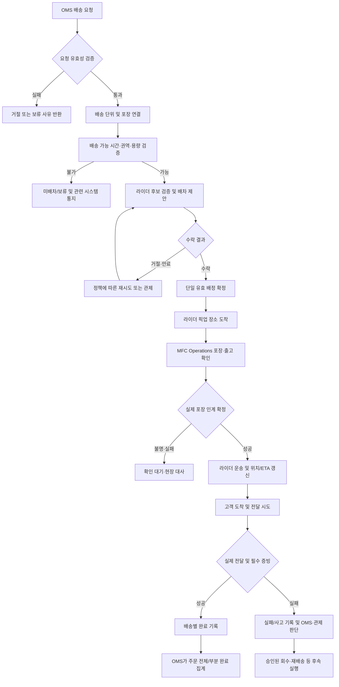
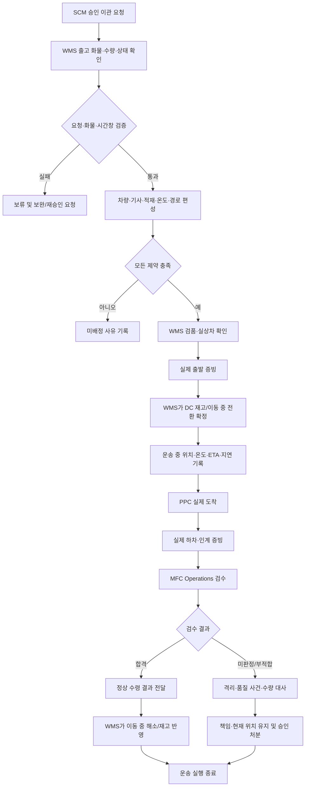
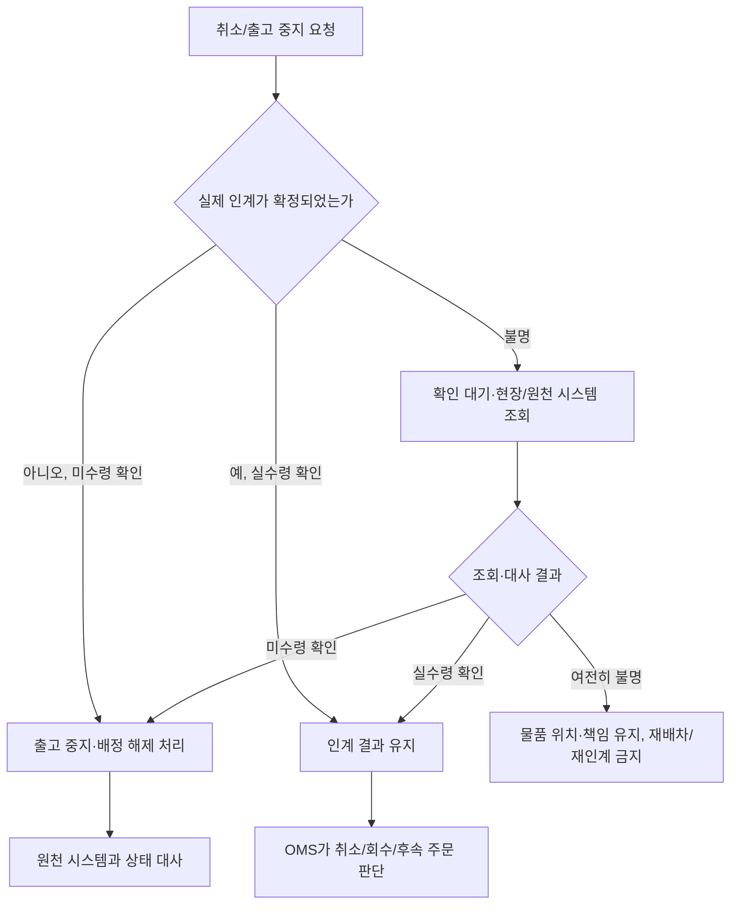

# TMS 비즈니스 로직 및 운영 기준

## 1. 목적·범위·책임

TMS는 **DC→PPC 간선 운송과 PPC→고객 배송**의 차량/라이더 자격·가용성, 운송 편성·배차·경로·도착/인계·전달 증빙·실패·회수 수행을 관리한다. 일회성 예약 주문의 도착 시간창은 포함하지만 정기구독 배송·요일별 반복 노선 자동 매칭은 초기 상세 범위에 넣지 않는다. DC4개 출고 회차를 사용하는 것과 반복 노선 최적화는 다르다.

SCM / Replenishment는 공급 필요·이관 승인, WMS는 DC 현물과 실제 출발, MFC Operations는 PPC 수령·검수·포장·현물 인계, OMS는 주문·취소·환불 판단을 확정한다. 관제 시스템은 사고·승인·고객 대응을 조율한다. TMS의 운송 종료가 PPC 재고 가산이나 고객 주문 전체 완료를 뜻하지 않는다. 외부 운송사 계약/API와 회계 정산·실제 입금 자동화는 구현 범위에서 제외하며 운영에 필요한 증빙/수행료 의무는 보존한다.

명시적 팀 결정 외의 아래 운송/배차 상세는 `[설계안]`이다. 상용 제품 조사와 외부 배송 사례의 수치를 바로픽 확정 정책으로 간주하지 않는다.

## 2. 주요 업무

| 업무 | 입력/선행 조건 | 결과 |
|---|---|---|
| 간선 편성 | 승인 공급·화물·출발/수령 가능시간 | 차량·기사·구획·정차 계획/미배정 |
| 운송 실행 | 검품/상차 확인·실제 출발 | 정차지별 실제 도착·하차 증빙·ETA |
| 라이더 운영 | 계정·수단·권역·위치·운행 상태 | 배차 후보 자격과 수행 권한 |
| 배송 배차 | 유효 배송·포장 준비예상·수량/용량 | 제안·수락·단일 유효 배정 |
| 픽업·전달 | 유효 배정·포장 인계·완료 증빙 | 배송별 성공/실패/사건 |
| 회수·재배송 | OMS 승인 대상과 주소 | 실제 수거·반납·재전달 이력 |

## 3. DC→PPC 운송 계획

### 3.1 수요 편성·차량·기사

SCM 승인 이관과 WMS의 준비 화물·SKU/LOT·수량·BOX/PLT·중량/부피·온도 조건을 대조한다. 같은 물량을 여러 운송에 중복 배정하지 않는다. 승인 요청은1이관1출발이며 차량 부족을 이유로 같은 요청을 여러 출발로 나누지 않는다. 불가능하면 계획 보류·수량/회차 재승인을 요청한다. 여러 요청을 한 차량에 싣는 것은 각 목적·수량을 구분하고 적재 조건을 통과할 때만 가능하다.

상품뿐 아니라 팔레트·상자·용기 중량과 실측 부피를 포함해 차량/구획 한도를 검사한다. 차량 대수 가용성과 차량1대 적재능력은 별도다. 냉장·냉동 구획·예냉·혼적·적층·압궤·봉인·하차 접근성을 확인하고 안전 한도 초과는 출발을 차단한다. EA를 고정 상수로 팔레트 수나 톤수로 바꾸지 않는다.

기사는 다음 가용 위치/시각·진행 운송·등록 수단의 운반 적합성·근무 조건·계정 제한을 검사한다. 가까워도 수행 중이거나 구획/등록 수단 조건을 못 맞추면 제외한다. 계획되지 못한 요청은 미배정 사유를 유지하고 실패분만 대체 차량/회차로 재검토한다. 성공한 배정을 재계획 때 다시 만들지 않는다.

### 3.2 회차·시간창

DC 계획은 작업 개시06:00/11:00/16:00/21:00, 출발08:30~09:30/13:00~14:00/18:00~19:00/23:00~익일00:00다. PPC의 실제 수령 창과 검수·적치 여력이 맞는 회차만 편성한다. 일반 보충6시간·긴급2시간은 목표이며 무조건 도착을 보장하지 않는다.

부산 간선 차종3.5톤/5톤 듀얼온도 탑차,15km 이내30~40분·15~35km50~70분·35~50km80~110분은 계획 입력이다. 실측 SLA나 모든 차량의 법적 적재한도를 의미하지 않는다. DC 도크10개·일60~80대/피크12~15대 계획도 실제 체류시간과 겹침을 검증한다.

도착뿐 아니라 하차·검수·사용 준비까지 고객 공급 약속을 충족하는지 검토한다. 정차지 이동·대기·작업시간을 모두 포함하며 중간 PPC 하차가 끝났다고 전체 운송을 완료하지 않는다. 차량·기사·화물·시간 변경은 적재/시간 제약을 재검증하고 원계획·최신예상·실제시각을 각각 보존한다.

`[팀 확인 필요]` PPC 매일 오전 수령안과 DC4회차/정상 당일 오후 공급안을 연결할 실제 시간표가 필요하다. 운송을 단순 기록만 한다는 초기 입고 정의서의 범위는 현재 요청에 따라 확장하되 외부 운송사/API가 이미 연동된 것으로 쓰지 않는다.

### 3.3 회차·수령 창·저온 대기의 실행 조건

[채택 설계] DC 작업/출발 회차, PPC 수령/검수 창, 도착 예정, 온도대별 승인 대기 한도를 함께 검사한다. 미설정·조회 불명은 해당 신규 편성/출발을 보류하고 SCM/DC/PPC 담당자에게 보완 요청한다. 이미 운송 중이면 현위치·보관 조건·누적 대기를 확인해 안전 도착/수령을 조율하며 과거 출발을 취소하지 않는다. 저온 분 단위 한도 초과/노출 불명은 품질 사건으로 전달하고 단순 회차 변경으로 이력을 초기화하지 않는다.

라이더 실제 운행과 PPC 준비/인계 시간은 별도 승인 설정이다. 고객 도착 슬롯은 두 조건과 수행 여력이 모두 맞을 때 가능하며00:00~08:00 실제 고객 배송은 허용하지 않는다. 08시/09시 원본 차이를 임의로 하나로 확정하지 않고 해당 센터·일자 승인 설정을 사용한다.

## 4. 간선 출발·운행·도착·차이

출발 전 WMS 승인·검품·실상차, 차량/기사·목적지·봉인·적격 온도, 미취소를 확인한다. 실제 출발 증빙을 WMS와 공유하고 **WMS만 DC 현물 감소·이동 중 전환을 확정**한다. TMS가 두 번째 재고를 차감하지 않는다.

운행 중 위치·통신 최신성·온도 이력·지연 사유·변경 ETA를 기록한다. 도착은 실제 차량 도착, 하차는 실제 화물 인계, 정상 인수는 PPC 검수 합격 결과다. TMS는 하차 수량/화물·시각·담당·사진/봉인 증빙을 제공하고 MFC Operations의 검수 결과를 받는다. 마지막 정차 완료도 미해결 수량·품질 사건을 자동 닫지 않는다.

지연은 계획/고객 약속과 승인된 임계값으로 판단한다. 기한 미설정을0분으로 간주하지 않는다. 후속 정차 ETA를 재계산해 SCM에 공급 유효성 재평가, PPC에 인력/보관 조정, OMS에 고객 약속 영향 검토를 요청한다. 도착 예정 변경으로 과거 약속 위반을 지우지 않는다.

미도착·과도착·오배송·파손·온도 이탈·봉인 훼손은 안전 확보 → 영향 화물 식별 → DC 상차/출발·차량/정차·PPC 재계수 대사 → 책임/처분 승인 순서다. 자동 손실·정상 인수·타 PPC 재배정을 하지 않는다. 출발 후 취소·역이관·강제반송·PPC 간 전환은 초기 미지원이다. 품질상 정상 판매가 불가능하면 보관 책임과 현 위치를 남기고 관제로 상신한다.

수량 차이는3영업일 조사, 추정손실10만원 초과 본사 상신을 지원한다. 종결에는 본사 재고 책임자 또는 운영 본부장 전자 승인과 재고 주체의 대사가 필요하다. TMS 운행 종료와 사고 손실 승인·품질 폐기는 별개다.

[채택 설계] 원출발과 대사한 실제 수령량 전체는 PPC 정상/격리 현물로 귀속하고 이동 중에서 한 번 해소한다. 검수 합격량만 정상, 미판정·부적합량은 격리이며 판매 가용은0이다. 수령 확정은 MFC Operations, 같은 결과에 따른 이동 중 해소는 WMS가 수행한다. 격리품 실제 폐기는 PPC 격리에서만 차감하고 미수령 잔량은 별도 유지한다. TMS는 인계 화물·실수량·시각·인계자/인수자·위치 증빙만 제공하며 기사 완료가 재고 수령을 대신하지 않는다.

## 5. 라이더 계정·운행·설정

[확정 정책] 라이더 가입은 프로젝트 계정·전화번호·등록 수단·활동권역·필요 동의·지급정보의 입력 형식과 중복을 검사한다. 실제 자격·면허·보험 가입/유효성·계좌 소유/실명 검증과 외부 검증기관 연계는 구현하지 않는다. 입력 검증을 통과한 프로젝트 계정은 운행 가능 상태로 등록한다. 입력된 자격/계좌 정보를 실제 검증 완료로 표시하지 않는다. 보험 심사·보험금 청구·보험사 연동도 구현 범위에서 제외한다.

운행 상태는 종료/운행 중 신규 배차 허용/운행 중 신규 배차 중지로 구분한다. 신규 배차OFF는 기존 수행을 취소하지 않는다. 운행 시작은 계정 제한·수단·권역·위치 권한/최신성을 검사한다. 종료 후에도 이미 발생한 수행 결과 기록·사고의 안전 조치는 처리한다. 00:00~08:00 신규 고객 픽업/배송을 제공하지 않으며 미완료 운송은 관제의 안전 보관/회수 등 예외 대응으로 연결한다. 앱 종료·통신 단절도 진행 배송을 자동 취소하지 않는다.

일반 대기목록 선택과 추천 제안 모드는 같은 배정 결과를 사용한다. 추천/AI 계산은 라이더 수락 이전에는 확정 배정이 아니다. 한 건씩 수행 설정이면 현재 배송을 마칠 때까지 신규 배정을 제한한다. 지도앱·알림·신규 배차 설정을 구분한다. 수단 변경은 수행 중 허용하지 않고 전화번호 변경은 계정 확인을 거치고 계좌 변경은 입력 형식·본인 계정의 수정 권한만 검사하며 기존 수행/정산 이력은 보존한다.

라이더의 본인 배달 목록·진행·완료·취소/회수·운행시간·예상/확정 수행료·공지/이벤트를 조회한다. 고객 후기·수행 횟수 기반 등급 보상/패널티는 도입하지 않는다는 배송 자료를 보존한다. 실제 직업 자격 심사 대신 프로젝트 계정/배정 권한과 수행 안전 상태를 관리하며 등급 경쟁은 별도다.

[확정 정책] 00:00 이상08:00 미만에는 고객 대상 실제 배송을 제공하지 않는다. 이 시간에도08:00 이후의 실제 제공 가능한 시간대를 선택해 예약 주문·결제할 수 있다. 07시 도착 슬롯은 제공하지 않는다. PPC·라이더의08시/09시 개시 차이와 시간대별 정원은 남은 확인 사항이며, 실제 가용 조건을 모두 충족하는 슬롯만 판매한다.

[확정 정책] 결제 후 주소·연락처·요청 사항은 변경 불가다. 예약 시간 변경은 OMS가 상품준비 전 검증·확정한 결과만 반영한다. 새 준비시각에 맞춰 미수락 제안·배차 계획을 갱신하며 기존 제안의 늦은 수락을 차단하고 새 배송을 중복 생성하지 않는다.

## 6. 배송 생성·분할·배차

### 6.1 요청 자격과 분할

OMS의 확정/미취소 배송과 MFC Operations의 포장 준비예상·봉투·중량·부피·온도 요구를 받는다. 패킹 중에도 예상 소요시간이 있으면 배차를 시작할 수 있지만 실제 픽업은 검품 완료 후다. 준비예상 변경은 기사 ETA와 대기를 재평가한다.

`[확정 정책]` 상품중량 **10,000g 초과**는 같은 주문 안에 여러 배송을 만들고 각 배송 상품중량을10,000g 이하로 배분한다. 주문·PG 결제·봉투값은1회이며 분할 추가 배달팁은 없다. 정확히10,000g은 이 기준에 의한 분할 대상이 아니다. 수단별 용량·부피·봉투·보냉 조건은 별도로 더 엄격하게 적용한다. 배송별 대상 포장·수량·라이더를 구분하며 원주문과 연결한다.

단일 상품10kg 초과, 포장재 중량 포함, 온도 혼재 운송 기준은 팀 확인 전 무단 분할/과적하지 않는다. 부피 때문에 추가 라이더가 필요한 경우도 독립 배송 구성과 수량 합계를 검증한다. 같은 포장을 여러 배송에 중복 배정하지 않는다.

### 6.2 후보·제안·수락

계정 정상·운행/신규배차ON·권역·위치 최신성·수단/용량·진행 배송·시간창을 검사한 후보만 제안한다. 도로 이동시간은 기사→PPC→고객과 기존 수행 전체를 평가한다. 최인접 기사와 전체 경로시간 최소 기사는 다를 수 있다. 경로 추천/AI 결과는 제약을 다시 검증하고 불가능한 제안은 미배정으로 남긴다. 모델 도입·성능이 검증된 것으로 가정하지 않는다.

제안에는 픽업지·고객 전달권역·배송 방식·예상 준비/운행시간·봉투/중량·수행료·특별조건·응답기한을 보여준다. 민감한 상세주소는 수행 단계에 필요한 범위만 공개한다. 거절·미응답·알림 실패·만료를 각각 기록한다.

동시 수락은 같은 배송에 유효 기사1명만 확정한다. 늦은 수락은 이미 배정/만료/주문 취소/자격 또는 용량 부족을 구분한다. 재전송은 기존 수락 결과를 반환한다. 배정 취소는 라이더의 수행 권한 해제이며 고객 주문 취소와 다르다.

### 6.3 운영 수치 후보와 충돌

| 항목 | 자료에 제시된 후보 | 적용 상태 |
|---|---|---|
| 거리 확장 | 1km→2km→3km | 단계별 제안 설계안, 승인된 정책일 때 적용 |
| 응답 기한 | 1분 | 확정 근거 추가 확인 필요 |
| 재요청 | 10분 간격 최대2회 | 전체 시도/같은 거절 기사 재요청 의미 충돌 |
| 지연 상신 | 20분 예시 | 예시를 고정 임계값으로 사용하지 않음 |
| 동시 수행 | 최대3건 | 한집 전용/알뜰 묶음·수단 적합성 확인 필요 |
| 거절 누적 | 연속5회 신규배차OFF 권유 | 계정 자동제재/등급 패널티와 구분 |
| 운행 시간 | 00:00~08:00 고객 배송 금지 확정 | 08시/09시 실제 개시시각은 확인 후 슬롯에 적용 |
| 봉투 추가배차 | 15L5개 초과/25L3개 초과/40L2개 초과/50L1개 초과 | 참고 규격이며 수단별 검증·승인 필요 |

운영 전 승인된 값을 등록하며 누락되면 무한 재시도·무제한 용량으로 진행하지 않는다. 거절한 기사에게 반복 강제 제안을 확정 정책으로 넣지 않는다. 배차 불가가 지속되면 PPC·OMS·관제에 사유/영향을 전달하고 신규 접수 제한을 검토한다. 보상 쿠폰은 별도 승인 없이는 발급하지 않는다.

## 7. 픽업과 포장 인계

가게 이동 → 가게 도착 → 유효 포장QR 전체 확인·실제 인계 → 픽업 완료 → 고객 이동 순서로 진행한다. GPS 접근만으로 도착 이후 단계나 픽업을 확정하지 않는다.

라이더·배송·주문·포장번호가 모두 현재 배정과 일치해야 한다. MFC Operations가 포장별 실제 전달을 확정할 때 해당 구성의 현물/예약을 한 번 소진하고 TMS는 같은 증빙으로 픽업을 반영한다. 잘못된 기사·주문·포장·무효 라벨·중복 스캔을 차단한다. 일부 전달이면 해당 포장만 추적하고 배송의 모든 유효 포장을 확인하기 전 전체 픽업완료로 표시하지 않는다.

QR 인식 실패·사진 업로드 실패·응답 유실은 현장 확인/권한 있는 대체 증빙 절차로 넘기며 단순 성공 버튼으로 우회하지 않는다. 이미 가져간 물품은 위치·보관·기사 책임을 유지하고 새로운 기사에게 임의로 넘기지 않는다.

### 7.1 취소와 픽업 요청이 경합하는 경우

[채택 설계] 실제 인계의 최종 판정은 MFC Operations다. 라이더는 최신 배정·유효 포장을 확인하고 현장의 인계 진행 승인 후 실제 수령한다. 취소/출고 중지가 먼저 확정된 포장은 수령하지 않는다. 인계 진행 중 취소는 현장 판정 대기이며 기사 앱만으로 취소 완료/픽업 완료를 함께 만들지 않는다.

실수령 후 응답이 없으면 같은 포장 인계 결과와 담당자·기사·증빙을 조회해 복구하며 재수령하지 않는다. 인계 여부 불명은 확인 대기로 관리하고 시간만으로 취소·재배차 후 재인계하지 않는다. 미수령 확인 후 중단이면 취소/배정 해제를, 실수령이면 인계 확정과 후속 배송/회수 판단을 따른다. 일부 포장 수령은 부분 인계로 유지하며 해당 배송의 모든 유효 포장 수령 전 출발하지 않는다. OMS 취소 요청은 현장 출고 중지와 함께 처리하고 TMS의 배정 해제만으로 재고·환불을 확정하지 않는다.

## 8. 고객 전달·위치·완료

픽업 후에만 고객 전달 작업을 수행한다. 지도/길찾기, 원주문 배송지·요청 사항, 허용 연락 방법을 제공한다. 승인된 방문 순서를 변경하면 시간창·한집 전용·기존 물품 선후·운반 조건을 다시 검증한다. 한집/알뜰의 동시 묶음 범위는 팀 정책이 필요하다.

위치는 좌표·갱신시각·정확도를 함께 관리한다. GPS 오류·권한 철회·갱신 지연은 `위치 확인 중`으로 표시하고 가짜 위치나 완료를 만들지 않는다. 고객은 본인 배송까지의 ETA만 조회하고 다른 고객 주소/전체 운행경로는 보지 않는다. 예측 ETA와 확정 고객 약속을 구분한다.

고객 도착 → 전달 방법/수령 확인 → 필요한 사진·서명·증빙 → 전달완료를 확정한다. 대면/비대면별 증빙 의무는 승인된 정책으로 설정한다. 비대면은 고객이 허용한 장소·사진·보관 위치를 기록하는 설계안이다. 사진 실패 시 전달 사실을 삭제하지 않고 확인 대기로 남겨 대체 증빙을 심사한다.

**[채택 설계] 시간 경과5시간만으로 전달완료를 확정하지 않는다.** 실제 전달 증빙으로 배송 상태를 확정하며 완료 누락은 재확인 알림·담당자 조사로 처리한다. 수행료 확정의5시간은 실제 전달완료시각부터 계산하는 별도 대기시간이다. 분할배송은 배송별 완료를 OMS가 집계하고 재배송은 별도 수행 이력을 남긴다.

[확정 정책] 주류 포함 주문의 인증은 토스페이먼츠 결제 인증 결과 확인으로 처리한다. TMS는 OMS의 해당 인증/주문 확정 결과와 유효 배정을 확인하고 일반 포장 인계·전달 증빙을 적용한다. 별도 현장 성인확인·신분증 촬영·서명 수집 및 주류 전용 자격/보험 검증은 구현하지 않는다. 결제 인증을 수행했다고 PG가 별도 연령 확인을 제공한 것으로 표시하지 않는다.

## 9. 고객 부재·사고·배차 취소

| 상황 | 즉시 처리 | 후속 판단·책임 |
|---|---|---|
| 픽업 전 기사 취소 | 유효 배정 해제·포장은 PPC에 유지 | 재배차, 이전 기사 인계 권한 해제 |
| 픽업 후 기사 이탈/사고·고장 | 안전 확보·현재 위치·물품/온도 기록 | 관제 승인 후 회수/재인계·대체 기사, 임의 양도 금지 |
| 고객 부재·출입 불가 | 원요청 확인·연락 기록·전달 보류 | 승인 대체 장소 또는 회수, 연락2회는 후보 기준 |
| 주소 불일치/변경 요청 | 원주소·오입력/지도오류/오배송 구분 | 확정 주문 주소 변경 불가, OMS 취소/회수·재주문 심사 |
| 파손·누락·포장 이상 | 영향 포장/품목·사진·시각 기록 | 현장 재검품 또는 OMS 교환/재배송/환불 판단 |
| 오픽업·오배송 | 포장·원주소·전달사진 대조, 현재 위치 보존 | 잘못된 완료 정정·회수·재배송 승인, 과거 이력 유지 |
| 위험 장소·위협 | 안전한 장소로 이탈·지원 요청 | 전달 중단·고객 대응·회수/비용 별도 심사 |
| 상태 오입력 | 원천 사실 확인 대기 | 승인 정정·고객 알림, 재고/금액은 소유 시스템 별도 보상 |

고객 귀책/라이더 귀책/포장 문제/시스템 오류의 판단과 고객 환불·라이더 수행료는 각각 기록한다. 단순 신고/평점만으로 공제·제재하지 않는다. 계정 공유·대리수행·수단 불일치·위치조작은 사실·소명 후 신규배차 제한/일시중지/계약 종료 여부를 결정하고 진행 물품의 안전한 처리를 먼저 확보한다.

배송 지연·실패는 OMS에 결과와 대안 가능성을 전달한다. TMS가 자동 PG 환불·재고 복원·고객 주소 변경을 실행하지 않는다. 고객 연락 실패·재시도 한도·200m 주소차이·계단 할증 등 미결정 수치는 자동 적용하지 않는다. 단순 변심 교환의 왕복 합계9,000원은 확정 정책이며 OMS 승인 비용을 운행 건별로 중복 부과하지 않는다.

[확정 정책] 일반 교환·반품은 상품 수령 후7일, 신선식품은24시간 접수 기준이며 하자·오배송·광고 상이 교환의3개월/인지30일 특례 자격은 OMS가 판단한다. TMS는 승인된 회수·재배송과 왕복9,000원/구매자 무상 조건만 실행하며 독자적으로 접수 기한이나 고객 환불을 결정하지 않는다. 부분 반품 PG 부분취소 역시 OMS가 수행한다.

## 10. 회수·교환·재배송과 수행료

OMS가 승인한 원주문 품목·수량·사유·고정 회수주소로 회수 작업을 만든다. 고객 수거 → 운송 → PPC 직접 반납 → 현장 수령확인을 각각 기록한다. 기사 수거완료는 PPC 검수/환불 완료가 아니다. 회수 수량 차이는 미회수/미반납으로 추적하고 MFC Operations가 적격 복구·폐기를 판단한다. 새 교환/재배송 상품은 별도 포장·배송·인계로 처리하며 원배송을 삭제하지 않는다.

고객 상품대금·배달팁과 라이더 수행료·회수료·추가 보상을 구분한다. 제안/수락 당시 금액·조건, 실제 단계, 귀책 심사와 승인 조정을 보존한다. 고객 환불만으로 기사 수행료를 자동 취소하지 않는다. 예상 → 확정 대기 → 지급 승인/지급 결과·실패·조정으로 의무를 추적하되 실제 지급 연동을 구현 완료로 가정하지 않는다.

[채택 설계] 실제 전달완료 후5시간이 경과하고 미해결 사고·수행 사실/금액 분쟁·중복 정산이 없으면 해당 배송의 수행료를 확정한다. 사건이 있으면 사건 해소까지 보류하고 사유·담당자를 남긴다. 확정 후 정정은 원수익을 삭제하지 않고 승인 조정으로 기록한다. 배송완료 상태와 수행료 확정/지급 상태는 분리한다.

수행일 다음 날부터 주말·공휴일을 제외해3영업일 뒤를 모의 지급예정일로 관리한다. 사건으로 확정이 늦어져 예정일이 지났으면 확정 후 다음 영업일로 이월한다. 실제 계좌 검증·은행 송금·보험 연계는 제외하고 관리자 모의 지급 확인과 이력만 관리한다. 거리별 기본2,600원 등 상세 요율·대기/계단 보상·취소수수료는 여전히 팀 확인 대상이며 미등록 금액은 자동 확정하지 않는다.

### 출발 후 이관 사고 처리의 채택 기준

[채택 설계] DC 실제 출발 이후에는 원이관 취소·타PPC 경로 전환·자동 역이관/강제반송을 지원하지 않는다. 목적 PPC에서 실제 물량을 확인해 합격분만 정상 인수하고, 의심/부적합품은 온도를 유지한 별도 위치에 안전 보류한다. 정보 오류나 의심이 해소된 적격품만 재검수 후 인수할 수 있으며, 부적합 확정품은 본사 품질 책임자의 승인과 실제 폐기 증빙으로 처리한다. 실제 DC 반송은 초기 구현 범위에서 제외한다.

원출발·인수 실적을 지우거나 반송 의사만으로 DC 재고를 늘리지 않는다. 미해결 수량과 보관 책임·현재 위치를 유지하고, 폐기는 같은 물량을 소유한 원장에 한 번만 반영한다. 격리품 처분과 미수령 잔량은 별도 대사하며 동일 손실을 두 번 차감하지 않는다.

## 11. 센터 운영 제한 연계

[채택 설계] PPC 운영 제한 정본은 MFC Operations, DC는 WMS다. TMS는 차량·라이더 가용성만 주관하고 센터 제한을 자체 해제하지 않는다. 배차·픽업/상차·출발 직전에 최신 업무별 제한을 검증한다. 접수 중지만으로 수행 배송을 취소하지 않고 안전 인계 중지는 영향 신규 픽업을 보류해 위치·보관 책임·OMS 영향 주문을 전달한다. 조회 불명/오래된 정상 응답으로 수행을 시작하지 않는다. 운송 중 안전 확보·전달 증빙·사고 조사·모의 수행료 처리는 기존 의무로 유지한다.

## 12. 권한·재처리·검증

라이더는 본인 유효 배정만 수행하고 PPC는 자기 센터 인계만 확인한다. 관제 수동 개입도 현재 배정·실물 위치·승인·원천 상태를 검사한다. 제안·수락·픽업·완료 응답 유실은 기존 결과 조회 후 같은 요청을 재전달한다. 중복 이벤트로 배정·차감·전달·수행료를 두 번 생성하지 않는다. 완료 후 늦은 도착 이벤트로 상태를 역행시키지 않는다.

관제 장애가 정상 수행을 모두 멈추게 하지 않되 안전/필수 증빙을 검증할 수 없는 작업은 보류한다. 복귀 후 미해결 배차·실물·전달·회수·보상 의무를 대사한다. 사진·주소·안심번호·서명 보존기간과 상세 조회 권한은 팀 정책을 등록한다.

| 검증 조건 | 기대 결과 |
|---|---|
| 중량 통과·구획/부피/시간창 위반 | 차량 편성/출발 불가, 원요청 중복 출발 없음 |
| 중간 PPC 하차·마지막 운행 종료 | 전체 인수/품질/고객 주문 자동완료 없음 |
| 신규배차OFF·운행 종료시간·통신 단절 | 새 제안 제한, 기존 배송 의무 유지 |
| 동시 수락·늦은 수락·같은 요청 재전송 | 기사1명, 실패 사유 구분·중복 배정 없음 |
| 포장3개 중2개QR·무효 라벨 | 부분 인계 추적·전체 픽업 차단 |
| 배송 일부완료·5시간 경과·사진 실패 | 실제 증빙 없는 성공/전체완료 금지 |
| 픽업 후 사고·회수품 반납 차이 | 보관 책임 유지·임의 양도/환불/재고 복구 없음 |

운영 전 시간표·배차 수치/재시도 의미·한집 전용 제약·수단별 용량·증빙·재배송/회수 한도·수행료·프로젝트 계정 정책을 확정해야 한다. 실제 자격·보험·계좌 검증은 제외로 확정되었다. 차량·라이더 앱·경로 모델·외부 API와 실제 운송 실행 시험은 이번 문서 통합에서 수행하지 않았다.

## 추가 채택 설계의 경계 검증

| 상황 | 기대 결과 |
|---|---|
| 기사 완료·PPC 미확정 수령 | 증빙 전달만 수행·원장 수령 자동 확정 없음 |
| 새 안전 제한 뒤 오래된 재개 수신 | 신규 픽업 차단 유지·진행 배송 안전 의무 유지 |

## 업무 판단·복구·설정 경계 검증

| 조건 | 기대 결과 |
|---|---|
| 배정 해제 응답 성공·실물 인계 여부 불명 | MFC 포장 판정 확인·임의 재수령/재배차 인계 없음 |
| PPC 수령 창 없음·이미 도착한 저온 화물 | 안전 수령/보관 조율·신규 출발은 보류·강제반송 없음 |

---

# 13. TMS-basic 업무 범주별 상세 구현 명세

> 이 장은 `TMS-basic.md`에 정의된 업무 범주를 기존 상세 정책에 연결하고, Claude Code가 구현 단위와 처리 규칙을 이해할 수 있도록 입력·검증·처리·결과·실패·연계 계약을 보완한다. 기존 1~12장의 정책과 검증 조건은 삭제하거나 대체하지 않는다.
>
> **중요한 해석 원칙**
> - 이 문서는 TMS / Delivery의 업무 기준이다. 아래 내용을 마이크로서비스 하나씩으로 분리하라는 의미가 아니다.
> - 외부 운송사 계약/API, 실제 보험·면허·계좌 검증, 은행 송금, 자동 PG 환불, 창고 재고 원장 변경은 현재 구현 완료 범위로 간주하지 않는다.
> - `[확정 정책]`, `[채택 설계]`, `[설계안]`, `[팀 확인 필요]` 표기를 유지한다. 확정되지 않은 수치나 정책을 코드 상수로 고정하지 않는다.
> - TMS가 기록하는 운송 사실과 OMS/WMS/MFC Operations가 확정하는 주문·재고·현장 사실을 구분한다. 다른 시스템의 책임을 TMS 내부에서 임의로 대체하지 않는다.

## 13.1 운송·배송 기준정보

### 목적

운송 계획과 배송 가능 여부 판단에 사용하는 거점, 주소, 서비스 권역, 운송 수단, 적재 능력, 온도 조건, 인수·인계 조건을 관리한다. 기준정보는 실제 수행 데이터와 분리한다. 기준정보를 수정하더라도 이미 생성된 운송·배송의 당시 조건을 추적할 수 있어야 한다.

### 관리 대상

1. **거점**
   - 거점 식별자, 거점 유형(DC/PPC/MFC/기타 승인된 회수지), 표시명, 주소, 좌표, 운영 상태를 관리한다.
   - 거점 유형과 실제 재고 원장 소유자를 혼동하지 않는다. TMS의 거점 정보만으로 재고 소유권을 변경하지 않는다.
   - 출발·도착 가능 시간, 하차/인수 작업에 필요한 시간, 현장 연락처 등 운영에 필요한 정보를 설정한다.
   - 거점이 비활성화되었거나 운영시간이 미설정인 경우 신규 운송 계획에 사용하지 않고 사유를 표시한다. 이미 운송 중인 건은 자동 취소하지 않고 관제 예외로 전달한다.

2. **서비스 권역**
   - 배송 가능한 권역과 배송 유형별 이용 가능 여부를 관리한다.
   - 고객 주소가 권역에 포함되는지 판단할 때 단순 직선거리만으로 가능하다고 단정하지 않는다. 실제 주소 좌표, 승인된 권역 경계, 도로 접근 가능성 및 운영 제한을 함께 확인한다.
   - 권역 데이터가 없거나 주소를 권역에 매핑할 수 없으면 임의로 가장 가까운 권역에 배정하지 않는다. 배송 가능 여부를 확인할 수 없는 상태로 반환하고 운영자 확인 대상으로 남긴다.
   - 권역 변경은 새 요청에 적용하되, 이미 수락된 배송에 적용할 때는 기존 배정의 수행 가능 여부를 재검증하고 변경 전후 값을 기록한다.

3. **주소·좌표**
   - 원본 주소, 정규화된 주소, 좌표, 좌표 출처, 마지막 갱신 시각, 위치 정확도 및 검증 상태를 구분한다.
   - 주소 문자열이 존재한다는 사실은 유효 좌표나 배송 가능성을 보장하지 않는다.
   - 좌표를 얻지 못하거나 위치 정확도가 운영 기준에 미달하면 경로시간·ETA를 확정값처럼 제시하지 않는다.
   - 결제 후 고객 배송지 변경은 기존 확정 정책에 따라 허용하지 않는다. 지도 좌표 오류나 주소 불일치는 고객이 확정 주소를 변경한 것으로 자동 처리하지 않고 관제/OMS 확인 대상으로 분류한다.

4. **운송 수단**
   - 수단 식별자, 유형, 등록 상태, 적재 중량 한도, 적재 부피 한도, 포장/봉투 수용 조건, 온도대 지원, 운행 가능 권역, 사용 가능 상태를 관리한다.
   - 최대 중량과 최대 부피는 서로 다른 제약이다. 중량이 한도 이하여도 부피 또는 온도 조건을 위반하면 배정할 수 없다.
   - 차량의 적재 한도와 차량 대수의 가용성은 별도로 검사한다.
   - 수단의 한도나 등록 조건이 미설정이면 무제한으로 간주하지 않는다. 해당 수단을 사용하는 신규 배정·출발을 보류한다.
   - 라이더가 수행 중인 수단을 임의로 바꾸지 못한다. 수단 변경은 수행 종료 후 또는 관제 승인 절차에 따라 처리하며 기존 수행 이력을 보존한다.

5. **온도·취급 조건**
   - 상품 또는 포장에 요구되는 온도대, 운송 수단이 지원하는 온도대, 구획 분리 여부, 예냉 필요 여부, 허용 대기 조건을 비교한다.
   - 혼적 가능 여부, 적층 가능 여부, 압궤 위험, 봉인 조건, 하차 접근성을 함께 검사한다.
   - 온도 측정값이 없거나 센서 데이터가 오래되었다는 이유만으로 정상 온도를 추정하지 않는다. 노출 여부를 알 수 없으면 품질 확인이 필요한 상태로 유지한다.
   - 저온 대기 한도와 온도 이탈 기준은 승인된 설정을 사용한다. 미설정 값을 0분 또는 무제한으로 취급하지 않는다.

6. **인수·인계 조건**
   - 인계 시 필요한 물품 식별자, 포장/BOX/PLT 식별자, 수량 단위, 인계자·인수자, 시각, 위치, 사진/QR/서명 등 증빙 종류를 업무 유형별로 설정한다.
   - 어떤 증빙이 필수인지는 승인된 정책으로 관리한다. 구현 편의상 모든 유형에 같은 증빙 규칙을 강제하지 않는다.
   - 증빙 누락이 발견되면 현장 사실이 없었다고 단정하지 않는다. 해당 단계의 확정 가능 여부를 판단하고 필요한 경우 확인 대기로 둔다.

### 기준정보 변경과 이력

- 변경 전 값, 변경 후 값, 변경자, 변경 시각, 변경 사유를 기록한다.
- 진행 중인 운송의 안전·용량·시간 조건에 영향을 주는 변경은 영향 범위를 계산하고 재검증한다.
- 기준정보가 삭제되더라도 과거 운송에서 사용한 기준값과 식별자는 이력 조회가 가능해야 한다.
- 기준정보의 누락·충돌·오래된 값은 명시적인 오류 또는 보류 사유로 반환한다. 조용히 기본값을 만들어 진행하지 않는다.

## 13.2 운송·배송 요청 접수

### 요청 유형

TMS / Delivery는 적어도 다음 세 가지 요청 유형을 업무상 구분한다.

- **거점 간 운송 요청:** SCM / Replenishment가 공급·이관 필요를 결정하고 WMS가 출고 대상 화물과 준비 상태를 제공한다. TMS는 운송 편성·출발·이동·도착·인계 사실을 관리한다.
- **고객 주문 배송 요청:** OMS가 확정된 주문과 배송 대상·주소·취소 상태를 제공하고 MFC Operations가 포장 준비 정보를 제공한다. TMS는 배차·픽업·전달·실패 결과를 관리한다.
- **회수·반송·재배송 요청:** OMS 또는 권한 있는 업무 시스템이 회수/재배송 자격과 대상을 승인한 뒤 요청한다. TMS는 승인 범위에 맞는 실제 수거·운송·반납·재전달을 기록한다.

### 공통 접수 검증

요청을 접수할 때 다음 항목을 확인한다.

1. 요청을 생성한 원천 시스템과 원천 요청 식별자가 존재하는가.
2. 같은 원천 요청이 이미 접수되어 있는가.
3. 요청 유형에 필요한 출발지·목적지·물품 또는 포장·수량·시간 조건이 존재하는가.
4. 요청이 취소되었거나 실행을 금지하는 상태가 아닌가.
5. 출발지와 목적지가 해당 운송 유형에서 허용되는 조합인가.
6. 권역·수단·온도·중량·부피·운영시간 조건을 판단할 기준정보가 있는가.
7. 요청에 필수 정보가 누락되었거나 서로 모순되는 값이 있는가.

검증에 실패하면 접수 실패 사유와 누락/충돌 항목을 반환한다. 불완전한 요청을 정상 운송으로 생성한 뒤 나중에 오류를 숨기지 않는다.

### 중복 접수 방지

- 원천 시스템의 요청 ID와 요청 유형을 이용해 동일 요청의 중복 생성을 방지한다.
- 같은 요청을 다시 받으면 새 운송을 만들지 않고 기존 요청의 접수 결과와 현재 상태를 반환한다.
- 기존 요청의 상태가 `확인 대기` 또는 `결과 불명`이면 새로운 요청을 생성하기 전에 원래 요청의 결과를 조회·대사한다.
- 요청 ID가 다르더라도 원주문·원포장·수량·출발/목적지가 중복 수행을 만들 수 있는 관계라면 업무 규칙으로 중복 여부를 검증한다. 다만 정상적인 분할 배송이나 별도 회수 작업을 단순히 유사하다는 이유로 중복 취급하지 않는다.

### 접수 결과

접수 결과는 최소한 다음 의미를 구분한다.

- **접수됨:** 필수 검증을 통과하여 TMS가 요청을 관리하기 시작했다.
- **계획 대기:** 요청은 유효하지만 운송/배차 계획이 아직 확정되지 않았다.
- **보류:** 정보 누락, 기준정보 미설정, 안전 제약, 센터 제한 또는 승인 대기로 실행을 진행할 수 없다.
- **거절:** 요청 자체가 유효하지 않거나 원천 시스템이 실행을 승인하지 않았다.
- **기존 요청 반환:** 같은 요청의 재전송이므로 신규 건을 만들지 않고 기존 결과를 반환했다.

접수 성공은 배차 성공, 실제 출발, 고객 배송 완료를 의미하지 않는다.

## 13.3 배송 가능 여부·시간 약속·슬롯 검증

### 판단에 필요한 입력

배송 가능 여부를 판단할 때 주소와 권역만 확인해서는 안 된다. 최소한 다음 조건을 함께 검증한다.

- 원천 주문이 확정되었고 취소되지 않았는지
- 목적 주소가 서비스 권역에 속하는지
- 선택한 배송 유형과 시간대가 허용되는지
- PPC의 포장 준비 예상 시각과 실제 인계 가능 시각
- 라이더 운행 허용 시간, 운행 상태 및 가용 인력
- 이동 예상시간, 정차·대기·전달에 필요한 시간
- 포장 중량·부피·봉투·온도 조건과 수단의 적합성
- 센터의 접수·피킹·포장·인계 제한
- 해당 시간대의 수용 가능 인원 또는 처리 정원
- 승인된 휴무·운영 제한·안전 제한

### 시간 약속 계산

- 이동시간만으로 ETA를 계산하지 않는다. 픽업지까지 이동, 준비 대기, 포장 인계, 고객까지 이동, 기존 수행, 방문/전달 작업시간을 구분한다.
- 거점 간 운송에서는 상차 대기, 도크 체류, 운행, 중간 정차, 하차, 수령 검수 및 현장 처리 여력을 함께 고려한다.
- ETA는 현재 정보에 기반한 예상값이다. 고객에게 확정된 시간 약속과 동일한 필드로 덮어쓰지 않는다.
- 위치나 준비 예상 시각이 갱신되면 새 ETA를 계산하되, 과거에 약속을 위반했다는 사실을 지우지 않는다.
- 이동시간 API나 경로 계산이 실패하면 임의의 0분 또는 직선거리 기반 시간을 확정값으로 반환하지 않는다. 예상시간 확인 불가로 표시하고 대체 절차를 따른다.

### 슬롯 제공 원칙

- `[확정 정책]` 00:00 이상 08:00 미만에는 고객 대상 실제 배송을 제공하지 않는다. 07시 도착 슬롯을 제공하지 않는다.
- 08시/09시 운영 개시 차이는 미해결 사항이다. 센터·일자별 승인 설정을 사용하고 전역 상수 하나로 임의 확정하지 않는다.
- 예약 주문은 실제 배송이 가능한 미래 시간대를 선택할 수 있다. 예약 결제 가능과 현재 즉시 배송 가능은 구분한다.
- 슬롯을 보여주기 전에 현장 처리 여력과 라이더 수행 여력을 모두 확인한다. 단일 서비스가 슬롯 점유 원장을 소유하도록 시스템 간 소유권을 명시하고, TMS는 가용 정보 제공과 배차 수행 가능 여부 검증을 담당한다.
- 동시 요청으로 정원이 초과되지 않도록 슬롯 점유를 원자적으로 확정하거나 슬롯 소유 시스템의 확정 결과를 받아야 한다.
- 슬롯 점유 실패 시 다른 슬롯을 자동 선택해 고객 선택을 바꾸지 않는다. 실패 결과를 반환하고 다시 선택하도록 한다.
- 슬롯을 확정했다고 해서 기사 배정이 확정된 것은 아니다. 배차 실패나 준비 지연은 별도 상태와 예외 처리로 관리한다.

## 13.4 운송·배송 단위 구성 및 분할

### 핵심 식별자와 관계

다음 개념을 하나의 레코드 또는 하나의 상태로 합치지 않는다.

- **원주문:** 고객이 구매한 주문과 주문 전체의 이행 상태를 OMS가 관리한다.
- **주문상품:** 주문에 포함된 상품과 수량.
- **포장:** 현장에서 실제로 준비된 봉투·상자 등 물리적 포장 단위.
- **배송 건:** 특정 대상 포장 또는 물량을 목적지로 전달하기 위한 실행 단위.
- **운송 건:** 거점 간 화물 또는 승인된 운송 물량의 실행 단위.
- **운행 건:** 차량/라이더가 특정 순서로 수행하는 이동 단위. 하나의 운행에 여러 배송을 포함할 수 있다.
- **배정:** 배송 또는 운송을 특정 수행 주체에게 할당한 기록.
- **인계 기록:** 실제 물품을 한 주체에서 다른 주체로 넘긴 사실.
- **사건 기록:** 지연·파손·분실·온도 이탈·오배송·고객 부재 등 예외 사실.

각 관계를 명시적으로 연결한다. 한 주문이 여러 포장과 배송으로 분리될 수 있고, 한 운행은 여러 배송을 수행할 수 있다. 반대로 하나의 포장을 여러 배송에 중복 배정해서는 안 된다.

### 분할 규칙

- `[확정 정책]` 상품중량이 10,000g을 초과하는 주문은 동일 주문 안에서 여러 배송으로 나누며, 각 배송의 상품중량은 10,000g 이하로 배분한다.
- 정확히 10,000g인 경우 이 기준만으로 분할하지 않는다.
- 주문·PG 결제·봉투값은 한 번 처리하고 분할 자체를 이유로 고객에게 추가 배달팁을 부과하지 않는다.
- 수단별 용량·부피·봉투·보냉 조건이 더 엄격하면 그 제약을 추가로 적용한다.
- 단일 상품이 10kg을 초과하는 경우, 포장재 중량 포함 여부, 온도 혼재 조건은 `[팀 확인 필요]`다. 확인 전 자동으로 쪼개거나 과적하지 않는다.
- 분할 후 원주문 상품 수량 합계와 각 배송에 배정된 수량 합계가 일치해야 한다.
- 분할 전후에 상품 또는 포장 수량이 사라지거나 중복되지 않도록 검증한다.
- 분할 배송 중 일부만 완료되면 해당 배송 건만 완료로 기록하고 OMS가 나머지 배송을 포함한 주문 전체 상태를 집계한다.
- 재배송은 기존 배송을 덮어쓰지 않고 원배송과 연결된 별도 실행 이력으로 만든다.

### 묶음 운행 규칙

- 한 운행에 여러 배송을 묶을 수 있는지는 수단 용량, 온도대, 권역, 방문 순서, 각 배송의 시간창, 한집 전용 조건, 포장 선후관계로 검증한다.
- 최대 3건 동시 수행은 자료에 있는 후보이며, 한집 전용/알뜰 묶음 및 수단 적합성 확인 전에는 확정 정책으로 구현하지 않는다.
- 묶음으로 인해 기존 배송의 약속시간이나 온도 조건을 위반한다면 묶지 않는다.
- 묶음 해제나 방문 순서 변경 시 이미 픽업한 물품의 실제 위치와 책임 주체를 보존한다.

## 13.5 운송 계획·경로 계획

### 거점 간 운송 계획

1. SCM 승인 이관 요청과 WMS의 출고 준비 화물을 대조한다.
2. 물품/SKU/LOT/수량/BOX/PLT/중량/부피/온도 조건과 출발·수령 시간창을 확인한다.
3. 같은 이관 요청의 물량이 이미 다른 운송에 배정되었는지 확인한다.
4. 차량의 대수 가용성, 개별 차량의 적재 능력, 온도 구획 및 하차 접근성을 각각 검증한다.
5. 기사·차량·운송 경로·정차 순서·도착 예상·하차 및 검수 시간을 계획한다.
6. PPC의 실제 수령 창과 인력/보관 여력이 맞는지 확인한다.
7. 제약을 모두 만족하는 경우 계획을 제안/확정하고, 만족하지 못하면 미배정 사유와 필요한 재승인 항목을 남긴다.

동일 이관 요청은 기존 정책에 따라 1이관 1출발이다. 차량 부족을 이유로 한 요청을 여러 출발로 무단 분할하지 않는다. 여러 이관 요청을 한 차량에 함께 적재하는 것은 각 요청의 물량·목적지·수량을 구분하고 모든 적재 조건을 통과할 때만 허용한다.

### 고객 배송 경로 계획

- 라이더의 현재 위치, 위치 갱신 시각·정확도, 현재 수행 중인 배송, 픽업 예상 준비 시각, 목적지, 약속 시간창, 수단 적합성을 확인한다.
- 기사와 고객 사이의 직선거리가 가장 짧다는 이유만으로 최적 후보로 판단하지 않는다. 기사→픽업지→고객 경로와 이미 수행 중인 배송을 함께 고려한다.
- 경로 추천 또는 AI 계산 결과는 제안일 뿐이다. 최종 제안 전 권역·용량·시간창·운행 제한을 다시 검증한다.
- 카카오맵 등 지도/경로 API는 지도·경로·예상 이동시간을 제공하는 역할로 구분한다. 지도 API 자체가 배차 결정, 기사 수락, 주문 취소, 재고 인계 또는 고객 완료를 확정한다고 간주하지 않는다.
- GreedRL 등 모델이나 별도 최적화 알고리즘을 도입하더라도 모델 결과를 곧바로 유효 배정으로 저장하지 않는다. 검증된 제약 검사와 배정 확정 절차를 통과해야 한다.
- 경로 계산이 실패하거나 결과가 오래되었으면 마지막 정상 결과를 현재 경로인 것처럼 무조건 재사용하지 않는다. 재계산 또는 관제 확인 상태로 표시한다.

### 재계획

차량/기사/목적지/화물/시간창이 변경되면 다음을 다시 검증한다.

- 현재 실물 위치와 이미 수행된 인계
- 기존 배정이 유효한지 여부
- 적재 중량·부피·온도 조건
- 새 목적지의 수령 가능 시간
- 후속 정차의 ETA와 약속 영향
- 취소/출고 중지 등 원천 상태
- 새 계획으로 동일 물량을 중복 수행하게 되는지 여부

재계획은 원래 계획을 삭제하지 않는다. 최초 계획, 변경 이력, 최신 예상, 실제 시각을 각각 보존한다. 이미 출발한 거점 간 이관의 취소·타 PPC 경로 전환·자동 역이관/강제반송은 초기 지원 범위에서 제외한다.

## 13.6 차량·라이더·운송사 관리

### 라이더 계정

- 프로젝트 계정, 전화번호, 등록 수단, 활동 권역, 필요한 동의, 지급정보 입력 형식과 중복 여부를 검증한다.
- `[확정 정책]` 실제 면허·자격·보험 가입/유효성, 계좌 소유/실명 검증과 외부 검증기관 연계는 구현하지 않는다.
- 입력 형식 검증을 통과했다는 이유로 외부 자격·보험·계좌 검증이 완료되었다고 표시하지 않는다.
- 전화번호 변경은 계정 확인 절차를 거친다. 계좌 정보 변경은 수정 권한과 입력 형식을 확인하며 기존 수행/정산 이력을 삭제하지 않는다.
- 계정 제한, 운행 상태, 신규 배차 설정, 위치 최신성, 수단 적합성은 서로 다른 속성으로 관리한다.

### 운행 상태와 신규 배차 설정

- 운행 상태는 종료, 운행 중 신규 배차 허용, 운행 중 신규 배차 중지로 구분한다.
- 신규 배차 OFF는 기존 배정이나 진행 중인 배송을 취소하지 않는다.
- 운행 종료 또는 앱 종료·통신 단절만으로 이미 인수한 물품을 미완료 취소 처리하지 않는다.
- 00:00~08:00에는 신규 고객 픽업/배송을 제공하지 않는다. 미완료 운송은 안전 보관·관제 대응으로 연결한다.
- 위치 권한이 철회되거나 위치 갱신이 오래되면 새 배차 후보에서 제외하거나 재확인을 요구한다. 위치가 확인되지 않는다고 허위 좌표를 생성하지 않는다.

### 운송사 범위

- `TMS-basic.md`의 업무 범주에는 외부 운송사 연계가 포함되어 있으나, 현재 상세 범위에서는 외부 운송사 계약/API를 구현 완료로 간주하지 않는다.
- 추후 외부 운송사 연계를 추가할 경우 운송사 식별자, 외부 운송 요청 ID, 상태 매핑, webhook/폴링 방식, 인증정보 보관, 재시도 정책, 중복 이벤트 처리, 취소 응답, 운송 증빙 및 비용 자료 계약을 별도 확정해야 한다.
- 외부 운송사 응답을 받았다는 사실만으로 WMS 재고 변경이나 OMS 주문 완료를 확정하지 않는다.
- 연동 전에는 실제 운송사 상태를 꾸며내지 않는다. 테스트 데이터와 실제 운송 실행 결과를 명확히 구분한다.

## 13.7 배차·할당의 상태와 동시성

### 배차 후보 검증

후보 라이더는 아래 조건을 모두 통과해야 한다.

1. 프로젝트 계정이 정상이며 배정 권한이 유효하다.
2. 운행 상태가 신규 배차를 허용한다.
3. 신규 배차 설정이 ON이다.
4. 활동 권역과 목적지가 맞는다.
5. 위치가 충분히 최신이며 경로 계산에 사용할 수 있다.
6. 수단과 포장/물품의 중량·부피·온도 조건이 맞는다.
7. 기존 수행 건수 및 한집 전용/묶음 조건을 위반하지 않는다.
8. 픽업 준비 예상과 고객 시간창을 충족할 수 있다.
9. 센터 운영 제한과 배송 시간 제한을 위반하지 않는다.

후보가 없으면 빈 결과만 반환하지 않고, 후보가 제외된 주요 사유를 분류해 관제와 관련 시스템이 조치할 수 있게 한다. 사유에는 권역 불일치, 위치 오래됨, 운행 종료, 신규 배차 OFF, 용량 초과, 시간창 불가, 센터 제한 등을 포함할 수 있다.

### 제안·수락·확정

- 제안은 라이더에게 수행 가능 여부를 묻는 상태이며, 유효 배정과 동일하지 않다.
- 수락 시점에 다시 배송 상태, 라이더 상태, 용량, 권역, 시간창, 센터 제한을 검증한다. 제안 시점에 적합했더라도 수락 시점에 조건이 바뀌었다면 거절할 수 있다.
- 같은 배송에 동시에 두 명이 수락하더라도 유효 배정은 한 명만 확정한다.
- 확정은 원자적 방식으로 처리하여 동시 요청이 같은 배송을 각각 점유하지 못하게 한다.
- 늦은 수락은 이미 배정됨, 제안 만료, 주문 취소, 라이더 자격/상태 변경, 용량 초과 등의 사유로 구분한다.
- 같은 수락 요청이 재전송되면 기존 수락 결과를 반환하고 배정·수행료·알림을 중복 생성하지 않는다.
- 배정 해제는 라이더의 수행 권한을 해제하는 업무이며 고객 주문 취소, 포장 취소, 재고 복원, 환불과 동일하지 않다.

### 재시도와 재배차

- 거리 확장 1km→2km→3km, 응답 기한 1분, 10분 간격 최대 2회 재요청은 후보/미확정 정책이다. 승인된 설정으로 등록되기 전 코드 상수로 확정하지 않는다.
- 같은 거절 기사에게 반복 제안을 강제하지 않는다. 거절·미응답·알림 실패·만료를 구분하여 이력을 남긴다.
- 재배차 전에 기존 배정의 해제 결과와 물품의 실제 인계 여부를 확인한다.
- 픽업 전이고 실제 인계가 없음을 확인한 경우에는 배정 해제 후 재배차할 수 있다.
- 픽업 후라면 단순 배정 해제로 새 기사에게 물품 책임을 넘기지 않는다. 관제 승인, 현재 위치·물품 상태 확인, 회수/재인계 등 실제 물품 인계 절차가 필요하다.
- 미배차가 지속되면 PPC·OMS·관제에 원인과 고객 약속 영향을 전달한다. 별도 승인 없이 보상 쿠폰이나 고객 추가 비용을 자동 발급/부과하지 않는다.

## 13.8 집하·상차·출발지 인계

### 고객 배송의 픽업

1. 라이더가 유효한 배정과 픽업 장소를 확인한다.
2. 라이더가 픽업 장소에 도착한다. GPS 접근만으로 물품 인수 또는 픽업 완료를 확정하지 않는다.
3. MFC Operations가 포장 준비·검품 상태와 출고 중지 여부를 확인한다.
4. 라이더, 배송, 원주문, 포장번호 및 실제 포장 수량이 현재 배정과 일치하는지 확인한다.
5. QR 등 포장 식별자를 확인하고 실제 물품 인계를 수행한다.
6. MFC Operations가 포장별 실제 인계를 확정하고 필요한 증빙을 남긴다.
7. TMS는 같은 인계 결과를 반영하고 라이더가 수행할 수 있는 상태로 전환한다.

포장 여러 개 중 일부만 인계되었다면 부분 인계로 기록한다. 모든 유효 포장을 확인하기 전 전체 픽업완료로 표시하지 않는다. 잘못된 기사·주문·포장, 무효 라벨, 중복 스캔은 차단한다.

### 픽업과 취소의 경합

- 취소 또는 출고 중지가 먼저 확정된 포장은 인계하지 않는다.
- 실제 인계 진행 중 취소가 도착하면 즉시 어느 한쪽의 성공 상태를 임의로 확정하지 않고 현장 판정을 기다린다.
- 실수령 후 응답이 유실되면 동일 포장 인계 결과와 담당자·기사·증빙을 조회해 복구한다. 물품을 다시 수령하지 않는다.
- 인계 여부가 불명확하면 `확인 대기` 상태로 유지한다. 시간이 지났다는 이유로 자동 취소·재배차·재인계를 실행하지 않는다.
- 미수령 사실이 확인된 경우 취소/배정 해제를 진행할 수 있다. 실수령 사실이 확인되면 인계 확정과 후속 배송 또는 회수 판단을 따른다.
- TMS의 배정 해제만으로 WMS/MFC 재고·예약·OMS 환불을 확정하지 않는다.

### DC 출발과 PPC 인계

- 출발 전 WMS의 승인·검품·실상차 결과, 차량/기사, 목적지, 봉인 및 온도 적격성, 미취소 상태를 확인한다.
- 실제 출발 증빙을 WMS와 공유한다. DC 현물 감소와 이동 중 재고 전환은 WMS가 확정하며 TMS가 별도로 차감하지 않는다.
- 도착, 하차, 정상 인수는 각각 별도 사건이다.
- TMS는 하차 수량/화물, 시각, 담당자, 사진/봉인 증빙을 제공한다. PPC 검수 합격은 MFC Operations가 확정하고 이동 중 재고 해소는 WMS가 수행한다.
- 기사 운행 완료나 차량의 목적지 도착만으로 정상 재고 입고를 확정하지 않는다.

## 13.9 운송·배송 실행과 상태 관리

### 상태는 사건을 기준으로 변경한다

각 상태는 실제 업무 사건과 근거가 있어야 한다. 예를 들어 다음을 서로 바꿔 쓰지 않는다.

- 배차 제안됨 ≠ 배차 수락됨
- 배차 수락됨 ≠ 물품 인수됨
- 픽업 장소 도착 ≠ 픽업 완료
- 고객 위치 도착 ≠ 고객에게 전달됨
- 차량 도착 ≠ 하차 완료
- 하차 완료 ≠ PPC 검수 합격
- 배송 완료 ≠ 주문 전체 완료
- 회수 수거 완료 ≠ 회수지 반납 완료
- 회수지 반납 완료 ≠ 창고 검수/환불 완료
- 배송 완료 ≠ 수행료 확정/지급 완료

### 상태 전이 검증

- 상태 전이는 현재 상태와 필요한 선행 사건이 충족될 때만 허용한다.
- 이미 완료된 단계보다 앞선 오래된 이벤트가 도착해도 상태를 역행시키지 않는다.
- 잘못된 순서의 이벤트는 폐기만 하지 말고 이벤트 ID, 원천, 수신 시각, 거부 사유를 남겨 조사할 수 있게 한다.
- 상태 변경이 다른 시스템의 작업을 요구하면 그 시스템의 확정 응답을 기다린다. 요청을 보냈다는 사실을 상대 시스템의 성공으로 간주하지 않는다.
- 취소와 인계, 배정과 수락, 완료와 정정 등 서로 경합하는 작업은 단일 최종 판정 절차를 둔다.
- 완료 후 정정이 필요하면 기존 기록을 삭제하거나 과거 사실을 덮어쓰지 않고 승인된 정정 이벤트를 추가한다.

### 이벤트와 시간

- 업무 발생 시각, TMS 수신 시각, 원천 시스템 시각을 구분한다.
- 이벤트 ID 또는 동등한 중복 식별자를 이용해 동일 이벤트가 반복 처리되지 않도록 한다.
- 순서가 뒤바뀐 이벤트는 현재 상태와 사건 이력을 대조한 뒤 처리한다.
- 응답 유실은 업무 실패와 동일하지 않다. 먼저 동일 요청의 결과를 조회하고, 결과가 없음을 확인한 뒤에만 재시도한다.
- 진행 상태 조회는 현재 상태뿐 아니라 미해결 사건·확인 대기·실패 사유를 보여줘야 한다.

## 13.10 위치 추적·ETA·조회 제공

### 위치 데이터

- 위치 좌표, 갱신 시각, 정확도, 수신 출처를 함께 저장한다.
- 마지막 위치가 오래되었으면 `위치 확인 중` 또는 이에 준하는 상태로 보여준다.
- 위치 권한 거부, GPS 오류, 네트워크 단절을 정상 위치로 위장하지 않는다.
- 위치 기록이 없거나 부정확하면 ETA를 확정값처럼 표시하지 않는다.
- 위치 수신은 배송 완료의 증빙이 아니다.

### ETA 계산 및 변경

- ETA는 현재 위치, 도로 경로, 교통/이동시간 자료, 픽업 준비 예상, 기존 수행, 방문 순서 및 약속 시간창을 바탕으로 계산한다.
- 예측 ETA와 OMS가 관리하는 확정 고객 약속을 구분한다.
- 준비 예상이 바뀌거나 위치가 갱신되거나 사고/정차가 발생하면 후속 ETA를 다시 계산한다.
- ETA가 변경되면 이전 ETA와 변경 시각·사유를 보존한다.
- 경로 API 실패, 위치 데이터 오래됨, 계산 시간 초과 등으로 ETA를 구할 수 없으면 확인 불가 상태를 반환한다.
- 지연 판단은 승인된 임계값과 원래 약속을 기준으로 한다. 지연 임계값이 미설정이면 0분으로 간주하지 않는다.
- 거점 간 운송 지연은 후속 PPC 수령/검수 여력과 공급 유효성에 영향을 줄 수 있으므로 SCM, WMS, MFC Operations, OMS에 필요한 정보를 전달한다.

### 조회 권한

- 고객은 본인 주문/배송에 필요한 진행 상태와 ETA만 조회한다.
- 고객에게 다른 고객의 주소, 전체 운행 경로, 라이더의 불필요한 개인정보를 제공하지 않는다.
- 라이더는 본인에게 유효하게 배정된 배송과 수행에 필요한 정보만 조회한다.
- PPC는 자기 센터의 인계/수령 작업을 확인한다.
- 관제/관리자 조회는 역할과 권한에 따라 제한하고, 민감한 주소·사진·연락처 상세 조회는 정책에 따라 기록한다.

## 13.11 인도·배송 완료 증빙

### 완료 확정에 필요한 정보

배송 완료 시 최소한 다음 사실을 연결한다.

- 원주문 ID와 배송 ID
- 실제 배정된 라이더 및 수행 주체
- 대상 포장/물품 식별자와 배송 수량
- 고객 주소 또는 승인된 전달 위치
- 실제 전달 시각
- 전달 방식과 수령 확인 결과
- 정책상 필요한 사진·서명·인수자 등 증빙
- 증빙 업로드/저장 결과 및 증빙 확인 상태

대면/비대면별 필수 증빙은 승인된 정책에 따른다. 비대면 전달은 허용된 장소, 사진, 보관 위치 등 요구되는 사실을 기록한다. 사진 업로드 실패 시 전달 사실을 지우거나 자동으로 성공 처리하지 않는다. 확인 대기로 두고 권한 있는 대체 증빙 절차를 따른다.

### 부분 전달과 오배송 의심

- 일부 포장만 전달되었으면 해당 포장/배송의 실제 결과를 기록하고 전체 배송 또는 원주문 완료로 확대하지 않는다.
- 주소 불일치, 포장 불일치, 전달 사진 불일치, 오픽업 의심이 있으면 즉시 정상 완료로 처리하지 않고 사건으로 등록한다.
- 완료 정정이 필요하면 원래 완료 기록과 증빙을 보존하고 승인된 정정 사유와 담당자를 남긴다.
- 고객 신고나 별점만으로 사실을 확정하거나 수행료를 자동 공제하지 않는다.

### 5시간 규칙

- `[채택 설계]` 실제 전달 증빙 없이 시간이 5시간 경과했다는 이유만으로 배송 완료를 확정하지 않는다.
- 수행료 확정을 위한 5시간은 실제 전달 완료 시각부터 계산하는 별도 대기시간이다.
- 배송 상태와 수행료 상태는 별도 관리한다. 완료된 배송이라도 사고·금액 분쟁·중복 정산이 있으면 수행료를 보류할 수 있다.

## 13.12 배송 실패·사고 대응

### 공통 사건 처리 순서

1. 고객·기사·현장 인력의 안전을 확보한다.
2. 현재 물품/포장 위치, 수량, 온도·보관 상태와 책임 주체를 확인한다.
3. 원주문·배송·포장·배정·인계 기록을 연결해 영향 범위를 식별한다.
4. 사건 유형과 발생 시각, 발견자, 증빙, 연락/조치 내역을 기록한다.
5. OMS, MFC Operations, WMS, SCM 또는 관제 중 필요한 책임 주체에 결과와 판단 요청을 전달한다.
6. 승인된 후속 조치(재배차, 회수, 재배송, 반송, 보류 등)를 실행한다.
7. 실제 물품 처리와 원천 시스템의 결과를 대사한 뒤 사건을 종결한다.

사건이 등록되었다는 사실은 손실 확정, 고객 환불, 재고 폐기, 기사 과실 또는 수행료 삭감을 의미하지 않는다.

### 주요 상황별 규칙

- **고객 부재/출입 불가:** 원요청과 방문 위치를 확인하고 연락 기록을 남긴다. 전달을 보류하며 승인된 대체 장소 또는 회수 판단을 요청한다. 연락 2회는 후보 기준이며 확정 설정 전 자동 규칙으로 고정하지 않는다.
- **주소 불일치:** 원주소, 지도 좌표 오류, 고객 오입력, 오배송 가능성을 구분한다. 결제 후 주소 변경 불가 정책을 우회해 주소를 덮어쓰지 않는다. OMS의 취소/회수/재주문 판단을 요청한다.
- **지연:** 현재 위치·원인·새 ETA·영향 배송을 기록하고 OMS와 관제에 전달한다. 승인되지 않은 임계값으로 자동 보상하지 않는다.
- **차량 장애/기사 사고:** 안전 확보 후 현재 위치와 물품/온도 상태를 기록한다. 픽업된 물품을 임의로 다른 기사에게 넘기지 않는다. 관제 승인 후 회수 또는 실제 재인계 절차를 진행한다.
- **분실/누락:** 포장·품목·수량과 마지막 인계 지점을 대사한다. 확인 전 손실 확정이나 재고 차감을 하지 않는다.
- **파손/포장 이상:** 영향을 받은 포장과 품목, 사진, 발생 시각을 기록한다. 현장 재검품 또는 OMS의 교환/재배송/환불 판단으로 연결한다.
- **온도 이탈:** 현재 보관 조건과 누적 노출을 확인하고 품질 사건으로 전달한다. 정상 판매 가능 여부를 TMS가 독자 결정하지 않는다.
- **오픽업/오배송:** 포장 ID, 원주소, 배정, 전달 증빙을 대조한다. 실제 물품 위치와 책임을 유지하고 승인된 회수/재배송을 수행한다.
- **위험 장소/위협:** 안전한 위치로 이탈하고 지원을 요청한다. 위험을 감수한 전달을 강제하지 않으며 전달 중단과 비용 판단을 별도로 기록한다.
- **상태 오입력:** 원천 사실을 확인한 뒤 권한 있는 정정 절차를 사용한다. 재고/금액 변경은 소유 시스템에서 별도로 처리한다.

### 책임·귀책 판단

- 고객 귀책, 라이더 귀책, 포장 문제, 시스템 오류를 분리해 기록한다.
- 단순 신고, 후기, 별점만으로 귀책이나 금액 공제를 확정하지 않는다.
- 계정 공유·대리 수행·수단 불일치·위치 조작 의심은 사실과 소명 절차를 거친다. 신규 배차 제한, 일시 중지, 계약 종료는 권한 있는 운영 판단으로 처리한다.
- 제재 판단보다 진행 중인 물품의 안전한 보관·인계가 우선이다.

## 13.13 회수·반송·재배송

### 회수 요청 생성

회수 요청은 OMS 등 권한 있는 시스템이 승인한 뒤 생성한다. 요청에는 원주문, 원배송, 회수 사유, 대상 상품/포장, 수량, 고정 회수주소, 지정 회수지, 고객 안내 조건 및 승인 정보를 포함한다.

- 회수 대상과 수량이 특정되지 않으면 회수 작업을 확정하지 않는다.
- 회수 주소를 TMS가 임의로 수정하지 않는다.
- 같은 회수 요청의 재전송은 기존 요청을 반환하며 회수 작업을 중복 생성하지 않는다.
- 반품/교환 가능 기간과 고객 환불 자격은 OMS가 판단한다. TMS는 정책을 독자적으로 재판정하지 않는다.

### 회수 실행 단계

1. 승인된 회수 대상과 유효 배정을 확인한다.
2. 지정 위치에서 대상 물품과 수량을 확인한다.
3. 실제 수거 시각, 수거자, 포장 상태, 증빙을 기록한다.
4. 운송 중 위치와 물품 보관 상태를 관리한다.
5. 지정 회수지/PPC에 도착해 실제 반납을 수행한다.
6. 회수지 담당자가 수령 수량과 상태를 확인한다.
7. 차이가 있으면 미회수/미반납/파손 등으로 구분해 사건을 남긴다.
8. MFC Operations 또는 해당 재고 소유 시스템이 검수·복구·격리·폐기 여부를 판단한다.
9. OMS가 회수/교환/환불 주문의 후속 상태를 확정한다.

기사의 수거완료는 회수지 반납 완료가 아니다. 회수지 반납 완료 역시 창고 검수나 환불 완료가 아니다.

### 재배송과 반송

- 재배송은 원배송과 연결된 별도 배송 실행으로 만든다.
- 원배송의 실패 사유, 기존 배정, 실제 인계, 완료/실패 증빙을 삭제하지 않는다.
- 실패 물품이 라이더에게 있는지, PPC에 있는지, 고객에게 전달되었는지 확인하기 전 재배송을 실행하지 않는다.
- 거점 간 출발 이후 이관의 자동 역이관/강제반송과 타 PPC 전환은 초기 지원 범위에서 제외한다.
- 실제 DC 반송도 초기 구현 범위에서 제외한다.
- 승인된 반송/회수라도 물품이 실제로 이동하고 인계된 기록이 있어야 한다. 반송 의사만으로 재고 위치나 수량을 변경하지 않는다.

### 반품 정책과 비용

- `[확정 정책]` 일반 교환·반품은 상품 수령 후 7일, 신선식품은 24시간 접수 기준이며 하자·오배송·광고 상이 교환의 3개월/인지 30일 특례 자격은 OMS가 판단한다.
- `[확정 정책]` 단순 변심 교환의 왕복 합계 9,000원은 확정 정책이다. TMS는 OMS가 승인한 비용 조건을 실행 기록에 연결하고 운행 건별로 중복 부과하지 않는다.
- 구매자 무상 조건 등 비용 면제도 OMS 승인 결과를 따른다.
- 부분 반품 PG 부분취소와 고객 환불은 OMS/Payment 책임이다. TMS가 자동 PG 환불이나 재고 복원을 수행하지 않는다.

## 13.14 취소·변경 처리와 실행 경합

### 단계별 취소 가능 여부

취소 요청은 현재 실행 단계와 실물 인계 여부에 따라 처리 가능성이 달라진다. 고객 요청이 들어왔다는 이유만으로 모든 단계를 취소할 수 있는 것은 아니다.

| 실행 단계 | TMS 처리 원칙 | 필요한 확인/후속 처리 |
|---|---|---|
| 요청 접수 전/계획 전 | 요청의 원천 상태와 중복 여부 확인 | OMS/SCM의 취소 확정 결과 반영 |
| 배차 제안 전 | 미실행 계획의 중단 가능 여부 확인 | 원천 요청 상태 확인 후 계획 취소 |
| 배차 제안 중 | 미수락 제안을 만료/철회 | 늦은 수락이 들어와도 배정 차단 |
| 배차 수락 후, 픽업 전 | 유효 배정 해제 가능 여부 확인 | 현장 출고 중지와 배정 해제를 대사 |
| 픽업/상차 진행 중 | 즉시 성공/취소를 단정하지 않음 | 현장 인계 여부를 확인하고 최종 판정 |
| 물품 인수 후, 전달 전 | 단순 취소/재배차 금지 | 현재 물품 위치와 책임을 확인해 회수/재인계 승인 |
| 고객 전달 완료 후 | 기존 완료를 취소로 덮어쓰지 않음 | OMS의 반품/회수/환불 절차로 연결 |
| 회수 수거 후, 회수지 반납 전 | 회수 물품 위치와 보관 책임 유지 | 승인된 회수 완료/대체 인계 절차 |
| 거점 간 운송 출발 후 | 초기 범위에서 원이관 취소/타 PPC 전환/강제반송 미지원 | 안전 확보, 목적 PPC 수령/격리 및 관제 대응 |

### 변경 요청

- 결제 후 주소·연락처·요청 사항은 변경 불가다.
- 예약 시간 변경은 OMS가 상품 준비 전 검증·확정한 결과만 반영한다.
- 시간 변경으로 준비 시각이 달라지면 미수락 제안과 배차 계획을 갱신한다.
- 이전 제안이 늦게 수락되는 것을 막고, 새 배송을 중복 생성하지 않는다.
- 배정된 배송의 실행 조건이 바뀌면 수단·권역·시간창·용량을 다시 검증한다.
- 이미 발생한 인계/전달 사실은 변경 요청으로 지우지 않는다. 정정은 별도 승인 이력으로 남긴다.

### 경합 처리의 공통 규칙

취소 요청과 픽업/전달이 동시에 발생할 수 있다. 최종 판정은 해당 단계의 실물 인계를 확정하는 시스템과 원천 주문 상태를 확인하여 결정한다. 응답이 늦거나 유실된 경우에는 같은 작업 결과를 조회하고, 결과가 확인될 때까지 신규 인계·재배차·중복 환불을 만들지 않는다.

## 13.15 운송 비용·실적·수행료

### 비용 개념 구분

다음 금액은 서로 다른 개념이며 같은 필드로 합치지 않는다.

- 고객이 지불하는 배송비/배달팁
- 라이더 또는 운송사에게 발생하는 실제 수행 비용
- 회수/반송 비용
- 취소 비용 또는 추가 작업 비용
- 사건에 따른 승인 조정/추가 보상
- 실제 지급 대상 금액과 지급 처리 상태

무료배송이더라도 운송 비용은 발생할 수 있다. 운송 원가가 변했다고 고객 결제 금액을 임의로 바꾸지 않는다.

### 수행료 산정과 확정

- 제안/수락 당시 제시된 수행료와 조건을 보존한다.
- 거리별 기본 2,600원, 대기/계단 보상, 취소 수수료 등은 상세 확정이 필요한 항목이다. 설정이 등록되지 않은 금액을 자동 확정하지 않는다.
- `[채택 설계]` 실제 전달 완료 후 5시간이 지나고 미해결 사고·수행 사실/금액 분쟁·중복 정산이 없으면 해당 배송의 수행료를 확정한다.
- 사건이 해결되지 않으면 수행료 확정을 보류하고 사유와 담당자를 기록한다.
- 고객 환불만으로 라이더 수행료를 자동 취소하지 않는다.
- 확정 후 정정은 기존 수익/수행료를 삭제하지 않고 승인 조정으로 기록한다.
- 분할 배송은 각 배송 실행의 수행 사실을 별도로 관리하고 원주문과 연결한다. 중복 지급 여부를 확인한다.

### 모의 지급

- 수행일 다음 날부터 주말·공휴일을 제외해 3영업일 뒤를 모의 지급예정일로 관리한다.
- 사건으로 확정이 늦어져 예정일이 지났으면 확정 후 다음 영업일로 이월한다.
- 실제 계좌 검증, 은행 송금, 보험 연계는 구현 범위에서 제외한다.
- 관리자는 모의 지급 확인과 이력을 기록할 수 있지만 실제 송금이 실행되었다고 표시하지 않는다.
- 지급 예정, 확정 대기, 지급 승인, 모의 지급 확인, 지급 실패/보류, 승인 조정 상태를 구분한다.
- 지급 상태 변경은 수행료 확정과 분리한다.

### 운송 실적 자료

TMS는 BI/Analytics가 분석할 수 있도록 접수, 계획, 배차, 수락/거절, 픽업/상차, 출발, 도착, 인계, 완료, 실패, 회수, 사고, 지연, 비용 근거 등의 사건을 제공한다.

분석 가능한 지표 예시는 다음과 같다. 계산 정의와 분모/분자는 BI와 합의해야 하며, 이름만으로 임의 산식을 고정하지 않는다.

- 배차 성공률 및 미배차 비율
- 제안 응답시간, 수락까지 걸린 시간
- 정시 픽업/출발/도착/전달 비율
- 배송별 실제 수행시간과 ETA 오차
- 배송 실패 및 재배송 비율
- 인계 수량 차이·파손·온도 이탈 사건 수
- 회수 수거/반납 완료 비율
- 배송 유형·권역·수단별 수행 건수와 비용 근거
- 수행료 보류/조정/모의 지급 상태

## 13.16 운영 관제·장애 복구

### 관제 대상

관제는 최소한 다음 상태를 찾아볼 수 있어야 한다.

- 접수되었으나 장시간 계획되지 않은 요청
- 미배차 또는 모든 제안이 만료/거절된 배송
- 준비 예상 시각을 넘긴 포장
- 장시간 픽업 대기 또는 인계 결과 불명
- 이동 중 위치 단절·ETA 급변·지연
- 센터 도착 후 미하차/미검수 상태
- 수량 차이, 파손, 온도 이탈, 봉인 훼손, 오배송 의심
- 고객 전달 실패, 회수 미반납, 재배송 대기
- 수행료 확정/지급 예정일이 지났지만 사건이 해결되지 않은 건
- 서로 다른 시스템의 상태가 일치하지 않는 건

### 수동 조치

- 수동 배차는 자동 배차와 같은 자격·권역·용량·시간창·센터 제한 검증을 통과해야 한다.
- 관제 권한이 있다고 해서 실물 인계, 재고 원장 변경, 고객 환불 또는 손실 처분을 직접 확정할 수 있는 것은 아니다.
- 수동 변경에는 변경 전 상태, 변경 후 상태, 조치자, 시각, 사유, 승인 근거를 남긴다.
- 이미 픽업된 물품을 다른 기사에게 넘길 때는 기존 기사 배정 해제만으로 충분하지 않다. 실물 위치와 인수인계 증빙을 확인한다.
- 안전/필수 증빙을 확인할 수 없는 작업은 보류한다. 반면 관제 시스템 장애만으로 이미 진행 중인 모든 배송을 자동 취소하지 않는다.

### 장애 복구와 대사

1. 원천 시스템별 마지막 정상 이벤트와 미확정 요청을 조회한다.
2. TMS가 가진 배정/인계/완료 이력과 OMS/WMS/MFC Operations의 상태를 비교한다.
3. 결과가 불명확한 작업을 확인 대기 목록에 둔다.
4. 동일 요청의 결과 조회를 우선하고, 중복 수행이 발생하지 않도록 한다.
5. 실물 위치·책임자·수량·증빙을 확인한다.
6. 각 시스템의 책임 범위에 따라 정정/재처리 요청을 보낸다.
7. 대사 결과와 조치자를 기록하고 미해결 사건을 종결한다.

### 외부 연계와 장애

- 외부 API 연결이 없거나 실패한 상태에서 실제 위치·운송 상태·운송사 비용을 만들어내지 않는다.
- 외부 API의 timeout은 실패 확정이 아니다. 동일 외부 요청 ID 또는 멱등성 키로 결과를 조회한 뒤 재시도한다.
- webhook 중복 수신, 이벤트 순서 역전, 늦은 취소 응답, 응답 유실을 고려한다.
- 재시도 횟수와 간격은 승인된 설정으로 관리한다. 설정 누락 시 무한 재시도하지 않는다.
- 외부 연동을 모의하는 테스트 데이터는 실제 운송 결과와 구분한다.

## 13.17 7개 업무 영역과의 협업 계약

### Commerce

- **TMS가 제공하는 정보:** 배송 가능 권역/방식, 예상 배송시간, 배송 진행 상태, 승인된 배송/회수 안내에 필요한 결과.
- **Commerce가 소유하는 책임:** 고객 선택·동의·안내와 구매 경험, 고객에게 보여줄 배송비 정책.
- 고객의 요청만으로 실행 중인 배송을 직접 변경하지 않는다. 주문 변경/취소는 OMS가 현재 주문 및 현장 상태를 검증한 결과를 따라야 한다.
- TMS의 실제 수행 비용은 고객에게 청구하는 배송비와 다르며 고객 결제 금액을 임의 변경하지 않는다.

### BackOffice

- **TMS가 사용하는 정보:** 서비스 권역, 운송 정책, 계약/요금 기준, 센터 운영 제한, 사고·예외 승인, 운영자 권한.
- **BackOffice가 소유하는 책임:** 정책과 계약 관리, 권한 및 승인.
- 정책이 미설정이거나 승인 여부를 확인할 수 없으면 임의 기본값으로 진행하지 않는다.
- 정책 변경은 변경 시점과 적용 범위를 기록하고 진행 중 작업에 미치는 영향을 검토한다.

### WMS

- **TMS가 제공/요청하는 정보:** 출발 계획, 실제 출발 증빙, 도착/하차/인계 수량과 차이, 반송/회수 물품 관련 수행 사실.
- **WMS가 소유하는 책임:** 창고 작업, 재고 원장, 입출고, DC 현물 감소 및 이동 중 전환, 재고 대사.
- TMS는 WMS 재고를 직접 차감하거나 입고 확정하지 않는다.
- 운송 완료만으로 재고가 판매 가능 상태가 되지 않는다. PPC 검수 합격은 MFC Operations, 재고 반영은 해당 원장 소유 시스템의 확정 결과를 따른다.

### OMS

- **TMS가 제공하는 정보:** 배차·픽업·출발·도착·전달·실패·회수·재배송 수행 결과, 사건, 물품 위치 및 실행 가능 여부.
- **OMS가 소유하는 책임:** 주문 원장, 주문별 이행 조정, 주문 전체/부분 완료, 취소 가능 여부, 교환·반품 자격과 환불 판단.
- 배송 실패는 주문 취소나 환불을 자동 의미하지 않는다.
- 분할 배송의 개별 결과를 OMS에 제공하되 주문 전체 완료 여부는 OMS가 집계한다.
- 결제 후 주소/연락처/요청 사항 변경 금지와 예약 시간 변경 승인 정책을 우회하지 않는다.

### SCM / Replenishment

- **TMS가 제공하는 정보:** 운송 계획, 출발/도착 예상, 실제 운송 결과, 미운송·지연·수량 차이.
- **SCM / Replenishment가 소유하는 책임:** 공급/보충 필요, 이관 대상과 수량, 필요 시점 및 승인.
- 운송 불가나 지연이 발생하면 공급 필요 시점에 대한 재평가를 요청한다. TMS가 이관 필요 수량을 임의로 바꾸지 않는다.

### MFC Operations

- **TMS가 제공/요청하는 정보:** 라이더 도착 예상, 포장별 픽업 요청, 거점 도착/하차 증빙, 인계/수령 대사 결과.
- **MFC Operations가 소유하는 책임:** 피킹·포장 준비, 현장 검품, 포장별 실제 인계, PPC 수령 검수, 적치/현장 운영 상태.
- TMS의 도착 기록만으로 포장 준비 완료 또는 실물 인계를 확정하지 않는다.
- 포장별 인계의 실제 사실은 MFC Operations가 확정하며, 응답 유실 시 같은 결과를 조회해 중복 인계를 방지한다.

### BI / Analytics

- **TMS가 제공하는 정보:** 요청·배차·인계·출발·도착·완료·실패·사고·비용 근거 사건과 관련 시각.
- **BI / Analytics가 소유하는 책임:** 분석 모델과 지표 해석, 배송시간·정시율·배차 성공률·실패율·운송 원가 분석.
- TMS는 원시 사건의 의미를 보존한다. 분석용 집계값만 저장하고 원본 사건을 버리지 않는다.
- 지표의 정의·시간 기준·분모·분자는 관련 팀이 합의해야 하며, 명칭만으로 서로 다른 산식을 혼합하지 않는다.

### 직접 호출과 이벤트 연계

- 상대 시스템에 요청을 보냈다는 사실과 상대 시스템이 업무를 확정했다는 사실을 구분한다.
- 동기 응답이 성공이어도 원천 상태를 확인해야 하는 업무는 확정 결과를 조회한다.
- 이벤트를 재수신했을 때 동일 업무가 중복 실행되지 않도록 이벤트 식별자와 원천 요청 ID를 확인한다.
- 통신 오류·timeout·응답 유실 시 무조건 신규 요청을 생성하지 않는다.
- 이벤트 계약에는 발행 시스템, 수신 시스템, 이벤트 ID, 원천 요청 ID, 대상 엔터티 ID, 발생 시각, 수신 시각, 버전, 처리 결과/오류를 포함하도록 설계한다. 실제 필드명과 전송 방식은 구현 단계에서 팀 표준에 맞춰 확정한다.

## 13.18 권한·감사·개인정보·증빙 보존

### 권한 원칙

- 라이더는 본인에게 유효하게 배정된 배송과 수행에 필요한 정보만 수행한다.
- PPC 담당자는 자기 센터에 대한 인계/수령 업무만 확인한다.
- 관제는 배차 조정과 예외 조치를 수행할 수 있으나 원천 시스템의 승인 권한을 자동으로 대체하지 않는다.
- 운영자/관리자의 역할과 작업 권한은 분리한다. 읽기 권한이 있다는 이유로 취소·완료 정정·비용 조정을 허용하지 않는다.
- 권한 없는 상태 변경 요청은 거부하고 시도 이력을 남긴다.

### 감사 이력

다음 변경은 추적할 수 있어야 한다.

- 배차 제안/수락/거절/만료/해제 및 재배차
- 차량·라이더·운송 계획·방문 순서 변경
- 픽업/상차/도착/하차/인계/완료 증빙
- 취소/변경 경합의 최종 판정
- 사고 등록·분류·담당자·승인·종결
- 수동 상태 정정과 비용 조정
- 모의 지급 상태 변경
- 기준정보와 운영 정책 변경

각 기록에는 가능한 범위에서 조치 주체, 시각, 대상, 변경 전후 값, 사유, 원천 요청/이벤트 식별자를 남긴다.

### 개인정보 및 증빙

- 주소, 전화번호, 안심번호, 사진, 서명 등은 업무 수행에 필요한 범위에서만 조회한다.
- 고객/라이더에게 필요한 정보만 노출하고 다른 고객 정보나 전체 경로를 노출하지 않는다.
- 사진·주소·안심번호·서명의 보존기간은 팀 정책이 확정되어야 한다. 미정 기간을 임의로 확정하지 않는다.
- 보존기간과 권한 정책이 확정되기 전에도 불필요한 복제·다운로드·광범위한 접근을 최소화한다.
- 증빙 삭제/정정은 감사 가능성을 유지하며, 단순 상태 변경으로 원래 증빙을 숨기지 않는다.

## 13.19 구현 전 확정해야 할 설정과 미결 사항

다음 항목은 문서에 후보 또는 확인 필요로 남아 있으므로, Claude Code가 임의로 확정 정책을 만들어서는 안 된다.

| 항목 | 현재 문서 상태 | 구현 원칙 |
|---|---|---|
| PPC 오전 수령안과 DC 4회차/정상 당일 오후 공급의 실제 시간표 | 팀 확인 필요 | 센터·일자별 승인 설정 없이는 신규 편성/출발 보류 |
| PPC/라이더 08시 또는 09시 개시 차이 | 팀 확인 필요 | 승인된 센터·일자 설정 사용 |
| 라이더 배차 거리 확장 1km→2km→3km | 설계 후보 | 승인 설정으로 등록된 경우만 적용 |
| 배차 응답 기한 1분 | 확정 근거 추가 확인 필요 | 상수로 고정하지 않음 |
| 10분 간격 최대 2회 재요청의 의미 | 전체 시도/같은 거절 기사 재요청 충돌 | 재시도 의미와 대상 확정 필요 |
| 지연 상신 20분 | 예시 | 승인 임계값 없이는 자동 판정 금지 |
| 동시 수행 최대 3건 | 후보 | 한집 전용/알뜰 묶음·수단 적합성 확인 필요 |
| 연속 5회 거절 시 신규배차 OFF 권유 | 후보 | 자동 제재나 등급 패널티로 해석하지 않음 |
| 봉투 규격별 추가 배차 기준 | 참고 규격 | 수단별 검증과 승인 필요 |
| 단일 상품 10kg 초과, 포장재 중량 포함 여부 | 팀 확인 필요 | 자동 분할/과적 금지 |
| 온도 혼재 운송 조건 | 팀 확인 필요 | 승인 조건 없이는 적재/출발 보류 |
| 고객 연락 재시도 한도 | 미결정 | 임의 횟수 자동 적용 금지 |
| 주소 좌표 차이 200m | 미결정 | 자동 오배송/주소 변경 판정 금지 |
| 계단 할증·대기 보상·취소 수수료·거리별 수행료 | 미결정 | 금액 미등록 시 자동 확정 금지 |
| 사진/주소/안심번호/서명 보존기간 | 팀 정책 필요 | 보존기간 임의 생성 금지 |
| 외부 운송사 API 및 실제 운송 실행 | 현재 구현 범위에서 미완료 | 연동된 것으로 가장하지 않음 |
| 실제 면허·보험·계좌 검증, 실제 은행 지급 | 구현 제외 | 검증/송금 완료로 표시하지 않음 |

## 13.20 Claude Code 구현 시 준수할 개발 규칙

1. **먼저 기존 프로젝트 구조를 확인한다.** 이미 존재하는 엔터티, API, 상태값, 권한 체계, 예외 처리와 테스트를 확인하고 기존 구조를 무시한 채 중복 구현하지 않는다.
2. **업무 범주와 코드 경계를 동일시하지 않는다.** 도메인 책임을 분리하되 현재 프로젝트 구조와 팀의 MSA/모듈 기준에 맞춰 구현 단위를 결정한다.
3. **확정 정책과 미결 사항을 코드에서 구분한다.** 미결 정책은 설정 또는 명시적 미지원 상태로 둔다. 임의 숫자, 무제한 값, 가짜 성공 결과를 기본값으로 사용하지 않는다.
4. **원천 시스템의 소유권을 존중한다.** TMS는 주문·재고·환불·실제 지급 원장을 임의 변경하지 않는다.
5. **상태 전이와 실제 사건을 분리하지 않는다.** 완료 상태에는 필요한 선행 사건과 증빙이 있어야 한다.
6. **멱등성을 구현한다.** 요청/이벤트 재전송, webhook 중복, 응답 유실, 동시 수락, 늦은 수락에 대해 중복 배정·인계·배송·수행료를 만들지 않는다.
7. **물품 위치와 책임을 항상 추적한다.** 배정 해제, 기사 취소, 앱 종료만으로 물품을 사라지게 하거나 다른 기사에게 자동 이전하지 않는다.
8. **실패를 명시적으로 반환한다.** 검증 실패, 미배정, 기준정보 누락, 권한 부족, 외부 연계 실패, 결과 불명 상태를 구분하고 조치 가능한 사유를 제공한다.
9. **감사 이력을 남긴다.** 수동 변경과 예외 처리의 원인·담당자·전후 상태를 추적할 수 있어야 한다.
10. **테스트를 함께 작성한다.** 정상 흐름뿐 아니라 중복 요청, 동시성, 이벤트 역순, 취소/인계 경합, 위치 단절, 사진 업로드 실패, 재고 대사 불일치, 정책 미설정 등을 테스트한다.
11. **외부 연동은 명시적으로 분리한다.** 실제 API가 준비되지 않은 경우 인터페이스/어댑터와 테스트용 대체 구현을 구분하고, 테스트 결과를 실제 운송 성공으로 표시하지 않는다.
12. **완료 기준을 명시한다.** 기능 구현 후 API/상태 전이/권한/예외/테스트 결과를 정리하고, 미구현·미확정 항목을 숨기지 않는다.

## 13.21 업무 흐름도

### A. 고객 주문 배송의 기본 흐름

### B. DC→PPC 간선 운송 흐름

### C. 취소와 실물 인계의 경합

## 13.22 통합 검증 시나리오

아래 테스트는 기존 12장의 검증 조건을 대체하지 않고 추가한다.

| ID | 시나리오 | 기대 결과 |
|---|---|---|
| TMS-001 | 같은 원천 요청을 두 번 접수 | 신규 운송/배송을 중복 생성하지 않고 기존 결과 반환 |
| TMS-002 | 주소는 있으나 좌표/권역 판정이 불가능 | 배송 가능으로 단정하지 않고 확인 불가/보류 사유 반환 |
| TMS-003 | 운송 수단 중량은 통과하지만 부피 초과 | 배정/출발 차단 |
| TMS-004 | 차량 적재는 가능하지만 PPC 수령 창 미설정 | 신규 편성/출발 보류, 임의 기본 수령시간 사용 금지 |
| TMS-005 | 위치 정보가 오래되었는데 ETA 요청 | 위치 확인 중/ETA 확인 불가, 허위 현재 위치 생성 금지 |
| TMS-006 | 두 라이더가 동시에 같은 배송 수락 | 한 명만 유효 배정, 다른 요청은 이미 배정된 사유 반환 |
| TMS-007 | 제안 만료 후 늦은 수락 | 배정 확정 금지, 만료 사유 기록 |
| TMS-008 | 라이더 신규 배차 OFF | 신규 제안 제한, 기존 수행 배송 유지 |
| TMS-009 | 포장 3개 중 QR 2개만 확인 | 부분 인계만 기록하고 전체 픽업 완료 차단 |
| TMS-010 | 실물 인계 후 응답 유실 | 같은 인계 결과 조회, 중복 인계/수령 금지 |
| TMS-011 | 픽업과 취소 요청이 동시에 발생 | 실물 인계 여부를 대사하고 확인 전 재배차/재인계 금지 |
| TMS-012 | GPS가 고객 주소에 도달했으나 전달 증빙 없음 | 배송 완료 확정 금지 |
| TMS-013 | 사진 업로드 실패 | 전달 사실을 자동 삭제/완료하지 않고 확인 대기 및 대체 증빙 절차 |
| TMS-014 | 분할 배송 중 하나만 완료 | 해당 배송만 완료, OMS가 주문 전체/부분 상태 집계 |
| TMS-015 | 배송 실패 후 고객 환불 요청 | TMS는 실패 사실 전달, OMS/Payment 승인 없이 환불 실행 금지 |
| TMS-016 | 회수품은 수거했으나 PPC 반납하지 않음 | 회수 미완료, 현재 위치·책임 유지 |
| TMS-017 | 운송 완료했지만 PPC 검수 미완료 | 정상 재고/판매 가능 재고 자동 확정 금지 |
| TMS-018 | 같은 완료 이벤트가 반복 수신 | 완료·수행료·알림을 중복 생성하지 않음 |
| TMS-019 | 완료 이후 오래된 이동 이벤트 수신 | 완료 상태 역행 금지, 이벤트 이력 기록 |
| TMS-020 | 수행료 5시간 경과했으나 사고 미해결 | 수행료 확정 보류 및 담당자/사유 기록 |
| TMS-021 | 모의 지급 예정일이 지났으나 수행료 미확정 | 확정 전 지급 완료 처리 금지 |
| TMS-022 | 외부 경로 API timeout | 경로/ETA 성공을 꾸며내지 않고 결과 조회 또는 승인된 재시도 |
| TMS-023 | 수동 배차로 용량 초과 라이더 선택 | 자동 배차와 동일한 검증으로 차단 |
| TMS-024 | 권한 없는 사용자가 배송 완료 정정 시도 | 거부하고 감사 이력 기록 |
| TMS-025 | 기준정보의 수단 한도가 미설정 | 무제한으로 처리하지 않고 보류 |
| TMS-026 | 출발 후 DC→PPC 이관 취소 요청 | 자동 역이관/강제반송하지 않고 안전·수령·격리 절차로 연결 |
| TMS-027 | 같은 회수 요청 재전송 | 회수 건 중복 생성 없이 기존 결과 반환 |
| TMS-028 | 고객 주소 변경 요청이 배차 후 도착 | 주소 변경을 직접 반영하지 않고 OMS 승인/취소·회수 절차 확인 |
| TMS-029 | 센터 안전 제한이 새로 활성화됨 | 영향 신규 픽업/출발 차단, 진행 중 운송의 안전 의무 유지 |
| TMS-030 | 관제 장애 후 복구 | 미해결 요청·실물 위치·인계·완료·수행료를 대사하고 중복 실행 방지 |

## 13.23 문서와 구현 완료의 구분

이 문서는 업무 로직과 구현 규칙을 정의하는 기준 문서이며, 문서에 흐름이 적혀 있다는 사실만으로 해당 기능이 코드에 구현되었거나 외부 연계가 완료된 것은 아니다.

구현 완료를 보고할 때는 기능별로 다음을 구분한다.

- 업무 규칙만 문서화됨
- 도메인 모델/데이터 구조 구현됨
- API/화면 구현됨
- 권한·상태 전이·멱등성 검증 구현됨
- 자동/수동 예외 처리 구현됨
- 단위/통합 테스트 통과
- 외부 연계는 모의 구현인지 실제 연결인지
- 미결 정책 또는 팀 확인 항목이 남아 있는지

실제 차량·라이더 앱·지도/경로 모델·외부 API·현장 운송 실행 시험은 검증하지 않은 상태라면 완료로 표현하지 않는다.
