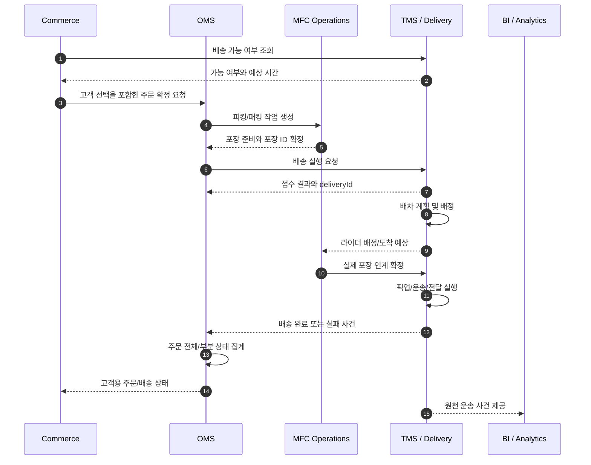
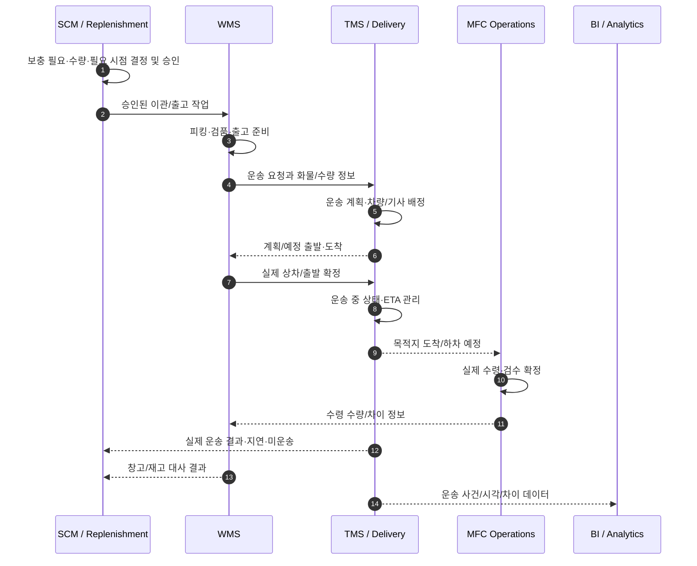
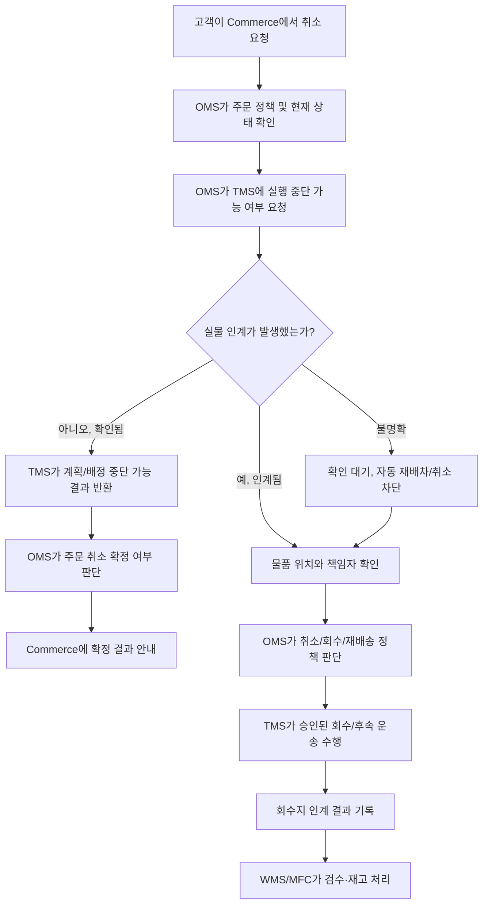

# TMS / Delivery와 7개 업무 영역 간 협업 및 책임 경계 명세

- **목적:** 바로픽의 TMS / Delivery가 Commerce, WMS, OMS, SCM / Replenishment, MFC Operations, BI / Analytics와 협업할 때 주고받을 데이터, 업무 순서, 상태 확정 권한, 예외 처리 및 구현 경계를 정의한다.
- **사용 목적:** Claude Code에 제공하여 API, 이벤트, 데이터 모델, 상태 전이, 검증 로직, 통합 테스트를 구현하도록 지시하는 상세 개발 문서다.
- **기준 자료:** `TMS-basic.md`, `TMS-business-logic.md`, `TMS-business-logic-expanded.md`.
- **표기:** 기존 문서에서 확인되는 원칙은 그대로 유지한다. 구체적인 API 경로, 필드명, 시간 제한, KPI 산식, 이벤트 전송 방식처럼 결정되지 않은 사항은 `[설계안]` 또는 `[팀 확인 필요]`로 표시한다.
- **업무 범위:** DC→PPC 거점 간 운송, PPC/MFC→고객 배송, 고객/배송 경로→회수지/거점 역물류. TMS는 운송 계획, 배차, 이동, 인계·전달·회수의 실행 사실과 증빙을 관리한다.
- **범위 밖:** 고객 결제·환불 실행, 주문 원장 소유, 재고 원장 직접 수정, 보충 수요·수량 결정, 창고 피킹/패킹 자체 수행, 회계상 실제 지급 자동화. 단, 관련 시스템에 실행 결과와 근거를 전달하는 것은 포함한다.

---

## 1. 공통 원칙과 소유권

### 1.1 업무 정본과 책임 분리

각 업무 영역은 자신이 소유한 업무의 정본(source of truth)을 유지한다. 다른 시스템은 해당 정본을 임의 수정하지 않고, 계약된 API·이벤트를 통해 요청하거나 확정 결과를 소비한다.

| 업무 사실 | 정본/소유 영역 | TMS가 담당하는 협업 | TMS가 해서는 안 되는 일 |
|---|---|---|---|
| 고객의 상품 선택, 배송 방식 동의, 구매 경험, 고객 안내 | Commerce | 배송 가능 여부·예상 시간·실행 상태 제공 | 고객 동의나 구매 조건을 임의 생성하거나 고객 청구 금액을 변경 |
| 주문 원장, 주문상품과 배송 단위 연결, 주문 전체/부분 완료, 취소 가능 여부, 교환·반품·환불 판단 | OMS | 배송 실행 건 연결, 실행 결과·실물 위치·중단 가능 여부 전달 | 주문 취소, 환불, 교환 자격, 주문 전체 완료를 독자 확정 |
| DC 창고 작업, 재고 원장, 피킹·상차·출고·입고 처리 | WMS | 운송 편성, 실제 출발/도착, 운송 중 사건, 인계 증빙과 수량 차이 제공 | 재고를 직접 차감·가산하거나 창고 출고/입고를 임의 확정 |
| 보충 수요, 공급 필요 시점, 이관 대상·수량·우선순위·승인 | SCM / Replenishment | 승인된 요청을 운송 계획으로 편성하고 지연·미운송 결과 전달 | 보충 필요 수량·우선순위를 임의 변경 |
| PPC/MFC 피킹·패킹·검품·실제 인계·수령 검수·적치·현장 제한 | MFC Operations | 라이더 도착 예상, 픽업 요청, 운송 도착/하차 사건 제공 및 현장 확정 결과 반영 | GPS만으로 포장 준비·실물 인계·검수 합격을 확정 |
| 운송 기준정보, 계획·경로·차량/라이더 할당, 운송 실행·추적·전달/회수 증빙 | TMS / Delivery | 해당 실행 업무의 정본 유지 | 다른 영역의 주문·재고·보충 원장을 대체 |
| 분석 모델·대시보드·KPI 산식과 해석 | BI / Analytics | 원천 운송 사건·계획/실제 시각·비용 근거 사건 제공 | 집계값으로 원본 사건을 대체하거나 KPI 산식을 독자 확정 |
| 서비스 권역·운송 정책·계약·요금 기준·권한·예외 승인 | BackOffice 또는 해당 정책 소유 영역 | 승인된 정책을 조회하고 운송 단계에서 적용 | 정책 미설정 시 임의 기본값으로 진행하거나 권한을 우회 |

`Delivery`가 TMS 내부 모듈인지 별도 서비스인지는 아키텍처 결정 사항이다. 물리적 배포 구조와 관계없이 위 책임 경계는 유지한다.

### 1.2 모든 영역에 적용할 불변 조건

1. **요청과 확정은 다르다.** 요청 전송 또는 HTTP 성공 응답만으로 상대 업무가 확정되었다고 간주하지 않는다.
2. **TMS는 운송 실행 사실을 소유한다.** 배차, 운송 중 상태, 실제 출발/도착, 배송 시도, 전달 증빙, 실패, 회수 수거·반납의 운송 사실을 기록한다.
3. **원천 시스템은 자기 업무의 최종 상태를 소유한다.** OMS는 주문, WMS는 창고/재고, SCM은 보충 요청, MFC Operations는 현장 준비·인계·검수 상태를 확정한다.
4. **운송 종료가 상위 업무 완료를 뜻하지 않는다.** 고객 배송 완료는 OMS의 주문 전체 완료와 같지 않을 수 있다. 회수 수거 완료는 반품 검수나 환불 완료가 아니다. 거점 도착은 입고 검수 합격이나 판매 가능 재고를 뜻하지 않는다.
5. **중복 요청은 멱등하게 처리한다.** 같은 원천 요청이나 이벤트를 재수신해도 운송 건·배정·인계·완료 사건·수행료 근거를 중복 생성하지 않는다.
6. **실물 상태가 불명확하면 추측하지 않는다.** 인계 여부가 불분명하면 확인 대기 상태를 유지하고 위치·담당자·증빙을 대사한다.
7. **Timeout은 실패 확정이 아니다.** 요청 ID로 결과를 조회하고, 필요하면 같은 멱등성 키로 재시도한다.
8. **오래된 이벤트로 상태를 역행시키지 않는다.** 원천 발생 시각, 상태 버전/순번, 현재 상태를 검증한다.
9. **수동 조치에도 동일한 검증을 적용한다.** 관리자 권한이 있어도 자격, 용량, 시간창, 원천 취소 상태, 센터 제한, 실물 위치를 우회할 수 없다.
10. **필수 정책 미설정은 무제한 허용이 아니다.** 영향 업무를 보류하고 오류·운영 조치 대상을 기록한다.

### 1.3 동기 API와 이벤트의 구분

- 동기 API는 즉시 검증/응답이 필요한 업무에 사용한다. 예: 배송 가능 여부, 현재 주문 취소 상태, 배차 직전 센터 제한.
- 이벤트는 상태 변화 사실을 전달한다. 예: 배차 확정, 실제 출발, 배송 실패, 인계 완료.
- 동기 응답이 접수 결과라면 접수와 최종 확정을 분리한다. 최종 확정은 소유 시스템의 확정 응답·이벤트 또는 정본 조회로 확인한다.
- 이벤트 소비자는 이벤트 ID, 원천 요청 ID, 대상 엔터티 ID, 상태 버전 등을 확인한다.
- 실제 전송 방식(REST, 메시지 브로커, webhook, polling)은 기존 프로젝트 구조에 맞춰 결정한다. 아래 이벤트 명칭은 논리적 명칭이며 실제 topic/path를 확정한 것은 아니다.

### 1.4 공통 연계 메시지 권장 필드 `[설계안]`

| 필드 | 목적과 규칙 |
|---|---|
| `eventId` | 이벤트 고유 식별자. 같은 이벤트 재전달 시 동일 값 유지 |
| `eventType`, `eventVersion` | 이벤트 종류 및 스키마 버전 |
| `sourceSystem` | 발행 시스템 코드 |
| `sourceRequestId` | 원천 업무 요청 식별자. 재시도·대사·중복 판정에 사용 |
| `correlationId` | Commerce→OMS→TMS→WMS/MFC 흐름 전체 추적 |
| `aggregateId` | `transportId`, `deliveryId`, `replenishmentRequestId` 등 대상 식별 |
| `occurredAt`, `publishedAt`, `receivedAt` | 사건 발생·발행·수신 시각을 구분 |
| `sequence` 또는 `stateVersion` | 상태 순서 및 오래된 이벤트 판정 |
| `payload` | 최소한의 업무 데이터 |
| `traceContext` | 프로젝트 표준 trace ID 등 장애 추적 정보 |

---

## 2. Commerce와의 협업

### 2.1 Commerce 소유 업무

Commerce는 상품 탐색·구매 경험, 배송 옵션 선택과 고객 동의, 배송비 표시, 고객에게 보여주는 배송 안내 및 고객 요청 입력을 소유한다. 고객에게 얼마의 배송비를 청구할지, 쿠폰·프로모션을 어떻게 반영할지도 Commerce 또는 가격 정책 소유 영역의 책임이다.

Commerce는 TMS의 배송 가능 여부와 예정 시간을 조회할 수 있지만, TMS가 산출하는 운송 수행 원가를 고객 청구 배송비로 그대로 사용하면 안 된다. 고객 청구 배송비와 실제 운송 수행 비용은 서로 다른 업무 값이다.

### 2.2 TMS 소유 업무

TMS는 출발지·목적지·배송 방식·물품 취급 조건·희망 시간창을 검증하고, 승인된 서비스 권역과 운영 제한, 수단 자격, 용량, 시간창, 가용성을 바탕으로 배송 가능 여부를 반환한다. 실제 주문이 OMS를 통해 확정되면 TMS는 배송 실행 단위를 생성/연결하고 배차·픽업·이동·전달·실패·회수 상태를 관리한다.

TMS는 고객 화면 문구나 구매 경험을 결정하지 않는다. Commerce가 고객에게 안전하게 표시할 수 있는 상태 코드, 예상 시간, 허용된 안내 정보를 제공한다.

### 2.3 배송 가능 여부 조회 흐름

1. Commerce가 배송지, 요청 시각/시간창, 배송 방식, 필요한 서비스 조건을 수집한다.
2. Commerce가 TMS 배송 가능 여부 조회를 호출한다.
3. TMS가 주소/좌표 유효성, 서비스 권역, 배송 방식 지원 여부, 시간창, 운영 제한, 수용 가능성을 검증한다.
4. TMS가 `가능`, `불가`, `추가 확인 필요` 중 하나와 사유 코드, 예상 배송 시간 또는 선택 가능한 시간창을 반환한다.
5. Commerce가 결과를 고객에게 표시하고 선택·동의를 처리한다.
6. 조회 결과만으로 TMS가 배송 예약/실행 건을 생성하지 않는다. 주문 확정과 실제 실행 요청은 OMS와의 계약을 따른다.

예외:
- TMS timeout이면 Commerce는 배송 가능으로 간주하지 않고 임시 오류/재조회 경로를 제공한다.
- 지원하지 않는 주소/방식을 가능으로 보정하지 않는다.
- 조회 시점의 수용 가능성은 스냅샷일 수 있으므로 실제 주문/배송 요청 시점에 재검증한다.
- 고객이 주소를 바꾸면 이전 조회 결과를 그대로 재사용하지 않는다.

### 2.4 주문 후 배송 조회 흐름

1. Commerce는 OMS가 확정한 주문 식별자로 배송 상태를 조회한다.
2. OMS는 주문과 운송 실행 건의 연결을 소유한다. TMS는 유효한 배송/운송 식별자로 실행 상태를 제공한다.
3. TMS는 배차 대기, 배차 확정, 픽업 대기, 픽업 완료, 이동 중, 전달 시도, 완료, 실패, 회수/재배송 등 정의된 운송 상태를 제공한다.
4. Commerce는 내부 상태를 고객 친화적인 표현으로 변환한다. 내부 사고 코드, 라이더의 불필요한 개인정보, 내부 운영 메모는 노출하지 않는다.
5. 분할 배송이면 개별 배송 건 상태를 보여줄 수 있지만 주문 전체 완료 여부는 OMS 집계 결과를 사용한다.

### 2.5 고객의 주소·시간·배송 요청 변경

- Commerce는 고객 변경 요청을 수집하지만 실행 중인 배송을 직접 수정하지 않는다.
- OMS가 주문 정책과 현재 상태를 확인한 후 변경 요청을 TMS로 전달한다.
- TMS는 현재 단계에서 재계획·재배차·취소가 가능한지 판단하고, 실행 가능 여부·필요 조치·이미 발생한 수행 사실을 반환한다.
- 실물 인수 후에는 주소 필드만 덮어쓰지 않는다. 물품 위치, 기사 책임, 추가 이동, 회수/관제 승인 여부를 확인한다.
- 시간창 변경도 같은 원칙이다. 고객이 새 시간을 선택했다는 이유만으로 기존 배정을 자동 변경하지 않는다.

### 2.6 배송 실패·회수·재배송 안내

1. TMS는 실패 시도, 시각, 사유 코드, 증빙, 물품의 현재 위치와 책임 상태를 기록한다.
2. TMS는 OMS에 운송 결과와 후속 판단이 필요한 사실을 전달한다.
3. OMS는 주문 정책에 따라 재배송·취소·부분 완료·환불 검토를 판단한다.
4. Commerce는 OMS의 확정 결과와 TMS의 실제 실행 상태를 바탕으로 고객에게 안내한다.
5. 배송 실패 자체는 주문 취소나 환불을 자동 의미하지 않는다. TMS는 환불을 실행하지 않는다.

### 2.7 Commerce 연계 계약

| 방향 | 논리적 계약 | 핵심 데이터 | 확정 권한 |
|---|---|---|---|
| Commerce → TMS | 배송 가능 여부 조회 | 배송지/좌표, 시간창, 배송 방식, 서비스 조건 | TMS가 운송 가능성 응답 |
| Commerce → OMS | 고객 선택/변경 요청 | 주문/장바구니 참조, 선택값, 동의 | OMS가 주문 정책 처리 |
| OMS → TMS | 배송 실행/변경 요청 | 주문 참조, 배송 단위, 출발/도착, 시간창, 조건, 멱등성 키 | TMS가 실행 요청 검증·접수 |
| TMS → Commerce 또는 조회 API | 배송 상태 조회 | 배송 참조, 권한/조회 범위 | TMS가 운송 사실 제공 |
| TMS → OMS → Commerce | 상태 이벤트/조회 결과 | 배송 ID, 상태, 시각, 실패/증빙 참조 | OMS가 주문 집계, Commerce가 고객 표시 |

### 2.8 금지 경계

- Commerce는 TMS의 수행료를 고객 배송비로 간주하거나 청구 금액을 임의 변경하지 않는다.
- Commerce가 TMS 상태를 임의로 완료 처리하지 않는다.
- TMS는 고객 동의, 쿠폰, 상품 가격, 결제 상태를 변경하지 않는다.
- 고객 요청은 변경 처리의 입력이지 이미 실행된 운송을 되돌리는 명령이 아니다.

---

## 3. WMS와의 협업

### 3.1 WMS 소유 업무와 TMS 소유 업무

WMS는 DC 창고 작업, 재고 원장, 피킹, 출고 준비, 상차, 실제 출고, 입고/반입 처리와 재고 대사를 소유한다. TMS는 WMS가 운송 대상으로 확정한 물품의 운송 계획·배정·실제 이동·도착·하차/인계 증빙과 운송 중 발생한 수량 차이·파손 보고를 소유한다.

TMS는 창고 내 작업을 대신하지 않으며, 운송 상태가 재고 원장보다 우선하지 않는다.

### 3.2 WMS에서 TMS로 전달할 데이터

- DC 출고 작업/출고 요청 ID
- 보충/이관 요청 ID와 승인 참조
- 출발 DC 및 목적 PPC/MFC ID
- 화물·컨테이너·토트·팔레트 등 취급 단위 ID
- 운송에 필요한 품목/수량 요약, 중량·부피·취급 조건
- 출고 준비 상태와 출고 가능 시각
- 예정 출고 회차 또는 시간창
- 상차/인계 결과와 확정 수량
- 출고 중지/취소 상태와 상태 버전
- 온도·파손 주의 등 운송 제한
- 원천 요청 ID, 이벤트 ID, 발생 시각, 상태 버전

TMS는 운송에 필요하지 않은 고객/상품 상세를 과도하게 복제하지 않는다. 다만 물품 식별·수량 대사에 필요한 참조는 유지한다.

### 3.3 DC→PPC 운송 흐름

1. SCM / Replenishment가 보충/이관 요청을 승인한다.
2. WMS가 DC 피킹·검품·출고 준비를 수행하고 운송 가능한 화물 단위를 확정한다.
3. WMS 또는 승인된 오케스트레이션 계층이 TMS에 운송 요청을 전달한다.
4. TMS가 중복 여부, 출발지/목적지, 승인 참조, 시간창, 취급 조건, 센터 제한을 검증한다.
5. TMS가 요청을 운송 계획에 편성한다. 계획 불가 시 이유를 반환한다.
6. 실제 상차/출발은 WMS/현장 담당자가 확정한다. GPS 이동만으로 TMS가 물품 인계를 확정하지 않는다.
7. WMS가 출발 결과를 확정하면 TMS는 같은 결과를 연결해 운송 실행 상태를 갱신한다. 응답 유실 시 동일 출고 ID/증빙을 조회해 중복 상차를 막는다.
8. TMS가 운송 중 상태·ETA·지연을 제공한다.
9. 목적지 도착 시 TMS가 도착/하차 시도와 증빙을 기록하고 목적지 담당 영역에 전달한다.
10. 실제 수령 수량, 파손·누락·과잉 수량과 검수 결과는 목적지 담당 영역이 확정한다.
11. WMS와 목적지 담당 영역은 예정 수량, 출발 수량, 실제 도착 수량, 차이 수량을 대사한다.
12. TMS의 운송 완료는 재고 입고·가산·판매 가능 상태를 직접 확정하지 않는다.

### 3.4 수량 차이·파손·누락

예: 요청 수량 20개 중 정상 18개, 파손 1개, 미확인 1개라면 TMS는 요청 수량을 18개로 덮어써 문제를 숨기지 않는다.

- 요청/출고 예정 수량 20개를 원본으로 보존한다.
- 출발지에서 실제 인계된 수량과 목적지에서 실제 수령 확인한 수량을 각각 기록한다.
- 파손 1개는 파손 사건, 증빙, 발견 시점, 확인 담당자와 연결한다.
- 미확인 1개는 대사 대기 상태로 유지하며 근거 없이 분실 확정하지 않는다.
- TMS는 운송 중 파손/분실 가능 사건과 인계 시각을 제공한다.
- WMS는 DC 출고/재고 원장과 출발 수량을 대사한다.
- MFC Operations는 목적지 수령·검수 결과를 확정한다.
- SCM은 부족 위험/재보충 필요를 재평가할 수 있지만 TMS가 요청 수량을 자동 증액하지 않는다.
- 차이 해결 전 원본 수량과 사건 이력을 덮어쓰지 않는다.

### 3.5 WMS 연계 계약

| 방향 | 논리적 계약 | 핵심 데이터 | 소유권 |
|---|---|---|---|
| WMS → TMS | 간선 운송 요청 | 출고 ID, 목적지, 화물 ID, 수량, 조건, 시간창, 승인 참조 | WMS가 출고/재고 사실 제공 |
| TMS → WMS | 운송 접수/계획 결과 | 운송 ID, 접수/거절, 미충족 사유, 계획 정보 | TMS가 운송 가능성과 계획 관리 |
| WMS → TMS | 상차/출발 확정 | 실제 시각, 수량, 담당자, 증빙 | WMS가 실제 출고 확정 |
| TMS → WMS | 운송 상태/ETA | 출발, 이동, 지연, 예상 도착, 도착 사건 | TMS가 운송 사실 제공 |
| TMS → WMS | 도착/차이 사건 | 도착 시각, 증빙, 예정·실제 수량 차이, 파손/누락 참조 | TMS는 사건 제공, WMS는 창고 대사 |
| 목적지 영역 → TMS/WMS | 수령/검수 결과 | 수량, 파손/누락, 검수 상태, 증빙 | 목적지 영역이 실물 수령/검수 확정 |

### 3.6 금지 경계

- TMS는 WMS 재고 원장을 직접 수정하지 않는다.
- TMS GPS 도착만으로 실제 하차·인계를 완료 처리하지 않는다.
- WMS 출고/입고 상태는 TMS 운송 상태와 별도로 확정한다.
- 실물 인계 여부를 확인하지 않고 원천 출고 요청을 폐기하거나 재배차하지 않는다.

---

## 4. OMS와의 협업

### 4.1 OMS 소유 업무

OMS는 주문 원장, 주문상품과 배송 단위 연결, 주문별 이행 조정, 주문 전체/부분 완료 집계, 취소 가능 여부, 교환·반품 자격, 환불 판단 및 관련 결제 시스템에 전달할 결과를 소유한다. 한 주문이 여러 포장/배송으로 나뉠 수 있으며, TMS는 각 운송 단위의 결과를 제공하고 OMS가 주문 상태를 집계한다.

### 4.2 TMS 소유 업무

TMS는 OMS가 요청한 배송 실행을 검증하고 배송 실행 식별자(`deliveryId` 등)를 관리한다. 배차, 픽업, 운송, 전달 시도, 성공/실패, 증빙, 회수·재배송 실행 상태를 기록한다. OMS에는 실제 운송 결과, 물품 위치/책임, 실행 중단 가능 여부를 제공한다.

### 4.3 주문에서 배송 실행을 생성하는 흐름

1. OMS가 주문 상태와 이행 가능성을 확인한다.
2. OMS가 배송 대상 상품/수량, 포장 참조, 출발지, 목적지, 고객 시간창, 취급 조건을 전달한다.
3. TMS가 주문 참조, 중복 여부, 원천 상태, 주소·시간창·서비스 조건을 검증한다.
4. TMS가 요청을 접수하면 실행 식별자를 반환한다. 접수는 배송 완료가 아니다.
5. TMS가 실행 단위를 배차·픽업·운송·전달 과정으로 관리한다.
6. TMS가 상태 변화와 사건을 OMS에 전달한다.
7. OMS가 배송 건별 결과를 주문상품/수량과 연결하고 분할 배송을 포함해 주문 전체/부분 상태를 계산한다.
8. OMS가 집계한 상태를 Commerce와 관련 후속 업무에 제공한다.

### 4.4 취소와 단계별 실행 중단

OMS가 취소 요청을 받으면 주문 정책을 확인한 뒤 TMS에 현재 실행을 중단할 수 있는지 확인한다. TMS 응답은 “운송 실행 관점에서 중단 가능한가”를 의미하며 “주문 취소 승인”과 동일하지 않다.

| TMS 단계 | TMS 처리 | OMS/다른 영역 후속 |
|---|---|---|
| 요청 전/계획 전 | 원천 상태 확인 후 접수 거절/취소 가능 | OMS가 주문 취소 정책 확정 |
| 계획 중, 배차 전 | 미실행 계획 취소 가능 여부 반환 | OMS가 주문 결과 확정 |
| 배차 제안 중 | 제안 철회/만료, 늦은 수락 차단 | OMS가 주문 상태 관리 |
| 기사 수락 후, 픽업 전 | 배정 해제 가능 여부와 현장 출고 중지 필요 여부 확인 | OMS가 주문 상태 확정, MFC/WMS 출고 상태 대사 |
| 픽업/상차 진행 중 | 실물 인계 확인 전 확정하지 않음 | OMS는 현장 판정을 기다림 |
| 실물 인수 후, 전달 전 | 단순 취소/재배차 금지, 위치·책임 확인 후 후속 절차 | OMS가 주문 정책/고객 대응 결정 |
| 고객 전달 완료 후 | 완료를 취소 상태로 덮어쓰지 않음 | OMS가 반품/회수/환불 자격 판단 |
| 회수 수거 후, 회수지 반납 전 | 회수 운송 미완료 유지 | OMS는 반품 상태, TMS는 위치·책임 관리 |

### 4.5 배송 실패·부분 배송·재배송

- TMS는 시도별 결과를 보존하고 실패를 성공으로 덮어쓰지 않는다.
- 실패 사유 코드, 증빙, 물품이 기사에게 있는지/거점으로 돌아왔는지/일부 전달되었는지 구분한다.
- 일부 포장만 전달되면 실제 전달된 단위와 미전달 단위를 구분해 OMS에 제공한다.
- OMS가 부분 완료, 재배송, 취소, 환불 검토 등 다음 단계를 판단한다.
- 재배송은 기존 실패를 지우고 상태를 초기화하는 방식으로 구현하지 않는다. 원 배송과 연결된 별도 실행 시도/배송 단위를 만드는 방식을 권장한다(`[설계안]`).
- 원 주문 ID, 원 배송 ID, 실패 시도 ID, 새 실행 ID를 추적할 수 있어야 한다.
- OMS 승인 없이 TMS가 고객 요청만으로 재배송을 생성하지 않는다.

### 4.6 회수/반품 연결

1. OMS가 회수 자격과 대상을 판단하고 회수 요청을 승인한다.
2. TMS가 회수 실행 건을 생성하고 현재 보유자/고객에서 지정 회수지까지 운송을 관리한다.
3. 실제 물품이 기사에게 인계되면 수거 시각·물품 식별·수량·증빙을 기록한다.
4. 수거 이후 지정 회수지에 도착/인계되기 전까지 회수 운송은 완료가 아니다.
5. 지정 회수지에서 실제 수령/인계가 확인되면 TMS가 회수 운송을 완료 처리한다.
6. WMS/MFC Operations가 검수·적치·격리 등을 수행한다.
7. OMS가 회수 및 검수 결과를 기반으로 반품/환불 정책을 처리한다.
8. TMS의 회수 완료는 검수 완료, 재고 가산, 환불 완료를 의미하지 않는다.

### 4.7 OMS 연계 계약

| 방향 | 논리적 계약 | 핵심 데이터 | 주의점 |
|---|---|---|---|
| OMS → TMS | 배송 실행 요청 | 주문 ID/버전, 배송 단위, 출발/도착, 포장 참조, 수량, 시간창, 조건, 멱등성 키 | OMS가 주문 정본 소유 |
| TMS → OMS | 접수 결과 | `deliveryId`, 접수/거절/확인 대기, 검증 사유 | 접수와 완료 구분 |
| TMS → OMS | 운송 상태 이벤트 | 배차·픽업·이동·전달·실패·회수·재배송, 시각, 증빙 참조 | OMS가 주문 집계 |
| OMS → TMS | 취소/변경 검증 요청 | 주문/배송 ID, 요청 종류, 상태 버전, 승인 정보 | TMS가 실행 가능 여부 응답 |
| TMS → OMS | 중단 가능 여부/결과 | 가능/불가/확인 대기, 이유, 물품 위치, 수행된 작업 | 주문 취소 확정과 구분 |
| OMS → TMS | 승인된 회수/재배송 요청 | 원 주문/배송, 대상 단위, 목적지, 승인 참조 | 원 사건과 추적 가능 |

### 4.8 금지 경계

- TMS는 주문 전체 완료, 환불 승인, 교환/반품 자격을 결정하지 않는다.
- OMS는 운송 사실을 추측해 배송 완료 처리하지 않는다.
- 취소 요청만으로 TMS가 실물 위치 확인 없이 배정을 해제하지 않는다.
- 주소/연락처/요청 사항을 원천 주문보다 우선해 독자 변경하지 않는다.
- 이미 발생한 운송 사건을 삭제하지 않는다. 정정은 별도 정정 사건과 감사 이력으로 남긴다.

---

## 5. SCM / Replenishment와의 협업

### 5.1 SCM 소유 업무

SCM / Replenishment는 어느 거점에 무엇이 얼마나 필요한지, 필요한 시점, 이관 대상·수량·우선순위, 보충 요청의 승인·변경·취소를 소유한다. 보충 수요 계산, 목표 재고, 안전 재고, 필요 수량과 우선순위는 TMS의 운송 계획과 분리한다.

### 5.2 TMS 소유 업무

TMS는 승인된 요청을 운송 가능한 단위로 편성하고 차량·기사·운송 일정·경로·출발 회차를 계획한다. 예정 출발/도착, 계획상 수용 가능 수량, 실제 출발/도착, 지연·미운송·부분 도착·파손/수량 차이를 기록해 SCM이 공급 계획을 재평가할 수 있도록 한다.

TMS는 용량에 맞추어 요청 수량을 임의로 줄이거나 늘리지 않는다. 분할 운송이 필요하면 원 요청 수량과 분할 운송 수량의 합계, 미운송 잔량을 명시한다. 분할 승인/잔량 규칙이 없으면 요청을 임의 완료 처리하지 않는다.

### 5.3 보충 요청부터 운송 실행까지

1. SCM이 요청 ID, 출발지, 목적지, 화물/품목, 수량, 필요 시점, 우선순위, 승인 상태를 확정한다.
2. 승인된 요청만 운송 계획 후보가 된다.
3. TMS가 요청 완전성, 거점 유효성, 운영 시간, 수단/용량, 취급 조건, 목적지 수령 가능 시간을 검증한다.
4. 가능하면 운송 단위, 예정 출발/도착, 필요한 차량·기사·회차를 계획한다.
5. 불가하면 차량 용량 부족, 시간창 불일치, 목적지 수령 불가, 운영 제한, 필수 정보 누락 등 사유를 반환한다.
6. SCM이 필요 시점·수량·우선순위를 재검토하거나 승인된 대안을 선택한다. TMS는 공급 필요성 판단을 대신하지 않는다.
7. WMS가 출고 준비와 상차를 완료하면 TMS가 운송 실행을 시작한다.
8. TMS가 지연·미운송·부분 도착 결과를 SCM에 전달한다.
9. SCM이 부족 위험과 재보충 필요를 재평가한다. TMS가 추가 보충 요청을 자동 생성하지 않는다. 자동 생성이 필요하면 별도 승인된 규칙으로 정의한다.

### 5.4 지연·계획 변경

- 계획 출발/도착과 실제 시각을 별도로 저장한다.
- 지연 예상 시 영향받는 보충 요청, 목적지, 예상 지연, 원인 분류, 마지막 확인 시각을 SCM에 전달한다.
- 지연 이벤트만으로 보충 수량을 변경하지 않는다.
- SCM이 우선순위를 바꾸면 TMS는 이미 배정/상차/출발한 운송에 영향을 주는지 검증한다.
- 운송 중 목적지를 바꾸려면 실물 위치, 목적지 수령 가능성, 승인 권한, 원 요청 상태를 확인한다.
- 출발 후 원 요청 취소는 자동 역이관/타 PPC 전환으로 처리하지 않는다. 안전한 수령·격리·반송 등 승인된 절차로 연결한다.

### 5.5 SCM 연계 계약

| 방향 | 논리적 계약 | 핵심 데이터 | 책임 |
|---|---|---|---|
| SCM → TMS | 승인된 보충 운송 요청 | 요청 ID, 승인 버전, 출발/도착 거점, 수량, 필요 시점, 우선순위, 취급 조건 | SCM은 필요·수량·승인 소유 |
| TMS → SCM | 운송 계획 결과 | 운송 ID, 계획 출발/도착, 편성 단위, 미수용 사유, 분할 제안 | TMS는 운송 가능성·계획 소유 |
| TMS → SCM | 지연/미운송/부분 도착 | 계획 대비 차이, 예상 영향, 실제 수량/사건 참조 | SCM이 공급 계획 재평가 |
| SCM → TMS | 승인된 변경/취소 | 새 버전, 변경 항목, 승인자/사유 | TMS가 실행 단계·실물 위치 검증 |
| TMS → SCM | 운송 종료 결과 | 실제 출발/도착, 운송 상태, 차이/증빙 참조 | SCM이 보충 요청 종결에 활용 |

### 5.6 금지 경계

- TMS는 목표 재고·안전 재고·보충 수량을 계산/확정하지 않는다.
- SCM은 실제 운송 상태를 추측해 운송 완료로 표시하지 않는다.
- TMS는 용량 부족 시 요청 수량을 조용히 줄이지 않는다.
- 요청 변경은 버전/승인 근거를 가져야 한다.
- 운송 완료를 재고 입고 완료로 간주하지 않는다.

---

## 6. MFC Operations와의 협업

### 6.1 MFC Operations 소유 업무

MFC Operations는 PPC/MFC 현장 작업을 소유한다. 피킹, 패킹, 포장 준비, 검품, 포장별 실물 인계, 현장 안전 제한, 도착 물품 수령·검수, 적치/격리와 작업자 조치를 포함한다.

TMS는 라이더/차량 도착 예상, 픽업 대상, 운송 도착/하차 사건을 제공하지만 GPS 접근만으로 포장 준비나 실물 인계를 확정하지 않는다.

### 6.2 TMS 소유 업무

TMS는 픽업 대상 배송 건, 배정된 라이더, 픽업 예정 시각, ETA, 운송 상태, 도착/출발 사건을 관리한다. 실제 인계 결과는 MFC Operations의 확정 결과와 연결한다. 운송 완료·실패·지연의 증빙과 관제 필요 상태를 관리한다.

### 6.3 PPC→고객 픽업 흐름

1. OMS가 유효한 주문 배송 실행 요청을 생성해 TMS에 전달한다.
2. MFC Operations가 피킹/패킹을 수행하고 포장 ID·수량·준비 상태를 확정한다.
3. TMS가 준비 예상 시각과 센터 제한을 확인하고 배차를 계획한다.
4. 라이더가 픽업 장소에 접근한다. GPS 접근은 물품 인계 증거가 아니다.
5. TMS가 MFC Operations에 라이더 도착/도착 예상 정보를 제공한다.
6. MFC Operations가 포장 준비, 검품, 출고 중지 여부, 주문/배송/포장 ID와 수량을 확인한다.
7. 실제 인계 직전 현재 배정과 주문 취소/출고 중지 상태를 재검증한다.
8. 담당자가 QR/바코드 등으로 포장을 확인하고 라이더에게 실물을 전달한다.
9. MFC Operations가 실제 인계 포장·수량·담당자·시각·증빙을 확정한다.
10. TMS가 같은 결과를 반영하고 배송 실행을 진행한다.
11. 일부 포장만 인계되면 부분 인계로 기록한다. 모든 유효 포장이 확인되기 전에 전체 픽업 완료로 표시하지 않는다.
12. 응답 유실 시 같은 포장/배송 ID로 기존 결과를 조회해 중복 인계를 방지한다.

### 6.4 PPC 도착·하차·수령

1. TMS가 목적 PPC 도착 시각과 운송/화물 참조를 기록한다.
2. TMS가 도착 정보를 MFC Operations 및 필요 시 WMS에 전달한다.
3. 현장 담당자가 차량/기사, 운송 ID, 화물 단위, 예정 수량을 대조한다.
4. 실제 하차·수령 수량과 파손/누락을 현장에서 확인한다.
5. MFC Operations가 수령/검수 결과를 정본으로 기록하고, TMS가 해당 결과를 운송 사건에 연결한다.
6. 검수 합격·격리·파손·수량 차이에 따라 현장 후속 작업을 수행한다.
7. TMS는 도착만으로 재고를 가산하거나 상품을 판매 가능 상태로 만들지 않는다.

### 6.5 센터 운영 제한

- PPC 운영 제한의 정본은 MFC Operations, DC 운영 제한의 정본은 WMS다.
- TMS는 배차·픽업/상차·출발 직전에 최신 제한 상태를 확인한다.
- 단순 접수 중지만으로 이미 수행 중인 배송을 모두 자동 취소하지 않는다.
- 안전 인계 중지 시 영향받는 신규 픽업/출발을 보류하고 기사 위치·물품 위치·보관 책임·영향 주문을 관제/OMS에 전달한다.
- 제한 상태 조회 불가 또는 오래된 정상 응답만 존재하면 안전에 영향을 주는 신규 인계를 진행하지 않는다.
- TMS가 센터 제한을 자체 해제하지 않는다.

### 6.6 현장 예외

**포장 미준비:** 인계 완료로 표시하지 않는다. MFC가 준비 예상 시각을 갱신하고 TMS가 대기/재계획 가능성을 판단한다. 허용 대기 시간은 `[팀 확인 필요]`이며 임의 고정값을 넣지 않는다.

**잘못된 포장/기사/주문:** 포장 ID·배송 ID·주문 참조·현재 배정이 맞지 않으면 인계를 거부하고 사유를 기록한다. 무조건 통과시키는 관리자 우회 기능을 두지 않는다.

**일부 누락/파손:** 정상 인계 단위와 문제 단위를 분리한다. TMS는 실제 인계된 단위만 수행 대상으로 전환하고, OMS 주문 수량은 승인된 OMS 흐름 없이 수정하지 않는다.

**라이더 도착 후 대기:** 도착 시각과 실제 인계 시각을 분리하고 대기 사유·현장 상태를 관제에 제공한다. 도착을 픽업 완료로 간주하지 않는다.

### 6.7 MFC 연계 계약

| 방향 | 논리적 계약 | 핵심 데이터 | 책임 |
|---|---|---|---|
| MFC → TMS | 포장 준비/픽업 가능 정보 | 포장 ID, 배송 ID, 준비 상태, 수량, 예상 준비 시각, 출고 중지 | MFC가 포장/현장 상태 소유 |
| TMS → MFC | 라이더 배정/도착 예상 | 배송 ID, 배정 참조, ETA, 픽업 대상 포장 | TMS가 운송 계획 소유 |
| MFC → TMS | 실제 포장 인계 확정 | 포장 ID, 수량, 담당자, 시각, 증빙, 버전 | MFC가 실물 인계 확정 |
| TMS → MFC | 도착/하차 사건 | 운송 ID, ETA, 실제 도착, 하차/인계 사건 | TMS가 운송 사건 소유 |
| MFC/WMS → TMS | 수령/검수 결과 | 실제 수량, 파손/누락, 검수 상태, 증빙 | 현장/재고 소유 영역이 확정 |
| MFC → TMS | 운영 제한 변경 | 제한 종류, 범위, 시작/종료, 버전 | MFC가 PPC 제한 소유 |

### 6.8 금지 경계

- TMS 위치 데이터만으로 포장 준비/실물 인계를 완료하지 않는다.
- MFC는 라이더 위치만으로 운송 시작/고객 전달을 확정하지 않는다.
- TMS는 피킹·패킹·검품·적치를 완료 처리하지 않는다.
- 현장 인계가 불명확하면 재배차보다 실물 위치와 책임 대사가 먼저다.

---

## 7. BI / Analytics와의 협업

### 7.1 BI / Analytics 소유 업무

BI / Analytics는 분석 모델, 대시보드, KPI 정의·집계·해석·비교 분석을 소유한다. 배송시간, 정시율, 배차 성공률, 실패율, 재배송률, 운송 원가 등의 산식은 관련 업무 영역과 협의해 확정한다.

TMS는 분석을 위해 원천 운송 사건을 정확하고 추적 가능하게 제공한다. 집계값만 저장하고 원본 사건을 버리지 않는다.

### 7.2 TMS가 제공할 원천 사건

- 배송/운송 요청 접수·거절·중복 판정
- 계획 생성·변경·취소와 계획 버전
- 배차 후보 평가, 제외 사유, 제안·수락·거절·만료·확정·해제·재배차
- 픽업 예정, 라이더 도착, 실제 포장 인계, 실제 출발
- 운송 중 위치/구간 진행 정보(개인정보 최소화 정책 적용)
- 최초 ETA·최신 ETA 변경 이력·실제 도착
- 도착, 하차/인계, 수령 결과, 수량 차이
- 고객 전달 시도, 성공/실패, 실패 코드, 증빙 참조
- 회수 요청, 수거, 운송, 반납, 반납 확인
- 지연·사고·센터 제한·대기·수동 조치
- 수행료 산출 근거, 보류/확정/조정 사유(실제 회계 지급과 구분)
- 원천 요청 ID, 배송/운송 ID, 상태 버전, 발생/수신 시각, 조치자
- 재시도, 응답 유실 복구, 중복 제거, 대사 및 정정 사건

### 7.3 원천 사건과 KPI 분리

- 원천 사건은 실제 상태 변화/조치 기록이다. 예: 도착 시각과 실제 포장 인계 시각.
- 파생 지표는 사건들로 계산한 결과다. 예: 픽업 대기 시간은 실제 인계 시각에서 도착 시각을 뺀 값으로 계산할 수 있지만 산식과 제외 조건은 BI와 합의해야 한다.
- 계획값과 실제값은 별도 보존한다. 계획 도착 시간을 실제 도착으로 덮어쓰지 않는다.
- 최초 ETA, 최신 ETA, 실제 도착은 서로 다른 의미다.
- 배송 건별 성공률과 주문별 완료율은 분모가 다르다. 분할 배송이 있으면 TMS 배송 성공률을 OMS 주문 완료율과 동일하게 취급하지 않는다.
- TMS 수행료는 운송 수행 비용 근거이며 고객 배송비·상품 매출·환불액·회계상 실제 지급액과 동일하지 않다.
- KPI 정의, 시간대, 분모/분자, 취소·재시도 포함 여부, 부분 배송 처리와 제외 기준은 `[팀 확인 필요]`로 남기고 BI와 업무 소유자가 합의한다.

### 7.4 KPI 협의 항목

| 지표 후보 | 필요한 원천 데이터 | 합의할 정의 |
|---|---|---|
| 배차 성공률 | 유효 배차 요청, 확정, 거절/만료/미배정 | 취소 요청 포함 여부, 재배차를 별도 시도로 볼지 |
| 배차 소요 시간 | 요청, 첫 제안, 최종 확정 시각 | 최초 제안 기준인지 최종 배정 기준인지 |
| 픽업 대기 시간 | 라이더 도착, 실제 인계 | 부분 인계·재도착 처리 방식 |
| 운송 리드타임 | 출발, 도착/전달 | 간선 운송과 고객 배송을 분리할지 |
| 정시 도착률 | 약속 시간창, 실제 도착/전달 | 시간창 시작/종료 기준, 제외 사유 |
| 배송 성공률 | 배송 시도와 결과 | 배송 건 기준인지 주문 기준인지, 재배송 처리 |
| 1차 배송 성공률 | 최초 배송 시도 결과 | 재배송 성공을 최초 성공으로 소급하지 않음 |
| 실패율/사유 비중 | 시도 결과, 실패 코드 | 사유 분류를 어느 영역이 확정하는지 |
| 재배송률 | 원 배송과 재배송 연결 | OMS 승인 재배송만 포함할지 |
| 회수 완료 시간 | 회수 승인, 수거, 회수지 인계 | 수거와 반납을 각각 측정할지 |
| 계획 대비 실제 운송 시간 | 계획/실제 출발·도착 | 어떤 계획 버전을 기준으로 삼을지 |
| 운송 원가 | 수행료 근거, 거리/시간/수단, 조정 사건 | 산식, 보류 건, 사고/대기 비용, 추정치 구분 |
| 센터 대기 시간 | 도착·인계·출발·제한 사건 | 대기 원인을 어느 영역이 분류하는지 |
| 재고 차이 연관 분석 | 요청·출발·도착 수량, 파손/누락 | 어느 영역의 확정 수량을 기준으로 할지 |

### 7.5 데이터 제공과 품질

- 원천 사건은 실시간 이벤트 또는 증분 데이터로 제공할 수 있으며 방식은 아키텍처 결정 사항이다.
- 중복·지연 이벤트를 허용하되 이벤트 ID/상태 버전으로 판별 가능해야 한다.
- 정정은 원본을 삭제하지 않고 정정 사건/보정 레코드로 표현한다.
- BI가 원천 사건과 집계를 대사할 수 있도록 사건 ID와 집계 기준 시각을 제공한다.
- 분석 데이터에 전화번호·정확한 주소·사진 원본을 기본 복제하지 않는다. 필요한 경우 목적·권한·보존 기간을 승인한다.
- BI 피드백으로 지표 오류가 발견되면 원천 사건 품질과 산식을 함께 확인한다.
- BI 장애는 현장 운송을 자동 중단시키지 않는다. 다만 TMS 자체의 필수 원천 이력을 기록할 수 없는 경우 데이터 유실 위험에 맞춰 안전하게 처리한다.

### 7.6 BI 연계 계약

| 방향 | 논리적 데이터 계약 | 내용 | 책임 |
|---|---|---|---|
| TMS → BI | 운송 사건 스트림/증분 데이터 | 사건, ID, 발생 시각, 계획/실제 구분, 원천 참조 | TMS가 원천 사건 품질 보장 |
| TMS → BI | 배차 결과 데이터 | 후보·제외 사유·제안·수락·거절·확정·재배차 | TMS가 실행 사실 제공 |
| TMS → BI | 운송 비용 근거 | 항목, 산출 근거, 보류/확정/조정 상태 | TMS가 근거 보존, 회계 지급은 별도 |
| BI → 업무 담당자 | 품질 이슈/분석 결과 | 사건 누락, 이상치, KPI 편차, 개선 제안 | BI는 분석 제공, 원천 상태 변경은 소유 영역이 수행 |

---

## 8. 영역 간 연쇄 시나리오

### 8.1 고객 주문 배송

구현 경계:
- Commerce는 고객 선택/표시를 소유한다.
- OMS는 주문 및 주문 전체/부분 집계를 소유한다.
- MFC Operations는 포장 준비와 실제 인계를 확정한다.
- TMS는 배송 실행 결과를 소유한다.
- BI는 원천 사건을 분석한다. BI 장애가 운송 결과를 변경하지 않는다.

### 8.2 DC→PPC 보충 운송

구현 경계:
- SCM은 보충 필요·수량·승인을 소유한다.
- WMS는 DC 출고와 재고 원장을 소유한다.
- TMS는 운송 계획과 실제 운송 사건을 소유한다.
- MFC Operations는 PPC 수령·검수·현장 상태를 소유한다.
- TMS 도착 이벤트만으로 재고를 가산하지 않는다.

### 8.3 취소와 실물 인계 경합

구현 경계:
- 고객 요청만으로 운송을 취소 완료 처리하지 않는다.
- 실물 인계 여부가 불명확하면 확인 대기를 유지한다.
- 이미 인계된 물품은 배정 해제만으로 해결되지 않는다.
- 회수 수거·반납, 창고 검수, 환불은 서로 다른 완료 조건이다.

---

## 9. 공통 API·이벤트 계약

### 9.1 논리적 API 목록 `[설계안]`

| 논리 기능 | 호출자 → 소유자 | 목적 |
|---|---|---|
| 배송 가능 여부 조회 | Commerce → TMS | 주소/배송 방식/시간창 검증 |
| 운송 요청 접수 | OMS/WMS → TMS | 승인된 배송/간선 운송 요청 |
| 요청 결과 조회 | OMS/WMS/SCM → TMS | timeout 후 중복 생성 없이 결과 확인 |
| 배차 상태 조회 | 관제/OMS → TMS | 현재 배정과 실행 단계 확인 |
| 픽업 준비 상태 제공 | MFC → TMS | 포장 준비 및 실제 인계 가능성 전달 |
| 실제 인계 확정 | WMS/MFC → TMS | 출발지/목적지 실물 인계 사실 연결 |
| 실행 중단 가능 여부 | OMS → TMS | 현 단계에서 중단/해제 가능한지 확인 |
| 승인된 변경 요청 | OMS/SCM/WMS → TMS | 원천 승인·버전을 가진 변경 처리 |
| 운송 결과 조회 | OMS/WMS/SCM/Commerce → TMS | 실행 상태 및 허용된 세부 결과 |
| 운송 사건 제공 | TMS → 소비 시스템 | 상태 변화/실행 사실 통지 |
| 원천 사건 제공 | TMS → BI | KPI 분석용 데이터 |

### 9.2 응답 의미를 구분한다

권장 논리 상태:
- `ACCEPTED`: 요청 접수 완료. 계획이나 실행 완료를 의미하지 않는다.
- `REJECTED`: 검증/정책 위반으로 거절. 기계 판독 가능한 오류 코드 제공.
- `PENDING_CONFIRMATION`: 현장 또는 상대 시스템 사실 확인이 필요하다.
- `PLANNED`: 운송 계획이 생성되었다. 실제 출발/인계는 별도다.
- `CONFIRMED`: 응답이 의미하는 특정 사실이 해당 소유 시스템에서 확정되었다.
- `COMPLETED`: 특정 운송 실행 단위의 완료 조건 충족. 주문 전체 완료·재고 입고·환불 완료를 뜻하지 않는다.

실제 코드명은 프로젝트 표준에 맞춰 정하되, `success: true` 하나로 접수·계획·출발·인계·완료를 구분 없이 표현하지 않는다.

### 9.3 오류 응답

`[설계안]` 오류 응답은 `code`, `message`, `retryable`, `sourceRequestId`, `correlationId`, 충돌 시 `currentState`, 검증 상세 `details`, `occurredAt` 의미를 제공한다. 로직은 사용자용 문구를 파싱하지 않고 안정적인 오류 코드와 상태를 사용한다.

### 9.4 멱등성·재시도

- 생성/변경 요청은 원천 요청 ID 또는 멱등성 키를 가진다.
- 같은 키와 같은 업무 내용이 재전달되면 기존 결과를 반환한다.
- 같은 키에 다른 payload가 오면 충돌 오류를 반환하고 기존 건을 임의 수정하지 않는다.
- timeout 후 새 ID를 생성하기 전에 기존 요청 결과를 조회한다.
- 최대 재시도 횟수, 간격, 재시도 가능 오류, 운영자 개입 조건은 `[팀 확인 필요]`다. 설정이 없다고 무한 재시도하지 않는다.
- 중복 이벤트는 처리 이력 저장소로 차단한다.
- 향후 외부 운송사 연계 시 외부 요청 ID와 내부 운송 ID를 연결한다. 외부 API 응답만으로 OMS/WMS 정본을 변경하지 않는다.

### 9.5 이벤트 순서와 상태 버전

- 원천 시스템은 상태 변경 버전/순번을 제공하는 것을 권장한다.
- 오래된 이벤트는 현재 상태를 역행시키지 않는다. 필요 시 진단/감사 이력으로 보존한다.
- 동시 변경은 버전 비교, 낙관적 잠금 또는 프로젝트 데이터 계층에 맞는 조건부 갱신으로 처리한다.
- 유효한 상태 전이를 통과하지 못하면 변경을 거부하고 현재 상태와 이유를 기록한다.

---

## 10. 데이터 소유권과 참조 모델

### 10.1 TMS가 소유할 수 있는 실행 데이터

- `transportId`: 거점 간 운송 실행 식별자
- `deliveryId`: 고객 배송 실행 식별자
- 회수 운송 식별자
- 운송 계획과 계획 버전
- 차량/라이더 배정 및 배정 버전
- 정차/구간 순서, 예정·실제 출발/도착
- 운송 상태와 상태 변경 이력
- 운송 사건과 증빙 참조
- 실패/사고/대기 사유와 후속 조치 상태
- 수행료 산출 근거와 보류/확정/조정 이력(회계 지급 자체는 제외)
- 외부 운송 연계 ID(해당 연계가 구현되는 경우)

### 10.2 외부 영역 참조 데이터

| 데이터 | 정본 영역 | TMS가 보관할 수 있는 값 |
|---|---|---|
| 고객 주문/주문상품 | OMS | 주문 ID, 배송 대상 참조, 실행에 필요한 스냅샷 |
| 상품/수량/출고 작업 | WMS/OMS | 출고 ID, 포장/화물 ID, 운송에 필요한 수량·취급 정보 |
| 보충 수요/승인 | SCM | 보충 요청 ID, 승인 버전, 필요 시점 참조 |
| 포장 준비/현장 인계 | MFC/WMS | 포장 ID, 인계 결과 ID, 담당자/시각/증빙 참조 |
| 고객 표시 옵션/동의 | Commerce/OMS | 실행에 필요한 선택값과 원천 참조 |
| KPI/분석 모델 | BI | TMS 원천 사건을 소비한 분석 모델은 BI 소유 |
| 정책/계약/권한 | BackOffice/정책 소유 영역 | 정책 ID, 적용 버전, 검증 시점 스냅샷 |

### 10.3 참조 무결성

- 모든 운송 실행은 원천 요청을 추적할 수 있어야 한다.
- 배송 실행은 OMS 주문/배송 대상과 연결되어야 한다.
- 간선 운송은 승인된 보충/이관 요청 및 WMS 출고 작업과 연결되어야 한다.
- 픽업은 실제 포장/화물 단위와 연결되어야 한다.
- 회수는 원 배송/원 주문/승인된 회수 요청과 연결되어야 한다.
- 재배송은 원 배송 실패 또는 OMS 승인 재배송 요청과 연결되어야 한다.
- 외부 원천이 비활성화되더라도 보존이 필요한 TMS 실행 이력은 원천 참조와 함께 유지하되 개인정보 최소화 정책을 지킨다.

---

## 11. 권한·개인정보·감사

### 11.1 권한 경계

- Commerce는 고객에게 공개 가능한 배송 정보만 조회한다.
- OMS는 주문에 연결된 배송 결과를 조회하고 주문 정책에 따른 취소/회수/재배송 요청을 보낸다.
- WMS는 DC 출고/상차·창고 대사에 필요한 정보를 조회하고 출발/상차 사실을 확정한다.
- SCM은 보충 요청과 운송 계획/지연 결과를 조회한다.
- MFC Operations는 자기 센터의 픽업·도착·인계·수령·운영 제한 정보를 처리한다.
- 라이더는 본인에게 유효하게 배정된 건만 수행하고 필요한 최소 정보만 조회한다.
- 관제는 승인된 범위에서 재배차/사고 조정을 수행하지만 주문·재고·환불 정본의 권한을 자동으로 얻지 않는다.
- BI는 승인된 분석 데이터에 접근하고 불필요한 개인 식별 정보를 기본 수집하지 않는다.

### 11.2 감사 이력 대상

수동 배차/재배차/배정 해제, 계획 변경, 실행 상태 정정, 증빙 추가·정정, 취소 가능 여부 판단, 사고/파손/분실 조치, 센터 제한에 따른 보류/재개, 수행료 근거 보류/조정/확정, 권한 거부, 시스템 간 대사 후 수동 정정은 감사 이력을 남긴다.

감사 이력에는 변경 전후 값, 조치자, 시각, 사유, 승인 근거, 관련 요청/이벤트 ID를 포함한다. 기존 기록을 삭제하거나 변경 전 값을 잃지 않는다.

### 11.3 개인정보 최소화

- Commerce와 라이더에게 제공하는 고객 정보는 배송에 필요한 최소 범위로 제한한다.
- BI 데이터셋에 전화번호·정확한 주소·사진/서명 원본을 기본 포함하지 않는다.
- 증빙 보존 기간과 상세 조회 권한은 `[팀 확인 필요]`로 등록한다.
- 로그에 인증 토큰·비밀번호·불필요한 개인정보를 남기지 않는다.
- 증빙 원본은 모든 서비스에 복제하기보다 접근 제어가 있는 저장소의 참조 ID를 공유하는 방식을 검토한다.

---

## 12. 장애·불일치·대사

### 12.1 상대 시스템 timeout

1. 요청 ID와 correlation ID를 기록하고 결과를 실패로 단정하지 않는다.
2. 같은 요청 ID로 처리 결과를 조회한다.
3. 기존 처리가 완료되었으면 그 결과를 적용한다.
4. 처리 여부가 불명확하면 동일 멱등성 키로만 재시도한다.
5. 새 운송/배송/회수 건을 중복 생성하지 않는다.
6. 반복 실패는 설정된 정책에 따라 운영 대기열에 남기고 관제/관련 시스템에 표시한다.

### 12.2 상태 불일치

1. 원천 요청 ID와 운송 ID를 기준으로 양쪽 상태를 조회한다.
2. 마지막 정상 이벤트, 상태 버전, 실물 위치와 증빙을 비교한다.
3. 통신 지연/이벤트 누락인지 실제 업무 사실이 다른지 분류한다.
4. 실물 위치와 책임이 불명확하면 운송·재배차·재인계를 보류한다.
5. 각 업무 소유자가 자기 정본을 정정한다. TMS가 다른 영역 상태를 직접 덮어쓰지 않는다.
6. 정정 이벤트를 발행하고 대사 결과·조치자·시각을 기록한다.

### 12.3 중복·역순 이벤트

- 중복 이벤트는 처리한 `eventId`와 원천 요청 ID를 확인한다.
- 오래된 상태 이벤트는 업무 상태를 갱신하지 않고 지연/역전 이력으로 기록한다.
- 완료 이벤트 반복 수신으로 완료 사건·알림·수행료 근거를 중복 생성하지 않는다.
- 완료 후 늦은 `IN_TRANSIT` 이벤트가 와도 완료 상태로부터 역행하지 않는다.
- 정정은 원본을 덮어쓰기보다 승인된 정정 사건으로 추가한다.

### 12.4 외부 운송사/API

현재 상세 범위에서 외부 운송사 계약/API 연동을 완료된 기능으로 가정하지 않는다. 추후 구현 시 운송사 ID, 외부 요청 ID, 상태 매핑, webhook/polling, 인증정보, 재시도, 중복 이벤트, 취소 응답, 증빙/비용 계약을 별도 확정한다. API 연결 실패 상태에서 실제 위치·운송 상태·운송사 비용을 만들어내지 않는다. 모의 응답은 테스트 데이터로 명확히 구분한다.

---

## 13. Claude Code 구현 지침

### 13.1 코드 변경 전 조사

Claude Code는 코드를 변경하기 전에 다음을 조사하고 보고해야 한다.

1. 백엔드/프론트엔드 구조와 사용 프레임워크
2. 기존 TMS/Delivery 엔터티, DTO, API, 서비스, 저장소, 이벤트 처리 코드
3. OMS/WMS/SCM/MFC/Commerce와의 기존 연결 지점
4. 인증·권한·예외·로그·DB 마이그레이션 규칙
5. 이미 구현된 기능과 문서 요구사항 간 차이
6. 미확정 정책 및 팀 결정이 필요한 항목
7. 변경 예정 파일과 단계별 구현 계획

기존 코드를 조사하지 않고 새 아키텍처를 무조건 생성하지 않는다. 충돌이 있으면 차이와 선택지를 먼저 설명한다.

### 13.2 권장 구현 단계

**1단계 — 도메인과 소유권**
- TMS 소유 운송/배송/회수 엔터티와 외부 영역 참조를 분리한다.
- 주문 원장·재고 원장·보충 요청·현장 인계·분석 모델을 TMS가 중복 소유하지 않게 한다.
- 상태 전이와 이벤트 계약을 코드 수준에서 명시한다.

**2단계 — 원천 요청과 멱등성**
- OMS/WMS/SCM 요청을 검증하고 원천 요청 ID로 중복을 차단한다.
- 접수/거절/확인 대기 응답을 분리한다.
- timeout 이후 결과 조회와 재처리를 구현한다.

**3단계 — 운송 계획/배차/실행**
- 승인된 요청만 계획 후보로 사용한다.
- 자격·권역·용량·시간창·센터 제한을 자동/수동 배차에서 동일하게 검증한다.
- 배차·픽업·출발·도착·전달/실패 상태 전이를 검증한다.

**4단계 — 영역별 연계**
- Commerce 배송 가능/상태 조회
- WMS 출고·출발·도착·수량 차이
- OMS 배송 요청·취소 가능 여부·실행 결과
- SCM 보충 운송 요청·지연·미운송
- MFC 포장 준비·실제 인계·센터 제한
- BI 원천 사건/증분 데이터

**5단계 — 증빙/예외/감사**
- 배송·회수 증빙 참조
- 파손·누락·실패·사고·수동 조치 이력
- 개인정보 접근 제한
- 수행료 근거와 보류 상태

**6단계 — 데이터 품질/대사**
- 원천 사건 누락·중복·역순 검증
- 계획값/실제값 구분
- 합의된 KPI 산식만 구현
- 운영 대사 기능 제공

### 13.3 임의 결정 금지

명시적 결정이 없으면 다음을 임의 상수나 정책으로 확정하지 않는다.

- 배차 제안 만료·재시도 횟수·기사 대기 시간
- 정시 도착 허용 오차
- 주소 좌표 정밀도/지오코딩 공급자
- 배송비/수행료 산식과 보정 규칙
- 사진·서명·위치 데이터 보존 기간
- 센터 제한 조회의 최대 허용 신선도
- 이벤트 브로커/스케줄러/외부 연동 제품
- BI KPI 분모/분자 및 취소·재배송 포함 기준
- 부분 인계/배송/회수의 주문 집계 정책
- 고객 공개 실패 문구
- 회수품 격리/반송의 현장 절차

필수 정책이 없으면 `TODO` 또는 설정 항목과 검증 오류로 남기고, 안전하지 않은 기본값으로 진행하지 않는다.

### 13.4 구현 완료 보고

각 단계 완료 시 다음을 보고한다.

1. 구현 업무와 책임 경계
2. 생성/수정 파일
3. API·DTO·이벤트·엔터티
4. 상태 전이와 멱등성 처리
5. 영역별 연계 방식 및 mock 여부
6. 성공·실패·중복·timeout·이벤트 역순 테스트 결과
7. 미구현 항목과 팀 확인 필요 사항
8. 실행 방법, 환경 변수, 마이그레이션 안내

---

## 14. 통합 테스트 시나리오

아래 테스트는 최소 요구사항이다. 외부 시스템이 준비되지 않았다면 계약 기반 mock/fake로 테스트하되 mock을 실제 연동 성공으로 표시하지 않는다.

| ID | 상황 | 기대 결과 |
|---|---|---|
| INT-001 | Commerce 배송 가능 조회 | 조건 검증 후 가능/불가/확인 필요와 사유 반환 |
| INT-002 | 배송 가능 조회 timeout | 가능으로 간주하지 않고 재조회 가능 |
| INT-003 | 고객 주소 변경 | OMS 정책 검증 전 TMS 주소를 직접 덮어쓰지 않음 |
| INT-004 | 동일 OMS 배송 요청 재전달 | 같은 실행 결과 반환, 중복 배송 건 금지 |
| INT-005 | 존재하지 않는 주문 참조 | 거절/확인 대기, 임의 주문 연결 금지 |
| INT-006 | WMS 요청의 승인 참조 누락 | 정책에 따라 거절/보류 |
| INT-007 | TMS 도착 이벤트만 수신 | WMS 재고 자동 가산 금지 |
| INT-008 | 요청 20, 정상 18·파손 1·미확인 1 | 원본 수량과 결과 분리, 대사 대기 |
| INT-009 | SCM 요청 수량 변경 | 새 버전/승인 검증 후 영향 범위 처리 |
| INT-010 | 운송 용량 부족 | 수량을 조용히 줄이지 않고 미수용/분할 결과 반환 |
| INT-011 | MFC 포장 미준비 | 픽업 완료 금지, 대기/재계획 기록 |
| INT-012 | 라이더 GPS만 센터 도착 | 인계 미확정이면 픽업 완료 금지 |
| INT-013 | 잘못된 포장 스캔 | 인계 거절 및 사유 기록 |
| INT-014 | 포장 3개 중 2개만 인계 | 부분 인계, 미인계 포장 미완료 유지 |
| INT-015 | 인계 응답 유실 | 기존 결과 조회, 중복 인계 방지 |
| INT-016 | OMS 취소와 픽업 경합 | 실물 인계 확인 전 취소/성공 임의 확정 금지 |
| INT-017 | 실물 인수 후 취소 요청 | 단순 배정 해제 금지, 위치/책임 확인 |
| INT-018 | OMS 미승인 재배송 | 거절 또는 승인 대기 |
| INT-019 | 완료 이벤트 중복 | 완료 사건/알림/수행료 근거 중복 생성 금지 |
| INT-020 | 완료 뒤 늦은 이동 이벤트 | 완료 상태 유지, 늦은 이벤트 기록 |
| INT-021 | 회수 수거 후 회수지 반납 전 | 회수 운송 미완료, 위치/책임 유지 |
| INT-022 | 회수지 반납 완료 | 운송 완료만 기록, 검수/재고/환불은 별도 |
| INT-023 | PPC 안전 인계 제한 | 영향 신규 인계 보류, 진행 중 운송의 안전 의무 유지 |
| INT-024 | 센터 제한 조회 timeout/오래된 응답 | 안전 관련 신규 인계/출발 허용 금지 |
| INT-025 | BI 소비 장애 | 현장 운송 불필요한 취소 금지, 원천 사건 재전달 가능 |
| INT-026 | BI KPI와 원천 데이터 불일치 | 사건/산식/분모 대사, 원천 사실 임의 변경 금지 |
| INT-027 | 같은 멱등성 키에 다른 payload | 충돌 오류, 기존 건 임의 수정 금지 |
| INT-028 | 수동 배차로 용량 초과 후보 선택 | 자동 배차와 동일한 검증으로 거부 |
| INT-029 | 권한 없는 사용자의 상세 증빙 조회 | 접근 거부와 감사 이력 |
| INT-030 | TMS 장애 복구 | 미해결 요청·실물 위치·인계·완료·수행료 근거 대사, 중복 실행 금지 |

---

## 15. 팀 확인 필요 사항

1. TMS와 Delivery를 한 백엔드 모듈로 구현할지 논리적으로 분리할지.
2. OMS/WMS/SCM/MFC/Commerce 사이의 REST 호출과 이벤트 발행 조합.
3. 주문 ID, 배송 ID, 운송 ID, 포장 ID, 출고 ID, 보충 요청 ID의 형식과 소유 시스템.
4. 부분 배송/분할 배송의 주문 집계와 재배송 엔터티 모델.
5. 간선 운송의 실제 출발/도착/인계 증빙 수준.
6. PPC 수령/검수 결과의 정본이 WMS인지 MFC Operations인지.
7. 센터 제한 유형·적용 범위·상태 신선도 허용 기준.
8. 이벤트 재시도·보관·dead-letter·수동 재처리 정책.
9. 주소/위치/사진/서명 접근 권한과 보존 기간.
10. 수행료 산식, 보류/확정 책임, 향후 회계 연결 여부.
11. BI KPI 산식, 시간대, 취소·재배송·부분 완료 포함 기준.
12. 외부 운송사 API를 실제 연동할지 mock으로만 표현할지.
13. 실패 사유 코드와 고객용 문구의 소유 영역.
14. 운영자 역할과 수동 승인 권한.

이 항목이 확정되기 전에는 `[설계안]`을 팀 승인 정책으로 표현하지 않는다.

---

## 16. 구현 검토 체크리스트

이 체크리스트는 위 상세 명세를 대체하지 않는다. 구현 누락을 점검하기 위해 사용한다.

- [ ] Commerce가 고객 선택/동의/안내와 고객 청구 배송비를 소유하고 TMS는 운송 가능성과 실행 정보를 제공하는가?
- [ ] WMS가 DC 출고/재고 원장을 소유하고 TMS는 운송 사건을 소유하는가?
- [ ] OMS가 주문 원장·취소/환불 판단·주문 전체/부분 완료를 소유하는가?
- [ ] SCM / Replenishment가 보충 수요·수량·필요 시점·승인을 소유하는가?
- [ ] MFC Operations가 포장 준비·실제 인계·수령 검수·센터 제한을 소유하는가?
- [ ] TMS가 배차·운송·전달/회수 실행 상태와 증빙을 관리하는가?
- [ ] BI / Analytics가 KPI 산식과 분석 모델을 소유하고 TMS는 원천 사건을 보존하는가?
- [ ] 생성/변경 요청에 멱등성, 원천 요청 ID, 상태 버전이 있는가?
- [ ] timeout, 중복, 늦은 이벤트, 실물 위치 불명확, 부분 인계, 센터 제한을 테스트했는가?
- [ ] 미확정 정책을 임의 기본값으로 숨기지 않고 팀 확인 항목으로 드러냈는가?
