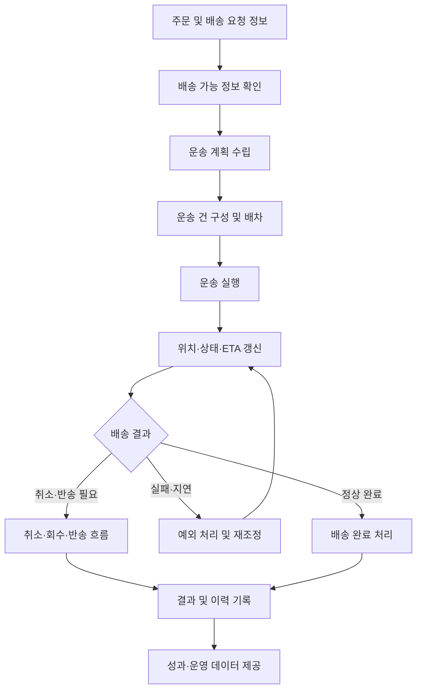
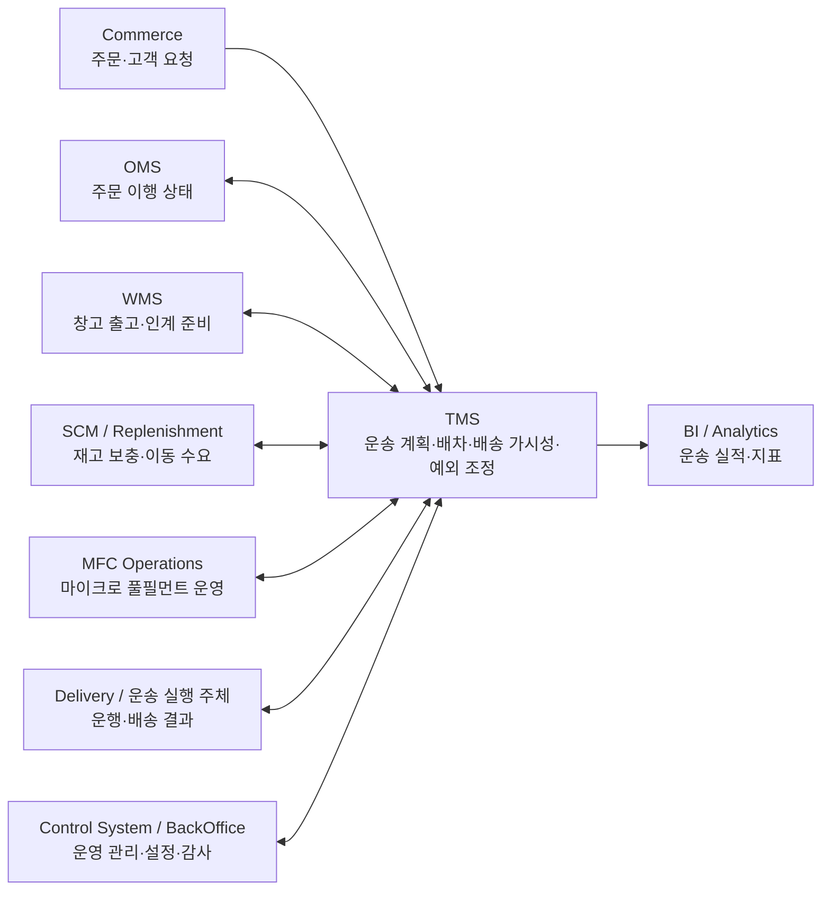
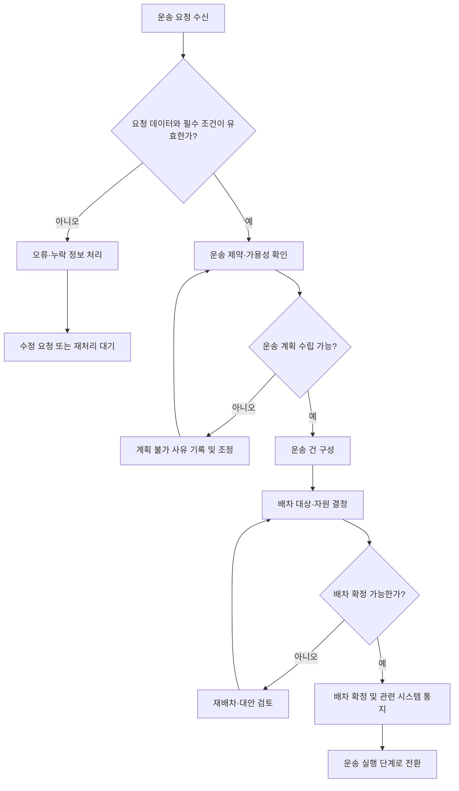
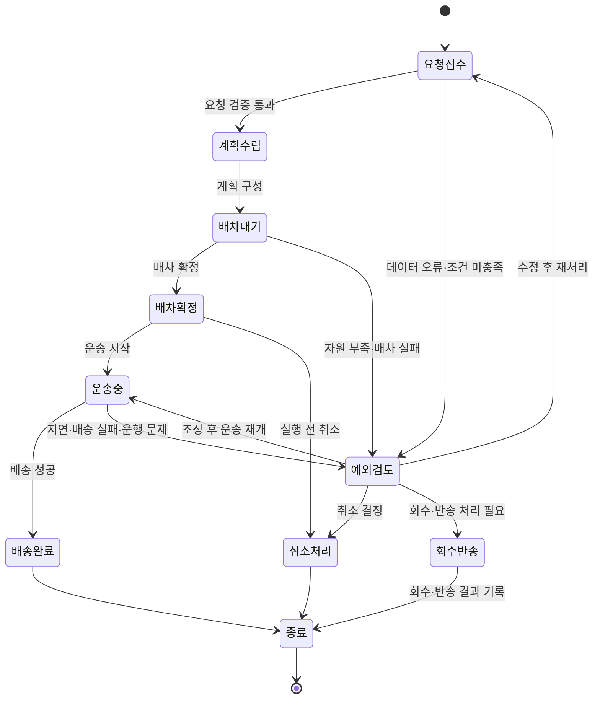
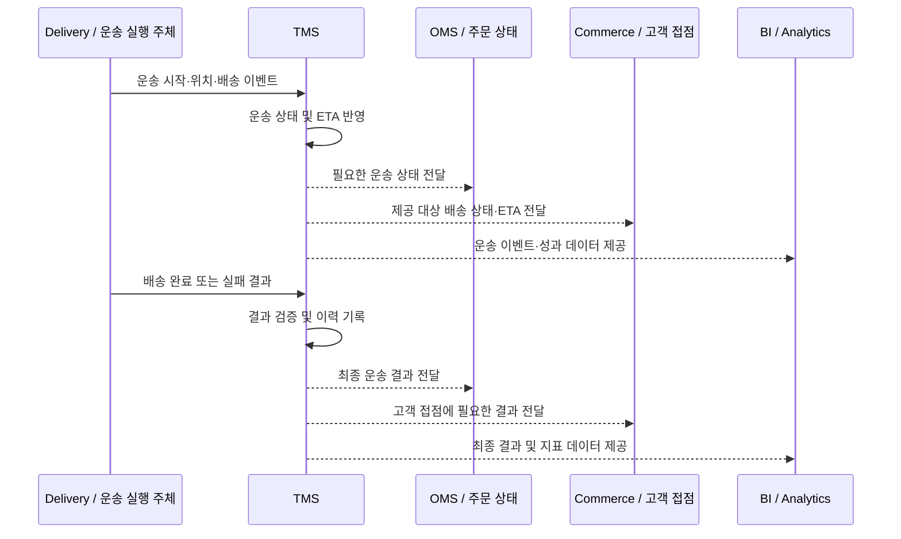
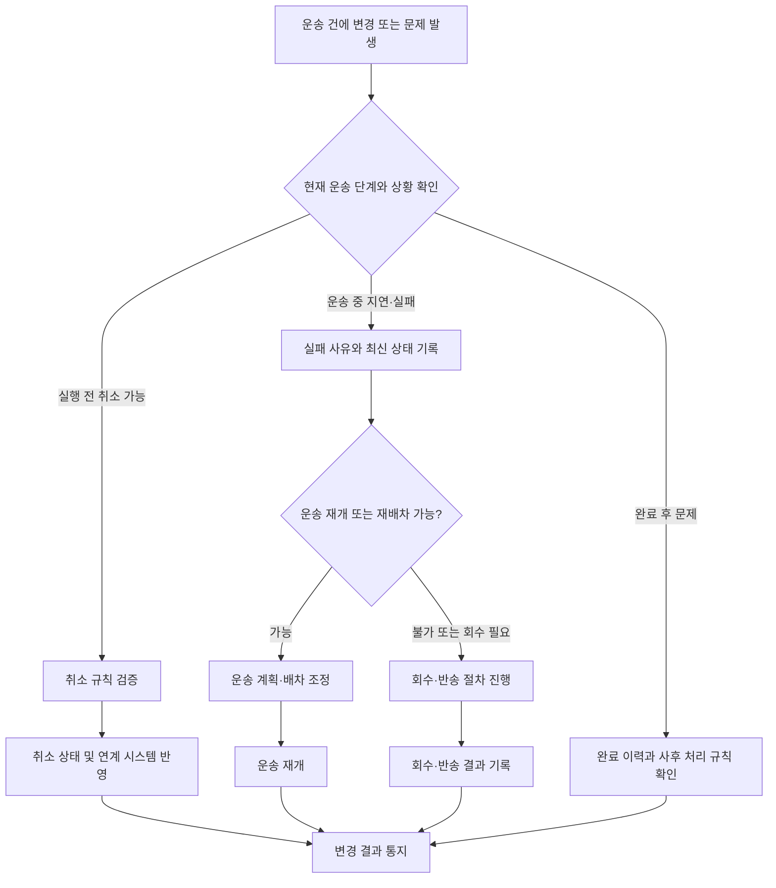
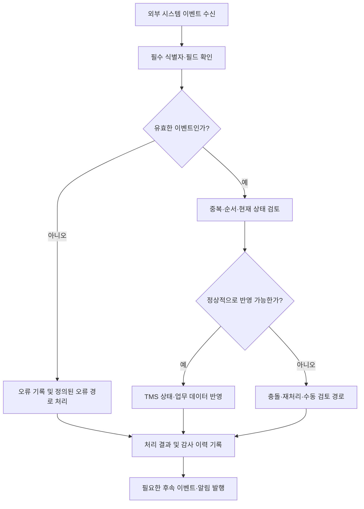
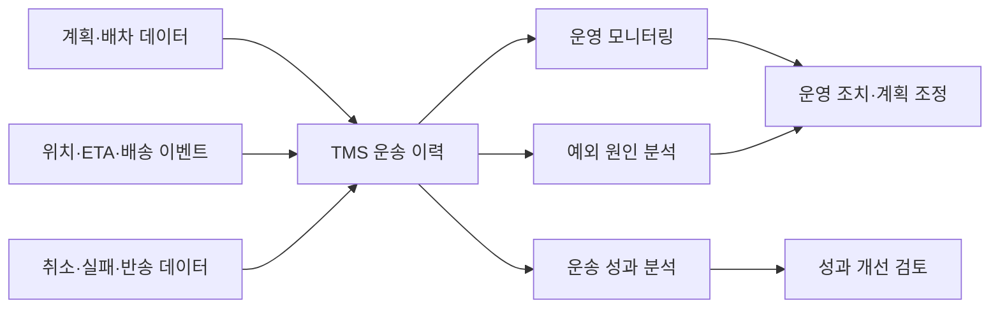

# TMS 업무 흐름 Mermaid 가이드

## 1. 문서 목적

이 문서는 `TMS-final.md`의 업무 규칙을 빠르게 이해할 수 있도록 Mermaid 다이어그램으로 표현한 보조 문서입니다.

- 원문 업무 규칙을 다시 복사하지 않고, 주요 흐름과 시스템 간 책임 관계를 그림으로 정리합니다.
- 상세한 조건, 예외, 수용 기준 및 미결정 사항은 `TMS-final.md`를 기준으로 확인합니다.
- 다이어그램은 업무 이해를 돕는 표현이며, 원문에 확정되지 않은 정책을 새로 확정하지 않습니다.

## 2. TMS 전체 업무 흐름

주문·출고 준비 정보부터 배차, 배송, 완료 결과까지 이어지는 대표 흐름입니다. 실제 실행 순서와 선행 조건은 연계 시스템 및 업무 상황에 따라 달라질 수 있습니다.

## 3. TMS와 주변 시스템의 책임 경계

이 그림은 TMS가 모든 업무를 직접 소유하는 것이 아니라, 각 시스템의 책임 정보를 받아 운송을 계획·조정하고 결과를 전달하는 구조를 나타냅니다.

**읽는 방법**
- TMS는 운송 계획, 배차, 운송 진행 상태 및 예외 조정을 중심으로 동작합니다.
- 주문·재고·창고·MFC의 원천 업무 상태를 TMS가 임의로 대체하지 않습니다.
- 실제 연계 방향, 이벤트 및 필수 필드는 `TMS-final.md`의 통합 계약과 각 영역별 규칙을 따릅니다.

## 4. 계획부터 배차까지의 의사결정 흐름

> 이 다이어그램의 판단 지점은 개념적 단계입니다. 구체적인 검증 규칙, 자원 선정 방식, 재시도 횟수 또는 타임아웃이 원문에서 확정되지 않았다면 구현 정책으로 간주하지 않습니다.

## 5. 운송 상태와 예외 처리의 개념 흐름

**주의:** 위 상태도는 이해를 위한 개념 모델입니다. 실제 상태 코드, 허용 전이, 취소 가능 시점 및 반송 조건은 원문에서 정의한 규칙을 우선합니다.

## 6. 배송 진행 정보와 ETA 갱신

이 흐름은 논리적인 연계 예시입니다. 모든 이벤트가 모든 시스템으로 직접 전달된다는 의미는 아니며, 실제 구독자·전달 조건은 인터페이스 정의를 따릅니다.

## 7. 취소·배송 실패·반송의 분기

## 8. 시스템 연계 이벤트의 공통 처리 흐름

**설계 시 확인할 항목**
- 이벤트 식별자와 업무 식별자
- 중복 수신 시 멱등 처리 기준
- 이벤트 순서가 뒤바뀌거나 늦게 도착한 경우의 처리
- 실패 재시도와 수동 복구의 책임 주체
- 상태 변경 이력 및 감사 기록
- 오류 응답, 재처리 가능 여부 및 모니터링

위 항목은 연계 설계 검토 목록입니다. 구체 값과 정책은 `TMS-final.md`에 명시된 내용 또는 별도 합의된 인터페이스 명세에서 확인해야 합니다.

## 9. 운영 지표와 데이터 흐름

분석 지표의 정확한 산식, 집계 주기, 목표치 및 데이터 보존 기준은 이 그림에서 정의하지 않습니다. 해당 기준이 필요한 경우 원문 및 별도 BI 정의를 확인합니다.

## 10. 원문과 함께 읽는 방법

| 이해하려는 내용 | 이 문서의 그림 | 원문에서 확인할 사항 |
|---|---|---|
| TMS 전체 업무 흐름 | 2번 | 업무 범위, 기본 흐름, 종료 조건 |
| 시스템별 책임과 연계 | 3번 | 각 도메인의 책임 경계, 연계 방향 |
| 계획·배차 판단 | 4번 | 필수 데이터, 제약 조건, 배차 규칙 |
| 상태 변화 | 5번 | 실제 상태 코드, 허용 전이, 취소 가능 시점 |
| 위치·ETA 및 배송 결과 | 6번 | 이벤트 정의, 전달 대상, 갱신 조건 |
| 취소·실패·반송 | 7번 | 상황별 처리 규칙과 예외 정책 |
| 이벤트 오류·재처리 | 8번 | 멱등성, 순서, 재시도, 감사 및 복구 규칙 |
| 성과 분석 | 9번 | 지표 정의, 산식, 집계 및 보존 기준 |

## 11. 정책 확정 상태에 대한 원칙

- 이 문서는 시각화 보조 자료이며 `TMS-final.md`를 대체하지 않습니다.
- 원문에서 미결정으로 남긴 정책은 이 문서에서도 확정된 것으로 취급하지 않습니다.
- 다이어그램의 화살표는 개념적 업무 흐름 또는 논리적 연계를 나타내며, 그 자체로 API, 메시지 토픽, 동기/비동기 방식이나 구현 완료를 의미하지 않습니다.
- 구현·테스트 시에는 원문의 업무 규칙, 수용 기준, 미결정 사항 및 승인된 인터페이스 명세를 함께 확인합니다.
