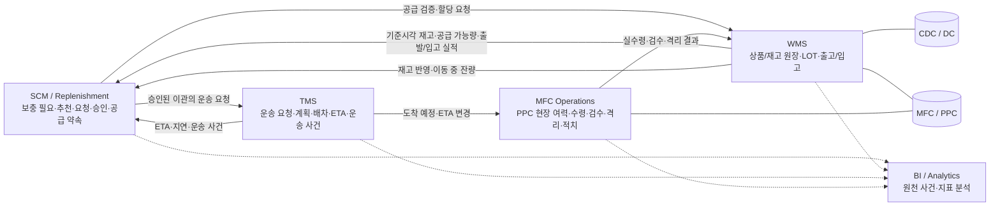
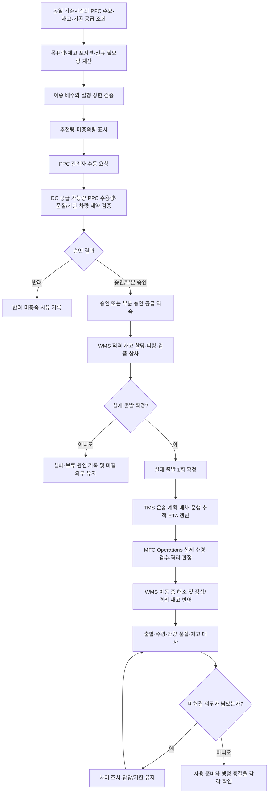
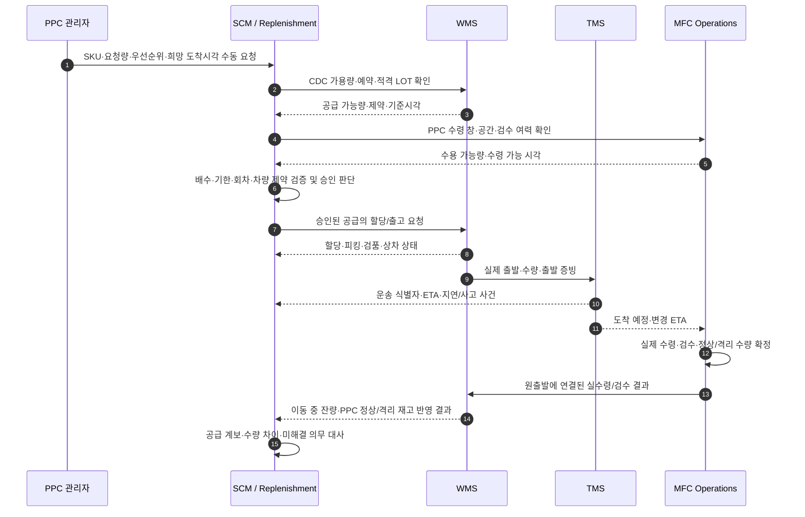
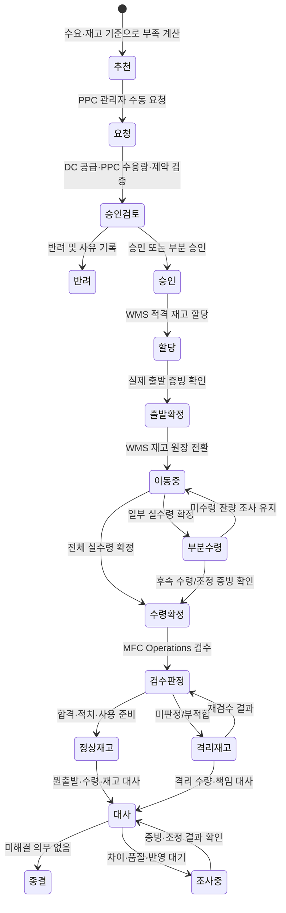
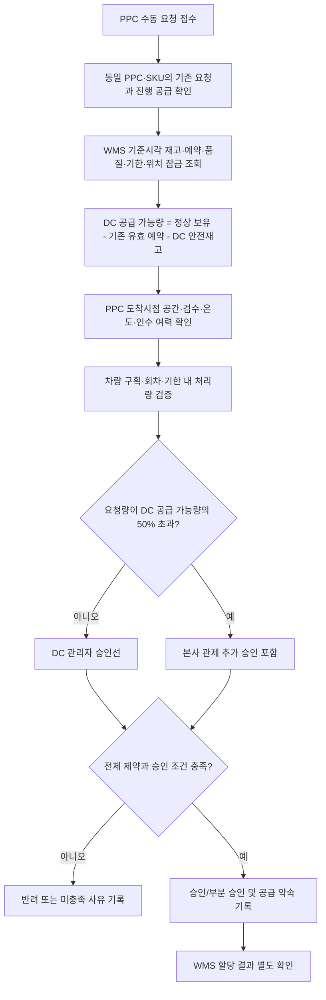
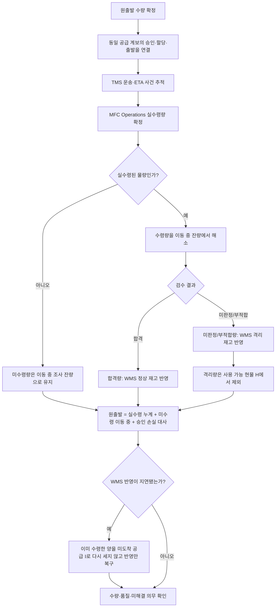
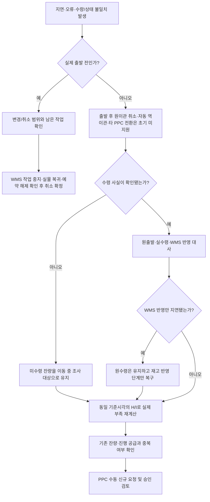

# SCM / Replenishment 비즈니스 로직 이해를 위한 Mermaid 가이드 — CDC→PPC

## 1. 문서의 목적과 읽는 방법

이 문서는 `SCM-Replenishment-business-logic-cdc-ppc.md`를 빠르게 이해하기 위한 시각적 안내서다. 기존 SCM 비즈니스 로직의 문장·정책·계산식·검증 조건을 재작성하거나 대체하지 않는다. 각 다이어그램은 시스템 경계와 업무 순서를 보여주며, 상세 규칙·예외·승인 조건·수용 기준은 원문 해당 절을 기준으로 한다.

**범위:** CDC/DC에서 PPC로 보내는 거점 간 보충 요청·공급 검증·이관 계획·운송 연계·실적 대사다. 외부 공급사 조달, 구매발주, DC 신규 입고 및 매입정산은 실행 범위가 아니다. Commerce, OMS, 고객 주문·배송 및 라이더 연계는 포함하지 않는다. PPC는 거점/목적지를 뜻하며, MFC Operations는 PPC 현장의 수령·검수·적치·사용 준비 및 수용 여력을 담당하는 운영 기능을 뜻한다.

## 2. 시스템 컨텍스트와 책임 경계



**읽는 법:** SCM은 무엇을 얼마나 보충할지 계산하고 PPC의 수동 요청·승인 및 공급 약속을 관리한다. WMS는 상품/실재고 원장과 출고·입고를 소유한다. TMS는 CDC→PPC 운송 계획·배차·ETA·운송 사건을 소유한다. MFC Operations는 PPC 현장의 수령·검수·격리·적치 및 인수 여력을 소유한다. SCM의 추천·승인·입고예정만으로 실재고가 증가하지 않는다.

## 3. 전체 CDC→PPC 보충 흐름



**읽는 법:** 추천은 요청이나 출고를 자동 생성하지 않는다. PPC 관리자가 수동 요청한 뒤 승인 및 WMS 할당·출발을 진행한다. TMS의 운송 상태와 ETA는 현장 수령·검수 사실을 대신하지 않는다. 정상 수령량, 격리량, 미수령 잔량을 분리해 대사한 후 사용 준비와 행정 종결을 각각 확인한다.

## 4. 시스템 간 시퀀스



**읽는 법:** 화살표는 논리적인 책임 전달을 뜻하며 반드시 동기식 API 호출을 의미하지 않는다. 실제 인터페이스 방식·필드·재시도 계약은 별도 인터페이스 정의에서 확정한다. 같은 요청의 재전송은 원 결과를 조회하며, 이미 성공한 출발을 다시 지시하지 않는다.

## 5. 요청·공급·실물 상태의 생애주기



**읽는 법:** 이 상태도는 업무 개념을 보여준다. 구현에서는 SCM 요청/승인 상태, WMS 재고 상태, TMS 운송 상태, MFC Operations 검수 상태를 하나의 공통 상태값으로 합치지 않는다. 한 번의 출발에 대해 부분 수령 확정은 여러 번 발생할 수 있지만, 이를 여러 번 출발한 것으로 기록하지 않는다.

## 6. 보충 수량 계산과 제약 적용

```mermaid
flowchart TD
    H[H: PPC의 품질·기한·사용 준비를 통과한 현물]
    I[I: 보호기간 안에 사용 가능해질 기존 공급 잔량]
    F[F: 기존 공급 계보/집계와 중복되지 않는 신규 예상 수요]
    SS[SS: 승인 안전재고]
    S[목표량 S = F + SS]
    IP[재고 포지션 IP = H + I]
    N[신규 필요량 N = max(0, S - IP)]
    M[m: 승인된 양의 정수 이송 배수]
    W[희망량 = ceil(N / m) × m]
    C[실행 상한 = DC·PPC 수용·차량·기한 제약의 최솟값]
    U[배수 적용 상한 = floor(C / m) × m]
    R[추천량 = min(W, U)]
    X[미충족량 = max(0, N - R)]
    H --> IP
    I --> IP
    F --> S
    SS --> S
    S --> N
    IP --> N
    N --> W
    M --> W
    C --> U
    M --> U
    W --> R
    U --> R
    N --> X
    R --> X
```

**읽는 법:** 목표량은 `F + SS`, 재고 포지션은 `H + I`, 신규 필요량은 `max(0, 목표량 - 재고 포지션)`이다. 희망량은 배수로 올림하지만 실행 상한은 배수로 내림하므로 제약을 넘겨 승인하지 않는다. 배수나 필수 기준이 미등록이면 임의의 0·1·무제한으로 대체하지 않고 영향을 받는 신규 계산·승인을 보류한다. 상세 공식과 수치 사례는 원문 5.2·5.4절을 기준으로 한다.

## 7. 공급 가능량·승인·희소 배분 판단



**읽는 법:** 일반 요청은 DC 관리자 승인 대상이며, 요청량이 현재 DC 공급 가능량의 50%를 초과하면 본사 관제 추가 승인이 필요하다. 정확히 50%인 경우에는 이 조건만으로 추가 승인을 요구하지 않는다. 승인만으로 WMS 예약/할당 성공을 선언하지 않으며 할당 결과를 별도로 확인한다. 공급 부족 배분의 우선순위·비례 배분은 확정 정책이 아닌 승인 검토용 설계안일 수 있으므로 원문 표시를 확인한다.

## 8. 출발·수령 수량과 공급 계보 대사



**읽는 법:** 승인·할당·출발은 동일한 공급 계보의 진행 단계이며 같은 물량을 여러 번 합산하지 않는다. 실제 수령된 물량은 WMS 반영이 늦더라도 미도착 공급으로 다시 계산하지 않는다. 정상 합격량, 격리량, 미수령 잔량을 분리하며, 격리품은 사용 가능 현물도 미도착 공급도 아니다.

## 9. 지연·실패·취소 및 복구 판단



**읽는 법:** 출발 전 취소는 작업 중지·실물 복귀·예약 해제 결과를 확인한 뒤 확정한다. 출발 후에는 초기 범위에서 자동 역이관이나 다른 PPC로의 전환을 만들지 않는다. WMS 응답 유실이나 반영 지연은 성공한 출발/수령을 다시 실행하는 근거가 아니다. 실제 부족을 다시 계산한 후 추가 공급이 필요하면 PPC 수동 요청·승인 절차를 따른다.

## 10. 주요 업무 책임 매트릭스

| 업무 결과 | SCM / Replenishment | WMS | TMS | MFC Operations |
|---|---|---|---|---|
| 보충 필요·추천량 | 수요·공급 비교, 추천·미충족 계산 | 재고·예약·적격 LOT 기준 제공 | ETA·회차·운송 제약 제공 | PPC 수용량·현장 여력 제공 |
| PPC 수동 요청·공급 승인 | 접수·검증·승인/부분 승인 기록 | DC 공급 적격성·할당 가능성 확인 | 회차·차량·ETA 제약 제공 | 수령 창·공간·인력 확인 |
| DC 출고·실제 출발 | 공급 약속 계보 유지 | 출고·실제 출발·재고 원장 | 출발 사건을 받아 운송 추적 | — |
| 운송 계획·진행 | 부족·우선순위 재평가 | 이동 중 수량 원장 | 계획·배차·ETA·지연·사고 | 도착 예정에 맞춰 수령 준비 |
| PPC 실수령·검수 | 공급 이행·미충족 대사 | 정상/격리 재고 반영 | 운송 증빙·사건 이력 제공 | 실수령·검수·격리·적치 확정 |
| 차이·사건 종결 | 미해결 의무·재계획 | 원장 대사·재고 조정 근거 | 운송 증빙·사건 이력 | 현장 수량·품질 증빙 |

## 11. 반드시 기억할 설계 원칙

- **추천 ≠ 요청 ≠ 승인 ≠ 할당 ≠ 출발 ≠ 수령 ≠ 사용 가능 ≠ 행정 종결.** 각각 독립적으로 확인한다.
- **1요청 1이관 1출발.** 부분 승인이나 부족량을 같은 요청의 두 번째 출발로 처리하지 않는다.
- 동일 공급의 승인·할당·출발은 서로 다른 공급량이 아니라 하나의 공급 계보다.
- 실제 수령량은 원출발에 연결하고 이동 중에서 한 번만 해소한다. WMS 반영 지연 때문에 중복 보충하지 않는다.
- 수령 정상량, 수령 격리량, 미수령 잔량은 분리한다. 격리품은 사용 가능 현물도 미도착 공급도 아니다.
- 출발 후 원이관 취소·자동 역이관·PPC 간 전환은 초기 범위에서 지원하지 않는다.
- 운송 완료나 ETA만으로 WMS 재고 원장·MFC 검수 결과를 확정하지 않는다.
- 미설정 필수값을 0, 1 또는 무제한으로 대체하지 않는다. 영향받는 신규 계산·승인을 보류하고 담당·사유를 남긴다.
- DC→PPC 공급 보충과 센터 내부 선반 보충은 별도 업무다. 내부 위치 이동과 센터 간 공급 요청을 같은 자동 보충 실행으로 취급하지 않는다.

## 12. 원문과의 대응표

| 이 가이드 | 원문에서 확인할 영역 |
|---|---|
| 시스템 컨텍스트와 책임 경계 | `SCM-Replenishment-business-logic-cdc-ppc.md` 1장(정의·하위 시스템·협업 경계) |
| 전체 CDC→PPC 보충 흐름 | 원문 3장(보충 업무 전체 흐름과 상태 전이), 6장(보충 감지와 수동 요청) |
| 시스템 간 시퀀스 | 원문 1.3절(다른 영역과의 협업), 8장(이관 실행과 공급 약속), 11장(연계·장애·권한) |
| 요청·공급·실물 상태 | 원문 3장, 8장, 8.1~8.2절 |
| 수량 계산과 제약 | 원문 5.2~5.4절(보충 계산안·입고예정 유효성·같은 기준시각의 수요와 공급 계보) |
| 공급 가능량·승인·희소 배분 | 원문 7장(DC 공급량·배분·승인) |
| 출발·수령 대사 | 원문 8장, 9.2절(차이와 사고) |
| 지연·실패·취소 | 원문 9장(지연·품질·차이·취소), 11장(연계·장애·권한) |
| 센터 내부 선반 보충과의 경계 | 원문 10장 |

이 가이드는 시각적 보조 문서이며 원문의 상세 규칙, 계산식, `[확정 정책]`, `[채택 설계]`, `[설계안]`, `[팀 확인 필요]` 표시와 수용 검증 항목을 대체하지 않는다. 다이어그램의 흐름은 원문에 적힌 책임과 제약을 설명하기 위한 것이며, 미확정 설계안을 확정 정책으로 승격하지 않는다.
