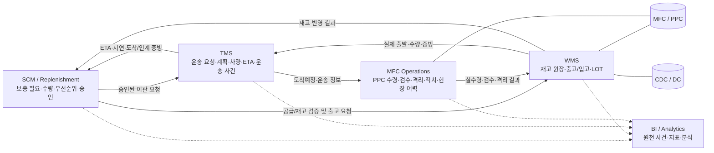
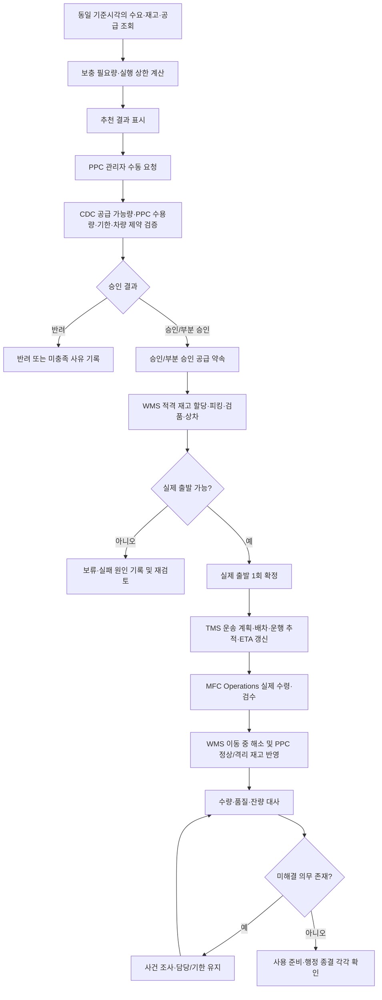
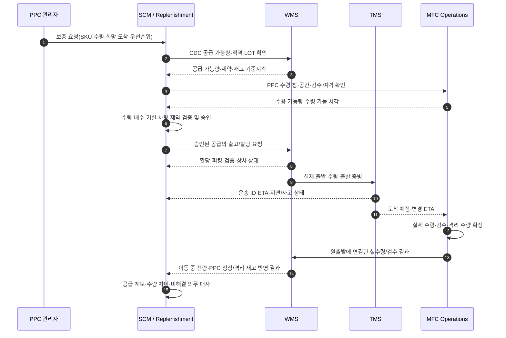
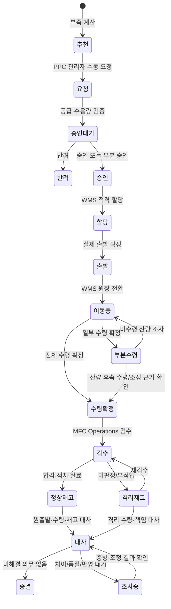
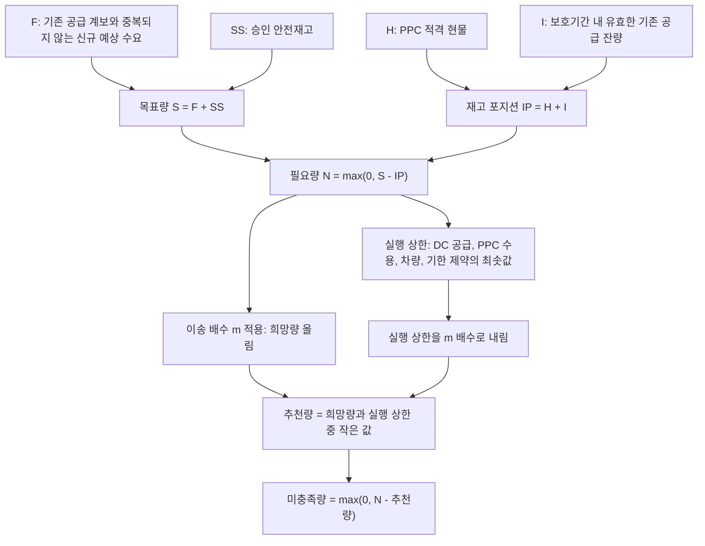
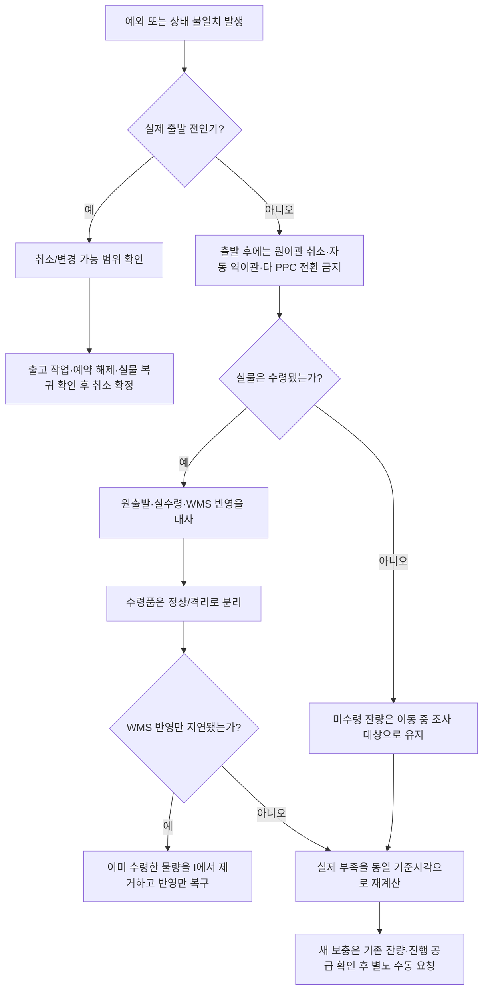

# TMS 비즈니스 로직 이해를 위한 Mermaid 가이드

## 1. 문서의 목적과 읽는 방법

이 문서는 `TMS-business-logic-in-scope.md`를 빠르게 이해하기 위한 시각적 안내서다. 기존 비즈니스 로직의 문장·정책·검증 조건을 재작성하거나 대체하지 않는다. 각 다이어그램은 시스템 경계와 업무 순서를 보여주며, 상세 규칙·예외·승인 조건·수용 기준은 원문 해당 절을 기준으로 한다.

**범위:** CDC/DC → MFC/PPC 거점 간 보충 운송. Commerce, OMS, 고객 배송, 라이더 연계는 포함하지 않는다. MFC Operations는 현장 운영 기능을 가리키며 PPC와 동의어로 사용하지 않는다. PPC는 거점/목적지를, MFC Operations는 해당 거점에서 수행하는 운영 업무를 뜻한다.

## 2. 시스템 컨텍스트와 책임 경계

**읽는 법:** SCM은 무엇을 얼마나 보충할지 결정하고 요청·승인을 관리한다. WMS는 실재고와 출고/입고 원장을 소유한다. TMS는 운송을 계획·배차하고 운송 사건을 추적한다. MFC Operations는 PPC 현장의 실제 수령·검수·적치와 수용 여력을 소유한다. BI는 원천 사건을 분석하지만 운영 원장을 정정하지 않는다.

## 3. 전체 CDC→PPC 보충 흐름

**읽는 법:** 추천은 이관을 생성하지 않는다. PPC 관리자의 수동 요청과 승인 뒤에 WMS 할당·출발이 진행되고, TMS가 운송을 추적한다. 도착은 수령·검수·재고 반영과 같지 않다. 실제 수령량, 정상/격리 수량, 미수령 잔량을 각각 대사한 뒤 사용 준비와 행정 종결을 따로 확인한다.

## 4. 시스템 간 시퀀스

**읽는 법:** 화살표는 논리적 책임 전달을 뜻하며 반드시 동기식 API 호출이라는 뜻은 아니다. 실제 인터페이스 방식·필드·재시도 계약은 시스템 간 인터페이스 정의에서 확정한다. 동일 요청 재전송은 새 이관을 만들지 않고 원 결과를 조회한다.

## 5. 데이터 및 수량의 생애주기

**읽는 법:** 이 상태도는 업무 개념을 보여준다. 구현에서는 SCM 요청/승인 상태, WMS 재고 상태, TMS 운송 상태, MFC 현장 검수 상태를 하나의 공통 상태값으로 합치지 않는다. 부분 수령은 한 번의 출발을 여러 번 출발한 것으로 바꾸지 않는다.

## 6. 수량 계산의 논리

**읽는 법:** 추천량은 필요량을 단순 올림한 값이 아니다. 실행 상한을 넘지 않도록 제약 상한을 이송 배수로 내림한 뒤 희망량과 비교한다. 배수나 필수 기준이 미등록이면 임의의 0/1/무제한 값으로 대체하지 않고 영향 계산·승인을 보류한다. 상세 공식과 예시는 SCM 상세 문서를 기준으로 한다.

## 7. 예외·복구 판단 트리

**읽는 법:** 시스템 응답 실패와 실물 실행 실패를 구분한다. WMS 응답 유실은 기존 작업/출발을 조회하고 재출발하지 않는다. 수령된 격리품과 미수령 잔량은 서로 다른 수량이다. 새 요청은 기존 공급 계보와 중복되지 않도록 별도 승인한다.

## 8. 주요 업무 책임 매트릭스

| 업무 결과 | SCM / Replenishment | WMS | TMS | MFC Operations |
|---|---|---|---|---|
| 보충 필요·추천 수량 | 계산·제안 | 재고 기준 제공 | 운송 제약 제공 | 수용량·현장 여력 제공 |
| PPC 수동 요청·공급 승인 | 접수·검증·승인 기록 | 공급 적격성·할당 가능성 확인 | 회차·차량·ETA 가능성 제공 | 수령 창·공간·인력 확인 |
| 실물 출고·출발 | 공급 약속 계보 유지 | 출고·실제 출발·재고 원장 | 출발 사건을 받아 운송 시작 | — |
| 운송 계획·진행 | 부족/우선순위 재평가 | 이동 중 수량 원장 | 계획·배차·ETA·지연·사고 | 도착예정에 맞춰 수령 준비 |
| 실제 PPC 수령·검수 | 공급 이행 대사 | 정상/격리 재고 반영 | 운송 증빙 제공 | 실수령·검수·격리·적치 확정 |
| 차이·사건 종결 | 미해결 의무·재계획 | 원장 대사·재고 조정 근거 | 운송 증빙·사건 이력 | 현장 수량·품질 증빙 |

## 9. 반드시 기억할 설계 원칙

- **추천 ≠ 요청 ≠ 승인 ≠ 할당 ≠ 출발 ≠ 수령 ≠ 사용 가능 ≠ 행정 종결.** 각각 독립적으로 확인한다.
- **1요청 1이관 1출발.** 부분 승인이나 부족량을 같은 요청의 두 번째 출발로 처리하지 않는다.
- 동일 공급의 승인·할당·출발은 서로 다른 공급량이 아니라 하나의 공급 계보다.
- 실제 수령량은 원출발에 연결하고 이동 중에서 한 번만 해소한다. WMS 반영 지연 때문에 중복 보충하지 않는다.
- 수령 정상량, 수령 격리량, 미수령 잔량은 분리한다. 격리품은 사용 가능 현물도 미도착 공급도 아니다.
- 출발 후 원이관 취소·자동 역이관·타 PPC 전환은 초기 범위에서 지원하지 않는다.
- 계획 ETA나 운송 완료만으로 WMS 재고 원장·MFC 검수 결과를 확정하지 않는다.
- 미설정 필수값을 0, 1 또는 무제한으로 대체하지 않는다. 영향받는 신규 계산·승인을 보류하고 담당·사유를 남긴다.

## 10. 원문과의 대응표

| 이 가이드 | 원문에서 확인할 영역 |
|---|---|
| 시스템 컨텍스트 | `TMS-business-logic-in-scope.md`의 범위·하위 시스템·협업 경계 및 TMS/WMS/SCM/MFC Operations/BI 연계 절 |
| 전체 보충 흐름 | SCM 승인 이관 요청, 출발·운송·수령·재고 반영 관련 절 |
| 시스템 간 시퀀스 | TMS와 WMS, SCM/Replenishment, MFC Operations의 인터페이스 책임표 |
| 상태 생애주기 | 요청·승인·할당·출발·운송·수령·대사 상태 구분 절 |
| 수량 계산 | 보충 필요량 계산, 입고예정 유효성, 이송 배수·실행 상한 관련 절 |
| 예외·복구 | 중복 요청 방지, 지연·품질·차이·취소, 출발 후 처리 제한 관련 절 |

이 가이드는 시각적 보조 문서이며 원문의 상세 규칙, `[확정 정책]`, `[채택 설계]`, `[설계안]`, `[팀 확인 필요]` 표시와 수용 검증 표를 대체하지 않는다.
