# Apache Kafka 완전 분석 및 학습 문서 (IMG-41~IMG-64)

## 문서 정보
- 기술 분야: Apache Kafka (요청의 `kafak`은 이미지 제목에 따라 Kafka로 정정)
- 이미지: 24장, 원본 파일 41.png~64.png
- 목적: 기술 학습 및 팀원 발표
- 기준: 이미지 하단의 Apache Kafka 4.1 표기
- 버전: 1.0

> **표기:** [원문]은 이미지에서 확인한 내용, [보충 설명]은 학습을 위한 추가 설명, [기술적 검토]는 오해를 막기 위한 정정이다. 각 절의 출처는 실제 관련 내용이 나타난 이미지 번호다.

## 목차
1. Kafka 개요와 동기·비동기 통신
2. Kafka 클러스터와 KRaft
3. Topic, Partition, Record, Key, Offset
4. Producer 전송 파이프라인
5. 복제, ACK, ISR, 장애 복구
6. Consumer와 Consumer Group
7. Offset Commit과 처리 보장
8. Consumer Lag과 처리량
9. At-most-once, At-least-once, Idempotence
10. Transaction과 Exactly-once
11. Retry, Retry Topic, DLT
12. Retention, Compaction, Tombstone
13. Outbox와 CDC
14. Spring Boot와 Kafka 연동
15. MSA 주문 처리
16. 운영 지표, 네트워크, 보안
17. 장애 실습과 관찰 기준
18. 핵심 개념 지도와 학습 순서
19. 핵심 내용 정리
20. 공식 참고 자료
- 부록 A. 이미지 인벤토리
- 부록 B. 분산 개념 통합 내역
- 부록 C. 기술적 검토 및 검수

---

# 1. Kafka 개요와 동기·비동기 통신

## 1.1 이벤트 기반 분산 메시징

[원문] Kafka는 Producer가 이벤트를 Topic에 저장하고, 여러 Consumer가 각자의 처리 방식으로 독립적으로 읽을 수 있는 분산 메시징 플랫폼이다. 서비스 간 직접 결합도를 낮추고, 이벤트를 여러 서비스가 활용할 수 있게 한다.

- **Event:** 시스템에서 발생한 사실 또는 상태 변화. 예: `OrderCreated`, `PaymentCompleted`.
- **Record:** Kafka가 저장·전달하는 데이터 단위.
- **Topic:** 관련 Record를 논리적으로 묶는 단위.
- **Producer:** 이벤트 발행자.
- **Consumer:** 이벤트 소비자.
- **Broker:** 이벤트 로그 저장과 읽기·쓰기 요청 처리 서버.

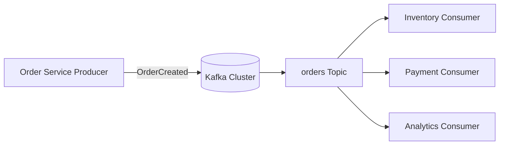

하나의 Topic을 서로 다른 Consumer Group이 구독하면 각 그룹은 독립적인 Offset을 관리하며 동일한 이벤트를 별도로 소비할 수 있다. Kafka는 메시지를 저장하므로 Consumer가 즉시 처리하지 못하더라도 보존 기간 내에서 나중에 읽을 수 있다.

[출처: IMG-41, IMG-45, IMG-51, IMG-61]

## 1.2 동기 HTTP와 비동기 이벤트

[원문] 동기 HTTP에서는 주문 서비스가 재고 서비스에 요청하고 응답을 기다린다. 재고 서비스의 지연·장애가 요청 경로에 영향을 준다. 비동기 방식에서는 주문 서비스가 Kafka에 이벤트를 발행하고, 재고 서비스가 나중에 이벤트를 Poll해 처리한다.

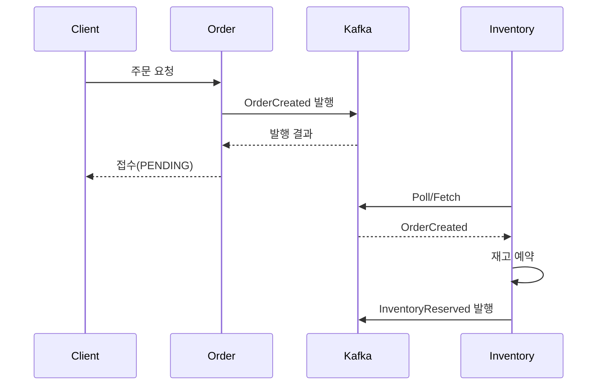

| 항목 | 동기 HTTP | 비동기 Kafka |
|---|---|---|
| 처리 | 호출 후 응답 대기 | 발행 후 Consumer가 별도 처리 |
| 결합 | 호출 대상 API·응답에 의존 | 이벤트 계약 중심 |
| 장애 영향 | 호출 대상 장애가 요청에 영향 | 발행 후 소비를 지연할 수 있음 |
| 사용자 응답 | 후속 처리 결과까지 기다릴 수 있음 | 접수와 최종 완료가 분리될 수 있음 |
| 추가 설계 | Timeout, Retry | 상태 추적, 중복 처리, 재처리 |

[기술적 검토] 비동기 방식이 장애를 자동으로 제거하지는 않는다. Broker 장애, 발행 실패, Consumer 지연, 중복 처리, 이벤트 순서, 업무 상태 추적을 별도로 설계해야 한다. Kafka가 모든 HTTP 통신을 대체하는 것도 아니다. 즉시 응답이 필요한 조회와 이벤트 기반 후속 처리의 경계를 구분한다.

[출처: IMG-42, IMG-41, IMG-61]

# 2. Kafka 클러스터와 KRaft

## 2.1 구성 요소

| 구성 요소 | 역할 |
|---|---|
| Producer | 이벤트 생성·직렬화·전송 |
| Broker | Partition 로그 저장, Producer/Consumer 요청 처리 |
| Consumer | Poll, 업무 처리, Offset 관리 |
| Controller | 클러스터 메타데이터와 Partition 리더십 관리 |
| Kafka Cluster | Broker와 Controller로 구성된 분산 시스템 |

[원문] Broker는 Partition 로그를 저장하고 읽기·쓰기 요청을 처리한다. KRaft Controller는 클러스터 메타데이터를 관리한다.

Kafka 4.x는 ZooKeeper 대신 KRaft 기반 메타데이터 합의 구조를 사용한다. Controller Quorum은 Raft 방식으로 메타데이터 변경을 합의한다.

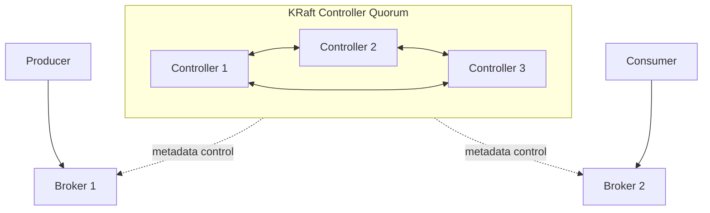

Controller 3개 구성 예시에서는 과반수 2개가 합의에 참여해야 한다. 3개 중 1개 장애까지 합의 지속이 가능하다.

[기술적 검토] Controller Quorum과 Partition ISR은 다른 개념이다. 전자는 클러스터 메타데이터 합의, 후자는 Partition 데이터 복제 상태다. 배포 방식에 따라 Broker와 Controller 역할을 한 프로세스가 함께 수행할 수도 있지만 역할 자체는 구분된다.

[출처: IMG-41, IMG-43, IMG-62]

# 3. Topic, Partition, Record, Key, Offset

## 3.1 Topic과 Partition

Topic은 이벤트의 논리적 분류이며 Partition은 실제 로그·분산 저장·병렬 처리 단위다. 예를 들어 `orders` Topic은 P0, P1, P2로 구성될 수 있다.

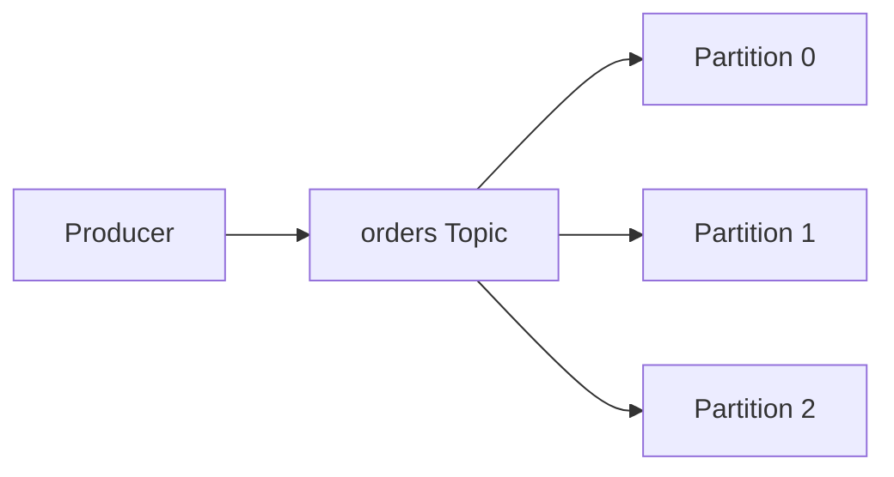

- 하나의 Partition 내부에서는 순서가 보장된다.
- 서로 다른 Partition 사이의 전역 순서는 자동 보장되지 않는다.
- Partition replica는 Broker에 분산 배치된다.
- Partition 수는 Consumer Group 병렬 처리 가능성과 관계된다.

[기술적 검토] Topic 전체가 Broker마다 통째로 분할되는 것이 아니라 각 Partition의 replica가 Broker에 배치된다.

[출처: IMG-41, IMG-44, IMG-46, IMG-64]

## 3.2 Record 구성

| 필드 | 의미 |
|---|---|
| Key | 파티션 선택과 동일 업무 키 연관성에 활용 |
| Value | 이벤트 데이터 |
| Timestamp | 시간 정보 |
| Headers | 부가 메타데이터 |
| Topic/Partition | 저장된 논리·물리 위치 |
| Offset | Partition 내부 위치 |

이미지 예시는 `orders` Topic, Partition 1, Offset 1025, Key `ORD-42`, Value `OrderCreated`, Timestamp `2024-12-17T15:30Z`, Headers의 `eventId`, `eventType`, `contentType`을 보여준다.

[출처: IMG-45]

## 3.3 Key와 파티션 선택

같은 Key를 가진 레코드는 일반적인 기본 파티셔닝에서 같은 Partition으로 배치되어 해당 Key의 순서 유지에 유리하다.

예:
| 이벤트 | Key | Partition |
|---|---|---|
| 주문 A 생성 | ORD-A | P0 |
| 주문 B 생성 | ORD-B | P1 |
| 주문 A 결제 | ORD-A | P0 |
| 주문 B 취소 | ORD-B | P1 |

Key가 없는 레코드는 기본 Partitioner 정책에 따라 선택된다.

[기술적 검토] Key 없는 레코드가 항상 완전한 무작위 균등 분배라고 단정할 수 없다. Kafka 클라이언트 버전과 Partitioner의 배치 효율 정책(예: Sticky 동작)에 따라 달라질 수 있다.

### Hot Key
특정 Key에 데이터가 집중되면 해당 Key가 매핑되는 Partition에 부하가 몰린다. 이미지 예시의 90%·5%·5% 분포는 Hot Partition을 설명한다. Key를 분할하면 부하가 나뉠 수 있지만 같은 업무 엔티티의 순서 보장이 깨질 수 있으므로 업무 키의 의미를 먼저 검토한다.

[출처: IMG-46]

## 3.4 Offset

Offset은 Partition 로그에서 레코드 위치를 나타내는 식별자다. Offset 10, 11, 12는 한 Partition 안의 위치를 나타내며 서로 다른 Partition의 Offset 숫자를 비교해 전역 순서를 판단할 수 없다.

[기술적 검토] Offset은 단순히 “현재 읽은 메시지 번호”가 아니다. Broker 로그 위치이며 Consumer Group은 다음에 읽을 위치를 별도로 Commit한다. 일반적으로 Offset 42까지 처리했다면 다음 읽기 위치인 43을 Commit하는 식으로 이해한다.

[출처: IMG-44, IMG-45, IMG-52, IMG-59, IMG-64]

# 4. Producer 전송 파이프라인

## 4.1 전송 단계

1. 애플리케이션 이벤트 객체 생성
2. Key·Value 직렬화(Serializer)
3. Partitioner가 Partition 선택
4. Partition별 Record Batch 구성
5. Broker 전송
6. ACK 응답 확인
7. Future/Callback으로 성공·실패 처리

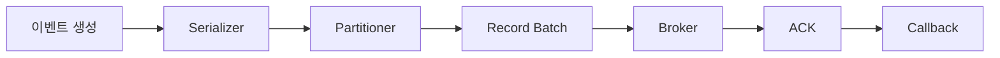

직렬화 실패는 Broker 전송 전에 발생할 수 있다.

## 4.2 Batch와 압축

Producer는 레코드를 배치로 묶어 네트워크 요청을 줄이고 압축 효율을 높일 수 있다.

| 설정 | 의미 |
|---|---|
| `batch.size` | 배치 크기 |
| `linger.ms` | 배치를 모으기 위해 기다리는 시간 |
| `compression.type` | 압축 방식 |
| `buffer.memory` | 전송 전 레코드 버퍼 메모리 |

큰 배치는 처리량에 유리할 수 있지만 대기 시간과 메모리 사용량을 높일 수 있다.

## 4.3 비동기 전송과 Callback

```java
ProducerRecord<String, String> record =
    new ProducerRecord<>("orders", "ORD-42", "{\"event\":\"OrderCreated\"}");

producer.send(record, (metadata, exception) -> {
    if (exception != null) {
        // 전송 실패 처리
    } else {
        System.out.println(metadata.topic());
        System.out.println(metadata.partition());
        System.out.println(metadata.offset());
    }
});
```

`send()` 호출이 반환됐다는 것만으로 Broker 저장 성공이 확정되는 것은 아니다. Future 결과 또는 Callback을 확인해야 한다.

## 4.4 Retry

네트워크 일시 장애, Leader 변경, Timeout 등은 재시도 대상이 될 수 있다. 다만 재시도는 중복 기록 가능성을 고려해야 한다. Producer Idempotence는 Producer 내부 재시도 중복을 줄이지만, 애플리케이션이 동일 업무 이벤트를 새 요청으로 다시 발행하는 것까지 자동 제거하지 않는다.

[출처: IMG-47, IMG-48, IMG-54]

# 5. 복제, ACK, ISR, 장애 복구

## 5.1 Leader와 Follower

Partition은 Leader replica와 Follower replica를 가질 수 있다.
- Leader: 해당 Partition의 읽기·쓰기 요청을 대표적으로 처리
- Follower: Leader 로그를 복제
- ISR: Leader와 동기화 상태를 유지하는 replica 집합

RF=3이면 총 replica는 3개다.

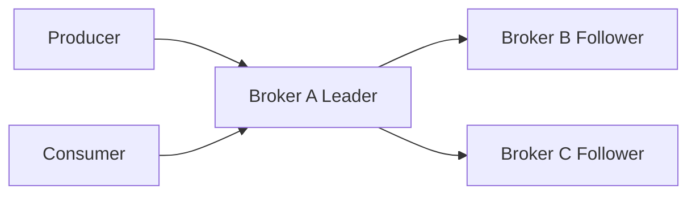

## 5.2 ACK

| 설정 | 의미 | 위험·특징 |
|---|---|---|
| `acks=0` | Broker 응답 대기 안 함 | 저장 성공 확인 불가 |
| `acks=1` | Leader 로컬 기록 후 응답 | Follower 복제 전 Leader 장애 시 손실 가능 |
| `acks=all` / `-1` | 현재 ISR 복제 조건을 충족한 뒤 응답 | 강한 내구성, 지연 가능 |

[기술적 검토] `acks=all`은 설정된 모든 replica가 아니라 현재 ISR을 기준으로 한다. 실제 쓰기 가능 조건은 `min.insync.replicas`와 ISR 상태에 좌우된다.

## 5.3 ISR과 min.insync.replicas

RF=3, `min.insync.replicas=2`라면 ISR 3개 또는 2개 상태에서 `acks=all` 쓰기가 가능할 수 있고, ISR이 1개로 줄면 쓰기가 거부된다.

| ISR 수 | 최소 2개 조건 | 결과 |
|---:|---|---|
| 3 | 충족 | 쓰기 가능 |
| 2 | 충족 | 쓰기 가능 |
| 1 | 미충족 | acks=all 쓰기 실패 |

`min.insync.replicas`는 `acks=all`과 함께 이해해야 한다. Broker 프로세스가 살아 있다는 사실만으로 ISR 멤버라고 단정할 수 없다.

## 5.4 Leader 장애

1. Leader Broker 장애
2. Controller가 Partition 리더십 변경 처리
3. 적절한 Follower가 새 Leader로 선출
4. Producer와 Consumer가 새 Leader를 찾아 재연결

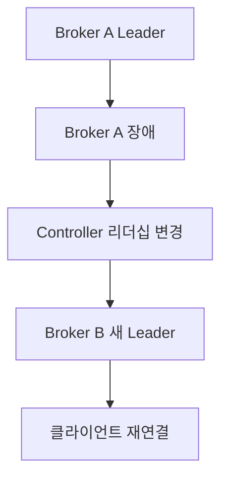

ISR 내 replica 선출은 데이터 일관성에 유리하다. ISR 밖 replica를 강제로 선출하는 Unclean Leader Election은 데이터 손실 위험이 있다.

[기술적 검토] “복제본이 있으므로 데이터는 절대 손실되지 않는다”는 표현은 틀리다. ACK, ISR, 복제 지연, 장애 유형, Unclean Election 정책에 따라 손실 위험이 달라진다.

[출처: IMG-43, IMG-48, IMG-49, IMG-62]

# 6. Consumer와 Consumer Group

## 6.1 Pull 기반 소비

Consumer는 Broker에 Fetch/Poll 요청을 보내 레코드를 가져온다. 가져온 뒤 업무를 처리하고 Offset을 Commit한다.

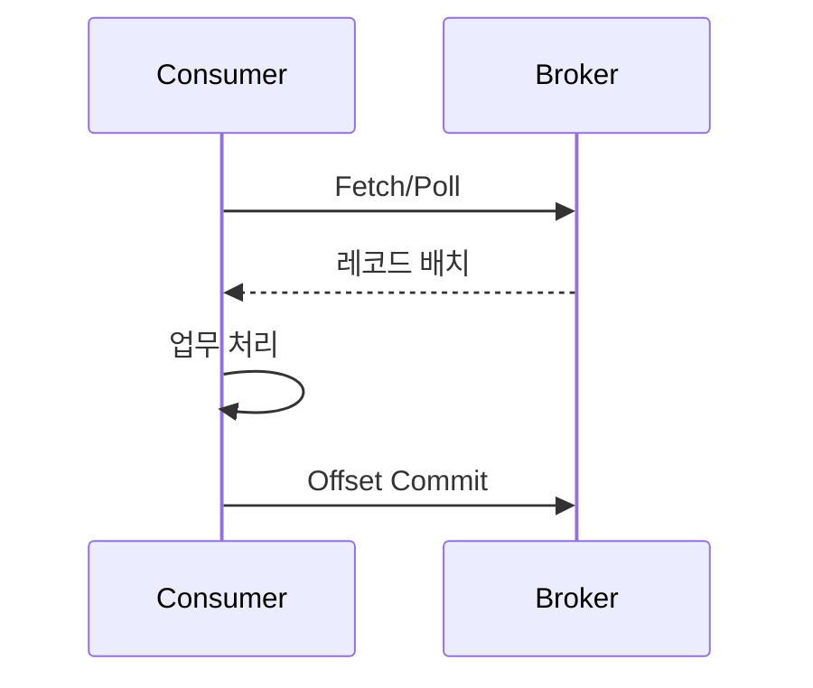

## 6.2 Consumer Group

같은 Consumer Group 내부에서는 Partition을 나눠 처리한다. 예를 들어 `orders`의 P0/P1/P2를 Consumer C1/C2/C3가 하나씩 담당할 수 있다.

서로 다른 Group(예: `inventory`, `analytics`)은 같은 Topic을 독립적으로 구독하고 Offset을 각각 관리한다.

## 6.3 Partition과 Consumer 수

| Partition | Consumer | 일반적인 결과 |
|---:|---:|---|
| 3 | 1 | 한 Consumer가 3개 처리 |
| 3 | 2 | 나눠 처리 |
| 3 | 3 | 각자 하나씩 처리 가능 |
| 3 | 5 | 최대 3개만 할당, 나머지 유휴 |

한 Consumer Group에서 동시에 Partition을 할당받는 Consumer 수의 상한은 해당 Topic Partition 수에 영향을 받는다.

## 6.4 Rebalance

발생 조건:
- Consumer 추가·종료·장애
- Topic Partition 수 변경
- 구독 Topic 변경
- Poll 지연 등으로 그룹에서 이탈한 것으로 판단

Rebalance는 Partition 소유권을 재분배한다. 잦은 Rebalance는 일시적 처리 중단과 지연을 일으킬 수 있다. `max.poll.interval.ms`, heartbeat, session timeout, 처리 시간, 할당 전략을 점검한다.

[출처: IMG-50, IMG-51, IMG-53, IMG-63]

# 7. Offset Commit과 처리 보장

## 7.1 Poll-Process-Commit

일반적인 순서는 Poll → 업무 처리 → 결과 저장 → Offset Commit이다. Offset 42를 처리 완료했다면 다음 읽기 위치인 43을 Commit하는 개념이다.

## 7.2 Auto Commit과 Manual Commit

- `enable.auto.commit=true`: 설정 주기에 따라 자동 Commit. 처리 완료보다 먼저 Commit될 경우 장애 시 메시지를 건너뛸 위험이 있다.
- `enable.auto.commit=false`: 애플리케이션이 처리 완료 시점에 Commit. 중복·누락 위험을 직접 통제해야 한다.

Manual Commit에서도 Commit을 너무 늦게 하면 재시작 후 중복 처리될 수 있다. 여러 Partition을 병렬 처리할 때는 아직 처리하지 않은 Offset을 앞질러 Commit하지 않도록 주의한다.

## 7.3 장애 시나리오

- 처리 완료 후 Commit 전에 장애: 동일 레코드 재수신 가능(중복).
- 업무 처리 전에 Commit: 재시작 후 해당 레코드 건너뛸 가능성(누락).

## 7.4 auto.offset.reset

| 값 | 의미 |
|---|---|
| `earliest` | 사용 가능한 가장 오래된 Offset부터 |
| `latest` | 새로 들어오는 데이터부터 |
| `none` | 유효 Offset이 없으면 예외 |

[기술적 검토] `auto.offset.reset`은 Consumer가 매번 시작할 때 무조건 적용되는 것이 아니다. 유효한 committed offset이 없거나 기존 Offset이 유효하지 않을 때 적용된다.

[출처: IMG-44, IMG-50, IMG-52]

# 8. Consumer Lag과 처리량

Lag은 최신 로그 위치와 Consumer Group의 처리 위치 사이의 차이를 나타낸다.

개념식:
```text
Lag = Log End Offset - Consumer Group Committed Offset
```

예: Log End Offset 1,000, Committed Offset 800이면 Lag은 약 200이다.

이미지의 처리량 예:
- Producer 1,000건/초
- Consumer 800건/초
- 초당 Lag 증가량 200건
- 300초 후 누적 증가량 60,000건

Consumer가 1,200건/초 처리하고 Producer 유입이 1,000건/초라면 Lag 60,000을 줄이는 단순 예상 시간은 `60,000 / (1,200-1,000) = 300초`다.

[기술적 검토] 이는 처리량이 일정하다는 단순 계산이다. 실제 처리량은 메시지 크기, Partition 분포, 외부 DB/API, 재시도, Rebalance 등에 따라 달라진다. Lag이 커지는 것 자체가 즉시 데이터 손실은 아니지만 Retention 기간을 넘겨 레코드가 삭제되면 재처리가 불가능해질 수 있다.

[출처: IMG-59, IMG-63, IMG-58]

# 9. At-most-once, At-least-once, Idempotence

## 9.1 전달 보장 수준

| 방식 | 일반적 처리 순서 | 특성 |
|---|---|---|
| At-most-once | 처리 전에 Commit | 중복은 줄지만 누락 가능 |
| At-least-once | 처리 후 Commit | 누락을 줄이나 중복 가능 |
| Exactly-once | 트랜잭션 등으로 원자적 처리 | 적용 범위를 명확히 해야 함 |

## 9.2 Idempotent Producer

`enable.idempotence=true`는 Producer 내부 재시도로 같은 레코드가 중복 기록되는 문제를 줄인다. Broker는 Producer ID(PID)와 Sequence Number를 이용해 중복을 감지한다.

주요 조건·설정:
```properties
enable.idempotence=true
acks=all
retries=2147483647
max.in.flight.requests.per.connection=5
```

[기술적 검토]
- Kafka 3.0 이후 충돌하는 설정이 없다면 Idempotence는 기본 활성화된다.
- 실제 설정은 사용 중인 Kafka 버전의 문서와 클라이언트 설정을 확인한다.
- Producer Idempotence는 Producer 내부 재시도 중복 방지이며 업무 이벤트 자체의 중복 발행까지 막지는 않는다.
- 결제·주문 등 업무 중복은 eventId, idempotency key, DB Unique Key 등으로 별도 방어한다.

## 9.3 Exactly-once 범위

Exactly-once를 모든 시스템에서 업무가 반드시 한 번만 실행되는 것으로 해석하면 안 된다. 구분할 범위는 Producer 중복 방지, Kafka Topic 간 원자적 쓰기, Consume-Process-Produce의 출력과 Offset 원자화, 외부 DB·API까지 포함한 업무 결과다.

[출처: IMG-48, IMG-54, IMG-55, IMG-64]

# 10. Transaction과 Exactly-once

Kafka Transaction은 여러 Topic·Partition에 기록하는 레코드를 원자적으로 Commit 또는 Abort할 수 있다.

개념 API:
```java
producer.initTransactions();
try {
    producer.beginTransaction();
    producer.send(new ProducerRecord<>("orders-result", key, value));
    producer.commitTransaction();
} catch (Exception e) {
    producer.abortTransaction();
}
```

Producer에는 `transactional.id`를 설정한다. 같은 식별자를 재사용하면 이전 Producer 세션의 미완료 트랜잭션 복구에 활용할 수 있으므로 동시 실행 인스턴스 간 식별자 충돌을 피해야 한다.

Consume-Process-Produce에서 출력 레코드와 소비 Offset을 같은 트랜잭션으로 반영하려면:
- Consumer `enable.auto.commit=false`
- Producer `transactional.id` 설정
- `sendOffsetsToTransaction()` 사용
- Consumer `isolation.level=read_committed` 권장
- Rebalance 및 Partition 소유권 변경 처리

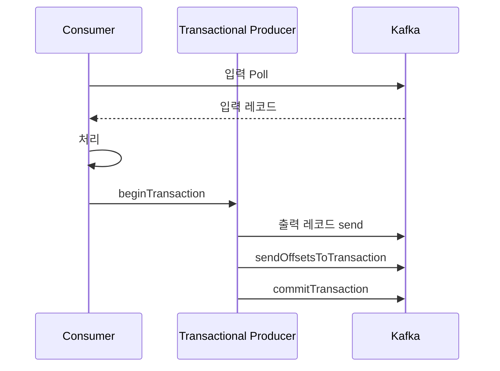

[기술적 검토] Kafka Transaction은 외부 DB나 결제 API까지 자동으로 묶지 않는다. DB 저장 후 Offset Commit 전에 장애가 발생하면 중복 처리가 가능하다. DB Unique Key, Inbox/Outbox, 업무 멱등성, 외부 API Idempotency Key 등을 함께 사용한다.

[출처: IMG-54, IMG-55, IMG-56]

# 11. Retry, Retry Topic, DLT

## 11.1 실패 분류

| 실패 | 예 | 일반적 대응 |
|---|---|---|
| 일시 장애(Transient) | 네트워크 Timeout, 일시 Broker 장애 | 제한된 재시도 |
| 데이터 오류(Data) | 역직렬화, 필수 필드 누락 | 격리·DLT |
| 업무 오류(Business) | 재고 부족, 잘못된 상태 전이 | 업무 정책·보상·DLT |

## 11.2 제한된 Retry

이미지 예시는 최대 3회, 5초→30초→5분 간격을 보여준다. 교육용 예시이며 실제 값은 SLA와 오류 특성에 맞춘다. Backoff, Jitter, 최대 대기 시간, 재시도 대상 예외 분류를 고려한다.

## 11.3 Retry Topic과 DLT

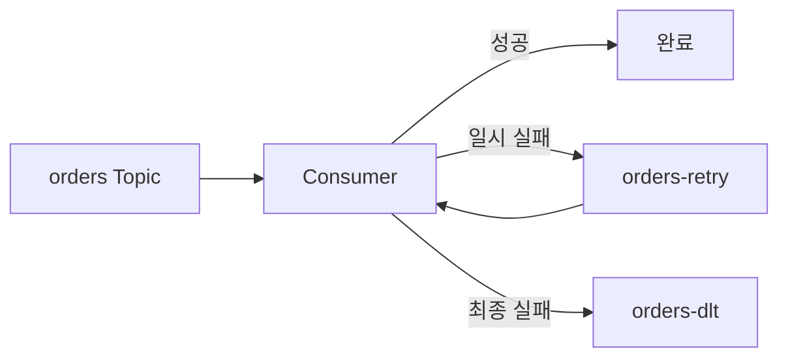

Retry Topic을 쓰면 실패 메시지를 원본 처리 흐름에서 분리하고 재시도 간격을 제어할 수 있다. 다만 재시도 대기 중 후속 메시지가 먼저 처리되어 같은 Key의 순서가 바뀔 수 있다.

DLT는 최종 실패 레코드를 별도로 보관한다. 원본 Topic·Partition·Offset, eventId, 오류 유형·메시지, 재시도 횟수, 실패 시각 등을 기록한다.

재처리:
1. DLT 조회
2. 원인 분석
3. 데이터 또는 업무 조건 수정
4. 재처리 대상 선정
5. 재발행
6. 결과 확인 및 이력 기록

[기술적 검토] DLT에 보냈다고 오류가 해결된 것은 아니다. 격리·관찰·재처리를 위한 운영 장치이며 민감정보 보관 정책도 필요하다.

[출처: IMG-47, IMG-57, IMG-63]

# 12. Retention, Compaction, Tombstone

## 12.1 Retention

대표 정책:
- `retention.ms`: 시간 기반 보존
- `retention.bytes`: 용량 기반 보존
- 오래된 로그 Segment 정리

[기술적 검토] 보존 기간이 지난 레코드가 그 순간 개별 삭제되는 구조로 단순화하면 안 된다. Kafka는 로그 Segment 단위로 정리한다.

## 12.2 Log Compaction

동일 Key의 과거 상태를 정리하고 최신 상태를 유지하는 데 적합하다.

예:
| Offset | Key | Value |
|---:|---|---|
| 0 | K1 | v1 |
| 1 | K2 | a |
| 2 | K1 | v2 |
| 3 | K3 | x |
| 4 | K2 | b |

Compaction 후 개념적으로 K1=v2, K2=b, K3=x가 남을 수 있다. 중간 상태는 제거될 수 있다. Compaction은 백그라운드 작업이며 레코드 순서를 재정렬하지 않고 Offset을 재부여하지 않는다.

## 12.3 Tombstone

Compacted Topic에서 Key 삭제를 표시하려면 해당 Key에 Value가 null인 레코드를 기록한다.

```text
Key = customer-42
Value = null
```

Tombstone은 즉시 모든 과거 레코드를 삭제하는 명령이 아니다. Compaction이 이전 Key 값을 정리하도록 표시하며 `delete.retention.ms` 등에 따라 Tombstone 자체도 나중에 정리된다.

## 12.4 Replay 주의

Retention은 보존 범위 밖 로그를 제거할 수 있고, Compaction은 같은 Key의 중간 상태를 제거할 수 있다. 따라서 Compacted Topic은 모든 이벤트 이력을 보존하는 용도가 아니라 Key별 최신 상태 유지에 적합하다.

[출처: IMG-58]

# 13. Outbox와 CDC

## 13.1 DB-Kafka 이중 쓰기 문제

주문 DB Commit 성공 후 Kafka 발행이 실패하면 주문은 저장됐지만 다른 서비스는 이벤트를 모른다. 반대로 Kafka 발행 후 DB Commit이 실패하면 실제로 없는 주문 이벤트가 전달될 수 있다.

## 13.2 Outbox 패턴

업무 데이터와 발행할 이벤트를 동일 DB 트랜잭션으로 저장한다.

예시:
- `orders`: order_id, customer_id, amount, status
- `outbox`: event_id, aggregate_id, event_type, payload, created_at, status

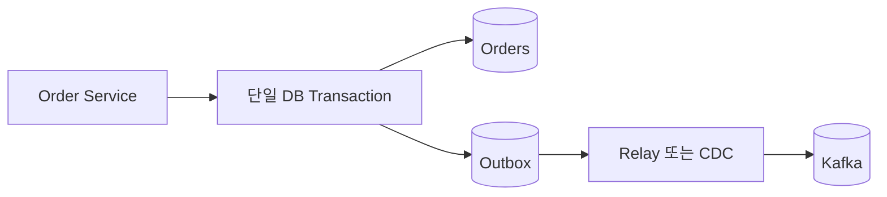

주문 데이터와 Outbox 레코드가 함께 Commit되므로 DB 저장 성공·이벤트 발행 의도 저장의 원자성을 확보한다.

## 13.3 Polling Relay와 CDC

- **Polling Relay:** 애플리케이션이 Outbox를 주기적으로 조회하고 PENDING 이벤트를 Kafka에 발행한다.
- **CDC:** DB 변경 로그(WAL/Binlog 등)를 읽어 변경을 전달한다. Debezium을 활용할 수 있다.

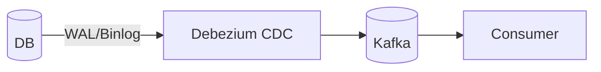

[기술적 검토] Outbox는 설계 패턴이고 CDC는 DB 변경을 감지·전달하는 기술이다. Outbox를 Polling Relay 또는 CDC로 발행할 수 있다.

## 13.4 중복 발행

Relay가 Kafka 발행에 성공한 직후 DB 상태 갱신 전에 장애가 나면 재시작 후 같은 이벤트를 다시 발행할 수 있다. `event_id`를 고유 식별자로 사용하고 Consumer 측에서도 중복 처리를 방지한다. 이미지의 상태 예시는 `PUBLISHED`, `PENDING`, `FAILED`다.

[출처: IMG-56, IMG-61]

# 14. Spring Boot와 Kafka 연동

## 14.1 구성

- `KafkaTemplate`: Producer 측 전송
- `ProducerFactory`: Producer 생성 설정
- `@KafkaListener`: 메시지 수신 메서드 지정
- `KafkaListenerContainerFactory`: Listener Container 생성
- `ConsumerFactory`: Consumer 생성
- Listener Container: Poll 및 Listener 호출 관리

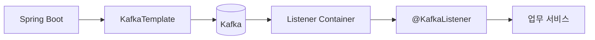

## 14.2 Producer 예시

```java
@Service
@RequiredArgsConstructor
public class OrderEventProducer {
    private final KafkaTemplate<String, OrderCreatedEvent> kafkaTemplate;

    public void publish(OrderCreatedEvent event) {
        kafkaTemplate.send("orders", event.orderId(), event);
    }
}
```

## 14.3 Consumer 예시

```java
@Component
public class InventoryEventListener {
    @KafkaListener(topics = "orders", groupId = "inventory")
    public void consume(OrderCreatedEvent event) {
        // 재고 예약 업무 처리
    }
}
```

`@KafkaListener`는 Broker가 메서드를 직접 호출하는 것이 아니다. Listener Container가 Kafka Consumer를 관리하고 Poll한 레코드를 Listener에 전달한다.

## 14.4 설정 예시

```yaml
spring:
  kafka:
    bootstrap-servers: localhost:9092
    producer:
      key-serializer: org.apache.kafka.common.serialization.StringSerializer
      value-serializer: org.springframework.kafka.support.serializer.JsonSerializer
    consumer:
      group-id: inventory
      auto-offset-reset: earliest
      enable-auto-commit: false
      key-deserializer: org.apache.kafka.common.serialization.StringDeserializer
      value-deserializer: org.springframework.kafka.support.serializer.JsonDeserializer
```

이는 개념 예시다. 실제 Spring Kafka 버전, JSON 타입 헤더, 신뢰 패키지, ErrorHandlingDeserializer, 오류 처리 정책에 맞춰 조정한다.

[출처: IMG-60]

# 15. MSA 주문 처리

## 15.1 전체 흐름

이미지의 업무 흐름은 주문 접수, 재고 예약, 결제, 실패 보상, 최종 주문 확정으로 구성된다.

1. 클라이언트가 주문 요청
2. Order Service가 주문을 `PENDING`으로 저장
3. Outbox/CDC를 통해 `OrderCreated` 발행
4. Inventory Service가 재고 예약
5. `InventoryReserved` 또는 예약 실패 이벤트 발행
6. Payment Service가 결제 처리
7. `PaymentSucceeded` 또는 `PaymentFailed` 발행
8. Order Service가 최종 상태를 `CONFIRMED` 또는 실패 상태로 변경

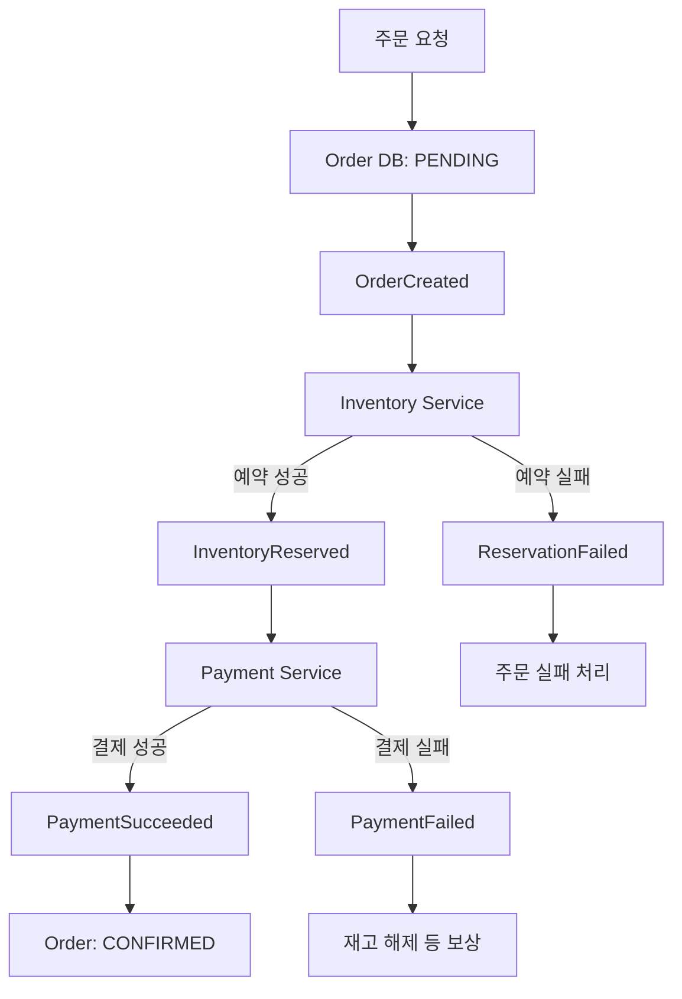

## 15.2 결제 멱등성

이미지에서는 Payment Service가 `idempotency key`를 활용하는 구조를 제시한다. 예를 들어 `orderId + paymentAttemptId`를 키로 삼아 동일 결제 요청이 재전달되면 기존 결과를 반환하도록 한다.

[기술적 검토] Kafka Producer Idempotence만으로 외부 결제 API 중복 호출을 막을 수 없다. Payment Service DB와 결제 시스템 수준의 멱등성이 필요하다.

## 15.3 실패 보상과 상태

이미지의 상태 예: `PENDING`(주문 접수), `RESERVED`(재고 예약), `PAID`(결제 완료), `CONFIRMED`(주문 확정). 결제 실패 시 재고 예약 해제, 후속 확정 실패 시 결제 취소·환불 등 보상 흐름이 필요할 수 있다.

[보충 설명] 이는 Saga 패턴과 연결된다. 보상은 이미 실행된 로컬 트랜잭션을 물리적으로 롤백하는 것이 아니라 새로운 업무 동작으로 이전 효과를 상쇄한다.

## 15.4 이벤트 계약

이벤트 예: `OrderCreated`, `InventoryReserved`, `PaymentSucceeded`, `OrderConfirmed`.

공통 메타데이터 후보:
- `eventId`
- `eventType`
- `aggregateId`
- `occurredAt`
- `correlationId`
- `causationId`
- `schemaVersion`

이벤트 필드와 의미를 변경하면 여러 Consumer가 영향을 받으므로 스키마 버전·호환성 정책이 필요하다.

[출처: IMG-41, IMG-45, IMG-61]

# 16. 운영 지표, 네트워크, 보안

## 16.1 지표

| 영역 | 주요 지표 |
|---|---|
| Producer | 전송 성공·실패, Retry, Request Latency, Batch 크기, Buffer 사용량 |
| Broker | 생존 여부, Leader 분포, Under Replicated Partitions, ISR, 디스크·네트워크 |
| Consumer | Lag, Records Consumed Rate, Fetch, 처리 시간, Commit 지연, Rebalance, DLT 적체 |

전체 Lag 평균뿐 아니라 Partition별 Lag도 확인해야 특정 Partition 병목을 찾을 수 있다.

## 16.2 네트워크 주소

- `listeners`: Broker가 연결을 수신하는 주소
- `advertised.listeners`: 클라이언트에 안내하는 접속 주소
- `bootstrap.servers`: 클라이언트가 최초 연결할 Broker 주소 목록

클라이언트는 Bootstrap 주소로 최초 연결한 뒤 메타데이터를 받고 실제 Partition Leader Broker에 연결한다. 따라서 advertised.listeners가 클라이언트 네트워크에서 접근 불가능하면 연결 장애가 발생할 수 있다.

## 16.3 보안

- TLS/SSL: 전송 구간 암호화
- SASL: 클라이언트 인증
- ACL: Principal별 Topic·Group·Cluster 접근 제어
- 인증(Authentication)과 인가(Authorization)는 구분한다.

운영 점검:
- Topic별 Retention
- Partition 수와 replication factor
- ISR·Under Replicated 상태
- Consumer Lag
- Retry·DLT 적체
- 스키마 호환성
- 민감정보 포함 여부
- 감사 추적
- Broker 디스크
- 복구·재처리 절차

[출처: IMG-62]

# 17. 장애 실습과 관찰 기준

## 17.1 Broker 장애
RF=3 Topic을 준비하고 Follower 중지, ISR 변화, Leader 중지, 새 Leader 선출, 클라이언트 재연결을 관찰한다. 지표: ISR 수, Leader 변경, Producer Retry, Timeout, 데이터 손실 여부.

## 17.2 Consumer 장애와 Lag
Producer를 계속 실행한 상태에서 Consumer를 중지해 Lag 증가를 확인한 뒤 재시작하여 처리량과 Lag 감소를 관찰한다. 지표: Log End Offset, Committed Offset, Lag, 처리량, 복구 시간.

## 17.3 Rebalance
Consumer 2개로 시작해 Consumer를 추가·종료한다. Partition 재할당, 처리 중단, Rebalance 시간, 중복 처리 여부를 관찰한다.

## 17.4 독성 메시지
정상·오류 메시지를 함께 발행하고 오류 분류, 제한 Retry, DLT 이동, 원본 위치·오류 메타데이터, 수정 후 재처리 과정을 확인한다.

## 17.5 Consumer 지연
Partition별 Lag 편차, 특정 Key 집중, 처리 시간, 외부 DB/API, Poll 간격, Rebalance를 확인한다.

[출처: IMG-57, IMG-59, IMG-63]

# 18. 핵심 개념 지도와 학습 순서

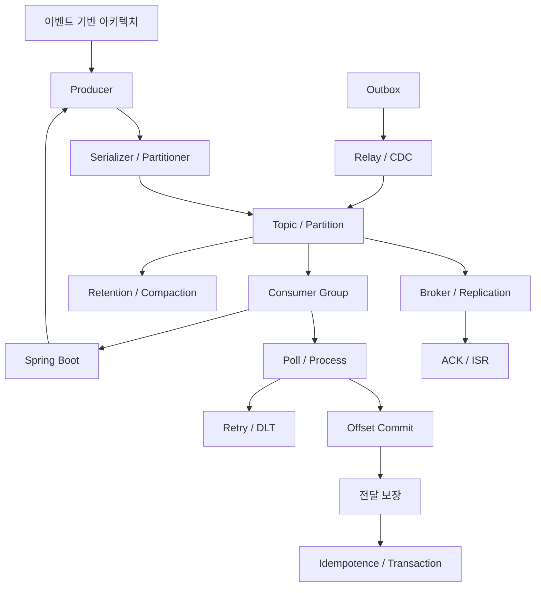

권장 학습 순서:
1. 이벤트 기반 아키텍처
2. Producer·Broker·Consumer
3. Topic·Partition·Record·Key·Offset
4. Producer 전송
5. Leader/Follower·ACK·ISR
6. Consumer Group·Partition Assignment
7. Poll·Offset Commit
8. Lag·Rebalance
9. Retry·DLT
10. Idempotence·Transaction
11. Retention·Compaction
12. Outbox·CDC
13. Spring Kafka
14. MSA 주문 사례
15. 운영·장애 대응

혼동 주의:
| 개념 | 구분 |
|---|---|
| Topic / Partition | 논리 분류 / 로그·병렬 처리 단위 |
| Broker / Controller | 데이터 요청·저장 / 메타데이터 제어 |
| Offset / Committed Offset | 로그 위치 / Group이 저장한 다음 읽기 위치 |
| ACK / ISR | Producer 응답 수준 / 동기화 Replica 집합 |
| Idempotence / Transaction | 재시도 중복 방지 / 여러 쓰기·Offset의 원자성 |
| Outbox / CDC | DB 이벤트 저장 패턴 / DB 변경 감지 기술 |
| Retention / Compaction | 보존·삭제 정책 / Key별 최신 상태 중심 정리 |

[출처: IMG-41~IMG-64]

# 19. 핵심 내용 정리

1. Producer는 이벤트를 생성해 Topic으로 전송한다.
2. Topic은 Partition으로 나뉘며 Partition은 순서가 있는 로그다.
3. Key는 관련 레코드를 같은 Partition으로 라우팅하는 데 활용된다.
4. Offset은 Partition 내부 레코드 위치다.
5. Broker는 로그 저장과 읽기·쓰기 요청을 처리한다.
6. KRaft Controller는 클러스터 메타데이터를 관리한다.
7. Leader/Follower는 Partition 데이터를 복제한다.
8. ACK와 ISR은 내구성과 쓰기 가능 조건에 영향을 준다.
9. Consumer는 Pull 방식으로 데이터를 가져온다.
10. Consumer Group은 Partition을 나눠 병렬 처리한다.
11. Offset Commit 시점에 따라 중복·누락 위험이 달라진다.
12. Lag은 Consumer가 최신 로그 위치를 따라가지 못하는 정도다.
13. Idempotence는 Producer 내부 재시도 중복을 줄인다.
14. Transaction은 Kafka 내부 여러 쓰기와 Offset을 원자적으로 반영할 수 있다.
15. Retry·DLT는 실패 메시지를 운영 가능한 방식으로 관리한다.
16. Retention과 Compaction은 목적이 다르다.
17. Outbox는 이중 쓰기 문제를 완화하고 CDC는 DB 변경을 전달한다.
18. Spring Kafka는 Spring 애플리케이션에서 Kafka Producer·Consumer를 사용하도록 지원한다.
19. MSA 주문 처리에는 상태 추적·멱등성·보상 처리가 중요하다.
20. Kafka 운영은 지표·보안·복구 정책을 함께 관리해야 한다.

# 20. 공식 참고 자료

1. Apache Kafka 4.1 Documentation: https://kafka.apache.org/41/documentation/
2. Kafka Design: https://kafka.apache.org/41/design/design/
3. Producer Configs: https://kafka.apache.org/41/configuration/producer-configs/
4. Consumer Configs: https://kafka.apache.org/41/configuration/consumer-configs/
5. KRaft: https://kafka.apache.org/41/operations/kraft/
6. Transaction Protocol: https://kafka.apache.org/41/operations/transaction-protocol/
7. Spring for Apache Kafka: https://docs.spring.io/spring-kafka/reference/

---

# 부록 A. 이미지별 인벤토리 및 원문 인덱스

| 이미지 | 원본 주요 제목·주제 | 유형 | 문서 위치 | 판독 |
|---|---|---|---|---|
| IMG-41 | Kafka 분산 메시징 처리 시스템: 개요, Producer·Consumer, Topic·Partition·Replica | 개념도·표 | 1, 2, 3 | 정상 |
| IMG-42 | 동기 HTTP와 비동기 이벤트: 대기, Backlog, 이벤트 발행 | 흐름도·비교표 | 1 | 정상 |
| IMG-43 | Broker와 KRaft Controller: 역할, Quorum, 장애 | 구조도 | 2, 5 | 정상 |
| IMG-44 | Topic·Partition·Offset: 로그와 읽기 위치 | 구조도 | 3, 7 | 정상 |
| IMG-45 | Record와 이벤트 계약: Key·Value·Timestamp·Headers, Event·Command, 스키마 | 표·코드 | 3, 15 | 정상 |
| IMG-46 | Partition 선택과 순서: Key·무키 레코드·순서 범위·Hot Key | 구조도 | 3 | 정상 |
| IMG-47 | Producer 파이프라인: 직렬화·배치·압축·비동기·Callback | 흐름도 | 4, 11 | 정상 |
| IMG-48 | acks와 쓰기 내구성: acks=0/1/all, ISR, RF, min ISR | 표·구조도 | 5, 9 | 정상 |
| IMG-49 | Leader·Follower와 장애 복구: 복제 지연·Unclean Election | 구조도·표 | 5 | 정상 |
| IMG-50 | Consumer Poll·처리·Commit, 오래 걸리는 처리와 비동기 주의 | 순서도 | 6, 7 | 정상 |
| IMG-51 | Consumer Group과 병렬 처리: 독립 구독·할당·상한 | 구조도·표 | 6 | 정상 |
| IMG-52 | Offset Commit과 재처리: 다음 위치·중복·초기 위치 reset | 구조도·표 | 7 | 정상 |
| IMG-53 | Rebalance와 파티션 소유권: 재할당·영향·관찰 지표 | 흐름도·표 | 6, 17 | 정상 |
| IMG-54 | 메시지 전달 보장: At-most/At-least once, Idempotence, EOS 범위 | 비교표·구조도 | 9, 10 | 정상 |
| IMG-55 | Kafka Transaction: begin/send/offset/commit·abort | 흐름도 | 10 | 정상 |
| IMG-56 | DB-Kafka Outbox: 이중 쓰기·Outbox·Relay·CDC·중복 발행 | 구조도·표 | 13 | 정상 |
| IMG-57 | Retry·DLT·독성 메시지: 실패 분류·재시도·보관·재처리 | 흐름도·표 | 11, 17 | 정상 |
| IMG-58 | Retention·Log Compaction·Tombstone·Replay | 구조도·표 | 12 | 정상 |
| IMG-59 | Consumer Lag과 용량 계산: 유입·처리 속도·복구 여유 | 그래프·계산 | 8 | 정상 |
| IMG-60 | Spring Boot Kafka 연동: KafkaTemplate·Listener·설정 | 구조도·코드·표 | 14 | 정상 |
| IMG-61 | 분산 주문 처리: 접수·재고 예약·결제·보상·추적 계약 | 업무 흐름도 | 15 | 정상 |
| IMG-62 | 운영 지표·연결·보안: Producer/Broker/Consumer, listeners, TLS/SASL/ACL | 표·구조도 | 16 | 정상 |
| IMG-63 | 장애 실습과 관찰 기준: Broker·Consumer·Rebalance·지연 | 실습·표 | 17 | 정상 |
| IMG-64 | Kafka 최종 개념 지도·확인 질문·공식 참고 링크 | 개념도·질문 | 18~20 | 정상 |

# 부록 B. 분산 개념 통합 내역

| 통합 개념 | 이미지 | 통합 위치 | 처리 방식 |
|---|---|---|---|
| 이벤트 기반 메시징 | 41, 42, 61 | 1, 15 | 개요·통신 방식·업무 사례 연결 |
| Broker와 KRaft | 41, 43, 62 | 2, 16 | 역할·운영 정보 통합 |
| Topic·Partition·Offset | 41, 44, 45, 46, 64 | 3 | 저장·레코드·순서·위치 |
| Producer 전송 | 47, 48, 54 | 4, 5, 9 | 전송과 신뢰성 구분 |
| 복제·ACK·ISR | 43, 48, 49, 62 | 5, 16 | 정상 복제와 장애 복구 |
| Consumer·Group | 50, 51, 53 | 6 | Poll·할당·Rebalance |
| Offset·Commit | 44, 50, 52, 54 | 7, 9 | 위치와 처리 보장 |
| Lag·처리량 | 50, 59, 63 | 8, 17 | 지표와 장애 실습 |
| 전달 보장·Transaction | 48, 54, 55, 64 | 9, 10 | 보장 수준과 적용 범위 |
| Retry·DLT | 47, 57, 63 | 11, 17 | 재시도·격리·재처리 |
| Retention·Compaction | 58, 59 | 12, 8 | 보존·정리·복구 여유 |
| Outbox·CDC | 56, 61 | 13, 15 | DB 이중 쓰기·업무 이벤트 |
| Spring Kafka | 60 | 14 | Producer·Listener·설정 |
| 주문 이벤트 흐름 | 41, 45, 61 | 15 | 이벤트 계약·서비스 간 흐름 |
| 운영·장애 | 62, 63 | 16, 17 | 지표·보안·실습 |

# 부록 C. 기술적 검토 및 검수

## C.1 주요 기술적 보완
- Topic이 Broker마다 분할된다는 오해를 막기 위해 Partition replica의 Broker 배치로 설명했다.
- Broker와 KRaft Controller의 역할을 구분했다.
- Key 없는 레코드가 항상 무작위 균등 분배된다는 단정을 피했다.
- Offset Commit이 다음 읽기 위치를 나타낸다는 점을 명시했다.
- Consumer Group 병렬성은 Partition 수의 영향을 받는다고 설명했다.
- `acks=all`은 현재 ISR과 `min.insync.replicas`를 함께 고려한다고 설명했다.
- Producer Idempotence와 업무 멱등성을 구분했다.
- Kafka Transaction과 외부 DB/API의 원자성을 구분했다.
- Retention은 Segment 단위 정리, Compaction은 Key별 상태 정리라고 구분했다.
- Outbox는 패턴, CDC는 변경 감지·전달 기술이라고 구분했다.
- `@KafkaListener`는 Listener Container가 Poll한 레코드를 전달한다고 설명했다.

## C.2 예시값 주의
이미지에 나타난 Controller 3개, RF=3, min ISR=2, Producer 1,000건/초, Consumer 800건/초, Lag 60,000, Retry 3회, 5초·30초·5분, Hot Key 90/5/5는 교육용 예시다. 모든 환경에 적용되는 고정 설정이 아니다.

## C.3 원문 보존 범위에 대한 정직한 고지
24장 모두를 확인하고 제목·주요 설명·구성 요소·흐름·예시 수치·핵심 설정을 인벤토리와 본문에 반영했다. 다만 본 파일은 이미지의 핵심 기술 정보를 재구성한 학습용 분석본이며, 이미지 안의 모든 작은 글씨를 한 글자씩 전사한 OCR 전문은 아니다. 코드 예시는 이미지의 구성과 의도를 설명하기 위해 재작성한 부분이 있으므로 원본 코드의 완전한 복제본으로 간주하면 안 된다.

## C.4 완료 체크
- [x] ZIP 내부 24장 확인 (41.png~64.png)
- [x] 이미지별 제목·핵심 주제·유형 인벤토리
- [x] 분산 개념을 학습 순서로 통합
- [x] 목차와 이미지 출처 연결
- [x] Mermaid 흐름도 재구성
- [x] 개념 예시 코드·설정 작성
- [x] 기술적 오해 가능성 검토
- [x] 중복 통합 내역 작성
- [x] 확인·보완 사항 작성
- [ ] 원본 이미지 모든 문장을 글자 단위로 전사한 OCR 전문 부록
- [ ] 실제 구현 직전 사용 중인 Kafka·Spring Kafka 버전에 맞춘 설정 재검증
