# Debezium CDC 완전 분석 및 학습 문서 (IMG-65~IMG-92)

## 문서 정보
- 기술 분야: Debezium CDC (Change Data Capture)
- 전체 이미지: 28장
- 분석 범위: IMG-65~IMG-92
- 문서 목적: 기술 학습 및 팀원 대상 발표
- 이미지에 표시된 기준 버전: Debezium 3.4 계열, Kafka Connect 4.0 / Kafka 4.0 표기
- 문서 버전: 1.0

> **원문과 보충 설명 구분**
> - **[원문]**: 이미지에서 확인한 개념·설정·도식·예시
> - **[보충 설명]**: 이해와 구현을 돕기 위해 추가한 설명
> - **[기술적 검토]**: 원문을 오해하지 않도록 버전·동작 조건을 명확히 하거나 정정한 내용
> - **[확인 필요]**: DB 버전, Debezium Connector 버전, Kafka Connect 배포 방식에 따라 달라지는 항목

---

## 목차

1. CDC와 Debezium 전체 구조
2. CDC 방식 비교: Polling, Trigger, Log 기반
3. Kafka Connect와 Debezium 실행 구조
4. 데이터베이스별 변경 로그 수집
5. PostgreSQL CDC 사전 준비
6. Initial Snapshot과 Streaming 전환
7. Incremental Snapshot과 재수집
8. Debezium 변경 이벤트 구조
9. INSERT·UPDATE·DELETE·Tombstone
10. Topic·Key·Partition 설계
11. Offset의 세 가지 위치와 복구 기준
12. Kafka Connect 내부 상태와 Schema History
13. 전달 보장과 Exactly-once 검토
14. DB 트랜잭션과 이벤트 순서
15. Schema Evolution과 데이터 타입
16. SMT와 이벤트 평탄화
17. Transactional Outbox
18. Outbox Event Router 매핑
19. 로그 보존·Heartbeat·Replication Slot
20. 장애 복구와 재동기화
21. CDC 파이프라인 모니터링
22. 구성 선택과 데이터 보호
23. 실습 시나리오와 관찰 포인트
24. DLT: 실패 레코드 격리 경로
25. Debezium Source와 Sink DLQ의 경계
26. Kafka Connect Sink DLQ 설정 읽기
27. DLQ 재처리와 복구 완료 검증
28. 핵심 내용 정리와 학습 순서
29. 공식 참고 자료
- 부록 A. 이미지별 인벤토리
- 부록 B. 분산 개념 통합 내역
- 부록 C. 기술적 검토 및 확인 사항

---

# 1. CDC와 Debezium 전체 구조

## 1.1 CDC란?

CDC(Change Data Capture)는 데이터베이스에서 발생한 데이터 변경을 감지하여 다른 시스템으로 전달하는 기술·패턴이다. 변경 사항을 주기적으로 전체 조회하는 대신 INSERT, UPDATE, DELETE 등 실제 변경을 추적해 전달한다.

**[원문]** Debezium은 데이터베이스의 변경 로그를 읽어 변경 이벤트로 변환하고, Kafka Connect를 통해 Kafka Topic으로 전달한다. downstream Consumer는 해당 이벤트를 읽어 검색 인덱스, 캐시, 분석 저장소, 다른 서비스 DB 등에 반영할 수 있다.

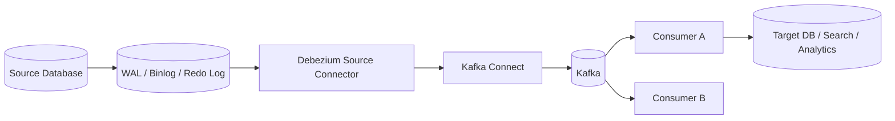

CDC의 핵심은 **원본 DB의 변경 사실을 다른 시스템에 전달하는 것**이다. Debezium은 데이터베이스 자체를 대체하지 않으며, 원본 DB에 저장된 업무 데이터의 변경을 추적한다.

[출처: IMG-65, IMG-86]

## 1.2 Debezium의 전체 구성

| 구성 요소 | 역할 |
|---|---|
| Source Database | 실제 업무 데이터가 저장되는 원본 DB |
| Database Transaction Log | DB가 기록한 변경 내역. 예: PostgreSQL WAL, MySQL Binlog |
| Debezium Source Connector | DB 로그를 읽고 Debezium Change Event로 변환 |
| Kafka Connect Worker | Connector와 Task를 실행하는 런타임 |
| Kafka Topic | 변경 이벤트를 저장·전달하는 메시지 저장소 |
| Consumer | Kafka 이벤트를 읽어 후속 시스템에 반영 |
| Target System | 검색 엔진, 분석 DB, 캐시, 다른 서비스 DB 등 |

## 1.3 Debezium을 사용하는 이유

- 전체 테이블을 반복 조회하는 방식보다 변경분 중심으로 전달할 수 있다.
- 원본 DB와 후속 시스템 간 데이터 동기화 파이프라인을 구성할 수 있다.
- 여러 Consumer가 동일한 변경 이벤트를 각자의 목적으로 활용할 수 있다.
- 애플리케이션의 모든 데이터 변경 지점에 별도 이벤트 발행 코드를 넣지 않고도 DB 변경을 포착할 수 있다.
- Outbox 패턴과 결합하면 업무 트랜잭션과 이벤트 발행 의도를 일관되게 관리할 수 있다.

**[기술적 검토]** CDC가 원본 DB와 대상 DB를 자동으로 완전한 동기 상태로 유지하는 것은 아니다. 이벤트 지연, 재시도, 중복, 스키마 변경, 대상 시스템 오류, 삭제 정책 등을 설계해야 한다.

[출처: IMG-65, IMG-86]

# 2. CDC 방식 비교: Polling, Trigger, Log 기반

## 2.1 Polling 기반 CDC

**[원문]** 일정 주기로 DB를 조회해 변경된 데이터를 찾는 방식이다.

예:
```sql
SELECT *
FROM orders
WHERE updated_at > :last_checked_time;
```

장점:
- DB의 로그 기능을 직접 다루지 않고 구현할 수 있다.
- 구현 개념이 단순하다.
- 기존 테이블과 `updated_at` 같은 컬럼을 활용할 수 있다.

한계:
- 조회 주기만큼 변경 전달이 늦어진다.
- 변경이 없는 시간에도 반복 조회한다.
- 같은 시각의 업데이트, 타임스탬프 정밀도, 삭제 데이터 추적이 어렵다.
- 대량 데이터에서는 조회 부하와 인덱스 관리가 중요하다.

## 2.2 Trigger 기반 CDC

**[원문]** DB Trigger가 INSERT·UPDATE·DELETE 발생 시 별도 변경 이력 테이블에 기록한다. 별도 프로세스가 변경 이력 테이블을 읽어 전달한다.

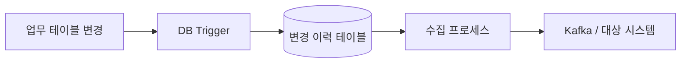

장점:
- 변경 시점에 기록하므로 Polling보다 빠르게 포착할 수 있다.
- 삭제 이벤트도 별도 이력으로 남길 수 있다.
- DB 로그 포맷을 직접 해석할 필요가 없다.

한계:
- Trigger가 업무 트랜잭션에 추가 부하를 줄 수 있다.
- Trigger와 이력 테이블의 운영·정합성을 관리해야 한다.
- DB 스키마 변경 시 Trigger도 함께 관리해야 한다.

## 2.3 Log 기반 CDC

**[원문]** DB가 트랜잭션을 위해 기록하는 로그를 읽어 변경 사항을 포착한다.

| DB | 변경 로그 / 기술 |
|---|---|
| PostgreSQL | WAL(Write-Ahead Log), Logical Decoding |
| MySQL | Binlog(Binary Log) |
| Oracle | Redo Log 등 DB 로그 기반 메커니즘 |
| SQL Server | Transaction Log 기반 CDC 메커니즘 |

장점:
- 업무 테이블을 반복 조회하지 않고 변경 로그를 기반으로 수집한다.
- INSERT·UPDATE·DELETE를 추적할 수 있다.
- 로그에 기록된 트랜잭션 순서를 기반으로 변경 이벤트를 구성할 수 있다.

주의:
- DB별 로그 기능과 설정이 다르다.
- 로그 보존 기간과 Connector 처리 위치를 함께 관리해야 한다.
- 권한·복제 슬롯·Binlog 설정 등 사전 조건이 필요하다.

**[기술적 검토]** Debezium의 대표적인 동작 방식은 Log 기반 CDC다. 다만 모든 DB Connector가 동일한 내부 구현을 쓰는 것은 아니다. DB 종류에 따라 Logical Decoding, Binlog, DB 전용 API 등 서로 다른 메커니즘을 사용한다.

## 2.4 방식 비교

| 구분 | Polling | Trigger | Log 기반 |
|---|---|---|---|
| 변경 감지 | 주기적 SELECT | DB Trigger | DB 로그 |
| 지연 | 조회 주기에 영향 | 낮게 구성 가능 | 로그 처리 지연에 영향 |
| DB 부하 | 반복 조회 | 쓰기 트랜잭션에 Trigger 부하 | 로그 읽기 및 DB 설정 부담 |
| 삭제 추적 | 별도 설계 필요 | 이력 테이블로 가능 | 로그 이벤트로 추적 |
| 구현·운영 | 비교적 단순 | DB 종속 구현 | 초기 설정과 운영 이해 필요 |

[출처: IMG-66]

# 3. Kafka Connect와 Debezium 실행 구조

## 3.1 Worker, Connector, Task

**[원문]**
- Worker: Kafka Connect 실행 프로세스다.
- Connector: 어떤 외부 시스템에서 데이터를 가져오거나 어디로 보낼지 정의한다.
- Task: 실제 데이터 수집·전송 작업을 수행하는 실행 단위다.

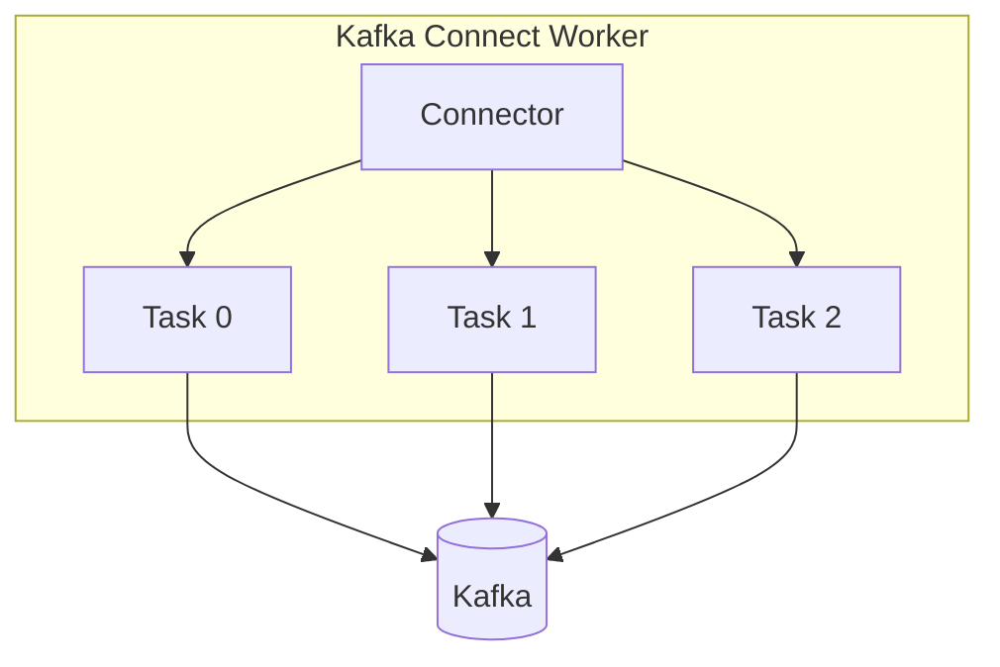

Source Connector는 외부 시스템에서 데이터를 읽어 Kafka로 보낸다. Sink Connector는 Kafka에서 데이터를 읽어 외부 시스템으로 보낸다.

## 3.2 Worker 배포 형태

- **Standalone:** 단일 Worker 프로세스로 실행한다. 설정이 단순하지만 Worker 자체 장애에 취약하다.
- **Distributed:** 여러 Worker가 하나의 Connect Cluster로 동작한다. Connector Task를 Worker에 분산 배치하고 Worker 장애 시 재할당할 수 있다.

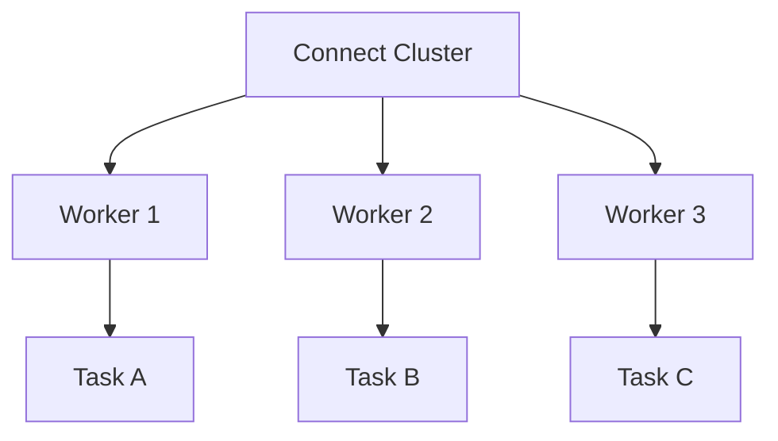

## 3.3 Task 수의 한계

**[원문]** Worker 수를 늘려도 Source Connector가 단일 Task만 지원하거나 DB 로그를 한 흐름으로 읽도록 설계되어 있다면 Task가 무한히 늘어나지 않는다.

**[기술적 검토]** Kafka Connect의 `tasks.max`는 Task 수의 상한을 요청하는 설정이지 모든 Connector가 그 수만큼 Task를 생성한다는 보장은 아니다. 실제 병렬성은 Connector 구현과 DB별 제약에 의해 결정된다. PostgreSQL Connector는 일반적으로 하나의 커넥터 작업 흐름으로 논리 복제 스트림을 읽는 특성이 있어 Task 수를 늘리는 것만으로 테이블별 병렬 수집이 보장되지 않는다.

## 3.4 분산 실행과 Offset

Distributed Worker는 Connector 설정·상태·Offset을 Connect 내부 Topic에 저장한다. Worker 장애 시 다른 Worker가 작업을 이어받을 수 있지만, Source DB 로그가 필요한 위치까지 보존되어 있어야 한다.

[출처: IMG-67]

# 4. 데이터베이스별 변경 로그 수집

## 4.1 PostgreSQL: WAL과 Logical Decoding

**[원문]** PostgreSQL은 WAL을 기록한다. Logical Decoding은 WAL의 변경을 논리적인 데이터 변경 이벤트로 해석할 수 있게 한다. Debezium PostgreSQL Connector는 Logical Replication 기능을 활용해 변경을 읽는다.

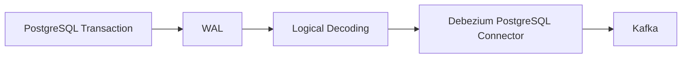

주요 용어:
- WAL: 장애 복구와 복제를 위해 DB 변경을 기록하는 로그.
- Logical Decoding: WAL을 논리적인 변경 스트림으로 변환하는 기능.
- Output Plugin: Logical Decoding 결과를 특정 형식으로 제공하는 플러그인.
- Replication Slot: Connector가 소비해야 할 로그 위치를 추적하고 필요한 WAL 보존에 관여하는 DB 객체.
- LSN(Log Sequence Number): WAL 위치를 나타내는 식별자.

## 4.2 MySQL: Binlog

**[원문]** MySQL은 Binlog에 데이터 변경 이벤트를 기록한다. Debezium MySQL Connector는 Binlog를 읽어 변경 이벤트를 생성한다.

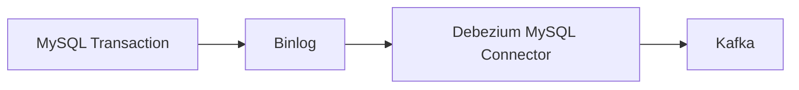

MySQL CDC 구성에서는 다음 항목을 확인한다.
- Binlog 활성화
- ROW 기반 기록 설정
- Binlog 보존 기간
- Connector 전용 계정과 권한
- Server ID 고유성 및 복제 관련 설정
- GTID 사용 여부와 복구 정책

**[기술적 검토]** PostgreSQL의 WAL/LSN과 MySQL의 Binlog File/Position 또는 GTID는 같은 역할을 가진 개념이 아니다. DB마다 로그 위치와 복구 방식이 다르다.

## 4.3 공통 원칙

Debezium은 DB 로그를 읽고 Kafka Connect SourceRecord로 변환한다. Kafka Connect는 이를 Kafka에 기록하고 Source Offset을 저장한다. 대상 Consumer는 Kafka 레코드를 별도로 처리한다.

[출처: IMG-68]

# 5. PostgreSQL CDC 사전 준비

## 5.1 WAL 설정

**[원문]** PostgreSQL CDC를 위해 WAL 관련 설정과 Logical Replication 기능을 준비한다.

대표 설정 예시:
```conf
wal_level = logical
max_replication_slots = 10
max_wal_senders = 10
```

- `wal_level=logical`: Logical Decoding에 필요한 정보를 WAL에 기록한다.
- `max_replication_slots`: 동시에 사용할 수 있는 Replication Slot 수의 상한을 설정한다.
- `max_wal_senders`: WAL Sender 프로세스의 최대 수를 설정한다.

**[기술적 검토]** 숫자 10은 이미지의 설명용 예시이며 운영 환경의 고정 권장값이 아니다. Connector 수, 다른 복제 구성, DB 자원, 장애 복구 계획에 맞춰 산정한다.

## 5.2 Publication

Publication은 Logical Replication에서 어떤 테이블의 변경을 발행할지 정의하는 DB 객체다.

예:
```sql
CREATE PUBLICATION dbz_publication
FOR TABLE public.orders, public.order_items;
```

전체 테이블을 대상으로 하는 구성도 가능하지만, 실제 설정 방식은 Connector 설정과 PostgreSQL 버전에 맞춰야 한다.

## 5.3 Replication Slot

Replication Slot은 Connector가 읽어야 할 WAL 위치를 DB가 추적하도록 한다. Connector가 중단되어도 필요한 WAL이 즉시 제거되지 않도록 보호하는 역할을 한다.

주의:
- Connector가 장기간 중단되면 WAL이 계속 보존되어 디스크가 급증할 수 있다.
- Slot이 비활성화되거나 오래된 위치에 머무르는지 모니터링해야 한다.
- 불필요한 Slot을 무작정 삭제하면 Connector 복구가 어려워질 수 있다.

## 5.4 권한과 연결

필요 항목:
- DB 접속 계정
- Replication 권한
- 대상 Schema·Table 조회 권한
- Publication·Replication Slot 생성 또는 사용 권한
- 네트워크 방화벽과 TLS
- Connector 설정의 hostname, port, database, user, password

**[기술적 검토]** 운영에서 Superuser 권한을 Connector 계정에 무조건 부여하는 것은 바람직하지 않다. 필요한 최소 권한을 식별해 전용 계정에 부여한다.

[출처: IMG-69]

# 6. Initial Snapshot과 Streaming 전환

## 6.1 Snapshot이 필요한 이유

DB 로그는 일반적으로 무한정 보관되지 않는다. Connector가 과거부터 존재하지 않았다면 현재 WAL/Binlog만 읽어서는 기존 테이블의 전체 상태를 알 수 없다. 따라서 Debezium은 최초 수집 시 테이블의 현재 데이터를 Snapshot으로 읽어 Kafka에 전달한 뒤 변경 로그 Streaming으로 전환한다.

## 6.2 Initial Snapshot 흐름

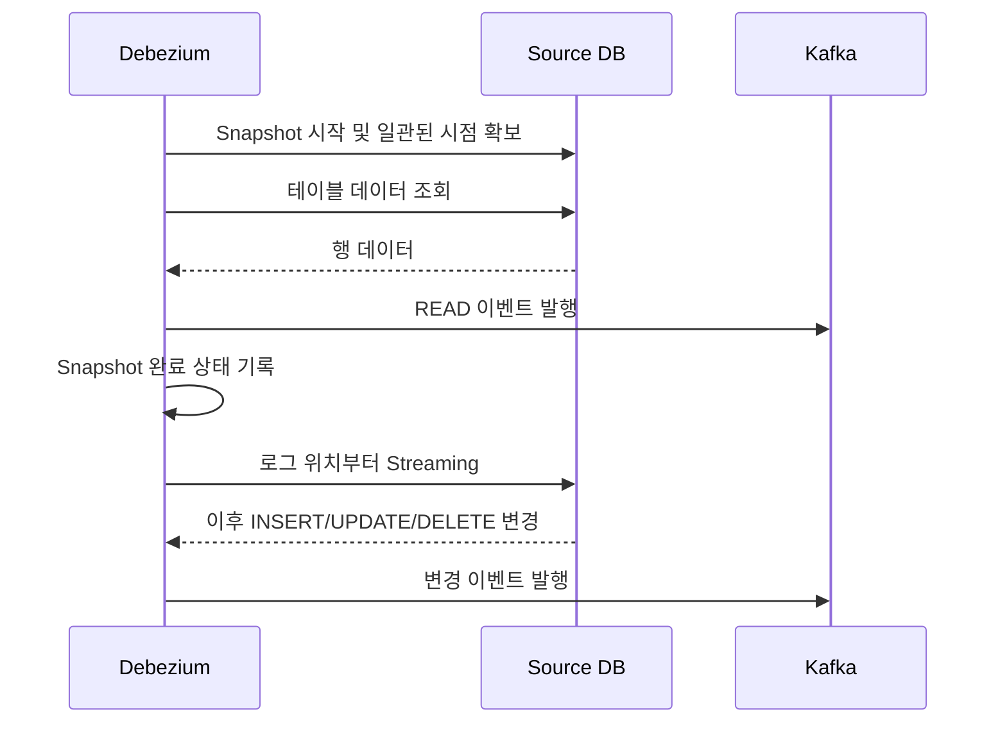

일반적인 개념 흐름:
1. Snapshot 트랜잭션 또는 일관된 읽기 기준을 확보한다.
2. DB 로그의 기준 위치를 확보한다.
3. 대상 테이블과 행을 읽는다.
4. Snapshot 데이터에 대한 `READ` 이벤트를 발행한다.
5. Snapshot 완료 및 Offset 상태를 기록한다.
6. 확보한 로그 위치를 기준으로 Streaming을 이어간다.

## 6.3 Snapshot과 Streaming의 차이

| 구분 | Snapshot | Streaming |
|---|---|---|
| 목적 | 기존 데이터의 기준 상태 수집 | 이후 변경분 지속 수집 |
| 데이터 | 테이블의 현재 행 | INSERT·UPDATE·DELETE 등 변경 |
| 시점 | 초기 또는 별도 요청 시 | 지속적으로 실행 |
| 이벤트 예 | `op=r` | `op=c/u/d` |

## 6.4 전환 시 데이터 정합성

Snapshot 도중 DB에 신규 변경이 발생할 수 있다. Debezium은 Snapshot 기준 위치와 로그 Streaming 위치를 연계해 Snapshot 이후 변경을 이어서 처리한다.

**[기술적 검토]** Snapshot이 단순히 테이블을 읽고 끝난 다음 WAL의 맨 끝부터 시작하는 구조라고 이해하면 안 된다. Snapshot의 일관성 기준 시점과 로그 위치를 연결해야 변경 누락을 방지할 수 있다. 세부 절차는 Connector와 DB에 따라 다르다.

## 6.5 Snapshot 모드

대표적인 PostgreSQL `snapshot.mode` 개념:
- `initial`: Offset이 없을 때 초기 Snapshot을 수행하고 이후 Streaming.
- `always`: Connector 시작 시 Snapshot을 수행하는 모드.
- `initial_only`: 초기 Snapshot 후 Streaming을 계속하지 않고 종료.
- `no_data`: Snapshot 데이터 없이 로그 Streaming을 시작하는 모드. 필요한 변경 로그가 존재한다는 전제가 중요하다.
- `when_needed`: Offset이 없거나 필요한 로그 위치를 사용할 수 없는 경우 등 조건에 따라 Snapshot.

**[확인 필요]** Snapshot 모드 이름과 지원 범위는 Debezium 버전에 따라 달라질 수 있다. 이미지의 3.4 계열 기준 설정은 실제 배포하는 3.4.x 공식 문서에서 재확인한다.

[출처: IMG-70]

# 7. Incremental Snapshot과 재수집

## 7.1 Incremental Snapshot이란?

Initial Snapshot은 많은 테이블과 데이터를 한 번에 읽어야 할 수 있다. Incremental Snapshot은 대상 테이블을 Chunk 단위로 나누어 점진적으로 읽는 방식이다. Streaming을 완전히 멈추지 않고 Snapshot 작업을 병행할 수 있도록 설계되어 있다.

## 7.2 Chunk 처리

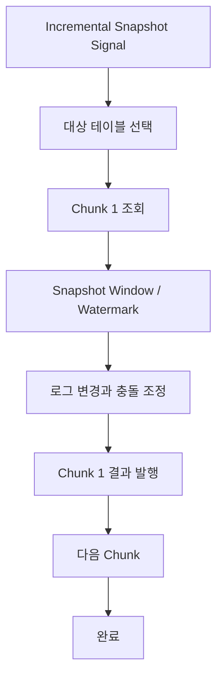

- 대상 테이블을 지정한다.
- PK 또는 Connector가 지원하는 정렬 기준을 이용해 Chunk 범위를 나눈다.
- Chunk별 Snapshot 데이터를 읽는다.
- Snapshot 중 같은 행에 대한 Streaming 이벤트가 도착하면 충돌을 조정한다.
- Chunk 처리를 반복한다.

## 7.3 Snapshot Window와 Watermark

**[원문]** Snapshot Window는 특정 Chunk를 읽는 동안 Snapshot에서 읽은 행과 실시간 Streaming 변경이 겹치는 상황을 조정하는 구간이다. 동일 Key에 대해 Snapshot `READ`와 이후 UPDATE/DELETE가 충돌할 경우 최신 Streaming 변경이 오래된 Snapshot 결과를 덮어쓰지 않도록 처리한다.

**[기술적 검토]** Incremental Snapshot은 단순히 테이블을 여러 번 나누어 SELECT하는 기능만이 아니다. Watermark와 Snapshot Window를 사용해 Snapshot 결과와 Streaming 이벤트 간 충돌을 해결하는 것이 핵심이다.

## 7.4 Signal

Incremental Snapshot은 Signal을 통해 시작할 수 있다.
- DB Signal Table에 명령 기록
- Kafka Signal Topic에 명령 발행

Signal에는 Snapshot 유형과 대상 Data Collection(테이블) 정보가 포함될 수 있다.

**[확인 필요]** Signal 채널, 읽기 전용 Incremental Snapshot 지원, 필요한 권한은 Connector 종류와 Debezium 버전에 따라 다르다.

## 7.5 재수집 시 주의

- Snapshot 재실행 시 downstream에서 동일 데이터가 다시 도착할 수 있다.
- Consumer는 이벤트 중복과 Snapshot `READ` 이벤트를 처리할 수 있어야 한다.
- 대량 Snapshot은 DB 부하와 Kafka 처리량에 영향을 준다.
- 대상 테이블과 Chunk 크기를 제한하고 진행 상태를 관찰한다.

[출처: IMG-71]

# 8. Debezium 변경 이벤트 구조

## 8.1 Key와 Envelope

Debezium 변경 이벤트는 일반적으로 Key와 Value로 구성된다.

- **Key:** 변경된 행을 식별하는 Primary Key 등.
- **Value/Envelope:** 변경 연산, 변경 전·후 데이터, Source 메타데이터, Timestamp 등을 담는다.

예시 개념:
```json
{
  "before": {
    "id": 42,
    "status": "PENDING"
  },
  "after": {
    "id": 42,
    "status": "PAID"
  },
  "source": {
    "db": "commerce",
    "schema": "public",
    "table": "orders"
  },
  "op": "u",
  "ts_ms": 1734449400000
}
```

## 8.2 before와 after

| 항목 | 의미 |
|---|---|
| `before` | 변경 전 행 상태 |
| `after` | 변경 후 행 상태 |
| `source` | 변경이 발생한 DB·Schema·Table·로그 위치 등 메타데이터 |
| `op` | 변경 연산 유형 |
| `ts_ms` | 이벤트 관련 시간 정보 |

`before` 데이터의 제공 여부와 상세 필드는 DB 및 Connector 설정에 따라 다를 수 있다.

## 8.3 Operation 코드

| op | 의미 |
|---|---|
| `c` | Create / INSERT |
| `u` | Update |
| `d` | Delete |
| `r` | Read / Snapshot |

## 8.4 Source 메타데이터

**[원문]** Source 정보에는 DB, Schema, Table, 로그 위치 등 변경 출처를 추적하는 정보가 포함될 수 있다.

예:
```json
{
  "source": {
    "version": "3.4.x",
    "connector": "postgresql",
    "name": "commerce",
    "db": "commerce",
    "schema": "public",
    "table": "orders",
    "lsn": 123456789
  }
}
```

위 JSON은 필드 구성을 설명하기 위한 축약 예시다. 실제 Source 구조는 Connector·DB 버전에 따라 달라진다.

[출처: IMG-72]

# 9. INSERT·UPDATE·DELETE·Tombstone

## 9.1 INSERT

새 행이 추가되면 `op=c` 이벤트가 발생한다. `before`는 일반적으로 null이고 `after`에 신규 행 데이터가 포함된다.

```json
{
  "before": null,
  "after": {"id": 42, "status": "PENDING"},
  "op": "c"
}
```

## 9.2 UPDATE

기존 행이 수정되면 `op=u` 이벤트가 발생한다. `before`와 `after`에 변경 전후 상태가 포함될 수 있다.

```json
{
  "before": {"id": 42, "status": "PENDING"},
  "after": {"id": 42, "status": "PAID"},
  "op": "u"
}
```

## 9.3 DELETE

행이 삭제되면 `op=d` 이벤트가 발생한다. `before`에 삭제 직전 데이터가 포함될 수 있으며 `after`는 null이다.

```json
{
  "before": {"id": 42, "status": "PAID"},
  "after": null,
  "op": "d"
}
```

## 9.4 Tombstone

Kafka에서 Compacted Topic을 사용할 때 Debezium은 삭제 이벤트 이후 동일 Key에 Value가 null인 Tombstone 레코드를 발행할 수 있다. Tombstone은 해당 Key의 이전 값을 Compaction 대상으로 표시한다.

```text
Key = {"id": 42}
Value = null
```

**[기술적 검토]**
- Debezium의 DELETE 이벤트와 Kafka Tombstone은 같은 것이 아니다.
- DELETE 이벤트는 Envelope의 `op=d`와 삭제 전 정보 등을 전달한다.
- Tombstone은 Kafka Compaction에서 Key를 제거하도록 하는 null Value 레코드다.
- Tombstone 발행 여부와 시점은 `tombstones.on.delete` 등 Connector 설정에 영향을 받는다.

## 9.5 소비자 처리

Consumer는 `op`에 따라 대상 시스템의 INSERT/UPSERT/DELETE를 수행한다. Snapshot `r` 이벤트는 초기 상태 적재로 취급할 수 있다. 이벤트를 재처리할 가능성이 있으므로 Key 기반 Upsert 또는 이벤트 ID 기반 멱등 처리가 중요하다.

[출처: IMG-73]

# 10. Topic·Key·Partition 설계

## 10.1 Topic 이름

Debezium의 기본 Topic 이름은 Connector의 Topic Prefix/Logical Name, Schema, Table 등의 조합으로 만들어질 수 있다.

예시 개념:
```text
shop.public.orders
shop.public.order_items
```

실제 이름은 `topic.prefix` 및 Connector 버전·설정에 따라 결정된다.

## 10.2 Key 설계

**[원문]** 이벤트 Key는 변경된 DB 행의 식별자를 바탕으로 구성한다. 일반적으로 Primary Key가 활용된다.

Key가 동일한 이벤트는 기본 Key 기반 Partitioner에서 같은 Partition으로 라우팅되므로 동일 행의 변경 순서를 유지하는 데 유리하다.

## 10.3 Partition과 순서

- Partition 내부 순서만 보장된다.
- 같은 Key가 같은 Partition에 들어가도록 설계하면 동일 행 변경 순서를 보존하기 쉽다.
- 서로 다른 행 또는 Partition 간 전역 순서는 보장되지 않는다.
- Primary Key가 변경되거나 Key 구조가 바뀌면 이전·신규 Key 이벤트의 관계를 고려해야 한다.

## 10.4 Hot Partition

특정 Key 또는 특정 테이블에 변경이 집중되면 한 Partition에 부하가 몰릴 수 있다. Partition 수를 늘리는 것만으로 단일 Hot Key 병목이 해결되는 것은 아니다.

## 10.5 보존 정책

Topic 보존은 downstream 재처리 기간과 복구 목표에 맞춰 설계한다. Compaction을 사용할 경우 Key별 최신 상태가 목적에 맞는지 확인한다. 변경 이력 전체가 필요한 경우 단순 Compaction이 적합하지 않을 수 있다.

[출처: IMG-74]

# 11. Offset의 세 가지 위치와 복구 기준

## 11.1 세 가지 위치

**[원문]** CDC 파이프라인에는 서로 다른 세 위치를 구분해야 한다.

1. DB 로그 위치: Source DB의 WAL LSN 또는 Binlog Position/GTID.
2. Source Offset: Debezium이 어디까지 읽고 처리했는지를 Kafka Connect가 저장하는 위치.
3. Consumer Offset: Kafka Consumer Group이 Kafka Topic에서 어디까지 소비했는지 저장하는 위치.

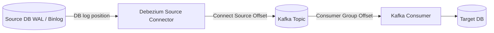

## 11.2 서로 다른 Offset

| 위치 | 관리 주체 | 의미 |
|---|---|---|
| DB Log Position | DB와 Connector | 원본 변경 로그의 읽기 위치 |
| Connect Source Offset | Kafka Connect | Source Connector 진행 위치 |
| Consumer Offset | Kafka Consumer Group | Kafka Topic 소비 위치 |

**[기술적 검토]** 세 Offset을 하나의 숫자나 같은 의미로 취급하면 안 된다. PostgreSQL LSN과 Kafka Offset은 서로 다른 좌표계다.

## 11.3 복구 기준

Connector 재시작 시 Source Offset과 DB 로그 보존 상태를 확인한다. Consumer 재시작 시 Consumer Group Offset과 Kafka Topic Retention을 확인한다. 대상 DB 반영이 Offset Commit보다 늦거나 빠른 경우 중복·누락 가능성을 별도로 검토한다.

## 11.4 복구 확인

- Connector가 마지막으로 저장한 Source Offset
- DB 로그가 해당 위치까지 보존되는지
- Replication Slot 또는 Binlog가 유효한지
- Kafka Topic에 이벤트가 기록되었는지
- Consumer Group의 Committed Offset
- 대상 DB에 이벤트가 반영되었는지

[출처: IMG-75]

# 12. Kafka Connect 내부 상태와 Schema History

## 12.1 Kafka Connect 내부 Topic

Distributed Kafka Connect는 운영 상태를 저장하기 위해 내부 Topic을 사용한다.

| 내부 Topic | 역할 |
|---|---|
| Config Topic | Connector 설정 저장 |
| Offset Topic | Source Connector 진행 Offset 저장 |
| Status Topic | Connector·Task 상태 저장 |

이 Topic들은 일반 업무 이벤트 Topic과 구분하여 접근 권한·Replication·Retention·백업 정책을 설계한다.

## 12.2 Schema History

Debezium은 변경 로그를 해석할 때 테이블 구조가 어떻게 바뀌었는지 알아야 한다. Schema History는 DB 스키마 변경 이력을 추적하는 데 사용된다.

예:
1. `orders` 테이블에 `status` 컬럼 존재
2. `amount` 컬럼 추가
3. Connector가 변경된 Schema를 인식
4. 이후 변경 이벤트를 새로운 구조에 맞게 해석

**[기술적 검토]** Schema History Topic과 Kafka Connect Config/Offset/Status Topic은 목적이 다르다. 모두 내부 운영에 중요하지만 서로 대체할 수 없다. Schema History의 구체적인 저장·복구 방식은 Connector와 버전에 따라 확인한다.

## 12.3 Schema Registry와의 차이

- Debezium Schema History: Source DB 스키마 변경을 Connector가 추적·해석하기 위한 기록.
- Schema Registry: Kafka 메시지 Schema의 등록·버전·호환성을 관리하는 별도 서비스.

두 기능은 연계할 수 있지만 같은 구성 요소가 아니다.

## 12.4 상태 보호와 이름 변경

Connector 설정 이름, Topic Prefix, 내부 Topic 이름을 변경하면 기존 Offset·Schema History와 연결이 끊길 수 있다. 운영 중 임의 변경하지 말고 변경 영향과 재Snapshot 필요성을 검토한다.

[출처: IMG-76]

# 13. 전달 보장과 Exactly-once 검토

## 13.1 전달 보장 관점

CDC 파이프라인의 전달 보장은 Source DB → Debezium → Kafka → Consumer → Target DB 전체를 나누어 생각해야 한다.

- Source Connector가 DB 로그를 읽은 위치를 저장한다.
- Kafka에 이벤트를 발행한다.
- Consumer가 이벤트를 처리하고 Offset을 Commit한다.
- Target DB 반영과 Consumer Offset Commit의 순서를 결정한다.

## 13.2 At-least-once와 중복

장애 상황에서 Kafka 발행 성공 후 Source Offset 저장이 완료되지 않으면 같은 Source 이벤트가 다시 발행될 수 있다. Consumer 처리 후 Consumer Offset Commit 전에 장애가 나면 동일 Kafka 레코드를 다시 처리할 수 있다.

따라서 중복은 파이프라인 여러 경계에서 발생할 수 있다.

## 13.3 Idempotence와 Exactly-once

- Kafka Producer Idempotence: Producer 재시도에 의한 Kafka 중복 기록을 줄인다.
- Kafka Transaction: Kafka 내부 출력 레코드와 Offset 처리의 원자성에 활용한다.
- Consumer 멱등성: 같은 이벤트가 여러 번 도착해도 대상 업무 결과가 중복 반영되지 않게 한다.
- End-to-end Exactly-once: 원본 DB, Kafka, 외부 대상 DB/API를 포함한 전체 경계에서 달성 여부를 별도로 검증해야 한다.

**[기술적 검토]** “Debezium을 사용하면 CDC가 자동으로 Exactly-once가 된다”는 설명은 부정확하다. Connector·Kafka 설정만으로 외부 Target DB의 쓰기와 Consumer Offset Commit까지 단일 원자 트랜잭션으로 묶을 수는 없다.

## 13.4 이미지의 Exactly-once 조건

이미지는 Source-Kafka 전달, Kafka 내부 처리, Consumer 측 반영을 분리하여 설명한다. 구현 시 다음을 확인한다.
- Source Connector가 지원하는 보장 수준
- Kafka Producer의 Idempotence·Transaction 설정
- Kafka Connect 버전과 Connector 지원 범위
- Sink Connector의 오류·재시도·DLQ 정책
- Target DB의 Upsert·Unique Key·트랜잭션
- Consumer Offset Commit 시점

[출처: IMG-77]

# 14. DB 트랜잭션과 이벤트 순서

## 14.1 원본 DB 트랜잭션

DB에서 여러 행 변경이 하나의 트랜잭션으로 실행되면 Commit 여부와 순서를 고려해 변경 이벤트를 해석해야 한다.

예:
```sql
BEGIN;
UPDATE orders SET status = 'PAID' WHERE id = 42;
INSERT INTO payment_history(order_id, amount) VALUES (42, 50000);
COMMIT;
```

두 변경은 하나의 DB 트랜잭션에 속한다. CDC 소비자가 이벤트를 별개 레코드로 받더라도 업무적으로 같은 트랜잭션에 속한다는 사실을 고려할 수 있어야 한다.

## 14.2 Debezium Transaction Metadata

Transaction Metadata를 활성화하면 트랜잭션 BEGIN/END 정보 및 이벤트 수 등의 메타데이터를 전달할 수 있다. 실제 지원 여부와 설정은 Connector·DB·버전을 확인한다.

## 14.3 이벤트 순서

- DB 로그의 순서와 Kafka Partition 기록 순서를 구분한다.
- 동일 Key가 동일 Partition에 들어가는지 확인한다.
- 여러 Partition을 Consumer가 병렬 처리하면 처리 완료 순서는 달라질 수 있다.
- 여러 테이블 변경을 하나의 업무 트랜잭션으로 처리해야 한다면 Transaction Metadata 또는 별도 집계 로직을 고려한다.

## 14.4 업무 데이터 반영

대상 시스템이 주문 테이블과 결제 테이블을 각각 반영할 때 한쪽만 먼저 반영되는 중간 상태가 발생할 수 있다. 대상 측에서 트랜잭션 경계, 완료 표시, 재시도, 보상 정책을 설계한다.

[출처: IMG-78]

# 15. Schema Evolution과 데이터 타입

## 15.1 Schema Evolution

Schema Evolution은 DB 테이블 구조가 변경되는 과정이다.

예:
- v1: `id`, `status`
- v2: `id`, `status`, `currency`
- v3: `id`, `status`, `currency`, `updated_at`

Schema 변경은 Connector뿐 아니라 Kafka Consumer와 Target Schema에도 영향을 준다.

## 15.2 호환성

| 변경 | 영향 예 | 검토 |
|---|---|---|
| Nullable 컬럼 추가 | 기존 Consumer가 새 필드를 무시할 수 있음 | 기본값·Null 처리 |
| 필수 컬럼 추가 | 기존 데이터와 Consumer 처리에 영향 | Default·Backfill |
| 컬럼 삭제 | Consumer가 참조하는 필드 사라짐 | 배포 순서 |
| 타입 변경 | 역직렬화·매핑 실패 가능 | 호환 타입·변환 |
| 컬럼명 변경 | 기존 필드 참조 실패 | 단계적 전환 |

## 15.3 DDL과 Schema History

Connector는 DB 스키마 변경을 추적해 이후 변경 로그를 올바른 구조로 해석해야 한다. Schema History가 유실되거나 DB DDL 변경을 Connector가 지원하지 않는 방식으로 수행하면 복구·해석 문제가 생길 수 있다.

## 15.4 타입 매핑

DB별 데이터 타입이 Kafka 메시지 Schema 또는 JSON 표현으로 변환된다. Decimal, Timestamp, Binary, Enum, JSON, 배열 등은 표현 방식과 정밀도·Timezone을 확인해야 한다.

**[기술적 검토]** 모든 DB 타입이 동일한 JSON 타입으로 손실 없이 변환된다고 가정하면 안 된다. 실제 Connector의 타입 매핑 옵션과 Converter 설정을 확인한다.

[출처: IMG-79]

# 16. SMT와 이벤트 평탄화

## 16.1 SMT란?

SMT(Single Message Transform)는 Kafka Connect가 개별 메시지를 변환하는 기능이다. Debezium 이벤트를 Consumer가 사용하기 쉬운 형태로 바꾸거나 필드·헤더를 추가·제거할 수 있다.

## 16.2 ExtractNewRecordState

**[원문]** `ExtractNewRecordState`는 Debezium Envelope에서 `after` 값을 추출해 평탄화하는 데 사용된다.

```text
Before:
{
  "before": {...},
  "after": {"id": 42, "status": "PAID"},
  "source": {...},
  "op": "u",
  "ts_ms": ...
}

After:
{
  "id": 42,
  "status": "PAID"
}
```

## 16.3 삭제 처리

Delete 이벤트는 `after=null`이므로 평탄화 후 삭제 정보를 어떻게 표현할지 정책이 필요하다.
- 삭제 이벤트를 유지
- Tombstone 생성
- 삭제 메타데이터를 헤더 또는 필드로 보존
- 삭제 이벤트를 대상 시스템에 전달해 실제 행 삭제 수행

## 16.4 원시 Envelope 보존

평탄화하면 `before`, `source`, `op`, transaction metadata 등 정보가 사라지거나 별도 위치로 이동할 수 있다. 원본 변경 추적·감사·재처리가 필요하다면 모든 메타데이터를 제거하지 않는다.

## 16.5 적용 범위

SMT는 Source Connector 또는 Sink Connector의 메시지 경로에 설정할 수 있다. 설정 위치와 적용 방향을 확인한다. 변환 전후 메시지 구조를 샘플로 검증한다.

[출처: IMG-80]

# 17. Transactional Outbox

## 17.1 이중 쓰기 문제

애플리케이션이 업무 DB 저장과 Kafka 발행을 각각 수행하면 두 작업 사이에 원자성이 보장되지 않는다.

실패 예:
1. DB Commit 성공
2. Kafka 발행 실패
3. DB에는 주문이 있지만 이벤트는 없음

반대 순서로 Kafka를 먼저 발행하면 DB Commit 실패 시 실제로 존재하지 않는 주문 이벤트가 전달될 수 있다.

## 17.2 Outbox 패턴

업무 데이터와 발행할 이벤트를 같은 DB 트랜잭션으로 저장한다.

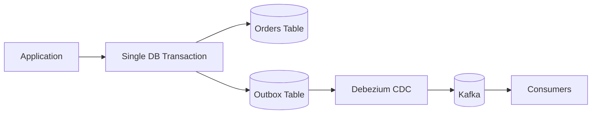

예시 테이블:
```sql
CREATE TABLE outbox (
    id            UUID PRIMARY KEY,
    aggregate_type VARCHAR(100) NOT NULL,
    aggregate_id   VARCHAR(100) NOT NULL,
    type           VARCHAR(100) NOT NULL,
    payload        JSONB NOT NULL,
    created_at     TIMESTAMP NOT NULL
);
```

주문 생성 트랜잭션에서 `orders`와 `outbox`를 함께 Commit한다. Debezium이 Outbox 행의 변경을 읽어 Kafka로 발행한다.

## 17.3 의미와 장점

- 업무 DB 변경과 이벤트 발행 의도를 같은 트랜잭션으로 저장한다.
- 애플리케이션의 DB-Kafka 이중 쓰기 문제를 줄인다.
- Outbox 레코드를 CDC가 읽으므로 별도 Polling Publisher 없이 구성할 수 있다.
- 이벤트 발행 실패와 재시작을 DB 로그·Connector Offset 기반으로 복구할 수 있다.

## 17.4 중복과 정리

Outbox 이벤트가 재발행될 가능성에 대비해 고유 `event_id`를 둔다. Consumer는 동일 이벤트의 재처리를 멱등하게 처리한다. Outbox 원본 행의 삭제·보존은 CDC가 읽기 전에 지워지지 않도록 설계한다.

**[기술적 검토]** Outbox 패턴은 외부 Kafka와 DB를 하나의 분산 트랜잭션으로 묶는 방식이 아니다. 같은 DB 트랜잭션에 업무 데이터와 이벤트 레코드를 저장하고, CDC가 이를 비동기 전달하는 방식이다.

[출처: IMG-81]

# 18. Outbox Event Router 매핑

## 18.1 Event Router SMT

Debezium Outbox Event Router는 Outbox 테이블의 행을 일반 DB 변경 이벤트 형태 그대로 내보내는 대신, 업무 이벤트로 라우팅하고 Kafka 메시지 Key·Header·Value를 구성하도록 돕는 SMT다.

## 18.2 입력 행 예시

```json
{
  "id": "event-1001",
  "aggregatetype": "Order",
  "aggregateid": "ORD-42",
  "type": "OrderCreated",
  "payload": {
    "orderId": "ORD-42",
    "amount": 50000
  }
}
```

## 18.3 기본 매핑 개념

| Outbox 컬럼 | 이벤트 용도 |
|---|---|
| `id` | 이벤트 ID |
| `aggregatetype` | Aggregate 유형 및 라우팅 정보 |
| `aggregateid` | 메시지 Key 후보 |
| `type` | 이벤트 유형 |
| `payload` | 이벤트 본문 |

**[원문]** Aggregate Type을 이용해 Topic을 결정하고, Aggregate ID를 Kafka Key로 활용하며, Payload를 Value로 전달하는 구조를 설명한다.

## 18.4 라우팅 예

```text
aggregatetype = Order
aggregateid   = ORD-42
type          = OrderCreated
payload       = {...}

Topic = outbox.event.Order
Key   = ORD-42
Value = payload
```

실제 Topic 이름은 Event Router의 `route.topic.replacement` 등 설정에 따라 결정된다.

## 18.5 이벤트 ID와 운영

이벤트 ID를 헤더나 메시지 본문에 포함하면 Consumer가 중복 처리 여부를 확인할 수 있다. Outbox Event Router의 컬럼명·정규식·라우팅 규칙은 실제 테이블 스키마에 맞춰 설정한다.

[출처: IMG-82]

# 19. 로그 보존·Heartbeat·Replication Slot

## 19.1 DB 로그 보존

Debezium이 읽어야 할 WAL/Binlog가 DB에서 삭제되면 Connector는 마지막 Source Offset부터 이어서 읽지 못할 수 있다. 따라서 DB 로그 보존과 Connector 처리 속도를 함께 관리한다.

## 19.2 Replication Slot과 WAL 누적

PostgreSQL Replication Slot은 Connector가 아직 읽지 않은 WAL을 DB가 제거하지 않도록 할 수 있다. Connector가 중단되거나 읽기 위치가 멈추면 WAL이 누적되어 디스크 사용량이 커질 수 있다.

운영 점검:
- Slot 활성 상태
- Restart LSN / Confirmed Flush LSN 등 위치
- Retained WAL 크기
- Connector 처리 지연
- DB 디스크 여유 공간

## 19.3 Heartbeat

**[원문]** Heartbeat는 Connector가 변경 이벤트를 거의 생성하지 않는 상황에서도 진행 상태를 확인하고 로그 위치 진척을 전달하는 데 활용할 수 있다.

대표 설정 예:
```properties
heartbeat.interval.ms=10000
```

10초는 설명용 예시다. 실제 간격은 환경에 맞춰 조정한다.

Heartbeat Topic은 데이터 변경 이벤트 Topic과 목적이 다르다. 모니터링 및 로그 위치 진척에 활용할 수 있다.

## 19.4 Heartbeat가 필요한 상황

DB 전체에는 변경이 계속 발생하지만 Connector가 구독하는 테이블에는 변경이 거의 없는 경우, Connector가 최신 로그 위치를 Offset으로 충분히 진척시키지 못할 수 있다. Heartbeat는 이런 상황에서 로그 위치 관리에 도움을 줄 수 있다.

**[기술적 검토]** Heartbeat가 WAL을 무조건 삭제하거나 DB 디스크를 즉시 정리하는 것은 아니다. Replication Slot의 상태, Connector가 처리한 위치, DB 복제 상태가 함께 정상이어야 한다.

[출처: IMG-83]

# 20. 장애 복구와 재동기화

## 20.1 Connector 일시 중단

1. Connector 또는 Worker 장애 발생
2. Connector Task가 중단됨
3. Source DB는 변경 로그를 계속 기록
4. Worker 복구 또는 Task 재할당
5. 저장된 Source Offset을 확인
6. DB 로그가 보존되어 있으면 해당 위치부터 재개

## 20.2 로그 유실 또는 Slot 문제

필요한 WAL이 제거되었거나 Replication Slot이 유실되면 기존 Offset에서 이어서 읽지 못할 수 있다. 이때 무조건 Offset을 초기화하면 안 된다. Snapshot 재수행, 신규 Slot, 데이터 정합성 재검증 등 복구 계획이 필요하다.

## 20.3 DB Failover

PostgreSQL Primary 장애 후 Standby가 승격되는 경우 Connector가 새 Primary에 연결해야 한다. 새 Primary의 WAL 위치·Replication Slot 상태·Connector Offset의 연속성을 검증한다.

## 20.4 복구 기준

| 점검 항목 | 확인 내용 |
|---|---|
| Connector 상태 | RUNNING / FAILED / PAUSED |
| Task 상태 | Task별 실행·오류 |
| Source Offset | 마지막 처리 로그 위치 |
| DB 로그 | Offset 이후 로그 보존 여부 |
| Replication Slot | 존재·활성·WAL 보존 상태 |
| Schema History | 스키마 해석에 필요한 이력 |
| Kafka Topic | 마지막 이벤트 및 누락·중복 여부 |
| Target | 대상 DB와 검색 인덱스의 정합성 |

## 20.5 재동기화

로그를 이어 읽을 수 없으면 Snapshot 또는 별도 재적재로 대상 상태를 다시 맞출 수 있다. 재적재 중에는 실시간 Streaming과 Snapshot 데이터의 충돌·중복을 관리해야 한다.

**[기술적 검토]** Connector 재시작과 전체 재동기화는 다른 작업이다. 재시작은 저장된 위치에서 이어가는 것이고, 재동기화는 대상 데이터를 다시 맞추는 별도 절차다.

[출처: IMG-84]

# 21. CDC 파이프라인 모니터링

## 21.1 Source DB 모니터링

- WAL/Binlog 생성량과 보존량
- Replication Slot 상태
- DB 디스크 사용량
- DB 연결 수와 복제 전송 상태
- DDL 변경 및 권한 오류

## 21.2 Connector 모니터링

- Connector 상태
- Task 상태
- Source Record 처리량
- Snapshot 진행 상태
- Source Offset 진척
- 오류 로그와 Retry
- Connector 처리 지연

## 21.3 Kafka 모니터링

- Topic별 메시지 유입량
- Partition 분포
- Broker 상태
- Under Replicated Partitions
- Disk / Network
- Consumer Lag

## 21.4 Consumer·Target 모니터링

- Consumer 처리량
- Consumer Group Lag
- 대상 DB 쓰기 실패
- 이벤트 처리 지연
- 중복 이벤트 비율
- DLT 적체
- 대상 데이터 정합성

## 21.5 파이프라인 지연 구분

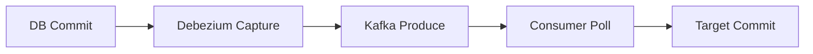

각 구간의 시각을 비교해 지연 원인을 구분한다. DB 변경 시각, Debezium 이벤트 Timestamp, Kafka Timestamp, Consumer 처리 시각, Target Commit 시각을 추적하면 어느 구간에서 지연이 발생했는지 분석할 수 있다.

[출처: IMG-85]

# 22. 구성 선택과 데이터 보호

## 22.1 배포 구성 선택

| 구성 | 특징 | 적합한 상황 |
|---|---|---|
| Kafka Connect + Debezium Connector | Kafka 기반 분산 CDC 파이프라인 | 운영·확장·복구가 중요한 일반적인 구성 |
| Debezium Server | Kafka Connect 외부로 변경 이벤트를 전달하는 별도 런타임 | Kafka Connect가 아닌 Sink로 전달할 때 |
| Debezium Engine | 애플리케이션 내부에 Debezium을 임베딩 | 애플리케이션이 직접 변경 이벤트를 처리해야 할 때 |

**[기술적 검토]** Debezium Server, Debezium Engine, Kafka Connect는 서로 다른 실행 방식이다. 모든 방식에서 Kafka가 필수인 것은 아니며, 반대로 Kafka Connect를 쓰는 구성에서는 Kafka가 핵심 전달 플랫폼이 된다.

## 22.2 최소 권한

- DB 전용 계정 사용
- 필요한 Schema·Table만 접근
- Replication 관련 권한 최소화
- Kafka Topic ACL 적용
- Connect REST API 접근 제한
- Secret을 설정 파일·Git에 평문 저장하지 않음

## 22.3 데이터 보호

- TLS로 DB·Kafka 연결 보호
- 인증·인가 분리
- 민감정보가 포함된 이벤트의 필드 마스킹·제외 검토
- Kafka Topic Retention과 접근 권한 관리
- DLT에도 원본 데이터가 포함될 수 있으므로 보안 적용
- 로그에 비밀번호·개인정보가 출력되지 않도록 관리

## 22.4 최소 범위부터 시작

운영 도입 시 모든 테이블을 한 번에 수집하기보다 대상 테이블, 컬럼, 이벤트 용도, 보존 기간, 소비자, 재처리 정책을 먼저 정하고 점진적으로 확장한다.

[출처: IMG-86]

# 23. 실습 시나리오와 관찰 포인트

## 23.1 초기 Snapshot

1. PostgreSQL에 테스트 테이블 생성
2. Debezium PostgreSQL Connector 설정
3. Connector 시작
4. Snapshot `READ` 이벤트 확인
5. Topic 이름과 Key 확인
6. Snapshot 완료 후 Streaming 전환 확인

## 23.2 INSERT·UPDATE·DELETE

```sql
INSERT INTO orders(id, status) VALUES (42, 'PENDING');
UPDATE orders SET status = 'PAID' WHERE id = 42;
DELETE FROM orders WHERE id = 42;
```

확인:
- `op=c`, `op=u`, `op=d`
- before / after
- Key
- Source metadata
- Tombstone 여부

## 23.3 Connector 중단·재시작

1. Connector 실행
2. 데이터 변경 발생
3. Connector 중지
4. DB 변경을 추가로 발생
5. Connector 재시작
6. 저장된 Source Offset 기준으로 이벤트 재개 확인

## 23.4 Schema 변경

1. 컬럼 추가
2. Connector Schema History 확인
3. 신규 컬럼이 포함된 이벤트 확인
4. Consumer의 역직렬화와 대상 Schema 반영 확인

## 23.5 Outbox

1. 주문 테이블과 Outbox 테이블 준비
2. 한 DB 트랜잭션에서 둘 다 INSERT
3. Debezium Outbox Event Router 설정
4. Kafka Topic·Key·Value 확인
5. Consumer에서 eventId 기반 중복 방지 확인

## 23.6 장애 실습 체크리스트

- [ ] Snapshot 중 Connector 중단
- [ ] Streaming 중 Connector 중단
- [ ] DB Replication Slot 상태 확인
- [ ] WAL 보존량 증가 관찰
- [ ] Kafka Broker 장애 시 Source 재시도 확인
- [ ] Consumer 중단 후 Lag 증가·회복 확인
- [ ] 잘못된 데이터의 DLT 이동 확인
- [ ] 재처리 후 대상 DB 정합성 확인

[출처: IMG-87]

# 24. DLT: 실패 레코드 격리 경로

## 24.1 DLT란?

DLT(Dead Letter Topic)는 정상 처리 경로에서 처리할 수 없는 레코드를 별도 Topic으로 격리하는 운영 패턴이다. Kafka Connect Sink Connector에서는 Sink가 Kafka 레코드를 대상 시스템에 전달하는 과정에서 오류가 발생했을 때 DLT에 보낼 수 있다.

## 24.2 기본 흐름

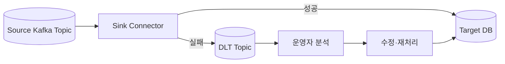

## 24.3 실패 분류

- 데이터 오류: 필수 필드 누락, 잘못된 타입, 역직렬화 실패
- Sink 오류: 대상 DB 연결 실패, 제약조건 위반
- 변환 오류: SMT 적용 실패
- 일시 장애: 네트워크·대상 시스템 일시 중단

모든 오류를 무조건 DLT로 보내는 것이 정답은 아니다. 일시 장애는 제한된 Retry가 적절할 수 있고, 영구적인 데이터 오류는 DLT 격리가 적절할 수 있다.

## 24.4 DLT에 보존할 정보

- 원본 Topic
- 원본 Partition
- 원본 Offset
- 원본 Key·Value
- 오류 클래스·메시지
- 실패 시각
- Connector 및 Task 정보
- 재시도 이력

[출처: IMG-89]

# 25. Debezium Source와 Sink DLQ의 경계

## 25.1 Source 단계와 Sink 단계

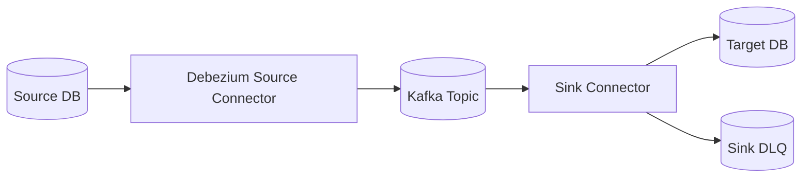

- Source Connector: DB 변경 로그를 읽어 Kafka에 발행한다.
- Sink Connector: Kafka 레코드를 읽어 외부 대상 시스템에 기록한다.
- Sink DLQ: Sink가 처리하지 못한 Kafka 레코드를 격리하는 경로다.

## 25.2 중요한 차이

**[원문]** Kafka Connect의 표준 DLQ 설정은 주로 Sink Connector의 레코드 처리 실패를 격리하는 용도로 이해해야 한다. Source Connector의 DB 수집 실패는 동일한 Sink DLQ 흐름으로 자동 처리되는 것이 아니다.

| 실패 위치 | 일반적인 대응 |
|---|---|
| Source DB 연결 실패 | Connector Retry·재연결·상태 점검 |
| DB 로그 해석 실패 | Connector 오류·로그·복구 절차 |
| Source 변환 오류 | Connector 오류 정책 및 지원 범위 확인 |
| Kafka 발행 실패 | Producer 재시도·Connector Task 오류 처리 |
| Sink 변환 실패 | Sink 오류 정책·DLQ 검토 |
| Target DB 쓰기 실패 | 재시도·DLQ·대상 시스템 복구 |

## 25.3 Sink DLQ의 의미

DLQ는 실패 레코드를 정상 흐름에서 분리할 뿐, 원본 DB의 변경 로그 문제를 해결하지 않는다. Source 측 장애와 Sink 측 장애를 같은 복구 절차로 다루지 않는다.

[출처: IMG-90]

# 26. Kafka Connect Sink DLQ 설정 읽기

## 26.1 설정 예시

이미지의 설정 항목을 설명하기 위한 예시다. 실제 속성 지원 여부와 동작은 Kafka Connect 버전에 맞춰 확인한다.

```properties
errors.tolerance=all
errors.deadletterqueue.topic.name=sink-dlq
errors.deadletterqueue.context.headers.enable=true
errors.log.enable=true
errors.log.include.messages=true
```

## 26.2 주요 설정

| 설정 | 의미 |
|---|---|
| `errors.tolerance` | 오류 발생 시 Connector가 허용할 오류 처리 수준 |
| `errors.deadletterqueue.topic.name` | 실패 레코드를 보낼 DLQ Topic |
| `errors.deadletterqueue.context.headers.enable` | 오류·원본 문맥을 Header에 포함 |
| `errors.log.enable` | 오류 로그 출력 |
| `errors.log.include.messages` | 오류 로그에 메시지 내용을 포함할지 여부 |

`errors.tolerance=none`은 오류 발생 시 Task가 실패하는 방식이고, `all`은 지원되는 레코드 오류를 허용해 DLQ 등 설정된 처리 경로로 보낼 수 있다.

## 26.3 재시도 범위

이미지에는 `errors.retry.timeout`, `errors.retry.delay.max.ms`가 등장한다. 해당 설정은 Kafka Connect 버전과 오류 처리 경로에 따라 지원 범위를 확인해야 한다. Connector 고유 Retry 설정과 Connect Framework의 오류 처리 설정을 혼동하지 않는다.

## 26.4 주의사항

- `errors.tolerance=all`은 모든 종류의 장애를 안전하게 무시한다는 뜻이 아니다.
- DLQ Topic이 존재하고 쓰기 권한이 있어야 한다.
- 메시지 본문을 오류 로그에 포함하면 개인정보·비밀정보가 노출될 수 있다.
- DLQ 적체를 모니터링하고 운영자 알림을 구성한다.
- 오류가 발생한 원인을 해결하지 않은 채 무조건 재처리하지 않는다.

[출처: IMG-91]

# 27. DLQ 재처리와 복구 완료 검증

## 27.1 DLQ 레코드 분석

DLQ 레코드에서 원본 Topic·Partition·Offset, Key, Value, 오류 유형, 실패 시각을 확인한다. 원본 메시지와 대상 시스템의 현재 상태를 함께 확인해야 한다.

## 27.2 재처리 경로

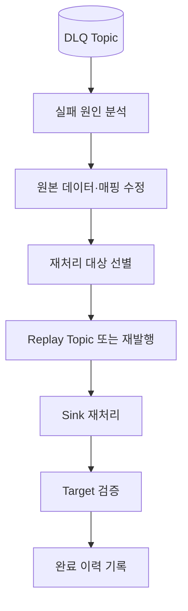

## 27.3 재처리 전 확인

- 원본 오류가 수정되었는가?
- 동일 레코드가 이미 대상 DB에 반영되지는 않았는가?
- 이벤트 순서가 중요한가?
- 후속 이벤트가 먼저 처리된 것은 아닌가?
- 삭제 이벤트 또는 Tombstone을 재처리할 때 대상 상태가 올바른가?
- 재처리로 중복 부작용이 발생하지 않는가?

## 27.4 중복·순서·삭제

- **중복:** 동일 이벤트를 여러 번 처리해도 결과가 달라지지 않도록 멱등성을 확보한다.
- **순서:** 같은 Key의 이벤트를 재처리할 때 원래 순서와 현재 대상 상태를 확인한다.
- **삭제:** Delete와 Tombstone을 구분하고 대상 시스템에서 삭제를 올바르게 반영한다.

## 27.5 복구 완료 기준

| 기준 | 완료 확인 |
|---|---|
| 실패 원인 | 원인 분석 및 수정 완료 |
| DLQ | 대상 레코드가 재처리 또는 폐기 정책에 따라 처리됨 |
| Target | 대상 데이터 반영 확인 |
| 중복 | 중복 반영 여부 확인 |
| 순서 | 업무상 순서 조건 확인 |
| 운영 이력 | 담당자·시각·결과·원본 Offset 기록 |
| 모니터링 | DLQ 적체 및 재발 여부 확인 |

**[기술적 검토]** DLQ에서 레코드를 꺼내 재발행하는 행위 자체가 복구 완료를 의미하지 않는다. 대상 시스템에 반영되었는지, 중복·순서·삭제가 올바른지 검증해야 한다.

[출처: IMG-92]

# 28. 핵심 내용 정리와 학습 순서

## 28.1 핵심 내용

1. CDC는 DB 변경을 감지해 다른 시스템으로 전달하는 기술·패턴이다.
2. Debezium은 대표적인 Log 기반 CDC 플랫폼이다.
3. Debezium Source Connector는 DB별 로그를 읽어 변경 이벤트를 만든다.
4. Kafka Connect Worker는 Connector와 Task를 실행한다.
5. PostgreSQL은 WAL·Logical Decoding·Replication Slot을 이해해야 한다.
6. MySQL은 Binlog와 복제 관련 설정을 이해해야 한다.
7. Initial Snapshot은 기존 데이터를 기준 상태로 수집한다.
8. Streaming은 Snapshot 이후의 변경을 지속 수집한다.
9. Incremental Snapshot은 Chunk·Watermark·Snapshot Window를 이용한다.
10. Debezium 이벤트는 Key와 Envelope(Value)로 구성된다.
11. `c/u/d/r`은 Create·Update·Delete·Read를 나타낸다.
12. DELETE 이벤트와 Kafka Tombstone은 구분해야 한다.
13. Topic·Key·Partition 설계는 순서와 병렬 처리에 영향을 준다.
14. DB Log Position, Connect Source Offset, Consumer Offset은 서로 다르다.
15. Schema History와 Kafka Connect 내부 Topic은 목적이 다르다.
16. Exactly-once는 파이프라인 전체 경계를 나눠 검토해야 한다.
17. Transaction Metadata는 DB 트랜잭션과 이벤트 관계를 이해하는 데 도움을 준다.
18. Schema Evolution은 Connector·Consumer·Target에 영향을 준다.
19. SMT는 이벤트를 변환하지만 Envelope 메타데이터 손실에 주의해야 한다.
20. Outbox는 DB-Kafka 이중 쓰기 문제를 완화한다.
21. Event Router는 Outbox 행을 업무 이벤트로 라우팅한다.
22. Replication Slot과 WAL 보존은 PostgreSQL 운영에서 중요하다.
23. Heartbeat는 변경 이벤트가 드문 경우 로그 위치 진척에 도움을 준다.
24. Connector 재시작과 전체 재동기화는 다른 작업이다.
25. Source 장애와 Sink DLQ 장애는 구분해야 한다.
26. DLQ 재처리 후에는 대상 데이터 정합성을 검증해야 한다.

## 28.2 권장 학습 순서

1. CDC가 필요한 이유와 Polling·Trigger·Log 방식 비교
2. Kafka Connect의 Worker·Connector·Task
3. PostgreSQL WAL·Logical Decoding 또는 MySQL Binlog
4. Snapshot과 Streaming 전환
5. Debezium Event Envelope와 `op`
6. Topic·Key·Partition 설계
7. DB Log Position·Source Offset·Consumer Offset
8. Schema History와 Schema Evolution
9. SMT와 Outbox Event Router
10. Outbox 패턴과 Transaction Metadata
11. Replication Slot·Heartbeat·로그 보존
12. 장애 복구·재동기화
13. Sink DLQ·재처리
14. 운영 지표·보안·실습

## 28.3 Kafka와 Debezium의 관계

| 구분 | Kafka | Debezium |
|---|---|---|
| 주 역할 | 이벤트 저장·전달 플랫폼 | DB 변경 감지·이벤트 생성 |
| 데이터 입력 | Producer 또는 Source Connector | DB Transaction Log |
| 저장 | Topic·Partition | 자체가 주 저장소는 아님 |
| 소비 | Consumer Group | 생성한 변경 이벤트를 Kafka로 전달 |
| Offset | Consumer Group Offset | Kafka Connect Source Offset 등 |
| 상호 관계 | 이벤트 플랫폼 | Kafka Connect와 함께 Kafka에 CDC 이벤트 전달 |

Kafka는 메시지를 저장·전달하고 Debezium은 DB 변경을 이벤트로 변환한다. 둘은 대체 관계가 아니라 함께 사용하는 관계다.

[출처: IMG-65~IMG-92]

# 29. 공식 참고 자료

이미지에 제시된 문서 주소 및 기술 검증에 참고할 공식 자료:

1. Debezium Documentation: https://debezium.io/documentation/
2. Debezium PostgreSQL Connector: https://debezium.io/documentation/reference/3.4/connectors/postgresql.html
3. Debezium MySQL Connector: https://debezium.io/documentation/reference/3.4/connectors/mysql.html
4. Debezium Outbox Event Router: https://debezium.io/documentation/reference/3.4/transformations/outbox-event-router.html
5. Debezium SMT: https://debezium.io/documentation/reference/3.4/transformations/
6. Kafka Connect User Guide: https://kafka.apache.org/40/kafka-connect/user-guide/
7. Kafka Connect Configuration: https://kafka.apache.org/40/configuration/kafka-connect-configs/
8. PostgreSQL Logical Decoding: https://www.postgresql.org/docs/current/logicaldecoding.html
9. PostgreSQL Replication Slots: https://www.postgresql.org/docs/current/logicaldecoding-explanation.html

---

# 부록 A. 이미지별 인벤토리

| 이미지 | 원본 제목·핵심 주제 | 유형 | 최종 문서 위치 | 판독 |
|---|---|---|---|---|
| IMG-65 | Debezium CDC의 전체 구조 | 아키텍처·개념도 | 1 | 정상 |
| IMG-66 | Polling·Trigger·Log 기반 CDC | 비교표·흐름도 | 2 | 정상 |
| IMG-67 | Kafka Connect에서 실행되는 Debezium: Worker·Connector·Task·분산 실행 | 구조도 | 3 | 정상 |
| IMG-68 | PostgreSQL과 MySQL의 변경 로그 | DB별 구조도 | 4 | 정상 |
| IMG-69 | PostgreSQL CDC의 준비 조건: WAL·Publication·Replication Slot·권한 | 설정·구조도 | 5 | 정상 |
| IMG-70 | Initial Snapshot과 Streaming 전환 | 순서도·타임라인 | 6 | 정상 |
| IMG-71 | Incremental Snapshot과 재수집: Chunk·Watermark·Signal | 흐름도 | 7 | 정상 |
| IMG-72 | Debezium 변경 이벤트 구조: Key·before/after·op·source·시간 | JSON·구조도 | 8 | 정상 |
| IMG-73 | INSERT·UPDATE·DELETE·Tombstone | 이벤트 예시·구조도 | 9 | 정상 |
| IMG-74 | Topic·Key·Partition 설계: 순서·Hot Key·보존 | 표·구조도 | 10 | 정상 |
| IMG-75 | 세 가지 위치와 재시작 지점: DB Log·Source Offset·Consumer Offset | 구조도 | 11 | 정상 |
| IMG-76 | Connect 내부 상태와 Schema History | 구조도·표 | 12 | 정상 |
| IMG-77 | 전달 보장과 멱등·Exactly-once 조건 | 구조도·비교 | 13 | 정상 |
| IMG-78 | DB 트랜잭션과 이벤트 순서 | 트랜잭션·이벤트 흐름 | 14 | 정상 |
| IMG-79 | Schema Evolution과 데이터 타입 | 표·구조도 | 15 | 정상 |
| IMG-80 | SMT와 이벤트 평탄화: ExtractNewRecordState·삭제 처리 | 변환 흐름도 | 16 | 정상 |
| IMG-81 | Debezium과 Transactional Outbox | DB·CDC·Kafka 구조도 | 17 | 정상 |
| IMG-82 | Outbox Event Router 매핑 | 필드 매핑·구조도 | 18 | 정상 |
| IMG-83 | 로그 보존·역압력·Heartbeat | 구조도·운영 지표 | 19 | 정상 |
| IMG-84 | 장애 복구와 재동기화 | 복구 흐름도 | 20 | 정상 |
| IMG-85 | CDC 파이프라인 모니터링 | 구성도·체크 항목 | 21 | 정상 |
| IMG-86 | 구성 선택과 데이터 보호: Kafka Connect·Debezium Server·Engine | 비교표·구조도 | 22 | 정상 |
| IMG-87 | 실습 시나리오와 관찰 포인트 | 실습 흐름·체크리스트 | 23 | 정상 |
| IMG-88 | 전체 복습과 공식 문서 | 개념 지도·참고 링크 | 28~29 | 정상 |
| IMG-89 | DLT: 실패 레코드를 격리하는 통로 | 구조도·운영 흐름 | 24 | 정상 |
| IMG-90 | Debezium Source와 Sink DLQ의 경계 | 비교 구조도 | 25 | 정상 |
| IMG-91 | Kafka Connect Sink DLQ 설정 읽기 | 설정값·흐름도 | 26 | 정상 |
| IMG-92 | DLQ 재처리와 복구 완료 검증 | 복구 흐름·체크리스트 | 27 | 정상 |

# 부록 B. 분산 개념 통합 내역

| 통합 개념 | 관련 이미지 | 통합 위치 | 처리 방식 |
|---|---|---|---|
| CDC 전체 구조와 목적 | 65, 66, 86 | 1, 2, 22 | CDC 개요와 구현 방식 연결 |
| Kafka Connect 실행 구조 | 65, 67, 86 | 1, 3, 22 | Worker·Connector·Task·배포 방식 통합 |
| DB 로그 수집 | 68, 69 | 4, 5 | DB별 로그와 사전 조건 연결 |
| Snapshot | 65, 70, 71, 87 | 6, 7, 23 | Initial·Incremental·실습 통합 |
| 이벤트 구조와 연산 | 72, 73, 74 | 8, 9, 10 | Envelope·op·Tombstone·Key |
| Offset과 상태 | 75, 76, 84 | 11, 12, 20 | DB Log·Connect·Consumer 위치 구분 |
| 전달 보장·트랜잭션 | 77, 78 | 13, 14 | 중복·순서·Exactly-once 범위 |
| Schema 변경과 SMT | 76, 79, 80 | 12, 15, 16 | Schema History·타입·평탄화 |
| Outbox | 81, 82 | 17, 18 | 이중 쓰기·Router 매핑 통합 |
| 로그 보존·운영 | 83, 84, 85 | 19, 20, 21 | Heartbeat·복구·모니터링 |
| 배포·보안·실습 | 86, 87, 88 | 22, 23, 28, 29 | 구성 비교와 실습 연결 |
| DLQ | 89, 90, 91, 92 | 24~27 | 개념·경계·설정·재처리 통합 |

# 부록 C. 기술적 검토 및 확인 사항

## C.1 기술적 보완 사항

1. **CDC와 Debezium 구분:** CDC는 변경 감지·전달 패턴이고 Debezium은 이를 구현하는 플랫폼/커넥터다.
2. **Kafka Connect Task 병렬성:** `tasks.max`가 실제 Task 수를 보장하지 않는다.
3. **DB별 로그 차이:** PostgreSQL WAL/LSN과 MySQL Binlog/GTID를 같은 형식으로 취급하지 않는다.
4. **Snapshot 정합성:** Snapshot 기준 시점과 로그 위치를 연결해야 누락을 막을 수 있다.
5. **Incremental Snapshot:** Chunk뿐 아니라 Watermark와 Snapshot Window가 충돌 조정에 중요하다.
6. **DELETE와 Tombstone:** Debezium Delete Envelope와 Kafka null-value Tombstone은 구분해야 한다.
7. **Offset 세 종류:** DB 로그 위치, Connect Source Offset, Consumer Offset은 서로 다른 값이다.
8. **Schema History:** Kafka Connect 내부 Config/Offset/Status Topic과 목적이 다르다.
9. **Exactly-once:** Kafka 내부 원자성과 외부 DB/API까지 포함한 End-to-end 보장을 구분한다.
10. **SMT 평탄화:** Envelope의 Source·Operation·Transaction 메타데이터 손실을 검토한다.
11. **Outbox:** 분산 트랜잭션이 아니라 업무 데이터와 Outbox 레코드를 동일 DB 트랜잭션에 저장하는 패턴이다.
12. **Heartbeat:** WAL을 직접 삭제하는 기능이 아니라 로그 위치 진척과 모니터링에 도움을 주는 기능이다.
13. **DLQ:** Kafka Connect의 DLQ는 주로 Sink 레코드 처리 실패를 위한 것이며 Source DB 로그 수집 장애와 구분한다.
14. **DLQ 재처리:** 재발행 자체가 복구 완료는 아니며 대상 시스템의 정합성 확인이 필요하다.

## C.2 버전 및 환경 의존 사항

다음 설정·동작은 Debezium 3.4.x, Kafka Connect 4.0, DB 버전, Connector별 구현을 기준으로 실제 배포 환경에서 확인해야 한다.
- Snapshot Mode와 Incremental Snapshot Signal 지원 범위
- PostgreSQL Publication·Replication Slot 구성
- MySQL Binlog·GTID 설정
- Schema History Topic 관련 설정
- Outbox Event Router 컬럼·Topic 매핑 속성
- ExtractNewRecordState 삭제 처리 옵션
- Kafka Connect 오류 처리·DLQ 설정
- Exactly-once Source 지원 범위

## C.3 예시값 주의

이미지에 표시된 `wal_level=logical`, `max_replication_slots=10`, `max_wal_senders=10`, `heartbeat.interval.ms=10000` 등은 설명용 예시다. 운영 환경에서는 DB·Connector 수, 데이터량, 장애 복구 목표, 디스크 용량을 기준으로 조정한다.

## C.4 원문 보존 범위 고지

28장 모두의 제목과 핵심 기술 요소, 표·흐름·설정 항목을 확인해 인벤토리와 본문에 반영했다. 본 문서는 이미지 정보를 학습 순서에 맞게 재구성한 기술 분석본이다. 이미지의 모든 작은 글씨를 한 글자씩 전사한 OCR 전문은 아니며, 일부 코드·JSON은 원본 구조를 설명하기 위해 재작성한 개념 예시다. 원본에 있는 값과 보충 예시를 혼동하지 않도록 본문에서 설명용 예시임을 표시했다.

## C.5 완료 체크

- [x] ZIP 내부 28장 확인 (65.png~92.png)
- [x] 이미지별 인벤토리 작성
- [x] 주요 개념 추출 및 학습 순서 재구성
- [x] 분산된 동일·유사 개념 통합
- [x] 주요 챕터별 이미지 출처 표기
- [x] 구조도와 데이터 흐름 Mermaid 재구성
- [x] 코드·JSON·설정 예시 분석
- [x] 기술적 오해 가능성 검토
- [x] DLT 추가 이미지 4장(89~92) 독립 챕터로 통합
- [x] 중복 통합 내역 및 확인 사항 작성
- [ ] 이미지의 모든 문장을 글자 단위로 전사한 OCR 전문 부록
- [ ] 실제 배포 버전과 DB 버전에 맞춘 최종 설정 검증
