# MSA 분산 트랜잭션과 이벤트 기반 메시지 처리

> **목적:** 기술 학습 및 팀 발표용  
> **범위:** DB 트랜잭션, 메시지 브로커, Kafka 기초, Kafka Connect, Debezium CDC, Transactional Outbox, Outbox Relay, SMT, Spring Kafka Consumer, `@KafkaListener`, Consumer Group, Topic·Partition·Offset, Retry, DLT/DLQ, Saga Pattern  
> **읽는 순서:** 먼저 메시지가 이동하는 기반 구조를 이해하고, DB 이벤트를 안전하게 발행하는 Outbox·CDC를 살펴본 뒤, Spring Consumer의 수신·실패 처리와 Saga를 연결한다.

---

# 목차

1. [전체 구조 먼저 보기](#1-전체-구조-먼저-보기)
2. [기초 개념: DB 트랜잭션과 메시지 브로커](#2-기초-개념-db-트랜잭션과-메시지-브로커)
3. [Kafka의 기본 구조](#3-kafka의-기본-구조)
4. [Kafka Connect와 Record](#4-kafka-connect와-record)
5. [Transactional Outbox Pattern](#5-transactional-outbox-pattern)
6. [Outbox Relay와 메시지 브로커의 차이](#6-outbox-relay와-메시지-브로커의-차이)
7. [Debezium CDC와 이벤트 Envelope](#7-debezium-cdc와-이벤트-envelope)
8. [SMT: ExtractNewRecordState와 Outbox Event Router](#8-smt-extractnewrecordstate와-outbox-event-router)
9. [Kafka Consumer와 Spring `@KafkaListener`](#9-kafka-consumer와-spring-kafkalistener)
10. [Consumer Group, Partition, Offset](#10-consumer-group-partition-offset)
11. [Retry, DLT와 DLQ](#11-retry-dlt와-dlq)
12. [Saga Pattern과 보상 트랜잭션](#12-saga-pattern과-보상-트랜잭션)
13. [전체 통합 흐름: 주문 생성부터 실패 처리까지](#13-전체-통합-흐름-주문-생성부터-실패-처리까지)
14. [핵심 개념 비교](#14-핵심-개념-비교)
15. [발표·학습 점검 질문](#15-발표학습-점검-질문)
16. [참고 자료](#16-참고-자료)

---

# 1. 전체 구조 먼저 보기

이 문서의 기술들은 서로 대체하는 기술이 아니다. 각각 다른 문제를 해결하며, 하나의 MSA 이벤트 처리 구조 안에서 함께 사용될 수 있다.

## 1.1 전체 메시지 흐름

주문 서비스에서 주문이 생성되고, 재고 서비스가 주문 이벤트를 전달받는 상황을 가정한다.

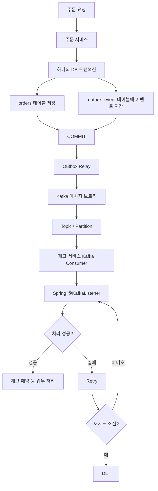

여기서 각 구성 요소의 역할은 다음과 같다.

| 구성 요소 | 역할 |
|---|---|
| DB 트랜잭션 | 업무 데이터와 Outbox 이벤트를 원자적으로 저장 |
| Outbox 테이블 | 외부에 전달해야 할 이벤트를 DB에 보관 |
| Outbox Relay | Outbox 이벤트를 읽어 Kafka로 전달 |
| Debezium | DB 변경 로그를 읽어 CDC 이벤트 생성 |
| Kafka Connect | 외부 시스템과 Kafka 사이의 데이터 연결·전송 프레임워크 |
| SMT | Kafka Connect 레코드의 구조나 내용을 변환 |
| Kafka Broker | 메시지를 저장하고 Consumer가 읽을 수 있도록 제공 |
| Topic / Partition | 메시지를 주제별·분할 단위로 저장 |
| Kafka Consumer | Topic의 메시지를 가져와 처리 |
| `@KafkaListener` | Spring Kafka에서 메시지를 받을 메서드 선언 |
| Retry / DLT | 실패 메시지 재시도 및 격리 |
| Saga | 여러 서비스에 걸친 업무 흐름과 보상 작업 관리 |

## 1.2 먼저 구분해야 할 핵심

- **메시지 브로커:** 메시지를 받아 보관하고 Consumer가 가져갈 수 있도록 전달하는 시스템이다.
- **Outbox Relay:** DB의 Outbox 테이블에 저장된 이벤트를 메시지 브로커로 옮기는 전달자다.
- **Outbox 테이블:** DB 트랜잭션 자체를 기록하는 로그 테이블이 아니라, 발행할 이벤트를 저장하는 업무 테이블이다.
- **Debezium:** DB 변경 로그를 읽는 CDC 도구이며, Kafka Connect 기반으로 동작한다.
- **SMT:** Kafka Connect 파이프라인에서 레코드를 변환하는 기능이다.
- **Kafka Consumer:** Kafka에서 메시지를 읽는 클라이언트다.
- **`@KafkaListener`:** Spring Kafka 애플리케이션에서 Consumer 메시지를 처리할 메서드를 선언하는 어노테이션이다.
- **Saga:** 메시지 전송 자체가 아니라 여러 서비스의 비즈니스 트랜잭션 흐름과 보상을 관리하는 패턴이다.

---

# 2. 기초 개념: DB 트랜잭션과 메시지 브로커

## 2.1 DB 트랜잭션이란?

DB 트랜잭션(Transaction)은 데이터베이스에서 수행하는 하나 이상의 작업을 하나의 논리적 작업 단위로 묶는 것이다.

대표적으로 다음과 같은 특징을 ACID라고 한다.

| 속성 | 의미 |
|---|---|
| Atomicity(원자성) | 트랜잭션 내 작업은 전부 성공하거나 전부 실패해야 한다. |
| Consistency(일관성) | 트랜잭션 전후 데이터는 정의된 제약조건과 규칙을 만족해야 한다. |
| Isolation(격리성) | 동시에 실행되는 트랜잭션 간 간섭을 정해진 격리 수준에 따라 제어한다. |
| Durability(지속성) | 커밋된 데이터는 장애가 발생해도 보존되어야 한다. |

예를 들어 주문을 생성할 때 주문 테이블에 주문 정보를 저장하고, 주문 상세 테이블에 상품 정보를 저장한다고 가정한다.

```sql
BEGIN;

INSERT INTO orders (order_id, status)
VALUES ('ORD-1001', 'CREATED');

INSERT INTO order_items (order_id, product_id, quantity)
VALUES ('ORD-1001', 'P-01', 2);

COMMIT;
```

두 INSERT가 모두 성공하면 COMMIT한다. 중간에 오류가 발생하면 ROLLBACK하여 트랜잭션 내 변경을 취소한다.

**주의:** DB 트랜잭션은 기본적으로 해당 데이터베이스의 작업을 원자적으로 묶는다. DB와 Kafka에 대한 작업까지 자동으로 하나의 트랜잭션으로 묶어 주는 것은 아니다.

## 2.2 메시지 브로커(Message Broker)란?

메시지 브로커는 Producer가 보낸 메시지를 받아 저장하거나 중계하고, Consumer가 메시지를 가져가 처리할 수 있도록 하는 미들웨어다.

대표 기술:
- Apache Kafka
- RabbitMQ
- ActiveMQ

기본 구성은 다음과 같다.

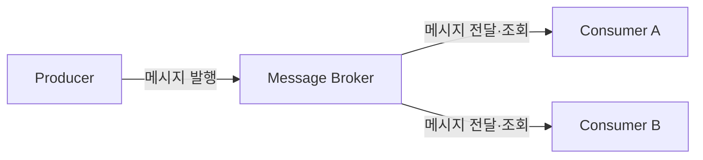

- **Producer:** 메시지를 생성하여 브로커에 발행하는 쪽
- **Message Broker:** 메시지를 수신·저장·전달하는 중간 시스템
- **Consumer:** 브로커에서 메시지를 읽어 업무 처리를 수행하는 쪽

예를 들어 주문 서비스가 `OrderCreated` 이벤트를 Kafka에 발행하면 재고 서비스와 알림 서비스가 각자 해당 이벤트를 소비할 수 있다.

메시지 브로커를 사용하면 서비스가 서로의 내부 구현이나 DB를 직접 호출하지 않고 이벤트를 통해 느슨하게 연결될 수 있다.

## 2.3 Kafka는 메시지 브로커인가?

그렇다. Apache Kafka는 분산 이벤트 스트리밍 플랫폼이며, MSA에서는 메시지 브로커처럼 사용한다.

Kafka는 메시지를 Topic과 Partition에 기록하고, Consumer가 Offset을 기준으로 메시지를 읽도록 한다.

Kafka의 주요 특징:
- 대량의 이벤트를 처리할 수 있도록 분산·확장 가능하다.
- 메시지를 디스크에 저장하고 설정된 보존 정책에 따라 유지한다.
- Consumer가 메시지를 읽는 위치를 Offset으로 관리한다.
- 여러 Consumer Group이 같은 Topic을 독립적으로 소비할 수 있다.
- Partition을 통해 병렬 처리와 확장성을 제공한다.

---

# 3. Kafka의 기본 구조

## 3.1 Producer와 Consumer

- **Producer:** Kafka Topic에 메시지를 발행한다.
- **Consumer:** Kafka Topic에서 메시지를 읽어 처리한다.
- Producer와 Consumer는 서로 직접 연결되지 않아도 된다. Kafka가 중간에서 메시지를 보관한다.

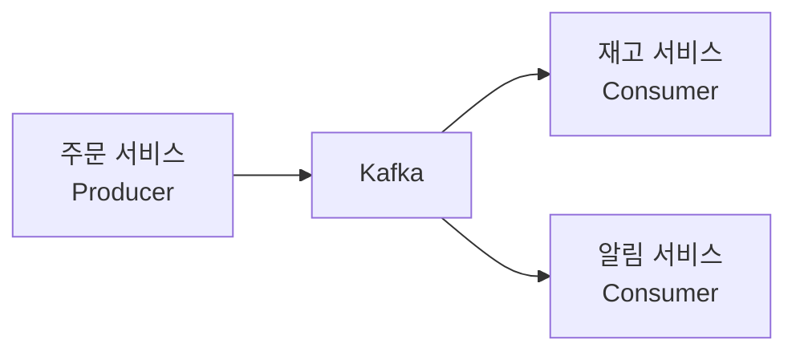

주문 이벤트 하나를 여러 서비스가 각자의 목적으로 소비할 수 있다. 일반적으로 서비스별로 서로 다른 Consumer Group을 사용하면 각 그룹이 독립적으로 Topic을 소비한다.

## 3.2 Topic이란?

Topic은 Kafka에서 메시지를 분류하는 논리적인 이름 또는 카테고리다.

예:
- `order-events`
- `payment-events`
- `inventory-events`
- `delivery-events`

주문 생성·취소·변경 등 주문 도메인과 관련된 이벤트를 `order-events` Topic에 발행하도록 설계할 수 있다.

Topic은 DB 테이블과 동일한 개념이 아니다. 메시지를 분류하고 보관하는 Kafka의 논리적 단위다.

## 3.3 Partition이란?

Partition은 하나의 Topic을 여러 조각으로 나눈 저장·처리 단위다.

Topic을 여러 Partition으로 나누는 이유:
- 여러 Consumer가 병렬로 메시지를 처리할 수 있다.
- 브로커 여러 대에 Partition을 분산하여 확장할 수 있다.
- 메시지 처리량을 높일 수 있다.

```text
Topic: order-events

Partition 0: [메시지 0] [메시지 1] [메시지 2] ...
Partition 1: [메시지 0] [메시지 1] [메시지 2] ...
Partition 2: [메시지 0] [메시지 1] [메시지 2] ...
```

각 Partition 안에서 메시지는 Offset 순서로 기록된다. Kafka가 Topic 전체에 대해 하나의 전역 순서를 보장하는 것은 아니다.

## 3.4 메시지 Key와 Partition 선택

Producer는 메시지를 발행할 때 Key를 지정할 수 있다.

예를 들어 주문 ID를 Key로 사용하면 같은 주문 ID를 가진 메시지가 일반적인 기본 파티셔닝 설정에서 같은 Partition으로 전달되도록 할 수 있다.

```text
Key = ORD-1001  → Partition 1
Key = ORD-1002  → Partition 0
Key = ORD-1001  → Partition 1
```

이렇게 하면 동일 주문에 대한 이벤트의 Partition 내 순서를 유지하는 데 도움이 된다.

다만 Partition 수 변경, 커스텀 Partitioner, 명시적 Partition 지정 등 설정에 따라 매핑과 순서 보장은 달라질 수 있다.

## 3.5 Offset이란?

Offset은 하나의 Partition 안에서 각 메시지를 구분하는 순번 또는 위치 값이다.

```text
Partition 0
Offset 0 → OrderCreated
Offset 1 → OrderPaid
Offset 2 → OrderPrepared
Offset 3 → OrderShipped
```

Consumer는 Offset을 기준으로 어디까지 읽고 처리했는지 관리한다.

Offset은 Partition마다 별도로 존재한다. 따라서 `Partition 0의 Offset 10`과 `Partition 1의 Offset 10`은 서로 다른 메시지 위치다.

---

# 4. Kafka Connect와 Record

## 4.1 Kafka Connect란?

Kafka Connect는 Kafka와 외부 시스템 사이에서 데이터를 가져오거나 내보내는 연결 프레임워크다.

애플리케이션에서 Producer 코드를 직접 작성하지 않고도 DB, 검색 엔진, 파일 시스템 등과 Kafka 사이의 데이터 연동을 구성할 수 있다.

두 가지 Connector 유형이 있다.

| 유형 | 방향 | 역할 |
|---|---|---|
| Source Connector | 외부 시스템 → Kafka | 외부 데이터 소스에서 데이터를 읽어 Kafka로 발행 |
| Sink Connector | Kafka → 외부 시스템 | Kafka 메시지를 읽어 외부 시스템에 기록 |

예:
- Debezium DB Connector: DB 변경 로그를 읽어 Kafka에 전달하는 Source Connector
- Sink Connector: Kafka 이벤트를 외부 DB나 검색 시스템에 전달

Kafka Connect는 Connector를 실행·관리하고 데이터 전송 파이프라인을 제공한다.

## 4.2 Debezium과 Kafka Connect의 관계

Debezium은 Kafka Connect 기반으로 실행되는 CDC Connector를 제공한다.

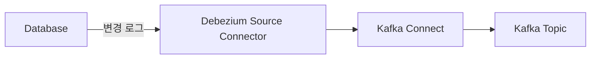

- Kafka Connect: Connector 실행 및 데이터 전송 프레임워크
- Debezium: DB별 변경 로그를 읽어 CDC 이벤트를 생성하는 Connector 기술

따라서 Debezium과 Kafka Connect는 같은 것이 아니다. Debezium이 Kafka Connect 위에서 동작한다고 이해하면 된다.

## 4.3 Kafka Connect Record란?

Kafka Connect Record는 Kafka Connect 파이프라인에서 데이터 한 건을 표현하는 레코드 객체다.

일반적으로 다음 정보를 포함한다.

| 구성 | 의미 |
|---|---|
| Topic | 레코드가 전달될 Kafka Topic |
| Key | 레코드를 식별하거나 파티션을 결정하는 데 활용되는 값 |
| Value | 실제 레코드 데이터 |
| Headers | 추가 메타데이터 |
| Schema | Key/Value의 데이터 구조 정보(사용하는 데이터 형식에 따라 존재) |
| Partition / Timestamp | 파티션 또는 시간 관련 정보(상황에 따라 존재) |

Kafka Connect의 SourceRecord와 SinkRecord는 Connect 파이프라인에서 다루는 레코드 유형이다.

**DB Row와 Kafka Connect Record는 같은 개념이 아니다.**
- DB Row: 데이터베이스 테이블의 한 행
- Connect Record: Kafka Connect가 전송 파이프라인에서 사용하는 메시지 단위 객체
- Connect Record의 Value 안에 DB Row 데이터가 포함될 수 있다.

## 4.4 “row를 자신만의 구성으로 바꿔 메모리에 담는다”는 설명

강의에서 들은 “row를 자신만의 구성으로 변경해 메모리에 담는다”는 설명은 다음 처리 과정을 가리켰을 가능성이 있다.

1. Debezium이 DB 변경 로그를 읽는다.
2. 변경 내용을 Debezium 이벤트 구조로 구성한다.
3. Kafka Connect가 이를 SourceRecord 형태로 표현한다.
4. SMT가 레코드의 Key, Value, Header, Topic 등을 변환할 수 있다.
5. 변환된 레코드가 Kafka로 전달된다.

이 과정에서 Connect 프로세스의 메모리에 레코드 객체가 생성·처리되는 것은 맞지만, 핵심 개념은 **메모리에 데이터를 저장하는 것**이 아니라 **DB 변경 내용을 Kafka Connect Record라는 메시지 구조로 표현하고 변환하는 것**이다.

---

# 5. Transactional Outbox Pattern

## 5.1 Outbox Pattern이란?

Transactional Outbox는 비즈니스 데이터 변경과 외부에 발행할 이벤트를 같은 DB 트랜잭션으로 저장한 뒤, 별도의 릴레이가 이벤트를 메시지 브로커로 전달하는 패턴이다.

핵심 목적은 DB 저장과 메시지 발행 사이에서 발생하는 이중 쓰기 문제(Dual Write Problem)를 줄이는 것이다.

## 5.2 이중 쓰기 문제(Dual Write Problem)

주문 서비스가 주문 DB와 Kafka에 각각 데이터를 기록한다고 가정한다.

```java
@Transactional
public void createOrder(Order order) {
    orderRepository.save(order);
    kafkaTemplate.send("order-events", toEvent(order));
}
```

이 코드처럼 DB와 Kafka에 각각 쓰는 구조에서는 다음 문제가 생길 수 있다.

**상황 A: DB 저장 성공, Kafka 발행 실패**
- 주문 데이터는 DB에 저장된다.
- Kafka에는 이벤트가 전달되지 않는다.
- 재고 서비스 등 다른 서비스는 주문 생성 사실을 알지 못한다.

**상황 B: Kafka 발행 성공, DB 트랜잭션 실패**
- Kafka에는 주문 생성 이벤트가 발행된다.
- DB 주문 저장은 롤백된다.
- 다른 서비스는 실제로 존재하지 않는 주문 이벤트를 처리할 수 있다.

Spring의 `@Transactional`만으로 DB와 Kafka의 쓰기가 자동으로 하나의 원자적 트랜잭션이 되는 것은 아니다. DB 트랜잭션과 Kafka 트랜잭션은 별도의 자원이며, 함께 묶으려면 별도 설계와 설정이 필요하다.

## 5.3 Outbox 테이블은 무엇인가?

Outbox 테이블은 **DB 트랜잭션 자체를 기록하는 테이블이 아니다.**

정확히는 **다른 서비스나 외부 시스템에 전달해야 할 이벤트를 저장하는 테이블**이다.

예를 들어 주문이 생성되면 다음 두 테이블에 기록한다.

- `orders`: 실제 주문 업무 데이터
- `outbox_event`: 다른 서비스에 전달할 `OrderCreated` 이벤트

## 5.4 Outbox 테이블 예시

```sql
CREATE TABLE outbox_event (
    id             VARCHAR(100) PRIMARY KEY,
    aggregatetype  VARCHAR(100) NOT NULL,
    aggregateid    VARCHAR(100) NOT NULL,
    type           VARCHAR(100) NOT NULL,
    payload        JSON NOT NULL,
    created_at     TIMESTAMP NOT NULL
);
```

| 컬럼 | 의미 | 예시 |
|---|---|---|
| `id` | 이벤트 고유 ID | `evt-001` |
| `aggregatetype` | 이벤트가 속한 도메인 유형 | `Order` |
| `aggregateid` | 도메인 객체 ID | `ORD-1001` |
| `type` | 이벤트 유형 | `OrderCreated` |
| `payload` | 전달할 이벤트 데이터 | 주문 JSON |
| `created_at` | 이벤트 생성 시각 | 생성 시간 |

실제 컬럼명과 타입은 Outbox Event Router 설정 및 DB 종류에 따라 달라질 수 있다. 위 구조는 개념 설명용 예시다.

## 5.5 DB 트랜잭션에서 Outbox를 저장하는 방식

주문 생성과 이벤트 저장을 같은 DB 트랜잭션으로 처리한다.

```sql
BEGIN;

INSERT INTO orders (order_id, status)
VALUES ('ORD-1001', 'CREATED');

INSERT INTO outbox_event (
    id, aggregatetype, aggregateid, type, payload, created_at
)
VALUES (
    'evt-001',
    'Order',
    'ORD-1001',
    'OrderCreated',
    '{"orderId":"ORD-1001","status":"CREATED"}',
    CURRENT_TIMESTAMP
);

COMMIT;
```

두 INSERT는 하나의 DB 트랜잭션에 포함된다.

- 둘 다 성공하면 COMMIT
- 하나라도 실패하면 ROLLBACK

따라서 주문 데이터는 저장됐는데 Outbox 이벤트가 저장되지 않는 상황을 방지할 수 있다.

**여기서 트랜잭션이 기록하는 것은 DB 작업의 원자적 실행 결과이며, Outbox 테이블은 이벤트 데이터 자체를 저장한다.** Outbox는 DB의 트랜잭션 로그(WAL, binlog 등)와 다른 개념이다.

## 5.6 Outbox가 해결하는 문제와 남는 문제

Outbox는 DB 업무 데이터와 이벤트 기록을 원자적으로 저장한다. 그러나 Kafka 전달과 Consumer 처리까지 모두 한 번에 원자적으로 보장하는 것은 아니다.

남는 고려 사항:
- Relay가 Kafka 발행 후 완료 상태를 기록하기 전에 중단되면 같은 이벤트가 재발행될 수 있다.
- Consumer가 메시지를 처리한 뒤 Offset 커밋 전에 중단되면 메시지가 다시 전달될 수 있다.
- 따라서 이벤트 ID 기반 중복 제거와 Consumer 멱등성이 중요하다.
- Outbox 데이터의 보관 기간, 삭제·아카이빙 정책도 필요하다.

---

# 6. Outbox Relay와 메시지 브로커의 차이

## 6.1 Outbox Relay란?

Outbox Relay는 Outbox 테이블에 저장된 이벤트를 읽어서 Kafka와 같은 메시지 브로커로 전달하는 구성 요소 또는 프로세스다.

Outbox Relay는 메시지 브로커 자체가 아니다.

## 6.2 역할 비교

| 구분 | Outbox Relay | 메시지 브로커 |
|---|---|---|
| 핵심 역할 | Outbox 이벤트를 읽어 브로커에 발행 | 메시지를 수신·저장·전달 |
| 데이터 출처 | DB의 Outbox 테이블 | Producer가 발행한 메시지 |
| 주요 작업 | 이벤트 조회·변환·발행 | Topic 저장·Consumer 제공 |
| 대표 예 | Debezium CDC 파이프라인, Polling Publisher | Apache Kafka, RabbitMQ |
| 비유 | 편지를 우체국으로 가져가는 전달 담당자 | 편지를 보관하고 수신자에게 제공하는 우체국 |

## 6.3 Outbox Relay 구현 방식

### A. Polling Publisher

애플리케이션 또는 별도 릴레이 프로그램이 Outbox 테이블을 주기적으로 조회한다.

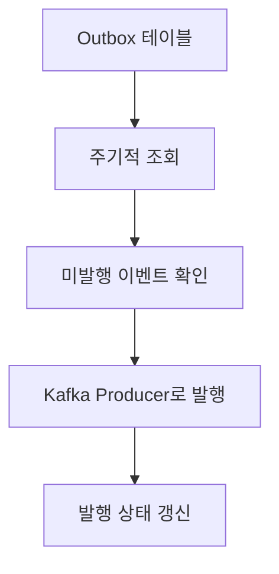

특징:
- 구현 방식이 직관적이다.
- 일정 간격으로 DB를 조회하므로 폴링 부하가 발생할 수 있다.
- 조회 주기에 따라 이벤트 전달 지연이 생긴다.
- 여러 Relay가 동시에 실행될 때 중복 발행 방지와 작업 선점 처리가 필요하다.
- Kafka 발행 성공 후 DB 상태 갱신 전에 장애가 나면 중복 발행 가능성이 있다.

### B. CDC 기반 Relay

Debezium이 DB 변경 로그를 읽어 Outbox 테이블의 INSERT를 감지하고, Kafka Connect 파이프라인을 통해 Kafka로 전달한다.

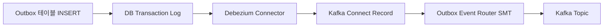

특징:
- DB를 반복 조회하는 방식이 아니라 DB 변경 로그를 읽는다.
- Outbox INSERT를 이벤트 발행의 입력으로 활용한다.
- DB 종류별 Connector 설정과 로그 보존·오프셋·스키마·커넥터 운영이 필요하다.
- 재시작과 장애 복구, 중복 전달 가능성에 대비해야 한다.

**중요:** Outbox Relay는 하나의 특정 제품 이름이 아니다. Outbox 이벤트를 브로커로 전달하는 역할을 가리키는 개념이며, Polling Publisher나 Debezium CDC 파이프라인으로 구현할 수 있다.

---

# 7. Debezium CDC와 이벤트 Envelope

## 7.1 CDC(Change Data Capture)란?

CDC는 데이터베이스에서 발생한 데이터 변경을 감지해 다른 시스템으로 전달하는 방식이다.

대표적인 변경:
- INSERT: 데이터 생성
- UPDATE: 데이터 수정
- DELETE: 데이터 삭제

Debezium은 DB의 트랜잭션 로그 등을 읽어 변경 이벤트를 생성하는 CDC 플랫폼이다.

DB 종류에 따라 PostgreSQL의 WAL, MySQL의 binlog 등 서로 다른 로그 메커니즘을 사용한다.

## 7.2 Debezium의 처리 흐름

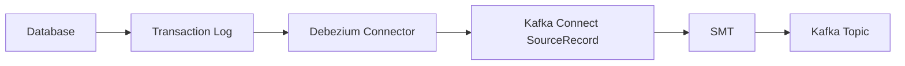

1. 애플리케이션이 DB 데이터를 변경한다.
2. DB가 변경 내용을 트랜잭션 로그에 기록한다.
3. Debezium Connector가 로그를 읽는다.
4. Debezium이 변경 이벤트를 구성한다.
5. Kafka Connect Record로 파이프라인에서 처리한다.
6. 설정된 SMT가 레코드를 변환할 수 있다.
7. 최종 레코드가 Kafka Topic으로 전달된다.

## 7.3 Envelope란?

Envelope(엔벌로프)는 Debezium의 변경 이벤트에서 실제 row 데이터와 변경 맥락을 함께 감싸는 구조다.

일반적인 Debezium 변경 이벤트의 Value는 다음과 같은 형태를 가질 수 있다.

```json
{
  "before": null,
  "after": {
    "id": 101,
    "status": "CREATED",
    "amount": 35000
  },
  "source": {
    "db": "commerce",
    "table": "orders"
  },
  "op": "c",
  "ts_ms": 1793760000000
}
```

주요 필드:

| 필드 | 의미 |
|---|---|
| `before` | 변경 전 row |
| `after` | 변경 후 row |
| `source` | 변경이 발생한 DB·테이블·로그 위치 등 출처 정보 |
| `op` | 변경 작업 유형 |
| `ts_ms` | 이벤트 시간 관련 타임스탬프 |

대표적인 `op` 값:
- `c`: create/insert
- `u`: update
- `d`: delete
- `r`: snapshot read

실제 필드와 타입은 Connector, DB, Debezium 버전 및 설정에 따라 달라질 수 있다.

## 7.4 Row와 Envelope의 차이

- **Row:** DB 테이블의 한 행에 해당하는 실제 데이터
- **Envelope:** Row와 변경 전후 값, 출처, 변경 유형 등의 메타데이터를 감싸는 이벤트 구조

따라서 `after`에 들어 있는 row와 Envelope 전체는 같은 것이 아니다.

## 7.5 Unwrap이란?

Unwrap은 Envelope에 포함된 여러 정보 중 필요한 데이터, 보통 `after`의 row를 추출해 메시지 구조를 단순화하는 작업을 말한다.

변환 전:
```json
{
  "before": null,
  "after": {
    "id": 101,
    "status": "CREATED"
  },
  "source": {
    "table": "orders"
  },
  "op": "c"
}
```

변환 후 개념 예시:
```json
{
  "id": 101,
  "status": "CREATED"
}
```

이렇게 하면 Consumer는 `before`, `source`, `op` 등 전체 Envelope를 해석하지 않고 row 중심으로 데이터를 처리할 수 있다.

단, DELETE 이벤트에서는 `after`가 `null`이므로 삭제 이벤트를 어떻게 표현할지 설정해야 한다. 메타데이터를 헤더나 별도 필드로 보존할지도 결정해야 한다.

**Unwrap은 row를 메모리에 저장하는 작업이라는 뜻이 아니다.** Kafka Connect가 처리하는 Record의 Value 등을 변환해 Envelope에서 필요한 데이터를 추출하는 것이다.

---

# 8. SMT: ExtractNewRecordState와 Outbox Event Router

## 8.1 SMT(Single Message Transform)란?

SMT는 Kafka Connect에서 레코드 한 건씩 적용하는 변환 기능이다.

변환할 수 있는 대상:
- Record Key
- Record Value
- Record Header
- Topic 이름
- 필드 추가·삭제·이름 변경
- 메시지 구조 평탄화
- 특정 필드 추출 또는 마스킹

SMT는 Kafka Connect 파이프라인의 변환 단계다. 일반적인 Kafka Consumer 내부의 업무 로직과 구분해야 한다.

## 8.2 ExtractNewRecordState SMT

`ExtractNewRecordState`는 Debezium의 일반적인 변경 이벤트 Envelope에서 새 row, 즉 보통 `after` 값을 추출하는 SMT다.

대표 목적:
- Envelope를 평탄화한다.
- Consumer가 row 중심으로 데이터를 쉽게 처리하도록 한다.
- 필요에 따라 삭제 이벤트와 메타데이터 처리 방식을 설정한다.

사용 예:
- 일반 `orders` 테이블의 변경 내용을 CDC로 전달
- Consumer가 Debezium Envelope 전체 대신 변경된 row 데이터를 받도록 구성

## 8.3 Outbox Event Router SMT

Outbox Event Router는 Outbox 테이블의 행을 해석해 도메인 이벤트 형태로 구성하고 Topic으로 라우팅하는 Debezium SMT다.

예를 들어 Outbox 테이블에 다음 행이 있다고 가정한다.

| 컬럼 | 값 |
|---|---|
| `id` | `evt-001` |
| `aggregatetype` | `Order` |
| `aggregateid` | `ORD-1001` |
| `type` | `OrderCreated` |
| `payload` | 주문 JSON |

Outbox Event Router는 설정에 따라:
- `aggregatetype` 등을 활용해 목적 Topic을 결정한다.
- `aggregateid`를 Kafka 메시지 Key로 사용한다.
- `type`을 이벤트 유형 정보로 전달한다.
- `payload`를 메시지 본문으로 구성한다.
- 이벤트 ID나 추가 컬럼을 헤더 등에 포함할 수 있다.

개념적인 결과:

```text
Topic: Order
Key: ORD-1001
Value: {
  "orderId": "ORD-1001",
  "status": "CREATED"
}
```

실제 Topic 명명 규칙과 Key·Value·Header 구성은 SMT 설정에 따라 달라진다.

## 8.4 두 SMT의 차이

| 구분 | ExtractNewRecordState | Outbox Event Router |
|---|---|---|
| 주 목적 | Debezium Envelope 평탄화 | Outbox 행을 도메인 이벤트로 구성·라우팅 |
| 입력 | 일반 테이블의 CDC 변경 이벤트 | Outbox 테이블 변경 이벤트 |
| 핵심 처리 | `after` row 추출 | Outbox 컬럼 해석, Topic·Key·Payload 구성 |
| 대표 사용 | 일반 테이블 CDC | Transactional Outbox 구현 |

둘 다 SMT지만 해결하려는 문제가 다르다.

- 일반 테이블 변경 이벤트에서 `after` row만 꺼내고 싶다면 `ExtractNewRecordState`
- Outbox 테이블에 기록한 이벤트를 도메인 이벤트로 만들어 Kafka에 전달하려면 `Outbox Event Router`

## 8.5 Outbox Event Router와 Envelope의 관계

Outbox Event Router는 일반적인 Debezium Envelope의 `after`를 단순 추출하는 것과 목적이 다르다.

Outbox Event Router는 Outbox 행의 여러 컬럼을 해석해 이벤트를 구성한다. 기본 설정에서는 `payload` 자체가 메시지 Value가 될 수 있고, 추가 컬럼을 이벤트 Envelope에 포함하도록 설정할 수도 있다.

따라서 다음을 구분해야 한다.

- Debezium Envelope: DB 변경 이벤트를 표현하는 기본 구조
- Unwrap / ExtractNewRecordState: Debezium Envelope에서 새 row를 추출하는 변환
- Outbox Event Router: Outbox 테이블의 row를 도메인 이벤트로 구성하는 변환

강의에서 “row를 자신만의 구성으로 변경해서 메모리에 담는다”고 설명했다면, Outbox 행을 이벤트로 재구성하는 문맥에서는 Outbox Event Router일 수 있고, 일반 CDC의 `after`를 추출하는 문맥에서는 ExtractNewRecordState일 수 있다. 설명만으로 둘 중 하나라고 단정할 수는 없다.

---

# 9. Kafka Consumer와 Spring `@KafkaListener`

## 9.1 Kafka Consumer란?

Kafka Consumer는 Kafka Topic에서 메시지를 가져와 처리하는 클라이언트다.

예를 들어:
- 주문 서비스가 `order-events` Topic에 `OrderCreated`를 발행한다.
- 재고 서비스 Consumer가 이벤트를 읽는다.
- 재고 서비스가 재고 예약을 수행한다.

Producer는 메시지를 발행하고 Consumer는 메시지를 소비한다.

## 9.2 Spring Kafka와 `@KafkaListener`

Spring for Apache Kafka는 Spring 애플리케이션에서 Kafka를 사용하도록 지원하는 라이브러리다.

`@KafkaListener`는 지정한 Topic의 메시지를 수신할 메서드를 선언하는 어노테이션이다.

즉, `@KafkaListener` 자체가 Kafka Broker나 Consumer 프로그램 전체를 뜻하는 것은 아니다. Spring Kafka가 Consumer와 Listener Container를 구성하고, 해당 Container가 메시지를 가져와 어노테이션이 붙은 메서드를 호출한다.

## 9.3 내부 동작 흐름

```mermaid
flowchart TD
    A[Kafka Broker / Topic] --> B[Kafka Consumer]
    B --> C[Listener Container]
    C --> D[@KafkaListener 메서드 호출]
    D --> E[업무 로직 실행]
    E --> F[처리 결과 및 Offset 관리]
```

개념적인 순서:
1. Spring 애플리케이션이 시작된다.
2. Spring Kafka가 `@KafkaListener`를 확인한다.
3. Listener Container가 구성된다.
4. Container 내부의 Kafka Consumer가 Topic을 구독하고 Partition을 할당받는다.
5. Consumer가 메시지를 Poll한다.
6. Listener Container가 메시지를 Listener 메서드에 전달한다.
7. Listener 메서드가 업무 로직을 수행한다.
8. 설정된 AckMode와 에러 처리 정책에 따라 Offset 커밋 또는 재시도 등이 수행된다.

## 9.4 기본 사용 예시

```java
@Component
public class OrderEventConsumer {

    @KafkaListener(
        topics = "order-events",
        groupId = "inventory-service"
    )
    public void consume(String message) {
        System.out.println("수신 메시지: " + message);
    }
}
```

- `topics`: 구독할 Topic
- `groupId`: Consumer Group 식별자
- `consume`: 메시지를 받았을 때 호출할 메서드
- `message`: 역직렬화된 메시지 본문

실제 문자열로 받을 수 있는지는 Consumer의 Deserializer 설정과 Producer 데이터 형식에 달려 있다.

## 9.5 DTO로 받는 예시

JSON 메시지를 DTO로 역직렬화하도록 설정하면 다음과 같이 받을 수 있다.

```java
@KafkaListener(
    topics = "order-events",
    groupId = "inventory-service"
)
public void consume(OrderCreatedEvent event) {
    // 주문 생성 이벤트 처리
}
```

DTO의 필드 구조와 JSON 데이터가 맞아야 하며, JSON Deserializer 및 신뢰 패키지 등 관련 설정이 필요할 수 있다.

## 9.6 ConsumerRecord로 메타데이터까지 받기

메시지 본문 외에 Key, Partition, Offset 등이 필요하면 `ConsumerRecord`를 받을 수 있다.

```java
@KafkaListener(
    topics = "order-events",
    groupId = "inventory-service"
)
public void consume(ConsumerRecord<String, String> record) {

    String key = record.key();
    String value = record.value();

    int partition = record.partition();
    long offset = record.offset();

    System.out.println("Key: " + key);
    System.out.println("Value: " + value);
    System.out.println("Partition: " + partition);
    System.out.println("Offset: " + offset);
}
```

`ConsumerRecord`는 Kafka가 전달한 레코드의 본문과 메타데이터를 함께 다룰 때 유용하다.

## 9.7 `@KafkaListener`를 여러 개 사용한다는 의미

여러 서비스 또는 여러 Listener 메서드에 `@KafkaListener`를 사용할 수 있다. 하지만 어노테이션이 여러 개라고 같은 메시지가 무조건 모든 Listener에 복제되는 것은 아니다.

메시지 분배는 Topic, Consumer Group, Partition 할당에 따라 결정된다.

- 같은 Group: Group 안의 Consumer들이 Partition을 나누어 처리한다.
- 다른 Group: 각 Group이 독립적으로 Topic을 소비할 수 있다.

---

# 10. Consumer Group, Partition, Offset

## 10.1 Consumer Group이란?

Consumer Group은 여러 Consumer 인스턴스를 하나의 소비 단위로 묶은 것이다.

같은 `group.id`를 가진 Consumer들은 Topic의 Partition을 나누어 처리한다.

예를 들어 Topic에 Partition이 3개 있고 Consumer Group에 Consumer가 3개 있다면 다음처럼 분배될 수 있다.

```text
Topic: order-events

Partition 0 ───── Consumer A
Partition 1 ───── Consumer B
Partition 2 ───── Consumer C

Consumer Group: inventory-service
```

같은 Consumer Group 안에서는 일반적으로 하나의 Partition이 한 시점에 한 Consumer에게 할당된다.

## 10.2 Consumer 수와 Partition 수

| 조건 | 결과 |
|---|---|
| Consumer 1개, Partition 3개 | Consumer 하나가 Partition 3개를 처리할 수 있음 |
| Consumer 2개, Partition 3개 | Consumer들이 Partition을 나누어 처리 |
| Consumer 3개, Partition 3개 | 각 Consumer가 하나씩 처리할 수 있음 |
| Consumer 4개, Partition 3개 | 최소 한 Consumer는 할당받을 Partition이 없어 유휴 상태가 될 수 있음 |

따라서 동일 Group에서 실제 병렬 처리 정도는 Partition 수에 영향을 받는다.

## 10.3 서로 다른 Consumer Group

서로 다른 Group은 같은 Topic을 각각 독립적으로 소비한다.

```text
Topic: order-events
       |
       +---- inventory-service Group
       |       ├─ Consumer A
       |       └─ Consumer B
       |
       +---- notification-service Group
               └─ Consumer C
```

재고 서비스는 재고 예약을 위해 이벤트를 소비하고, 알림 서비스는 고객 알림을 위해 같은 이벤트를 별도로 소비할 수 있다.

각 Group은 자신의 Offset 진행 상태를 독립적으로 관리한다.

## 10.4 Offset Commit이란?

Consumer가 메시지를 처리한 위치를 Kafka에 기록하는 작업을 Offset Commit이라고 한다.

예를 들어 Partition 0에서 Offset 10까지 처리했다면, Consumer Group은 다음에 어디부터 읽어야 하는지 진행 위치를 관리한다.

Offset Commit은 “업무 DB 트랜잭션이 커밋되었다”는 뜻과 같지 않다.

두 가지는 별개다.
- DB Commit: Consumer가 수행한 업무 데이터 변경이 DB에 확정됨
- Kafka Offset Commit: 해당 Consumer Group의 메시지 소비 위치가 Kafka에 기록됨

## 10.5 Offset Commit 시점이 중요한 이유

**너무 일찍 Offset을 커밋하는 경우**
1. Consumer가 메시지를 가져온다.
2. Offset을 먼저 커밋한다.
3. 업무 DB 처리 중 오류가 발생한다.
4. 재시작 후 이미 처리 완료로 기록된 위치 다음부터 읽을 수 있다.

이 경우 메시지를 다시 처리하지 못할 위험이 있다.

**업무 처리 후 Offset을 커밋하는 경우**
1. Consumer가 메시지를 가져온다.
2. 업무 DB 처리를 수행한다.
3. 업무 처리는 성공했지만 Offset 커밋 전에 Consumer가 중단된다.
4. 재시작 후 같은 메시지가 다시 전달될 수 있다.

이 경우 중복 처리가 발생할 수 있다.

따라서 Consumer는 중복 메시지에 대비한 멱등성 처리가 중요하다.

## 10.6 `@KafkaListener`의 처리 성공·실패와 Offset

Spring Kafka에서는 Listener Container의 AckMode, 자동 커밋 설정, 수동 ACK, 트랜잭션 설정, 에러 핸들러 등에 따라 Offset 처리 방식이 달라진다.

대표적으로:
- 자동 또는 Container 관리 커밋 방식
- `Acknowledgment`를 사용하는 수동 ACK 방식
- Kafka Transaction과 연계하는 방식

따라서 `@KafkaListener` 메서드가 끝났다는 사실만으로 항상 동일한 방식으로 Offset이 커밋된다고 단정하면 안 된다. 프로젝트의 Spring Kafka 설정을 함께 확인해야 한다.

---

# 11. Retry, DLT와 DLQ

## 11.1 Retry란?

Retry는 Consumer가 메시지를 처리하다 실패했을 때 다시 처리하는 것이다.

일시적인 오류라면 재시도 후 성공할 수 있다.

예:
- DB의 일시적인 연결 오류
- 외부 API의 일시적인 장애
- 네트워크 타임아웃

반대로 잘못된 JSON이나 필수 필드 누락처럼 메시지 자체에 문제가 있다면 반복해도 해결되지 않을 수 있다.

## 11.2 DLQ와 DLT란?

- **DLQ(Dead Letter Queue):** 정상 처리 경로에서 처리할 수 없는 메시지를 별도 보관하는 큐 또는 경로를 뜻하는 일반적인 용어다.
- **DLT(Dead Letter Topic):** Kafka에서 실패 메시지를 보관하기 위해 사용하는 별도 Topic을 가리키는 표현이다.

Kafka 환경에서는 실패 메시지를 별도 Topic으로 보내는 구조를 많이 사용하므로 DLT라는 표현을 자주 볼 수 있다. 라이브러리나 문서에 따라 DLQ라는 용어를 더 넓은 의미로 쓰기도 한다.

## 11.3 왜 DLT가 필요한가?

특정 메시지가 계속 실패하면 다음 문제가 생길 수 있다.
- 동일 메시지의 반복 처리로 Consumer 자원이 소모된다.
- 뒤에 있는 메시지 처리가 지연될 수 있다.
- 장애 원인을 찾기 어려워질 수 있다.

따라서 제한된 재시도 후에도 처리하지 못한 메시지를 DLT로 격리한다.

## 11.4 Retry와 DLT의 처리 흐름

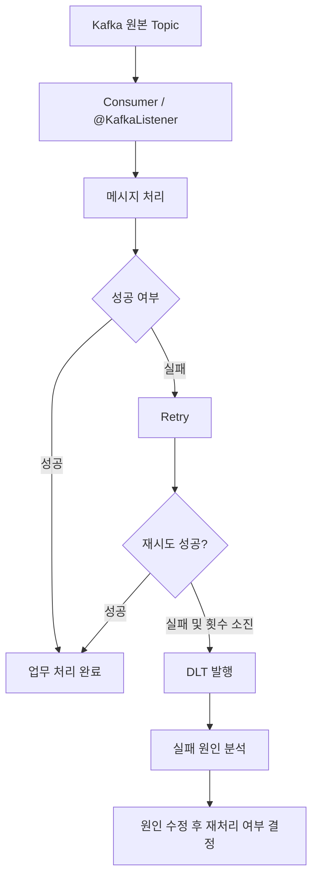

## 11.5 Spring Kafka에서의 개념적 구성

Spring Kafka에서는 `DefaultErrorHandler`, `DeadLetterPublishingRecoverer` 등을 이용해 재시도와 DLT 전송을 구성할 수 있다.

개념 예시:

```java
@Bean
public DefaultErrorHandler errorHandler(
        DeadLetterPublishingRecoverer recoverer) {

    // 최초 실패 후 1초 간격으로 2회 재시도하는 예시
    FixedBackOff backOff = new FixedBackOff(1000L, 2);

    return new DefaultErrorHandler(recoverer, backOff);
}
```

```java
@Bean
public DeadLetterPublishingRecoverer recoverer(
        KafkaTemplate<Object, Object> kafkaTemplate) {

    return new DeadLetterPublishingRecoverer(
        kafkaTemplate,
        (record, exception) ->
            new TopicPartition(
                record.topic() + ".DLT",
                record.partition()
            )
    );
}
```

위 코드는 개념을 설명하기 위한 예시다. 실제 적용 시에는 Spring Kafka 버전, Producer 직렬화 설정, DLT Topic 생성, 파티션 수, 권한, 예외 분류 등을 확인해야 한다.

## 11.6 어떤 오류를 재시도할 것인가?

| 오류 유형 | 일반적인 처리 방향 |
|---|---|
| DB 일시 연결 오류 | 제한된 재시도 |
| 외부 API 일시 장애 | 백오프를 적용한 재시도 |
| 네트워크 타임아웃 | 원인에 따라 재시도 |
| 잘못된 JSON | 재시도보다 격리·분석 |
| 필수 필드 누락 | 데이터 수정 또는 격리 |
| 지원하지 않는 이벤트 버전 | 호환성 확인 후 격리·재처리 |
| 비즈니스 규칙 위반 | 무조건 재시도하지 않고 업무 정책에 따라 거절·격리 |

일시적 오류(Transient)와 영구적 오류(Permanent)를 구분해야 한다.

## 11.7 DLT 운영 시 주의 사항

- DLT로 보냈다고 문제가 해결된 것은 아니다.
- 원본 Topic, Partition, Offset, 이벤트 ID, 예외 정보 등을 보존해야 한다.
- 실패 원인을 수정하지 않고 재처리하면 같은 실패가 반복된다.
- 재처리 시 중복 이벤트가 발생할 수 있으므로 Consumer 멱등성이 필요하다.
- DLT 보관 기간, 접근 권한, 모니터링, 알림, 재처리 절차를 정해야 한다.
- DLT에 격리된 메시지를 재처리할 때 원래의 이벤트 순서가 달라질 수 있음을 고려한다.

---

# 12. Saga Pattern과 보상 트랜잭션

## 12.1 Saga란?

Saga는 여러 마이크로서비스에 걸친 하나의 비즈니스 트랜잭션을 여러 개의 독립적인 로컬 트랜잭션으로 나누어 실행하고, 중간 단계가 실패하면 앞서 성공한 작업을 보상 트랜잭션으로 상쇄하는 패턴이다.

MSA에서는 서비스마다 독립적인 DB를 소유하는 경우가 많다. 주문 DB, 결제 DB, 재고 DB를 하나의 일반적인 로컬 DB 트랜잭션으로 묶어 원자적으로 COMMIT/ROLLBACK하기 어렵다.

## 12.2 Saga가 필요한 상황

예를 들어 주문 프로세스가 다음과 같다고 가정한다.

1. 주문 서비스: 주문 생성
2. 결제 서비스: 결제 승인
3. 재고 서비스: 재고 예약
4. 배송 서비스: 배송 요청 생성

배송 요청 단계에서 실패하더라도 이미 결제 서비스와 재고 서비스에서 수행한 DB 작업을 과거 시점으로 되돌릴 수는 없다.

Saga는 다음과 같은 별도의 보상 작업을 실행한다.
- 결제 승인 → 결제 취소 또는 환불
- 재고 예약 → 재고 예약 해제
- 주문 생성 → 주문 취소 처리

## 12.3 보상 트랜잭션(Compensating Transaction)

보상 트랜잭션은 이미 커밋된 로컬 트랜잭션의 결과를 업무적으로 취소하거나 상쇄하는 새로운 트랜잭션이다.

| 정방향 작업 | 보상 작업 예시 |
|---|---|
| 주문 생성 | 주문 취소 처리 |
| 결제 승인 | 결제 취소 또는 환불 |
| 재고 예약 | 재고 예약 해제 |
| 배송 요청 생성 | 배송 요청 취소 |

보상 트랜잭션은 DB `ROLLBACK`과 다르다. 이미 외부 결제 시스템에 전달된 승인 요청을 과거로 되돌리는 것이 아니라, 취소·환불이라는 새로운 업무 명령을 실행한다.

보상 작업 자체도 실패할 수 있으므로 재시도, 보상 상태 관리, 운영자 개입 절차가 필요하다.

## 12.4 Saga의 두 가지 구현 방식

### A. Choreography(코레오그래피)

중앙의 진행 관리자가 없이 각 서비스가 이벤트를 구독하고, 자기 작업을 수행한 뒤 다음 이벤트를 발행한다.

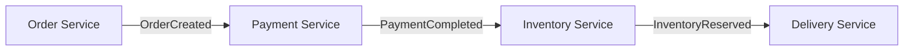

장점:
- 중앙 오케스트레이터가 필요하지 않다.
- 서비스 간 직접적인 제어 결합을 줄일 수 있다.
- 단순하고 짧은 이벤트 흐름에 적합하다.

단점:
- 서비스가 늘면 전체 흐름을 한눈에 파악하기 어렵다.
- 이벤트 간 의존 관계와 장애 원인 추적이 복잡해질 수 있다.
- 순환 이벤트와 중복 처리 방지 설계가 중요하다.

### B. Orchestration(오케스트레이션)

중앙 Saga 오케스트레이터가 각 서비스에 명령을 보내고 결과를 받아 다음 단계를 결정한다.

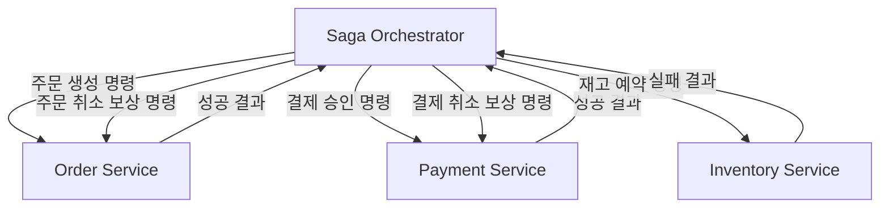

장점:
- 전체 업무 흐름과 현재 상태를 중앙에서 파악하기 쉽다.
- 실패 시 어떤 보상 작업을 수행할지 명시적으로 관리할 수 있다.
- 단계가 많고 분기·시간 제한·보상 규칙이 복잡한 프로세스에 적합하다.

단점:
- 오케스트레이터와 Saga 상태 저장·복구 로직이 필요하다.
- 오케스트레이터가 비즈니스 로직을 과도하게 떠안지 않도록 경계를 설계해야 한다.
- 고가용성, 재시작 후 복구, 중복 명령 처리가 필요하다.

## 12.5 Saga 설계 시 고려 사항

- **최종적 일관성:** 모든 서비스가 동시에 같은 순간에 변경되는 구조가 아니다. 처리 중에는 `PENDING` 등 중간 상태가 존재할 수 있다.
- **멱등성:** 동일 명령이나 이벤트가 재전달되어도 업무 결과가 중복 적용되지 않아야 한다.
- **재시도와 타임아웃:** 일시적 오류와 영구적 오류를 구분하고 재시도 정책을 둔다.
- **보상 실패:** 보상도 실패할 수 있으므로 별도 상태, 재시도, 운영자 처리 경로가 필요하다.
- **동시성:** 재고·쿠폰처럼 공유 자원을 여러 Saga가 동시에 변경할 때 조건부 갱신이나 예약 모델 등을 고려한다.
- **추적성:** `sagaId`, `correlationId`, `causationId` 등을 통해 단계별 이벤트를 연결한다.

Saga는 여러 서비스 전체에 대한 전통적인 ACID 원자성을 제공하지 않는다. 각 서비스의 로컬 트랜잭션은 ACID로 처리하되, 서비스 간 일관성은 보상과 최종적 일관성으로 맞춘다.

---

# 13. 전체 통합 흐름: 주문 생성부터 실패 처리까지

## 13.1 정상 흐름

주문 서비스가 주문을 생성하고, 재고 서비스가 주문 이벤트를 수신하는 상황이다.

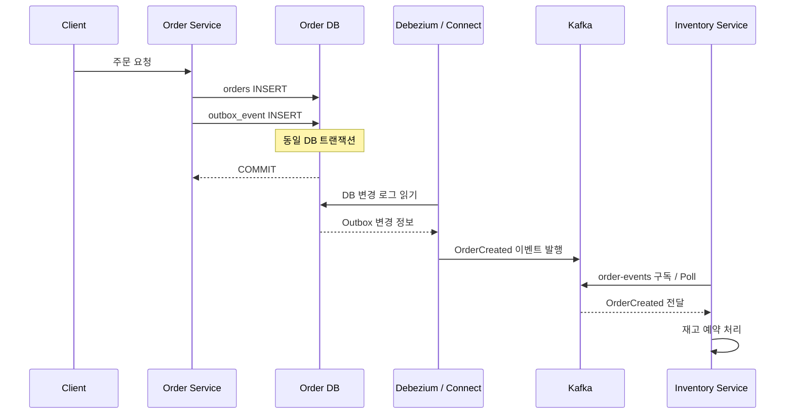

단계별 설명:

1. 고객이 주문 요청을 보낸다.
2. 주문 서비스가 주문 데이터를 생성한다.
3. 동일한 DB 트랜잭션에서 Outbox 테이블에 `OrderCreated` 이벤트를 저장한다.
4. DB 트랜잭션을 COMMIT한다.
5. Debezium이 DB 변경 로그에서 Outbox INSERT를 감지한다.
6. Kafka Connect가 변경 내용을 Record로 처리한다.
7. Outbox Event Router SMT가 Outbox 행을 도메인 이벤트로 구성한다.
8. 이벤트가 Kafka Topic에 저장된다.
9. 재고 서비스의 Kafka Consumer가 Topic에서 이벤트를 읽는다.
10. Spring Kafka의 Listener Container가 `@KafkaListener` 메서드를 호출한다.
11. 재고 서비스가 로컬 트랜잭션으로 재고 예약을 수행한다.

## 13.2 실패 메시지 처리

재고 서비스가 이벤트를 처리하다 일시적인 DB 오류를 만났다고 가정한다.

1. Consumer가 메시지를 읽는다.
2. `@KafkaListener`가 업무 로직을 실행한다.
3. DB 연결 오류 등으로 처리가 실패한다.
4. 에러 핸들러가 예외 유형과 재시도 정책을 확인한다.
5. 재시도 후 성공하면 업무 처리를 완료한다.
6. 재시도를 모두 소진하면 설정에 따라 DLT로 메시지를 보낸다.
7. 운영자가 원인을 분석하고 필요한 수정 후 재처리 여부를 결정한다.

## 13.3 Saga와 DLT의 차이

DLT 전송과 Saga 보상은 서로 다른 역할이다.

| 구분 | DLT | Saga 보상 |
|---|---|---|
| 목적 | 처리할 수 없는 메시지 격리 | 이미 진행된 업무 결과를 상쇄 |
| 대상 | 메시지 | 비즈니스 작업 |
| 실행 이유 | 재시도 소진 또는 처리 불가 | Saga 단계 실패 등 업무 흐름상 보상 필요 |
| 예시 | `OrderCreated` 메시지를 `order-events.DLT`에 격리 | 결제 취소, 재고 예약 해제, 주문 취소 |

**메시지를 DLT에 넣었다고 주문이 자동 취소되거나 재고가 자동 복구되는 것은 아니다.**

DLT에 격리된 메시지의 실패가 Saga의 실패 상태로 연결되고, 보상 명령이 실행되도록 별도로 설계해야 한다.

---

# 14. 핵심 개념 비교

## 14.1 전체 개념 비교

| 개념 | 해결하는 문제 | 핵심 역할 |
|---|---|---|
| DB Transaction | DB 내 여러 작업의 원자성 | COMMIT 또는 ROLLBACK |
| Message Broker | 서비스 간 메시지 전달 | 메시지 수신·저장·전달 |
| Kafka | 분산 이벤트 전달 | Topic·Partition 기반 이벤트 저장 및 소비 |
| Kafka Connect | 외부 시스템과 Kafka 연동 | Source/Sink Connector 실행 |
| Kafka Connect Record | Connect 파이프라인의 메시지 표현 | Topic·Key·Value·Header 등 데이터 표현 |
| Outbox Table | 발행할 이벤트 보관 | 업무 트랜잭션과 같은 DB에 이벤트 저장 |
| Outbox Relay | Outbox 이벤트 전달 | 이벤트를 Kafka로 발행 |
| Debezium | DB 변경 감지 | DB 로그 기반 CDC |
| Envelope | 변경 이벤트 구조 | before/after/source/op 등 변경 맥락 포함 |
| Unwrap | 이벤트 구조 단순화 | Envelope에서 after row 등 추출 |
| SMT | Connect 레코드 변환 | Key·Value·Header·Topic 변환 |
| ExtractNewRecordState | CDC Envelope 평탄화 | 새 row 추출 |
| Outbox Event Router | Outbox 이벤트 구성 | Outbox 행을 도메인 이벤트로 라우팅 |
| Kafka Consumer | 메시지 소비 | Topic에서 메시지를 읽고 처리 |
| `@KafkaListener` | Spring 메시지 수신 진입점 | Listener 메서드 선언 |
| Consumer Group | Consumer 병렬 처리 단위 | Partition을 Consumer들에 분배 |
| Partition | Topic의 분할 단위 | 병렬 처리와 파티션 내 순서 제공 |
| Offset | 소비 위치 관리 | Partition 내 메시지 위치 기록 |
| Retry | 일시적 처리 실패 대응 | 메시지 재처리 |
| DLT/DLQ | 반복 처리 실패 대응 | 실패 메시지 격리 |
| Saga | 여러 서비스의 업무 트랜잭션 | 단계 실행 및 보상 작업 관리 |

## 14.2 자주 혼동하는 개념

| 혼동하는 개념 | 올바른 구분 |
|---|---|
| Outbox 테이블 vs DB 트랜잭션 로그 | Outbox는 발행할 이벤트를 저장하고, DB 트랜잭션 로그는 DB 변경 이력을 기록한다. |
| Outbox Relay vs Message Broker | Relay는 이벤트를 브로커로 전달하고, Broker는 메시지를 보관·전달한다. |
| Kafka Connect vs Debezium | Connect는 연동 프레임워크이고, Debezium은 그 위에서 실행되는 CDC Connector 기술이다. |
| DB Row vs Connect Record | Row는 테이블 행이고, Record는 Connect 파이프라인의 메시지 객체다. |
| Envelope vs Row | Envelope는 row와 변경 메타데이터를 감싼 이벤트 구조다. |
| Envelope vs Unwrap | Envelope는 구조이고, Unwrap은 구조에서 필요한 데이터를 추출하는 변환이다. |
| ExtractNewRecordState vs Outbox Event Router | 전자는 일반 CDC 이벤트 평탄화, 후자는 Outbox 행의 도메인 이벤트 라우팅이다. |
| Consumer vs `@KafkaListener` | Consumer는 Kafka 메시지를 읽는 클라이언트이고, `@KafkaListener`는 Spring에서 수신 메서드를 선언하는 어노테이션이다. |
| Offset Commit vs DB Commit | 하나는 Kafka 소비 위치 기록, 다른 하나는 DB 업무 변경 확정이다. |
| DLT vs Saga 보상 | DLT는 메시지 격리, Saga 보상은 업무 결과 상쇄다. |

---

# 15. 발표·학습 점검 질문

## 15.1 기초 구조

1. Producer, Message Broker, Consumer는 각각 어떤 역할인가?
2. Kafka는 왜 메시지 브로커라고 부를 수 있는가?
3. Topic과 Partition의 차이는 무엇인가?
4. Partition을 여러 개로 나누면 어떤 이점이 있는가?
5. Offset은 무엇이며 왜 Partition마다 별도로 관리하는가?
6. 같은 Topic을 서로 다른 Consumer Group이 소비하면 어떤 일이 일어나는가?

## 15.2 Kafka Connect와 Debezium

7. Kafka Connect는 어떤 역할을 하는 프레임워크인가?
8. Source Connector와 Sink Connector의 방향은 어떻게 다른가?
9. Debezium과 Kafka Connect의 관계는 무엇인가?
10. Kafka Connect Record는 무엇이며 DB Row와 어떻게 다른가?
11. Debezium은 DB의 어떤 정보를 읽어 변경 이벤트를 만드는가?
12. Envelope의 `before`, `after`, `source`, `op`는 각각 무엇인가?
13. Unwrap은 무엇이며 왜 사용하는가?
14. “row를 메모리에 담는다”는 설명을 정확히 어떻게 이해해야 하는가?

## 15.3 Outbox와 SMT

15. DB 저장과 Kafka 발행을 각각 수행하면 어떤 이중 쓰기 문제가 생길 수 있는가?
16. Outbox 테이블은 무엇을 저장하는가?
17. Outbox 테이블은 DB 트랜잭션 로그와 어떻게 다른가?
18. 주문 테이블과 Outbox 테이블을 같은 트랜잭션으로 저장하는 이유는 무엇인가?
19. Outbox Relay와 Message Broker의 역할은 어떻게 다른가?
20. Polling Publisher와 CDC 기반 Relay의 차이는 무엇인가?
21. SMT는 무엇을 변환하는가?
22. ExtractNewRecordState와 Outbox Event Router의 차이는 무엇인가?

## 15.4 Consumer와 실패 처리

23. Kafka Consumer는 어떤 역할을 하는가?
24. `@KafkaListener`는 무엇이며 내부적으로 어떤 흐름으로 호출되는가?
25. Consumer Group은 왜 사용하는가?
26. 같은 Group 안에서 Partition은 어떻게 분배되는가?
27. Offset Commit과 DB Commit은 왜 구분해야 하는가?
28. 메시지 처리 후 Offset Commit 전에 장애가 발생하면 어떤 문제가 생길 수 있는가?
29. Retry와 DLT는 각각 어떤 상황에 사용하는가?
30. DLT에 보낸 메시지를 재처리할 때 무엇을 주의해야 하는가?

## 15.5 Saga

31. MSA에서 Saga가 필요한 이유는 무엇인가?
32. 보상 트랜잭션은 DB Rollback과 어떻게 다른가?
33. Choreography와 Orchestration의 차이는 무엇인가?
34. Saga의 최종적 일관성이란 무엇인가?
35. DLT에 메시지를 보냈다고 Saga 보상이 자동 실행되는가?

---

# 16. 참고 자료

실제 프로젝트 적용 시에는 사용하는 Kafka, Spring Kafka, Debezium 버전에 맞는 공식 문서를 확인한다.

1. **Microservices.io — Saga Pattern**  
   https://microservices.io/patterns/data/saga.html

2. **Microservices.io — Transactional Outbox**  
   https://microservices.io/patterns/data/transactional-outbox.html

3. **Apache Kafka Documentation**  
   https://kafka.apache.org/documentation/

4. **Kafka Connect Documentation — Single Message Transforms**  
   https://kafka.apache.org/documentation/#connect_transforms

5. **Debezium Documentation — Outbox Event Router**  
   https://debezium.io/documentation/reference/stable/transformations/outbox-event-router.html

6. **Debezium Documentation — Event Flattening (ExtractNewRecordState)**  
   https://debezium.io/documentation/reference/stable/transformations/event-flattening.html

7. **Spring for Apache Kafka — `@KafkaListener`**  
   https://docs.spring.io/spring-kafka/reference/kafka/receiving-messages/listener-annotation.html

8. **Spring for Apache Kafka — Exception Handling**  
   https://docs.spring.io/spring-kafka/reference/kafka/annotation-error-handling.html

9. **AWS Prescriptive Guidance — Saga Pattern**  
   https://docs.aws.amazon.com/prescriptive-guidance/latest/cloud-design-patterns/saga.html

---

## 최종 핵심 요약

```text
[DB 트랜잭션]
  주문 데이터 + Outbox 이벤트를 함께 저장
          |
          v
[Outbox Relay]
  Outbox 이벤트를 읽어 Kafka로 전달
          |
          v
[Kafka Broker]
  Topic / Partition에 메시지 저장
          |
          v
[Kafka Consumer]
  메시지를 읽음
          |
          v
[Spring @KafkaListener]
  서비스의 업무 로직 실행
          |
     성공 / 실패
       /      \
      v        v
   업무 완료   Retry → DLT

[Saga]
여러 서비스의 업무 단계와 실패 시 보상 작업을 관리
```

**한 문장씩 기억하기**
- DB 트랜잭션: DB 안의 여러 작업을 하나의 원자적 단위로 처리한다.
- Outbox 테이블: 외부에 발행할 이벤트를 DB에 저장한다.
- Outbox Relay: Outbox 이벤트를 메시지 브로커로 전달한다.
- Kafka: 메시지를 Topic과 Partition에 저장하고 Consumer가 읽도록 한다.
- Kafka Connect: 외부 시스템과 Kafka 사이의 데이터 연결을 관리한다.
- Debezium: DB 변경 로그를 읽어 CDC 이벤트를 생성한다.
- Envelope: 변경 데이터와 변경 맥락을 함께 담는 이벤트 구조다.
- SMT: Kafka Connect 레코드를 메시지 단위로 변환한다.
- `@KafkaListener`: Spring 애플리케이션에서 Kafka 메시지를 수신할 메서드를 선언한다.
- DLT: 재시도 후에도 처리할 수 없는 메시지를 별도 Topic으로 격리한다.
- Saga: 여러 서비스의 업무 트랜잭션을 연결하고 실패 시 보상 작업을 수행한다.
