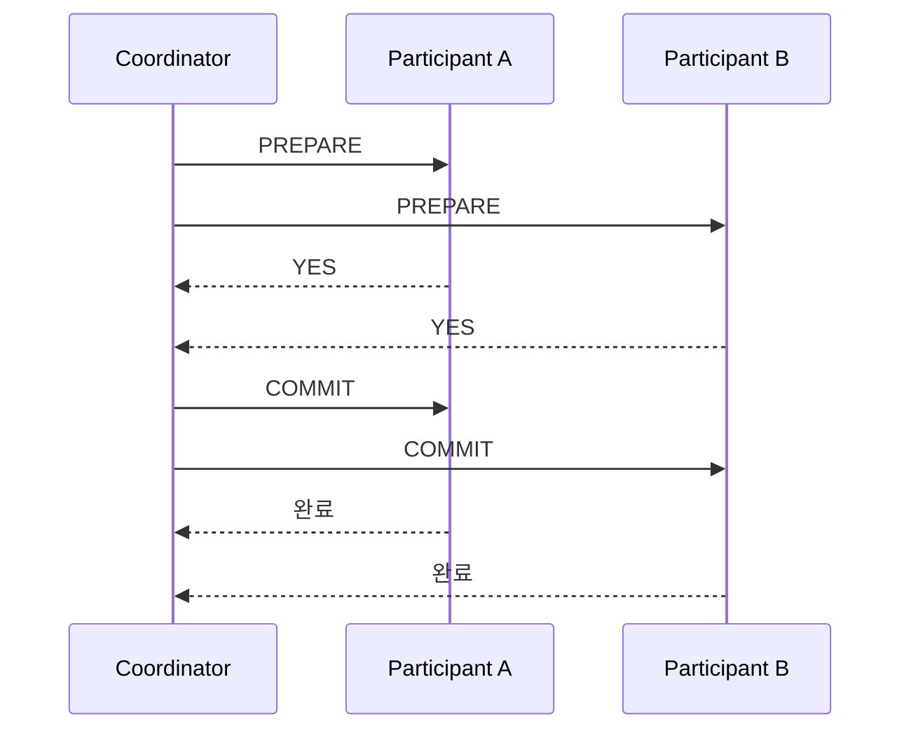
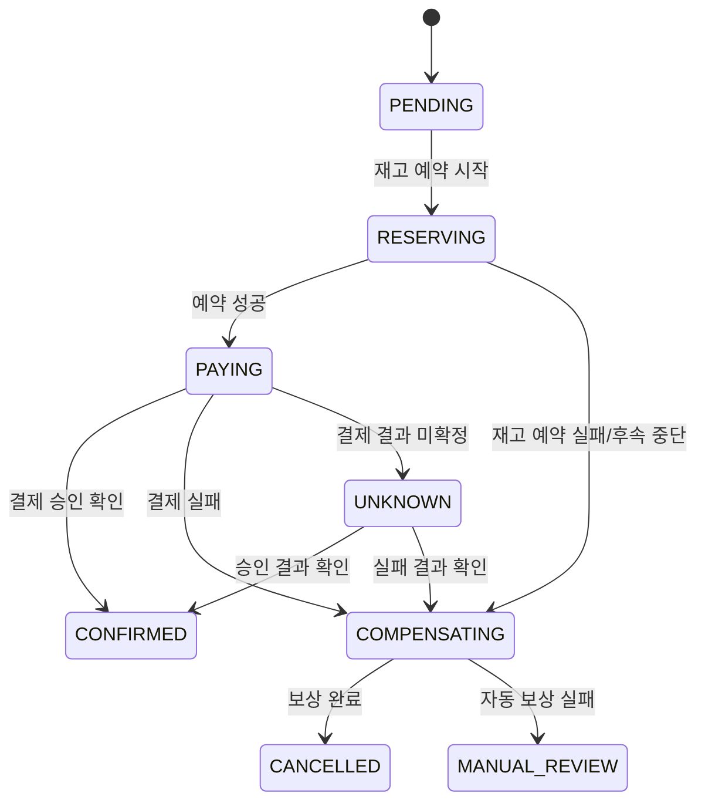
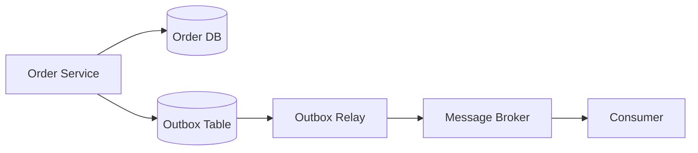
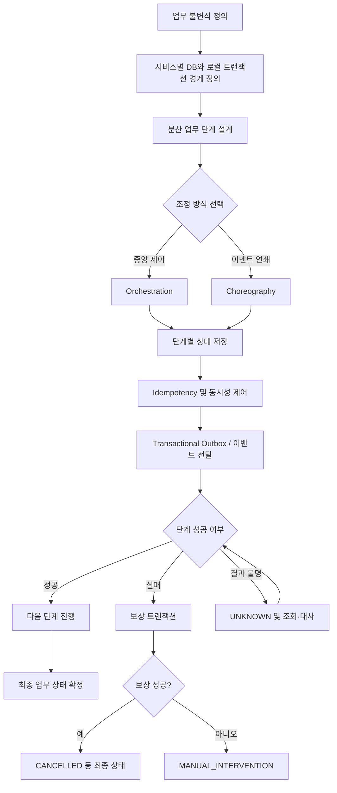

# 데이터 일관성과 Distributed Transaction 완전 분석 및 학습 문서

## 문서 정보

| 항목 | 내용 |
|---|---|
| 기술 분야 | 데이터 일관성과 Distributed Transaction |
| 분석 대상 | PART 17 |
| 전체 이미지 수 | 20장 |
| 분석 이미지 범위 | IMG-01 ~ IMG-20 |
| 작성 목적 | 기술 학습 및 팀원 대상 발표 |
| 문서 버전 | v1.0 |
| 원본 형식 | PNG 인포그래픽 20장 |
| 최종 형식 | Markdown |

> **문서 작성 원칙**
>
> - `[원문]`은 이미지에서 확인되는 핵심 설명·표·상태·예시를 보존한 내용이다.
> - `[보충 설명]`은 개념 이해와 실제 구현을 위해 추가한 설명이다.
> - `[기술적 검토]`는 원문의 표현을 정확하게 이해하기 위해 범위·전제·주의점을 명시한 내용이다.
> - 이미지의 작은 글씨나 표 내부의 일부 세부 문구는 해상도와 판독 한계로 완전한 문자 단위 전사가 어려울 수 있다. 그런 부분은 임의로 복원하지 않고 본문에서 의미가 확인되는 범위로 기술하며, 부록 C에 확인 필요 사항을 남긴다.
> - 출처 번호는 해당 설명이 실제로 확인되는 이미지에만 연결한다.

---

## 목차

1. [분산 트랜잭션 개요](#1-분산-트랜잭션-개요)
2. [로컬 트랜잭션과 ACID](#2-로컬-트랜잭션과-acid)
3. [Monolithic과 MSA의 커밋 경계](#3-monolithic과-msa의-커밋-경계)
4. [Spring @Transactional의 적용 범위](#4-spring-transactional의-적용-범위)
5. [Timeout과 UNKNOWN 상태](#5-timeout과-unknown-상태)
6. [업무 규칙과 데이터 일관성](#6-업무-규칙과-데이터-일관성)
7. [Strong Consistency와 Eventual Consistency](#7-strong-consistency와-eventual-consistency)
8. [2PC(2-Phase Commit)](#8-2pc2-phase-commit)
9. [2PC의 비용과 적용 판단](#9-2pc의-비용과-적용-판단)
10. [Saga 패턴과 로컬 트랜잭션의 연결](#10-saga-패턴과-로컬-트랜잭션의-연결)
11. [주문 Saga의 성공 경로](#11-주문-saga의-성공-경로)
12. [보상 트랜잭션과 DB Rollback의 차이](#12-보상-트랜잭션과-db-rollback의-차이)
13. [상태 머신으로 진행과 복구 표현하기](#13-상태-머신으로-진행과-복구-표현하기)
14. [Choreography 방식](#14-choreography-방식)
15. [Orchestration 방식](#15-orchestration-방식)
16. [Idempotency와 중복 요청 제어](#16-idempotency와-중복-요청-제어)
17. [동시 실행과 순서 역전](#17-동시-실행과-순서-역전)
18. [Transactional Outbox 패턴](#18-transactional-outbox-패턴)
19. [실패 시나리오를 통한 설계 검증](#19-실패-시나리오를-통한-설계-검증)
20. [분산 트랜잭션 데이터 일관성 최종 지도](#20-분산-트랜잭션-데이터-일관성-최종-지도)
21. [핵심 내용 정리](#21-핵심-내용-정리)
22. [부록 A. 이미지별 원문 및 분석 인덱스](#부록-a-이미지별-원문-및-분석-인덱스)
23. [부록 B. 중복 통합 내역](#부록-b-중복-통합-내역)
24. [부록 C. 확인 및 보완 사항](#부록-c-확인-및-보완-사항)

---

# 1. 분산 트랜잭션 개요

## 1.1 분산 트랜잭션이 필요한 이유

[원문]

주문 생성, 재고 예약, 결제 승인은 각각 서로 다른 서비스의 데이터베이스에서 커밋될 수 있다. 각 서비스는 자기 DB만 변경한다. 따라서 모든 HTTP 응답이 `200 OK`라고 해서 주문 전체가 완료된 것은 아니다. 부분 성공을 숨기지 말고 중간 상태를 표현할 수 있어야 한다.

예시 서비스 구성은 다음과 같다.

| 서비스 | 담당 기능 | 전용 DB |
|---|---|---|
| `order-service` | 주문 생성·취소 | Order DB |
| `inventory-service` | 재고 예약·해제 | Inventory DB |
| `payment-service` | 결제 승인·취소 | Payment DB |

클라이언트가 `POST /api/orders` 요청을 보내면 주문 생성 → 재고 예약 → 결제 승인 순서로 처리될 수 있다. 각 서비스는 자신의 DB에 대해 로컬 커밋을 수행한다.

[출처: IMG-01]

[보충 설명]

분산 트랜잭션은 하나의 업무 작업이 여러 서비스 또는 여러 데이터 저장소에 걸쳐 실행될 때, 부분 성공·부분 실패가 발생해도 업무적으로 허용되는 최종 상태를 만들기 위한 처리 방식이다.

예를 들어 주문 서비스가 주문 레코드를 생성하고 재고 서비스가 재고를 예약했지만 결제 서비스가 승인을 거절할 수 있다. 이때 주문 DB와 재고 DB의 변경은 이미 각각 커밋되었을 수 있으므로, 하나의 DB 트랜잭션처럼 전체를 단순 `ROLLBACK`할 수 없다.

핵심 문제는 **각 서비스의 로컬 성공을 전체 업무 성공으로 오인하지 않는 것**이다.

## 1.2 HTTP 성공과 업무 성공은 다르다

[원문]

분산 트랜잭션에서는 모든 단계의 HTTP 200보다 업무 불변식으로 성공을 판단한다. 주문, 재고, 결제가 모두 일관된 상태일 때만 '주문 완료'라고 판단한다.

[출처: IMG-01]

[보충 설명]

HTTP 200은 일반적으로 해당 HTTP 요청이 성공적으로 처리되었다는 응답이다. 그러나 응답을 반환한 서비스의 업무 단계가 성공했는지, 후속 서비스까지 모두 완료되었는지, 전체 업무가 최종 완료되었는지는 별도로 판단해야 한다.

예를 들어 다음은 서로 다른 사실이다.

- 주문 서비스가 주문 생성 요청을 정상 접수했다.
- 재고 서비스가 재고 예약을 완료했다.
- 결제 서비스가 결제 승인을 완료했다.
- 주문 전체가 업무 규칙을 만족하여 최종 완료되었다.

따라서 API 응답 코드와 업무 상태를 분리해서 설계해야 한다.

## 1.3 업무 불변식(Business Invariant)

[원문]

각 서비스의 성공 조건은 서비스별로 정의한다.

| 서비스 | 로컬 커밋 내용 | 성공 조건에 포함되는 상태 |
|---|---|---|
| `order-service` | 주문 상태 저장(생성, 취소) | 주문이 존재하고 상태가 완료 |
| `inventory-service` | 예약 상태 저장(예약, 해제) | 예약이 확정되어 있고 수량이 정상 |
| `payment-service` | 결제 상태 저장(승인, 취소) | 결제가 승인되어 있고 금액이 일치 |

[출처: IMG-01]

[보충 설명]

업무 불변식은 시스템이 항상 지켜야 하는 업무 규칙이다. 주문 완료의 예라면 다음 조건을 둘 수 있다.

1. 주문이 유효한 상태로 존재한다.
2. 필요한 재고가 예약되어 있다.
3. 결제가 승인되었다.
4. 결제 금액과 주문 금액이 일치한다.

단, 실제 업무에서는 결제 승인과 주문 완료 사이에 배송 준비·위험 검증 등 다른 조건이 추가될 수 있다. 불변식은 시스템의 업무 요구사항에 맞춰 정의해야 한다.

---

# 2. 로컬 트랜잭션과 ACID

## 2.1 로컬 트랜잭션이 해결하는 범위

[원문]

쇼핑몰에서 주문 요청이 오면 재고 수량을 확인하고 감소시키는 로직과 예약 기록 저장을 같은 로컬 트랜잭션으로 처리할 수 있다. 그러나 결제는 다른 서비스의 DB에서 처리되므로 동일한 원자성에 포함되지 않는다. 격리 수준에 따라 동시 요청 결과도 달라질 수 있다.

[출처: IMG-02]

[보충 설명]

로컬 트랜잭션은 하나의 데이터베이스 또는 하나의 트랜잭션 관리 범위 안에서 수행되는 변경 작업이다. 예를 들어 Inventory DB에서 다음 두 작업을 함께 처리할 수 있다.

- 상품 재고 수량 감소
- 재고 예약 기록 생성

두 작업이 하나의 트랜잭션에 포함되면 둘 다 커밋되거나 둘 다 롤백되도록 구성할 수 있다.

하지만 결제 서비스가 별도의 Payment DB를 사용한다면 Inventory DB의 로컬 트랜잭션이 Payment DB까지 자동으로 포함하지는 않는다.

## 2.2 ACID의 네 가지 성질

[원문]

ACID는 하나의 DB 트랜잭션에서 데이터의 정합성을 보장하기 위한 성질이다. 로컬 트랜잭션은 하나의 데이터베이스(또는 같은 DB 자원) 안에서 원자성을 제공하며, 다른 서비스의 DB는 별도 트랜잭션이므로 여러 서비스 전체가 동시에 원자적으로 롤백되지는 않는다.

| 특성 | 의미 | 로컬 트랜잭션에서의 의미 | 예시 |
|---|---|---|---|
| Atomicity(원자성) | 모든 연산이 성공하거나 모두 실패 | 하나의 DB 트랜잭션 내부 변경을 함께 커밋·롤백 | 주문과 예약 기록이 함께 저장 |
| Consistency(일관성) | 트랜잭션 전후 데이터가 정해진 제약·규칙을 만족 | 제약 조건과 업무 규칙을 위반하지 않도록 변경 | 재고 수량이 음수가 되지 않음 |
| Isolation(격리성) | 동시 트랜잭션의 간섭을 제어 | 격리 수준에 따라 동시 실행 결과를 제어 | 같은 재고를 동시에 예약 |
| Durability(지속성) | 커밋 결과가 지속됨 | 커밋된 데이터가 장애 후에도 보존되도록 함 | 커밋된 주문 레코드 유지 |

[출처: IMG-02]

[기술적 검토]

ACID의 Consistency는 DB 제약 조건만을 뜻하지 않는다. 애플리케이션이 정의한 업무 불변식까지 포함할 수 있지만, DB가 자동으로 모든 업무 규칙을 알아서 보장하는 것은 아니다. 애플리케이션 로직, 제약 조건, 트랜잭션 설계가 함께 필요하다.

## 2.3 로컬 트랜잭션의 경계

[원문]

주문 서비스, 결제 서비스, 배송 서비스는 각각 별도의 DB와 로컬 트랜잭션을 가질 수 있다. 주문 서비스의 로컬 트랜잭션은 Order DB를, 결제 서비스는 Payment DB를, 배송 서비스는 Delivery DB를 변경한다.

[출처: IMG-02]

[보충 설명]

서비스별 DB가 분리되어 있으면 각 서비스의 로컬 트랜잭션은 독립적으로 커밋된다. 한 서비스에서 커밋된 변경은 다른 서비스의 트랜잭션이 실패했다고 자동으로 취소되지 않는다.

따라서 시스템 전체의 일관성은 로컬 트랜잭션만으로 해결되지 않는다. 서비스 간 업무 흐름을 조정하는 분산 트랜잭션 패턴이 필요하다.

---

# 3. Monolithic과 MSA의 커밋 경계

## 3.1 Monolithic 구조와 MSA 구조의 차이

[원문]

Monolithic에서는 하나의 애플리케이션이 하나의 트랜잭션 DB를 사용하여 여러 테이블의 변경을 한 커밋에 묶기 쉽다. 반면 MSA에서는 여러 DB나 외부 결제를 사용하면 원격 API 호출은 로컬 트랜잭션 경계 밖에 놓인다.

| 구분 | 커밋 경계 | 변경 가능한 데이터 | 특징 |
|---|---|---|---|
| Monolithic(단일 DB) | 하나의 로컬 트랜잭션 | 여러 테이블 동시 변경 | 한 번의 커밋으로 원자성 확보가 비교적 쉬움 |
| MSA(DB/외부 결제) | 각 서비스별 로컬 트랜잭션 | DB와 외부 시스템에 분산 | 여러 서비스 전체의 원자성은 별도 설계 필요 |
| MSA(독립 배포 서비스) | 서비스별 DB 트랜잭션 | 각 서비스가 소유한 데이터 | 배포·장애 격리가 유리하지만 일관성 조정 필요 |

[출처: IMG-03]

[보충 설명]

Monolithic이라고 항상 하나의 DB를 쓰는 것은 아니며, MSA라고 반드시 DB가 서비스마다 하나씩만 존재하는 것도 아니다. 이미지의 비교는 일반적인 아키텍처 경향을 설명한다.

## 3.2 원격 API 호출은 로컬 DB 트랜잭션이 아니다

[원문]

각 서비스는 자신의 DB만 로컬 트랜잭션으로 커밋할 수 있다. 원격 API 호출은 로컬 트랜잭션 경계 밖에 놓이므로 여러 DB를 하나의 트랜잭션으로 묶기 어렵다. 복잡한 업무일수록 보상 트랜잭션, 중간 상태 관리, 장애 복구 비용이 커진다.

[출처: IMG-03]

[보충 설명]

다음 코드는 하나의 DB 트랜잭션이 외부 HTTP 호출까지 원자적으로 묶어 주지 않는다는 점을 보여주는 개념 예시다.

```java
@Transactional
public void createOrder(OrderRequest request) {
    orderRepository.save(new Order(request));

    // 원격 HTTP 호출은 현재 DB 트랜잭션의 원자성에 포함되지 않는다.
    inventoryClient.reserve(request.productId(), request.quantity());
    paymentClient.pay(request.paymentRequest());
}
```

위 메서드에서 Order DB의 트랜잭션이 롤백되더라도, 원격 재고 서비스가 이미 커밋한 예약이나 결제 시스템이 처리한 결제가 자동으로 취소되는 것은 아니다.

## 3.3 원격 API 호출이 실패했을 때

[원문]

주문 생성은 Order DB에 먼저 커밋되고, 이후 결제 서비스 호출이 실패할 수 있다. 이때 Order DB는 이미 커밋된 상태일 수 있으므로 주문 상태를 유지하거나 취소·보상하는 별도 처리가 필요하다. 재시작 시 중복 요청에도 멱등하게 동작하도록 설계해야 한다.

[출처: IMG-03]

[기술적 검토]

외부 API 호출을 `@Transactional` 메서드 안에 넣었다고 해서 외부 시스템이 같은 트랜잭션에 자동 참여하는 것은 아니다. 네트워크 호출이 DB 트랜잭션 동안 실행되면 DB 커넥션·락 점유 시간이 길어지는 문제도 생길 수 있다.

---

# 4. Spring @Transactional의 적용 범위

## 4.1 @Transactional은 어디까지 적용되는가?

[원문]

주문 서비스는 Order DB 트랜잭션으로 주문 데이터를 저장하고, Payment 서비스는 Payment DB 트랜잭션으로 결제 데이터를 저장한다. `@Transactional`은 선택된 트랜잭션 관리자와 자원 범위에서 동작하며, 원격 서비스의 DB 트랜잭션까지 자동으로 포함하지 않는다.

[출처: IMG-04]

[보충 설명]

Spring의 `@Transactional`은 일반적으로 현재 애플리케이션에서 설정된 `PlatformTransactionManager` 등의 트랜잭션 관리자를 통해 트랜잭션 경계를 선언한다. 적용되는 DB 자원은 트랜잭션 관리자 설정과 연결된 데이터 소스 등에 의해 결정된다.

| 구분 | 트랜잭션 경계 | 자동 포함 여부 |
|---|---|---|
| Order DB 작업 | Order 서비스의 로컬 DB 트랜잭션 | 해당 트랜잭션 관리자 범위에서 가능 |
| Payment DB 작업 | Payment 서비스의 별도 로컬 DB 트랜잭션 | Order 서비스의 `@Transactional`에 자동 포함되지 않음 |
| 외부 결제 API | 외부 사업자의 시스템 | 일반적인 로컬 DB 트랜잭션에 포함되지 않음 |
| 메시지 브로커 | 별도 메시징 자원 | DB 트랜잭션과 자동 원자성을 보장하지 않음 |

## 4.2 시나리오별 커밋 상태

[원문]

이미지에서는 주문 생성 요청 후 Payment 서비스로 결제 요청을 보내는 흐름을 설명한다. 결제 성공 시 주문이 완료될 수 있지만, 결제 실패 시 Order DB와 Payment DB의 상태가 서로 달라질 수 있다. 네트워크 오류나 타임아웃이 발생하면 결제 결과를 즉시 확정할 수 없는 경우도 있다.

[출처: IMG-04]

[보충 설명]

분산 업무에서는 다음을 별개로 기록해야 한다.

- 각 서비스가 수행한 로컬 커밋 결과
- 원격 호출 결과
- 전체 Saga 또는 업무 프로세스 상태
- 최종적으로 고객에게 보여 줄 주문 상태

---

# 5. Timeout과 UNKNOWN 상태

## 5.1 Timeout은 실패 확정이 아니다

[원문]

클라이언트가 결제 서비스를 호출했지만 정해진 시간 안에 응답을 받지 못했다. 네트워크 단절이나 응답 지연 때문에 클라이언트는 결제 성공 여부를 알 수 없다. 결제가 실제로 실패했는지, 성공했지만 응답만 유실되었는지 정확한 확인 없이 재시도하면 중복 결제 위험이 발생한다.

[출처: IMG-05]

[기술적 검토]

**Timeout은 호출자가 정해진 시간 안에 응답을 받지 못했다는 뜻이지, 서버 작업이 실패했다는 뜻이 아니다.**

예를 들어 다음 상황이 모두 가능하다.

1. 결제 요청이 결제 서버에 도달하지 못했다.
2. 결제 서버가 요청을 받았지만 처리 전에 실패했다.
3. 결제 서버가 결제를 승인했지만 응답이 네트워크에서 유실되었다.
4. 결제 서버가 처리 중이며 아직 결과가 확정되지 않았다.

따라서 Timeout을 곧바로 결제 실패로 처리하면 안 된다.

## 5.2 SUCCESS, UNKNOWN, FAILURE 구분

[원문]

| 상태 | 의미 | 예시 조치 |
|---|---|---|
| SUCCESS | 정상 승인 완료 | 결과 반영, 후속 처리 |
| UNKNOWN | 응답 미수신 등으로 결과 미확정 | 기존 요청 상태 확인, 조회·대사 수행 |
| FAILURE | 실패가 명확히 확인됨 | 실패 처리, 필요한 경우 보상 또는 재시도 |

이미지의 결제 예시에는 `payment_id=pay_001`, `status=APPROVED`, `amount=50,000`과 같은 승인 결과, `requestId=O042`, `timeout at 12:10:05`와 같은 타임아웃 확인 상황, `errorCode=INSUFFICIENT_FUNDS`, `status=DECLINED`와 같은 명확한 거절 결과가 제시된다.

[출처: IMG-05]

## 5.3 타임아웃 발생 후 확인 절차

[원문]

주문 서비스가 주문을 `PENDING`으로 기록하고 결제 승인 요청을 보낸다. 결제 서비스가 승인했지만 응답이 유실되면 주문 서비스는 결과를 모른다. 이후 결제 상태 조회 또는 대사로 최종 결과를 확인해야 한다.

[출처: IMG-05]

[보충 설명]

안전한 처리 흐름은 다음과 같다.

1. 주문을 `PENDING` 또는 결제 진행 중 상태로 저장한다.
2. 고유한 결제 요청 ID 또는 멱등성 키를 부여한다.
3. 결제 승인 요청을 전송한다.
4. 응답을 받지 못하면 `UNKNOWN`으로 분류한다.
5. 동일 요청을 무조건 새 결제로 재전송하지 않는다.
6. 결제 사업자의 조회 API, 웹훅, 정산 대사 등으로 기존 요청의 결과를 확인한다.
7. 승인으로 확인되면 성공 상태로 반영하고, 거절로 확인되면 실패·보상 절차를 진행한다.

## 5.4 재시도 정책

[원문]

실패 검증 흐름에는 주문 생성, 결제 승인 요청, 응답 유실, 결제 승인 조회 등의 단계가 포함된다. 잘못된 처리 방식과 올바른 처리 방식의 차이를 확인해야 한다.

[출처: IMG-05]

[기술적 검토]

재시도는 요청 종류와 실패 유형에 따라 달라야 한다.

- 일시적인 연결 실패: 재시도 가능성을 검토한다.
- 명확한 업무 거절(예: 잔액 부족): 동일 요청 재시도는 의미가 없을 수 있다.
- 응답 타임아웃: 결과 조회 또는 동일 멱등성 키 재요청으로 확인한다.
- 서버 오류: 중복 실행 가능성을 확인한 뒤 제한된 재시도와 백오프를 적용한다.

---

# 6. 업무 규칙과 데이터 일관성

## 6.1 데이터 일관성은 업무 규칙에서 시작한다

[원문]

분산 환경에서 일관성이 깨지는 문제는 단순히 DB가 여러 개이기 때문만은 아니다. 어떤 상태가 허용되는지, 어떤 작업이 가능한지, 실패 시 어떤 상태로 복구해야 하는지를 업무 규칙으로 정의해야 한다.

이미지의 예시는 재고, 결제, 주문, 배송과 같은 업무 단계별로 허용되는 상태와 조건을 정의한다.

[출처: IMG-06]

## 6.2 상태별 허용 작업과 로컬 커밋

[원문]

주문 상태에 따라 허용되는 작업이 다르다. 예를 들어 `PENDING`에서는 결제 승인 요청을 진행할 수 있고, `CONFIRMED`는 결제 성공 등 필요한 조건이 충족된 상태다. `CANCELLED`는 주문 취소 상태를 나타낸다.

| 주문 상태 | 허용 작업 예시 | 로컬 커밋 관점 |
|---|---|---|
| `PENDING` | 결제 승인 요청, 상태 확인 | 주문 DB에 대기 상태 기록 |
| `CONFIRMED` | 배송 준비 등 후속 처리 | 결제 성공 등 조건을 확인한 후 확정 |
| `CANCELLED` | 취소 결과 조회 | 취소 상태를 기록 |
| `UNKNOWN` | 상태 조회, 대사, 수동 검토 | 결과 확정 전 임의 완료 금지 |

[출처: IMG-06]

[보충 설명]

상태 이름과 전이는 시스템마다 다를 수 있다. 위 표는 이미지의 개념을 학습용으로 정리한 것이며, 실제 구현에서는 상태 전이표를 별도로 확정해야 한다.

## 6.3 업무 불변식 정책 예시

[원문]

이미지의 정책 예시는 재고·결제·주문 상태에 대한 규칙을 설명한다.

- 재고: 재고가 음수가 되지 않아야 한다.
- 결제: 한 주문에 유효한 결제 결과가 중복 반영되지 않아야 한다.
- 주문: 주문은 필요한 조건이 충족된 경우에만 완료 상태가 되어야 한다.
- 주문 취소: 이미 진행된 결제·재고 작업과 취소 상태가 서로 모순되지 않아야 한다.

[출처: IMG-06]

[보충 설명]

업무 규칙은 코드에 흩어 놓기보다 명시적인 표와 상태 전이 정책으로 관리하는 편이 안전하다. 예를 들어 주문 완료 조건을 다음처럼 정의할 수 있다.

```text
주문 완료 가능 조건
- 주문 레코드가 유효함
- 재고 예약이 확정됨
- 결제 승인 결과가 확인됨
- 결제 금액과 주문 금액이 일치함
- 취소 또는 보상 진행 상태가 아님
```

---

# 7. Strong Consistency와 Eventual Consistency

## 7.1 두 일관성 모델이 필요한 이유

[원문]

주문 서비스에서 주문이 성공했더라도 다른 서비스의 조회 모델에는 반영되지 않았을 수 있다. 이벤트가 전달되고 처리되는 데 시간이 걸리기 때문이다. 따라서 원장 데이터와 조회 모델이 서로 다른 시점의 데이터를 보여 줄 수 있다.

[출처: IMG-07]

## 7.2 Strong Consistency

[원문]

강한 일관성은 읽기 시점에 최신 성공한 변경 결과가 보장되는 모델이다. 주문 생성 직후 조회했을 때 최신 주문 상태를 확인할 수 있어야 하는 상황에 적합하다.

[출처: IMG-07]

[보충 설명]

Strong Consistency는 시스템의 읽기·쓰기 모델과 합의·복제 구조에 따라 보장 범위가 달라진다. 모든 분산 시스템에서 단순히 최신 값이 즉시 보인다고 가정해서는 안 된다.

강한 일관성이 특히 중요한 예시는 다음과 같다.

- 결제 승인 여부를 확정하는 작업
- 재고 예약 가능 수량을 판단하는 작업
- 중복 결제를 방지하는 작업
- 주문 취소 가능 여부를 결정하는 작업

## 7.3 Eventual Consistency

[원문]

최종 일관성은 변경 이벤트가 전달되고 처리된 후 일정 시간이 지나면 여러 조회 모델의 데이터가 동일한 상태로 수렴하는 모델이다. 이벤트 처리 지연이 발생할 수 있지만, 정상적으로 처리되면 결과적으로 일관된 상태에 도달한다.

[출처: IMG-07]

[보충 설명]

Eventual Consistency는 즉시 일치하지 않는 것을 허용하되, 장애가 복구되고 이벤트가 정상 처리되면 데이터가 수렴하도록 설계하는 접근이다.

| 비교 항목 | Strong Consistency | Eventual Consistency |
|---|---|---|
| 읽기 결과 | 최신 변경을 즉시 확인하도록 보장하는 설계 | 전파 지연 동안 이전 상태가 보일 수 있음 |
| 응답·가용성 | 강한 조정 과정으로 지연·가용성 비용이 커질 수 있음 | 비동기 처리로 응답성과 확장성에 유리할 수 있음 |
| 적합 사례 | 결제·재고 확정 등 | 통계·검색 인덱스·알림·조회 모델 등 |
| 주의점 | 구현 비용과 장애 영향 범위 | 지연, 중복, 순서 역전, 재처리 관리 |

## 7.4 주문 원장과 조회 모델의 차이

[원문]

주문 DB에 먼저 기록된 후 메시지 브로커를 통해 이벤트가 전달되고 조회 서비스 DB가 갱신될 수 있다. 이 과정에서 일정 시간 동안 주문 원장과 조회 DB 사이에 차이가 생길 수 있다.

[출처: IMG-07]

[보충 설명]

주문 원장은 주문 서비스가 소유하는 기준 데이터이고, 조회 모델은 사용자 화면이나 검색에 최적화된 복제 데이터일 수 있다. 조회 모델을 원장과 동일한 권한의 데이터로 취급하지 말아야 한다.

---

# 8. 2PC(2-Phase Commit)

## 8.1 2PC가 필요한 상황

[원문]

하나의 비즈니스 트랜잭션이 여러 서비스의 DB를 변경해야 할 때, 일부만 커밋되면 데이터 불일치가 발생한다. 2PC는 모든 참여 자원이 커밋 가능 여부를 확인한 후 최종 커밋 또는 롤백을 결정하는 방식이다.

[출처: IMG-08]

## 8.2 2PC의 구성 요소

[원문]

- Coordinator: 분산 트랜잭션의 전체 진행을 조정한다.
- Participant: 각 DB 등 실제 트랜잭션 자원으로, Prepare와 Commit/Rollback 요청에 응답한다.
- 참여 DB: 주문 DB, 결제 DB, 재고 DB 등 여러 DB가 될 수 있다.

[출처: IMG-08]

## 8.3 Prepare 단계와 Commit 단계

[원문]

| 단계 | 주체 | 설명 | 주요 비용 |
|---|---|---|---|
| 준비 단계(Prepare) | Coordinator → 참여 자원 | 각 자원이 커밋 가능 여부를 확인하고 잠금을 유지 | 네트워크 왕복, 잠금 유지 |
| 결정 단계(Commit/RB) | Coordinator → 참여 자원 | 모든 자원이 준비 완료이면 Commit, 실패 시 Rollback | 지연, Coordinator 의존성 |
| 완료 | 참여 자원 | 로컬 커밋 또는 롤백 처리, 잠금 해제 | 로그 기록, 복구 절차 |

[출처: IMG-08, IMG-09]

[보충 설명]

전형적인 2PC 흐름은 다음과 같다.



한 참여자가 준비 단계에서 실패하거나 `NO`를 반환하면 Coordinator는 전체 트랜잭션을 중단하고 롤백 결정을 전달한다.

## 8.4 2PC의 핵심 특성

[원문]

- 모든 참여 자원이 Prepare 단계에서 커밋 가능 여부를 확인한다.
- 모든 참여 자원이 준비 완료된 경우 Commit을 결정한다.
- 하나라도 실패하면 Rollback을 결정한다.
- Prepare 이후 Commit/Rollback 명령이 올 때까지 잠금이 유지될 수 있다.
- Coordinator 장애가 발생하면 참여 자원이 준비 상태에서 대기할 수 있다.

[출처: IMG-08, IMG-09]

[기술적 검토]

2PC는 원자적 결정을 위한 프로토콜이지, 장애가 발생해도 항상 즉시 복구되는 프로토콜은 아니다. 특히 Coordinator가 결정 내용을 기록한 뒤 참여자에게 전달하기 전에 장애가 발생하면 참여자들은 결정 결과를 알 수 없어 대기할 수 있다. 로그와 복구 프로토콜이 중요하다.

---

# 9. 2PC의 비용과 적용 판단

## 9.1 2PC의 비용

[원문]

여러 서비스의 데이터가 함께 변경되어야 하는 경우 2PC를 사용하면 원자적 결과를 조정할 수 있다. 하지만 준비 단계, 잠금, Coordinator 의존, 장애 복구 비용으로 인해 지연이 커지고 가용성이 떨어질 수 있다.

[출처: IMG-09]

## 9.2 2PC와 Saga 비교

[원문]

| 판단 항목 | 2PC 적합 시 | Saga 적합 시 |
|---|---|---|
| 업무 특성 | 원자성이 반드시 필요 | 보상으로 해결 가능 |
| 참여 자원 | 모든 자원이 2PC 지원(동일/호환 DB) | 외부 API, 다양한 저장소 포함 |
| 서비스 구조 | 강한 결합, 함께 배포 가능 | 독립 배포, 느슨한 결합 |
| 운영/가용성 | 일시적 블로킹 허용, Coordinator 단일 장애점 수용 가능 | Coordinator 장애 영향 최소화, 비동기 처리 가능 |
| 복구 능력 | 장애 복구 절차와 운영 역량 필요 | 보상 로직 운영 가능, 중간 상태 허용 |

[출처: IMG-09]

[기술적 검토]

Saga가 2PC보다 항상 더 가용성이 높거나 단순한 것은 아니다. Saga는 잠금 기반의 전역 원자성 대신 업무 단계와 보상 로직으로 결과를 조정한다. 그만큼 보상 실패, 중간 상태 노출, 재시도, 중복 이벤트, 순서 역전 등을 직접 설계해야 한다.

## 9.3 2PC 적용 시 고려 사항

- 모든 참여 자원이 프로토콜을 지원하는가?
- 동일한 트랜잭션 관리자 또는 호환 가능한 자원 구성이 가능한가?
- 잠금 유지 시간과 네트워크 지연을 감당할 수 있는가?
- Coordinator 장애 시 복구 절차가 준비되어 있는가?
- 일시적 블로킹이 업무적으로 허용되는가?
- 독립 배포와 서비스 간 느슨한 결합이 중요한가?

[출처: IMG-09]

---

# 10. Saga 패턴과 로컬 트랜잭션의 연결

## 10.1 Saga가 필요한 이유

[원문]

각 서비스는 자기 DB에서 로컬 트랜잭션만 커밋한다. Order DB, Inventory DB, Payment DB는 각각 별도 커밋 경계를 가진다. 따라서 한 서비스의 로컬 커밋이 다른 서비스의 DB까지 자동으로 되돌리지 않는다.

[출처: IMG-10]

## 10.2 Saga의 기본 원리

[원문]

Saga는 조정자가 단계적으로 로컬 트랜잭션을 연결한다. Order 서비스가 주문을 생성하고, Inventory 서비스가 재고를 예약하며, Payment 서비스가 결제를 승인한다. 각 단계가 성공하면 다음 단계로 진행하고, 실패하면 보상 트랜잭션을 수행한다.

[출처: IMG-10]

## 10.3 Saga 단계 예시

| 순서 | 단계 | 서비스 | 로컬 트랜잭션 | 결과 상태 |
|---|---|---|---|---|
| 1 | 주문 생성 | Order | 주문 생성 커밋 | `PENDING` |
| 2 | 재고 예약 | Inventory | 재고 예약 커밋 | `RESERVED` |
| 3 | 결제 승인 | Payment | 결제 승인 커밋 | `APPROVED` |
| 4 | 주문 확정 | Order | 주문 확정 커밋 | `CONFIRMED` |

[출처: IMG-10, IMG-11]

[보충 설명]

Saga는 하나의 거대한 전역 DB 트랜잭션을 만드는 방식이 아니다. 각 단계가 자신의 로컬 트랜잭션을 커밋하고, 전체 프로세스의 성공·실패에 따라 후속 단계 또는 보상 단계를 실행하는 방식이다.

## 10.4 실패 시 보상 예시

[원문]

주문 생성과 재고 예약이 성공했지만 결제가 실패하면, 재고 예약을 해제하고 주문을 취소하는 보상 흐름을 수행한다.

```text
주문 생성        Order DB: PENDING
     |
재고 예약        Inventory DB: RESERVED
     |
결제 승인        Payment DB: FAILED
     |
보상 트랜잭션
     |
재고 예약 해제   Inventory DB: RELEASED
     |
주문 취소        Order DB: CANCELLED
```

[출처: IMG-10, IMG-11]

[기술적 검토]

보상 순서는 원래 수행한 작업의 역순을 따르는 경우가 많지만, 모든 업무에서 단순 역순으로 충분한 것은 아니다. 이미 외부에 노출된 작업, 취소 불가능한 작업, 보상 자체가 실패할 수 있는 작업은 별도 정책이 필요하다.

---

# 11. 주문 Saga의 성공 경로

## 11.1 주문 Saga의 역할 분담

[원문]

주문 서비스가 전체 흐름을 관리하거나, 각 서비스가 이벤트를 발행해 다음 서비스를 연결할 수 있다. 주문 요청 이후 재고 예약, 결제 승인, 주문 확정이 순서대로 진행된다.

[출처: IMG-11]

## 11.2 성공 단계와 DB 상태

[원문]

| 순서 | 단계 | 호출 대상 | 주요 동작 | 커밋되는 DB | 상태 예시 |
|---|---|---|---|---|---|
| 1 | 주문 생성 | Order | 주문 레코드 생성 | Order DB | `PENDING` |
| 2 | 재고 예약 | Inventory | 재고 예약 | Inventory DB | `RESERVED` |
| 3 | 결제 승인 | Payment | 결제 승인 | Payment DB | `APPROVED` |
| 4 | 주문 확정 | Order | 주문 최종 확정 | Order DB | `CONFIRMED` |

[출처: IMG-11]

## 11.3 성공 경로의 핵심

[원문]

각 서비스는 자기 DB에 로컬 커밋을 수행한다. 단계가 성공하면 다음 단계로 진행하고, 최종 단계까지 완료되면 주문을 `CONFIRMED` 상태로 변경한다.

[출처: IMG-11]

[보충 설명]

단계별 성공 응답만 믿는 것이 아니라 각 단계의 결과를 영속적으로 기록해야 한다. 프로세스가 중간에 종료되어도 마지막으로 완료한 단계와 다음 실행할 단계를 확인할 수 있어야 한다.

---

# 12. 보상 트랜잭션과 DB Rollback의 차이

## 12.1 DB Rollback과 보상은 다른 개념이다

[원문]

예약 → 결제 → 주문 확정이 서로 다른 서비스의 로컬 트랜잭션으로 순차 처리되면, 이미 커밋된 데이터를 DB Rollback으로 되돌릴 수 없다. 보상은 새로운 트랜잭션을 실행해 이전 업무 결과를 상쇄하는 방식이다.

[출처: IMG-12]

## 12.2 차이 비교

| 구분 | DB Rollback | 보상 트랜잭션 |
|---|---|---|
| 실행 시점 | 로컬 트랜잭션 커밋 전 또는 DB가 지원하는 복구 범위 | 이미 커밋된 업무 단계 이후 |
| 방식 | 기존 트랜잭션의 변경을 취소 | 새로운 업무 명령을 실행해 결과를 상쇄 |
| 대상 | 해당 DB 트랜잭션 | 서비스·DB·외부 시스템에 걸친 업무 |
| 예시 | 재고 차감과 예약 기록을 함께 롤백 | 재고 예약 해제, 결제 취소, 주문 취소 |
| 상태 | 이전 트랜잭션이 커밋되지 않은 상태로 복귀 | 보상 완료라는 새로운 상태 기록 |

[출처: IMG-12]

## 12.3 보상은 새로운 트랜잭션이다

[원문]

보상은 이미 커밋된 데이터를 되돌리는 DB Rollback이 아니라, 각 서비스에서 별도의 보상 트랜잭션을 실행하는 방식이다. 예를 들어 예약 취소, 결제 취소, 환불은 원래 작업을 상쇄하는 새로운 업무 처리다.

[출처: IMG-12]

[보충 설명]

결제 취소는 결제 승인 기록을 삭제하는 것이 아니라 취소 거래를 추가로 기록하는 방식일 수 있다. 환불 역시 원 결제와 연결되는 별도의 거래로 관리해야 한다. 감사 추적과 회계 정합성을 위해 원 거래와 보상 거래의 관계를 보존한다.

## 12.4 보상 상태 예시

[원문]

이미지의 예시에는 다음과 같은 상태가 나타난다.

- `COMPENSATING`: 보상 진행 중
- `CANCELLED`: 취소 완료
- `MANUAL_INTERVENTION`: 자동 보상으로 해결하지 못해 수동 개입이 필요한 상태

[출처: IMG-12]

[기술적 검토]

`COMPENSATING`과 `MANUAL_INTERVENTION`은 모든 프레임워크가 강제하는 표준 상태가 아니다. 시스템에서 정의하는 업무 상태 예시로 이해해야 한다.

## 12.5 보상 실패와 중복 요청

[원문]

보상 도중 네트워크 오류·서비스 장애가 발생할 수 있다. 재시작 시 중복 보상 요청이 들어올 수 있으므로 보상 상태를 기록하고, 중복 요청에도 안전하게 처리해야 한다. 일부 실패는 자동 복구가 아닌 수동 개입으로 전환될 수 있다.

[출처: IMG-12]

---

# 13. 상태 머신으로 진행과 복구 표현하기

## 13.1 상태 머신이 필요한 이유

[원문]

분산 환경에서 주문은 여러 서비스의 DB를 순차적으로 거친다. 네트워크 실패, 서비스 중단, 중복 요청 등으로 업무가 중간에 멈추거나 잘못된 전이가 발생할 수 있다. 주문의 진행 상태와 복구 상태를 상태 머신으로 표현한다.

[출처: IMG-13]

## 13.2 주문 상태 전이 예시

[원문]

이미지의 대표 상태는 다음과 같다.

- `PENDING`
- `RESERVING`
- `PAYING`
- `CONFIRMED`
- `COMPENSATING`
- `CANCELLED`
- `MANUAL_REVIEW`
- `UNKNOWN`

대표 흐름은 다음과 같다.



[출처: IMG-13]

[기술적 검토]

위 다이어그램은 이미지의 상태 개념을 이해하기 위한 대표 흐름이다. 실제 허용 전이는 업무 정책에 따라 달라진다. 특히 `UNKNOWN`에서 어떤 상태로 전이할지는 결제 결과 조회·대사 등 확인 절차를 거쳐야 한다.

## 13.3 상태 전이 규칙

[원문]

상태마다 허용 이벤트와 전 조건, 다음 상태를 정의한다. 잘못된 상태 전이를 막고, 재시작·중복 처리 시에도 동일한 결과를 얻을 수 있도록 한다.

| 현재 상태 | 이벤트 예시 | 다음 상태 | 처리 의미 |
|---|---|---|---|
| `PENDING` | 재고 예약 요청 | `RESERVING` | 예약 시작 |
| `RESERVING` | 예약 성공 | `PAYING` | 결제 단계로 이동 |
| `PAYING` | 승인 성공 확인 | `CONFIRMED` | 주문 확정 |
| `PAYING` | 응답 타임아웃 | `UNKNOWN` | 결과 미확정 |
| `UNKNOWN` | 승인 결과 확인 | `CONFIRMED` | 성공 확정 |
| `UNKNOWN` | 실패 결과 확인 | `COMPENSATING` | 보상 시작 |
| `COMPENSATING` | 보상 완료 | `CANCELLED` | 취소 완료 |
| `COMPENSATING` | 보상 실패 | `MANUAL_REVIEW` | 운영자 개입 |

[출처: IMG-13]

## 13.4 이벤트 이력과 복구 규칙

[원문]

이벤트는 `CANCELLED`, `UNKNOWN`, `COMPENSATING` 등 상태와 함께 기록한다. 이벤트 처리 전후 상태를 비교하고, 잘못된 전이는 차단하며, 동일 이벤트의 재처리 여부를 확인한다.

[출처: IMG-13]

[보충 설명]

상태 컬럼만 저장하면 어떤 경로로 현재 상태에 도달했는지 알기 어렵다. 다음 정보를 이벤트 이력으로 남기는 것이 유용하다.

- Saga ID / 주문 ID
- 이벤트 ID
- 이벤트 유형
- 발생 시각과 수신 시각
- 이전 상태와 이후 상태
- 처리 결과
- 재시도 횟수
- 오류 코드와 오류 메시지
- 보상 단계 및 보상 결과

---

# 14. Choreography 방식

## 14.1 Choreography의 개념

[원문]

각 서비스는 자기 책임의 로컬 트랜잭션을 커밋한 후 다음 단계를 위한 이벤트를 발행한다. 다음 서비스는 이벤트를 구독하고 자신의 업무를 수행한다. 중앙 조정자가 모든 단계를 직접 호출하지 않고 이벤트를 통해 서비스 간 흐름을 연결한다.

[출처: IMG-14]

## 14.2 주문·재고·결제 흐름

[원문]

```text
Order Service
  └─ 주문 생성
      └─ OrderCreated 이벤트 발행
             ↓
Inventory Service
  └─ 재고 예약
      └─ InventoryReserved 이벤트 발행
             ↓
Payment Service
  └─ 결제 승인
      └─ PaymentApproved 이벤트 발행
```

[출처: IMG-14]

## 14.3 단계별 커밋 경계

[원문]

| 시간 순서 | 이벤트 및 동작 | 주문 DB | 재고 DB | 결제 DB |
|---|---|---|---|---|
| t1 | 주문 생성 요청 → 커밋 | 주문 생성 | - | - |
| t2 | `OrderCreated` 처리 | 주문 생성 | - | - |
| t3 | 재고 예약 요청 → 커밋 | 주문 생성 | 예약 완료 | - |
| t4 | `InventoryReserved` 발행·처리 | 주문 생성 | 예약 완료 | - |
| t5 | 결제 승인 요청 → 커밋 | 주문 생성 | 예약 완료 | 승인 완료 |
| t6 | `PaymentApproved` 처리 | 주문 확정 | 예약 완료 | 승인 완료 |

[출처: IMG-14]

## 14.4 Choreography의 장점과 주의점

[원문]

Choreography는 이벤트로 로컬 커밋을 단계적으로 연결한다. 각 서비스는 자기 DB와 업무를 관리하며, 이벤트 계약과 보상 규칙을 통해 전체 일관성을 유지한다.

[출처: IMG-14]

[보충 설명]

장점:
- 중앙 조정자에 대한 의존을 줄일 수 있다.
- 서비스별 독립성과 느슨한 결합에 유리하다.
- 이벤트 기반 비동기 처리에 적합하다.

주의점:
- 전체 Saga 흐름을 한눈에 파악하기 어렵다.
- 이벤트 연쇄가 길어지면 서비스 간 의존 관계가 복잡해진다.
- 중복 이벤트, 순서 역전, 무한 재시도, 이벤트 누락을 고려해야 한다.
- 보상 흐름이 여러 서비스에 분산되어 운영 가시성이 떨어질 수 있다.

---

# 15. Orchestration 방식

## 15.1 Orchestration의 개념

[원문]

Orchestrator가 진행 상태를 저장하고 다음 명령과 보상 단계를 결정한다. 각 서비스는 요청을 받아 자신의 DB에 로컬 트랜잭션을 수행하고 결과를 반환한다.

[출처: IMG-15]

## 15.2 구성 요소와 책임

[원문]

| 구성 요소 | 역할 | 데이터 경계 | 커밋 시점 |
|---|---|---|---|
| Orchestrator | 진행 상태 저장, 다음 명령 결정, 보상 실행 관리 | Orchestrator DB | 각 단계의 상태 변경 시 |
| 재고 서비스 | 재고 예약·해제 | Inventory DB | 예약 성공 시 커밋 |
| 결제 서비스 | 결제 승인·취소 | Payment DB | 결제 결과 확정 시 커밋 |
| 주문 서비스 | 주문 생성·확정·취소 | Order DB | 주문 상태 변경 시 커밋 |

[출처: IMG-15]

## 15.3 Orchestration의 주문 흐름

[원문]

```text
클라이언트
   |
   v
Orchestrator
   |
   +-- 1. 재고 예약 요청 ------> Inventory Service
   |
   +-- 2. 결제 승인 요청 ------> Payment Service
   |
   +-- 3. 주문 확정 요청 ------> Order Service
```

Orchestrator는 각 단계의 응답과 상태를 확인하고 다음 명령을 결정한다.

[출처: IMG-15]

## 15.4 단계 상태 예시

[원문]

| 순서 | 동작 | Orchestrator 상태 예시 |
|---|---|---|
| T1 | 주문 요청 수신 | `STARTED` |
| T2 | 재고 예약 | `STEP_RESERVE` |
| T3 | 결제 승인 | `STEP_PAY` |
| T4 | 주문 확정 | `STEP_CONFIRM` |
| T5 | 모든 단계 성공 | `COMPLETED` |

실패 시에는 현재 단계와 이미 커밋된 서비스 DB 상태를 확인한 뒤 보상 명령을 수행한다.

[출처: IMG-15]

## 15.5 Choreography와 Orchestration 비교

| 비교 항목 | Choreography | Orchestration |
|---|---|---|
| 흐름 제어 | 이벤트를 받은 서비스가 다음 단계를 진행 | Orchestrator가 다음 명령을 결정 |
| 중앙 조정자 | 필수 아님 | 존재 |
| 상태 추적 | 여러 서비스·이벤트에 분산 | Orchestrator에서 전체 진행 상태 관리 |
| 결합 방식 | 이벤트 계약 중심 | 명령·응답 계약 중심 |
| 장점 | 느슨한 결합, 서비스 자율성 | 흐름 가시성, 중앙 정책 관리 |
| 주의점 | 흐름 추적과 디버깅이 어려워질 수 있음 | Orchestrator가 복잡해지거나 장애 지점이 될 수 있음 |

[출처: IMG-14, IMG-15]

[기술적 검토]

Orchestration을 사용한다고 해서 모든 서비스의 DB를 하나의 트랜잭션으로 묶는 것은 아니다. Orchestrator 역시 분산 업무의 단계와 보상을 관리할 뿐, 각 서비스의 로컬 커밋 경계를 없애지 않는다.

---

# 16. Idempotency와 중복 요청 제어

## 16.1 중복 요청이 만드는 문제

[원문]

네트워크 오류나 타임아웃으로 클라이언트가 같은 결제 요청을 다시 보내면 결제가 중복 실행될 수 있다. 재시도와 중복 메시지 처리에서 같은 업무 결과가 여러 번 발생하지 않도록 멱등성 키와 처리 기록이 필요하다.

[출처: IMG-16]

## 16.2 Idempotency의 정의

[원문]

멱등 처리는 동일한 요청을 여러 번 반복해도 업무 결과가 한 번 처리한 것과 같도록 만드는 방식이다. 동일 요청을 반복해도 주문 생성, 결제 승인, 재고 차감 등의 결과가 중복 발생하지 않도록 한다.

[출처: IMG-16]

## 16.3 멱등성 키 예시

[원문]

이미지의 예시 요청에는 다음과 같은 값이 나타난다.

```http
POST /orders
Idempotency-Key: abc123
```

요청 본문 예시에는 주문 ID와 금액이 포함된다.

```json
{
  "orderId": "1001",
  "amount": 10000
}
```

[출처: IMG-16]

## 16.4 멱등성 저장 테이블 예시

[원문]

이미지에는 멱등 키, 상태, 응답 결과, 생성 시각, 만료 시각 등을 저장하는 예시가 있다.

| 멱등 키 | 상태 | 응답 결과 | 생성 시각 | 만료 시각 |
|---|---|---|---|---|
| `key123` | `COMPLETED` | 주문/결제 결과 | 기록 시각 | 만료 시각 |
| `def456` | `PROCESSING` | 처리 중 | 기록 시각 | 만료 시각 |
| `ghi789` | `FAILED` | 실패 결과 | 기록 시각 | 만료 시각 |

[출처: IMG-16]

[보충 설명]

실제 구현에서는 멱등성 키만으로 충분하지 않다. 일반적으로 다음 정보를 함께 관리한다.

- 멱등성 키
- 사용자 또는 호출 주체
- API/업무 종류
- 요청 본문 해시 또는 주요 파라미터
- 처리 상태(`PROCESSING`, `COMPLETED`, `FAILED` 등)
- 저장된 응답 결과
- 최초 처리 시각과 만료 시각

같은 키로 다른 요청 본문이 들어오면 충돌 또는 잘못된 재사용으로 처리해야 한다.

## 16.5 동시 중복 요청 처리

[원문]

동일 요청이 동시에 들어오면 한 요청만 처리되고 다른 요청은 기존 처리 결과를 확인해야 한다. 결과가 확정된 요청은 저장된 결과를 반환하고, 처리 중인 요청은 정책에 따라 대기하거나 진행 중 응답을 반환한다.

[출처: IMG-16]

[보충 설명]

동시 요청에서 안전성을 확보하려면 DB의 Unique 제약 조건 등으로 키의 중복 등록을 원자적으로 막아야 한다. 애플리케이션에서 먼저 조회하고 나중에 저장하는 방식만 사용하면 경쟁 조건이 발생할 수 있다.

---

# 17. 동시 실행과 순서 역전

## 17.1 동시 실행의 문제

[원문]

서로 다른 Saga가 같은 재고를 동시에 예약하거나, 취소 이후 승인 결과가 늦게 도착하는 상황이 발생할 수 있다. 메시지 순서가 뒤바뀌면 잘못된 상태로 업데이트될 위험이 있다.

[출처: IMG-17]

## 17.2 동시성 제어 전략

[원문]

이미지에서 제시하는 전략은 다음과 같다.

| 전략 | 설명 | 적용 예시 |
|---|---|---|
| 조건부 갱신 | 현재 상태와 조건을 확인하고 변경 | 현재 재고가 요청 수량 이상일 때만 예약 |
| 낙관적 버전 | 버전 번호를 비교해 오래된 변경을 차단 | `version = 1`일 때만 갱신 |
| 업무 잠금 | 특정 자원에 대한 동시 작업을 제한 | 특정 주문·재고 단위 잠금 |
| 예약 상태 관리 | 업무 상태에 따라 허용 작업 제한 | `RESERVED` 상태에서 중복 예약 차단 |
| 이벤트 순서 | 버전·시퀀스 등을 확인해 순서가 맞는 이벤트만 반영 | 이전 버전 이벤트 무시 또는 재처리 |

[출처: IMG-17]

## 17.3 버전 기반 처리 예시

[원문]

주문 A와 주문 B가 같은 재고를 동시에 예약한다. 한 요청이 재고 버전을 먼저 갱신하면 다른 요청은 이전 버전으로 변경을 시도했기 때문에 실패할 수 있다.

```sql
UPDATE inventory
SET quantity = quantity - :requestedQuantity,
    version = version + 1
WHERE product_id = :productId
  AND quantity >= :requestedQuantity
  AND version = :expectedVersion;
```

영향받은 행이 1개이면 갱신 성공, 0개이면 재고 부족 또는 버전 충돌로 판단하고 재조회·재시도·업무 실패 처리를 수행한다.

[출처: IMG-17]

[보충 설명]

위 SQL은 낙관적 잠금과 조건부 재고 차감을 결합한 예시다. 실제 구현에서는 예약 테이블과 재고 원장, 취소·해제 이력도 함께 설계해야 한다.

## 17.4 순서가 뒤바뀐 이벤트 처리

[원문]

이벤트 버전이 뒤바뀌어 도착할 수 있다. 예를 들어 `version 3` 이벤트가 먼저 처리된 뒤 `version 2` 이벤트가 늦게 도착하면 오래된 값으로 되돌아갈 수 있다. 버전 비교로 오래된 이벤트를 무시하거나 재조회·재처리해야 한다.

[출처: IMG-17]

[보충 설명]

이벤트에는 다음 정보가 유용하다.

- Aggregate ID(예: 주문 ID)
- Aggregate Version 또는 Sequence
- Event ID
- 발생 시각
- 이벤트 유형

발생 시각만으로 순서를 결정하는 것은 시계 오차와 동시성 문제 때문에 충분하지 않을 수 있다. 동일 Aggregate에 대해 단조 증가하는 버전이나 시퀀스를 사용하는 방법을 검토한다.

---

# 18. Transactional Outbox 패턴

## 18.1 DB 변경과 이벤트 발행 사이의 틈

[원문]

주문 DB를 변경한 뒤 이벤트를 발행하는 과정에서 DB 커밋은 성공했지만 이벤트 발행이 실패할 수 있다. 반대로 이벤트가 먼저 발행되고 DB가 롤백되면 실제 존재하지 않는 변경을 알리는 이벤트가 전달될 수 있다.

[출처: IMG-18]

## 18.2 Transactional Outbox의 원리

[원문]

주문 변경과 발행 의도를 같은 DB 트랜잭션으로 기록한다. 주문 DB 변경과 Outbox 테이블 저장이 함께 커밋된다. 별도의 relay가 Outbox를 읽어 브로커에 전달한다. DB와 브로커를 하나의 분산 트랜잭션으로 묶지 않고, 발행 의도를 DB에 안정적으로 저장한 뒤 비동기로 전달한다.

[출처: IMG-18]

## 18.3 처리 구조



주문 데이터와 Outbox 이벤트 레코드는 동일한 로컬 DB 트랜잭션 안에서 저장한다.

[출처: IMG-18]

## 18.4 Outbox 테이블 예시

[원문]

이미지에는 주문 변경 데이터와 Outbox 이벤트 데이터를 같은 트랜잭션으로 저장하는 예시가 제시된다.

```sql
BEGIN;

UPDATE orders
SET status = 'CREATED'
WHERE order_id = '1001';

INSERT INTO outbox (
    id,
    event_type,
    payload,
    status
) VALUES (
    'evt-001',
    'OrderCreated',
    '{"orderId":"1001"}',
    'NEW'
);

COMMIT;
```

[출처: IMG-18]

[기술적 검토]

위 SQL은 개념을 설명하기 위한 예시다. 원본 이미지에서 확인되는 모든 실제 컬럼·타입·제약 조건을 그대로 옮긴 완성 스키마는 아니다. 실제 시스템에서는 이벤트 ID, Aggregate ID, 이벤트 유형, payload, 생성 시각, 발행 상태, 재시도 횟수 등을 정의해야 한다.

## 18.5 Relay 처리 흐름

[원문]

| 순서 | 처리 | DB/브로커 상태 |
|---|---|---|
| 1 | 주문 요청 | Order DB 변경 전 |
| 2 | 주문 DB 변경 | 트랜잭션 내부 |
| 3 | Outbox 이벤트 저장 | 같은 트랜잭션 내부 |
| 4 | DB 커밋 | 주문 변경 + Outbox 저장 완료 |
| 5 | Relay 전송 | 브로커에 이벤트 전달 |
| 6 | 전송 결과 기록 | Outbox 상태 변경 |

[출처: IMG-18]

## 18.6 Outbox 실패·재시작 처리

[원문]

Relay가 이벤트를 전송한 후 발행 완료 상태를 기록하기 전에 장애가 발생하면 재시작 후 같은 이벤트를 다시 전송할 수 있다. 따라서 Consumer는 중복 이벤트를 안전하게 처리해야 한다.

[출처: IMG-18]

[보충 설명]

Transactional Outbox는 DB 변경과 이벤트 발행 의도의 원자성을 보장하지만, 일반적으로 브로커에 정확히 한 번만 전달되는 것을 보장하지 않는다. Relay가 브로커 전송 성공 직후 상태 갱신에 실패하면 같은 이벤트가 재전송될 수 있다.

따라서 다음 조합이 필요하다.

- Outbox: DB 변경과 이벤트 발행 의도를 함께 저장
- Relay: 미발행 Outbox를 반복 전송
- Consumer: Event ID를 기준으로 중복 처리 방지
- 재시도·Dead Letter: 반복 실패 이벤트 격리 및 운영 확인

---

# 19. 실패 시나리오를 통한 설계 검증

## 19.1 실패 검증의 목적

[원문]

예약부터 결제까지 여러 서비스가 참여하는 흐름에서 결제 거절, 응답 유실, 중복 요청, 보상 실패 등이 발생할 수 있다. 어떤 DB가 이미 커밋되었는지, Saga 상태가 무엇인지, 보상·재시도 결과가 무엇인지 확인해야 한다.

[출처: IMG-19]

## 19.2 서비스별 소유 데이터

[원문]

| 서비스 | 전용 DB | 담당 데이터 예시 |
|---|---|---|
| 예약 서비스(Inventory) | 예약 DB | 좌석·재고 예약, 예약 상태 |
| 주문 서비스(Order) | 주문 DB | 주문 생성, 주문 상태 |
| 결제 서비스(Payment) | 결제 DB | 승인·취소·실패 결과 |
| 알림 서비스(Notification) | 알림 DB | 발송 시도, 발송 결과 |

[출처: IMG-19]

[보충 설명]

서비스별 DB 소유권을 명확히 해야 한다. 다른 서비스가 직접 DB를 수정하는 대신 API나 이벤트를 통해 업무 명령·결과를 교환하는 구조가 바람직하다.

## 19.3 실패 유형별 검증

[원문]

이미지에서 다루는 주요 실패 상황은 다음과 같다.

- 예약 단계 실패
- 결제 승인 실패
- 응답 유실 및 `UNKNOWN`
- 중복 요청
- 보상 실패
- 보상 중단 또는 서비스 장애
- 재시작 후 복구
- Outbox 발행 실패

[출처: IMG-19]

## 19.4 실패 시나리오 검증표

| 시나리오 | 이미 커밋된 DB 예시 | Saga 상태 예시 | 복구·검증 방향 |
|---|---|---|---|
| 예약 실패 | 주문 DB만 생성 | 실패 또는 보상 필요 상태 | 주문 취소 또는 실패 확정 |
| 결제 거절 | 주문 DB, 재고 DB | 결제 실패 | 재고 해제 후 주문 취소 |
| 결제 응답 유실 | 주문 DB, 재고 DB, 결제 결과는 미확정 | `UNKNOWN` | 결제 상태 조회·대사 |
| 중복 요청 | 일부 또는 전체 단계 커밋 | 기존 진행 상태 | 멱등성 키로 기존 결과 반환 |
| 보상 실패 | 원래 단계 일부 커밋 | `COMPENSATING` | 보상 재시도 또는 수동 개입 |
| 서비스 재시작 | 단계별 커밋 상태가 DB에 남음 | 마지막 저장 상태 | 상태·이벤트 이력으로 재개 |
| Outbox 재전송 | 주문 DB와 Outbox 커밋 | 이벤트 전달 대기/재시도 | Consumer 중복 처리 방지 |

[출처: IMG-19]

## 19.5 운영 검증 체크리스트

[보충 설명]

- [ ] 각 단계의 로컬 커밋 결과가 저장되는가?
- [ ] Saga ID로 전체 단계를 추적할 수 있는가?
- [ ] Timeout을 실패로 단정하지 않고 `UNKNOWN`으로 분류하는가?
- [ ] 결제 상태 조회 또는 대사 절차가 있는가?
- [ ] 재시도에 멱등성 키가 적용되는가?
- [ ] 보상 작업이 멱등하게 실행되는가?
- [ ] 보상 실패를 재시도하거나 운영자에게 전달하는가?
- [ ] 이벤트 중복과 순서 역전을 방어하는가?
- [ ] Outbox Relay 재시작 후 미발행 이벤트를 다시 처리하는가?
- [ ] Consumer가 중복 이벤트를 안전하게 무시하거나 동일 결과를 반환하는가?
- [ ] `MANUAL_INTERVENTION` 상태를 모니터링하는가?

---

# 20. 분산 트랜잭션 데이터 일관성 최종 지도

## 20.1 전체 문제와 해결 전략

[원문]

분산 환경에서는 여러 서비스의 DB만으로 하나의 비즈니스 업무를 처리한다. 따라서 일관성을 위해 다음 요소를 조합한다.

1. 분산 환경의 문제와 업무 규칙
2. 로컬 트랜잭션 경계
3. 각 서비스의 커밋 단계
4. `UNKNOWN` 상태 관리
5. 보상 트랜잭션
6. 멱등성
7. 동시성·순서 관리
8. 이벤트 발행과 Outbox
9. 재시작 및 장애 복구

[출처: IMG-20]

## 20.2 주문·재고·결제 Saga 예시

[원문]

```text
주문 서비스(Order DB)
    |
    | 1. 주문 생성
    v
재고 서비스(Inventory DB)
    |
    | 2. 재고 예약
    v
결제 서비스(Payment DB)
    |
    | 3. 결제 승인
    v
주문 서비스
    |
    | 4. 주문 확정
    v
CONFIRMED
```

실패하면 각 서비스가 수행한 작업에 대응하는 보상 트랜잭션을 실행한다.

```text
결제 실패
   |
   v
재고 예약 해제
   |
   v
주문 취소
   |
   v
CANCELLED
```

[출처: IMG-20]

## 20.3 분산 일관성 설계의 8개 축

[원문]

이미지의 최종 지도는 분산 일관성 설계를 다음 축으로 정리한다.

| 축 | 핵심 질문 | 설계 요소 |
|---|---|---|
| 1. 분산 환경 | 데이터가 왜 나뉘어 있는가? | 서비스별 DB 소유권 |
| 2. 로컬 경계 | 어디까지 원자적으로 커밋되는가? | 로컬 트랜잭션 |
| 3. 단계 제어 | 어떤 순서로 업무를 수행하는가? | Saga 단계 |
| 4. UNKNOWN 처리 | 결과를 모를 때 어떻게 하는가? | 조회·대사·상태 보류 |
| 5. 보상 | 이미 커밋된 작업을 어떻게 상쇄하는가? | 보상 트랜잭션 |
| 6. 멱등성 | 중복 실행을 어떻게 막는가? | Idempotency Key |
| 7. 동시성 | 경쟁·순서 역전을 어떻게 방지하는가? | 버전, 조건부 갱신, 순서 관리 |
| 8. 발행 신뢰성 | DB 변경과 이벤트 전달의 간극을 어떻게 줄이는가? | Transactional Outbox |

[출처: IMG-20]

## 20.4 최종 설계 흐름

[보충 설명]



## 20.5 설계 원칙

- 각 서비스는 자기 DB의 데이터 소유자다.
- `@Transactional`은 원격 서비스 DB까지 자동으로 묶지 않는다.
- HTTP 성공 응답과 전체 업무 성공을 구분한다.
- Timeout은 실패 확정이 아니라 `UNKNOWN`일 수 있다.
- 이미 커밋된 작업은 DB Rollback이 아니라 보상 트랜잭션으로 상쇄한다.
- 재시도는 멱등성 키와 처리 이력을 바탕으로 수행한다.
- 동시 실행과 이벤트 순서 역전을 고려한다.
- DB 변경과 이벤트 발행 의도는 Transactional Outbox로 함께 기록할 수 있다.
- 최종 일관성은 중간 상태, 복구, 대사, 모니터링까지 포함한 운영 설계다.

[출처: IMG-20]

---

# 21. 핵심 내용 정리

## 21.1 반드시 구분해야 하는 개념

| 개념 | 핵심 의미 | 혼동하면 안 되는 점 |
|---|---|---|
| Local Transaction | 한 DB 트랜잭션 범위의 원자적 변경 | 여러 서비스 DB를 자동으로 묶지 않음 |
| ACID | 로컬 트랜잭션의 기본 성질 | 분산 업무 전체의 원자성을 자동 보장하지 않음 |
| 2PC | 참여 자원이 준비한 뒤 전역 Commit/Rollback 결정 | 잠금·Coordinator·가용성 비용이 있음 |
| Saga | 로컬 트랜잭션을 단계적으로 연결하고 실패 시 보상 | 전역 Rollback과 동일하지 않음 |
| Compensation | 이미 커밋된 업무를 새로운 트랜잭션으로 상쇄 | DB Rollback이 아님 |
| Choreography | 이벤트를 통해 다음 단계를 연결 | 중앙 조정자가 없어도 흐름 추적은 필요 |
| Orchestration | 조정자가 단계와 보상을 지시 | 각 서비스의 로컬 커밋 경계는 유지 |
| Idempotency | 같은 요청의 반복 실행을 안전하게 처리 | 단순히 중복 요청을 무조건 버리는 것과 다름 |
| Transactional Outbox | DB 변경과 이벤트 발행 의도를 같은 로컬 트랜잭션에 기록 | 브로커 전달을 무조건 exactly-once로 만들지는 않음 |
| UNKNOWN | 처리 결과를 아직 확인할 수 없음 | FAILURE로 단정하면 안 됨 |

## 21.2 발표 시 설명 순서

1. 주문·재고·결제가 서로 다른 DB에 저장되는 상황을 보여준다.
2. 로컬 트랜잭션과 ACID가 어디까지 보장하는지 설명한다.
3. 서비스 간 호출이 `@Transactional`의 경계 밖이라는 점을 설명한다.
4. Timeout이 왜 UNKNOWN인지 결제 예시로 설명한다.
5. 강한 일관성과 최종 일관성의 차이를 설명한다.
6. 2PC와 Saga를 비교한다.
7. Saga의 성공·실패 흐름과 보상 트랜잭션을 설명한다.
8. Choreography와 Orchestration의 제어 방식 차이를 설명한다.
9. 멱등성, 동시성, 순서 역전 문제를 설명한다.
10. Transactional Outbox로 DB 변경과 이벤트 발행 사이의 틈을 줄이는 방법을 설명한다.
11. 최종적으로 상태·복구·대사·운영 모니터링까지가 일관성 설계임을 정리한다.

---

# 부록 A. 이미지별 원문 및 분석 인덱스

| 이미지 번호 | 원본 주요 제목·내용 | 최종 문서 위치 | 판독 상태 및 비고 |
|---|---|---|---|
| IMG-01 | 데이터 일관성과 Distributed Transaction: 주문 하나가 세 개의 DB를 바꾼다면? 업무 불변식, 서비스별 DB, 주문 042의 실패 예시 | 1장 | 주요 제목·표·흐름 확인 |
| IMG-02 | Local Transaction과 ACID: 로컬 트랜잭션의 범위, ACID 의미 | 2장 | 주요 표·개념 확인 |
| IMG-03 | Monolithic과 MSA의 커밋 경계 | 3장 | 구조 비교·실패 흐름 확인 |
| IMG-04 | `@Transactional`은 어디까지 적용될까? | 4장 | 적용 범위·서비스별 DB 경계 확인 |
| IMG-05 | Timeout은 실패 확정이 아니다: SUCCESS, UNKNOWN, FAILURE | 5장 | 상태 구분·조회 및 재시도 흐름 확인 |
| IMG-06 | 데이터 일관성은 업무 규칙에서 시작한다 | 6장 | 업무 규칙·상태별 허용 작업 확인 |
| IMG-07 | Strong Consistency와 Eventual Consistency | 7장 | 모델 비교·주문 원장과 조회 모델 흐름 확인 |
| IMG-08 | 2PC — Prepare와 Commit | 8장 | Coordinator·Participant·단계 흐름 확인 |
| IMG-09 | 2PC의 비용과 적용 판단 | 9장 | 2PC와 Saga 비교표 확인 |
| IMG-10 | Saga — 로컬 트랜잭션의 연결 | 10장 | Order·Inventory·Payment 및 보상 흐름 확인 |
| IMG-11 | 주문 Saga의 성공 경로 | 11장 | 성공 단계·상태 변화 확인 |
| IMG-12 | 보상은 DB Rollback과 다르다 | 12장 | 보상 상태·실패 처리 확인 |
| IMG-13 | 상태 머신으로 진행과 복구를 표현하기 | 13장 | 상태·이벤트·전이 규칙 확인 |
| IMG-14 | Choreography — 이벤트로 단계 연결 | 14장 | 이벤트 기반 흐름·서비스 커밋 경계 확인 |
| IMG-15 | Orchestration — 진행자가 단계 조정 | 15장 | Orchestrator 역할·단계 상태 확인 |
| IMG-16 | Idempotency — 같은 요청의 효과는 한 번 | 16장 | 멱등성 키·저장 상태·중복 처리 확인 |
| IMG-17 | 동시 실행과 순서 뒤바뀜 | 17장 | 버전·조건부 갱신·순서 관리 확인 |
| IMG-18 | DB 변경과 이벤트 발행 사이의 틈: Transactional Outbox | 18장 | Outbox·Relay·재전송 흐름 확인 |
| IMG-19 | 실패 시나리오로 설계 검증하기 | 19장 | 실패 유형·서비스별 DB·복구 표 확인 |
| IMG-20 | 데이터 일관성 설계의 최종 지도 | 20장 | 전체 설계 축·종합 흐름 확인 |

---

# 부록 B. 중복 통합 내역

| 통합 개념 | 관련 이미지 | 통합 위치 | 처리 방식 |
|---|---|---|---|
| 분산 트랜잭션의 문제와 업무 불변식 | IMG-01, IMG-06, IMG-20 | 1장, 6장, 20장 | 최초 정의, 업무 규칙, 최종 설계 원칙으로 역할을 분리 |
| 로컬 트랜잭션과 서비스별 DB 경계 | IMG-01, IMG-02, IMG-03, IMG-04 | 1~4장 | 공통 정의를 2장에 모으고 아키텍처별 차이를 별도 설명 |
| HTTP 응답과 업무 성공의 차이 | IMG-01, IMG-04, IMG-05 | 1장, 4장, 5장 | 업무 성공 조건과 결과 미확정 상황을 구분 |
| Timeout 및 UNKNOWN | IMG-04, IMG-05, IMG-13, IMG-19, IMG-20 | 5장, 13장, 19장, 20장 | Timeout의 의미는 5장에 통합하고 상태 머신·검증에서 재참조 |
| Strong/ Eventual Consistency | IMG-06, IMG-07, IMG-20 | 6장, 7장, 20장 | 일관성 모델 설명을 7장에 통합 |
| 2PC Prepare/Commit | IMG-08, IMG-09, IMG-20 | 8장, 9장, 20장 | 동작 원리는 8장, 적용 비용은 9장 |
| Saga 성공·실패 흐름 | IMG-10, IMG-11, IMG-12, IMG-20 | 10~12장, 20장 | 기본 구조·성공·보상으로 분리 |
| 보상과 Rollback | IMG-10, IMG-12, IMG-13, IMG-19 | 10장, 12장, 13장, 19장 | 보상 개념을 12장에 집중하고 상태·실패 복구에서 연결 |
| Choreography와 Orchestration | IMG-14, IMG-15, IMG-20 | 14장, 15장, 20장 | 각 방식은 독립 장으로 설명하고 비교표에서 통합 |
| 멱등성·중복 처리 | IMG-05, IMG-13, IMG-16, IMG-17, IMG-18, IMG-19 | 5장, 13장, 16~19장 | 결제 재시도, 상태 전이, 메시지 중복의 맥락별 설명 |
| 동시성·이벤트 순서 | IMG-13, IMG-14, IMG-17, IMG-19 | 13장, 14장, 17장, 19장 | 이벤트 기반 처리의 위험과 버전 제어를 17장에 집중 |
| Outbox와 이벤트 재전송 | IMG-14, IMG-18, IMG-19, IMG-20 | 18~20장 | Outbox 원리·Relay·Consumer 중복 방어를 18장에 통합 |

---

# 부록 C. 확인 및 보완 사항

## C.1 판독 한계

- 이미지 20장은 모두 열어 확인했으며, 제목·주요 설명·핵심 표·상태 흐름·다이어그램을 분석했다.
- 원본은 한 장 안에 네 개의 설명 패널과 작은 글씨의 표·주석이 배치된 인포그래픽이다.
- 일부 표 셀의 세부 문구, 작은 각주, 예시 로그의 모든 문자·시간값은 현재 판독 환경에서 완전한 문자 단위로 보증하기 어렵다.
- 판독이 불확실한 값을 임의로 채우지 않았다. 본문에 작성한 SQL·JSON·Mermaid 중 일부는 원본의 구조를 이해하기 쉽게 재구성한 예시이며, 원본 코드의 완전한 전사라고 주장하지 않는다.

## C.2 기술적 검토가 필요한 핵심 사항

1. **`@Transactional`과 외부 호출**  
   일반적인 Spring 로컬 트랜잭션은 원격 서비스의 DB나 외부 결제 API를 자동으로 포함하지 않는다.

2. **Timeout과 실패 판정**  
   응답을 받지 못한 상태는 서버 측 작업의 실패를 증명하지 않는다. UNKNOWN으로 두고 조회·대사해야 한다.

3. **2PC와 장애 복구**  
   2PC는 원자적 결정에 유용하지만 잠금 유지, Coordinator 장애, 참여자 대기와 복구 비용이 존재한다.

4. **Saga와 보상**  
   보상은 기존 DB 트랜잭션을 되돌리는 Rollback이 아니라 새로운 업무 트랜잭션이다. 보상 실패도 별도 상태와 재처리 정책이 필요하다.

5. **Eventual Consistency**  
   최종 일관성은 단순히 시간이 지나면 무조건 맞는다는 뜻이 아니다. 재시도, 이벤트 보존, 중복 제거, 순서 관리, 대사와 운영 복구가 있어야 수렴할 수 있다.

6. **Idempotency**  
   멱등성 키의 저장과 중복 방지는 원자적으로 구현해야 한다. 동일 키의 요청 내용이 달라지는 경우도 검증해야 한다.

7. **Transactional Outbox**  
   Outbox는 DB 변경과 발행 의도를 원자적으로 저장한다. Relay의 중복 전송 가능성은 남으므로 Consumer 멱등성이 필요하다.

## C.3 원본과 최종 문서의 차이

- 이미지의 순서를 학습 순서로 그대로 사용하지 않고 기술적 선후 관계에 따라 재배열했다.
- 같은 개념이 여러 이미지에 반복될 때는 한곳에서 통합 설명하고, 각 문단에 실제 근거 이미지 번호를 병기했다.
- 원본의 도식은 Markdown Mermaid 또는 텍스트 흐름으로 재구성했다. 이는 원본 이미지의 시각적 배치를 그대로 복제한 것이 아니라 연결 관계를 읽기 쉽게 표현한 것이다.
- 이해를 돕기 위해 추가한 정의·SQL·JSON·체크리스트는 `[보충 설명]`으로 구분했다.
- 이미지에 명시되지 않은 프레임워크별 구현 세부사항은 원문 사실처럼 단정하지 않았다.

## C.4 최종 검수 체크리스트

- [x] ZIP 내부 이미지 20장 확인
- [x] IMG-01~IMG-20 번호 유지
- [x] 이미지별 주요 주제 인덱스 작성
- [x] 분산된 개념을 학습 순서에 따라 통합
- [x] 핵심 개념별 원본 이미지 출처 표시
- [x] 주요 표와 상태 흐름을 Markdown으로 재구성
- [x] 핵심 처리 구조를 Mermaid로 재구성
- [x] 원문·보충 설명·기술적 검토 구분
- [x] 중복 통합 내역 작성
- [x] 판독 및 기술적 확인 사항 작성

> **최종 참고:** 본 문서는 업로드된 20장 이미지에 근거한 학습용 통합 문서다. 실제 서비스 설계·구현 전에는 사용하는 DB, 메시지 브로커, Spring 트랜잭션 관리자, 외부 결제사의 API 계약과 장애 복구 정책을 별도로 확인해야 한다.
