# 메시지 분산 처리 v2 — Event-Driven Microservices 완전 분석 및 학습 문서

## 문서 정보

| 항목 | 내용 |
|---|---|
| 기술 분야 | 메시지 분산 처리 v2 |
| 상위 주제 | Event-Driven Microservices |
| 분석 대상 | IMG-21 ~ IMG-40 |
| 전체 이미지 수 | 20장 |
| 문서 목적 | 기술 학습 및 팀원 대상 발표 |
| 문서 버전 | v1.0 |
| 작성 기준 | 이미지 원문 보존, 개념 통합, 기술적 검토 및 보충 설명 구분 |

> **표기 원칙**
>
> - `[원문]`: 이미지에서 확인되는 핵심 설명·용어·수치·예시를 반영한 내용
> - `[보충 설명]`: 학습에 필요한 배경이나 구현 관점의 추가 설명
> - `[기술적 검토]`: 원문의 표현을 그대로 일반화하면 오해가 생길 수 있어 범위를 명확히 한 내용
> - `[확인 필요]`: 이미지의 작은 글자·가상 수치 등으로 정확한 판독이나 실제 환경별 확인이 필요한 내용
> - 출처는 해당 설명이 실제로 확인된 이미지에만 연결했다.

---

## 목차

1. [이벤트 기반 마이크로서비스 개요](#1-이벤트-기반-마이크로서비스-개요)
2. [동기 요청과 비동기 이벤트](#2-동기-요청과-비동기-이벤트)
3. [Message · Command · Event의 구분](#3-message--command--event의-구분)
4. [Producer · Broker · Consumer 아키텍처](#4-producer--broker--consumer-아키텍처)
5. [이벤트 계약과 스키마 설계](#5-이벤트-계약과-스키마-설계)
6. [팬아웃과 작업 분배](#6-팬아웃과-작업-분배)
7. [Kafka의 Topic · Partition · Consumer Group](#7-kafka의-topic--partition--consumer-group)
8. [RabbitMQ의 Exchange · Queue · Binding · Ack](#8-rabbitmq의-exchange--queue--binding--ack)
9. [전달 보장 수준과 처리 경계](#9-전달-보장-수준과-처리-경계)
10. [Consumer 커밋·Ack 순서](#10-consumer-커밋ack-순서)
11. [Duplicate Event와 Idempotent Consumer](#11-duplicate-event와-idempotent-consumer)
12. [이벤트 순서 역전과 버전 기반 처리](#12-이벤트-순서-역전과-버전-기반-처리)
13. [Retry · Backoff · Jitter · Dead Letter](#13-retry--backoff--jitter--dead-letter)
14. [Transactional Outbox](#14-transactional-outbox)
15. [Eventual Consistency와 사용자 경험](#15-eventual-consistency와-사용자-경험)
16. [주문 업무의 이벤트 연결 사례](#16-주문-업무의-이벤트-연결-사례)
17. [스키마 진화와 이벤트 재생](#17-스키마-진화와-이벤트-재생)
18. [Lag · Backpressure · 관측 가능성](#18-lag--backpressure--관측-가능성)
19. [실패 시나리오 검증](#19-실패-시나리오-검증)
20. [전체 아키텍처 흐름과 설계 체크리스트](#20-전체-아키텍처-흐름과-설계-체크리스트)
21. [핵심 내용 정리](#21-핵심-내용-정리)
- [부록 A. 이미지별 인벤토리 및 문서 위치](#부록-a-이미지별-인벤토리-및-문서-위치)
- [부록 B. 중복 통합 내역](#부록-b-중복-통합-내역)
- [부록 C. 기술적 검토 및 확인 사항](#부록-c-기술적-검토-및-확인-사항)

---

## 1. 이벤트 기반 마이크로서비스 개요

### 1.1 동기 호출 중심 구조의 문제

[원문]

주문 서비스가 재고 서비스와 결제 서비스를 동기 호출하는 구조에서는 호출한 서비스가 응답을 기다린다. 하위 서비스 중 하나라도 지연되거나 장애가 발생하면 그 영향이 요청 경로를 따라 상위 서비스와 사용자에게 전파될 수 있다.

이미지의 가상 비교 예시는 다음과 같다.

| 항목 | 예시 값 |
|---|---:|
| 주문 서비스 응답 시간 | 200ms |
| 재고 서비스 지연 | 3,000ms |
| 결제 서비스 장애 | 타임아웃 30% |
| 전체 요청 성공률 예시 | 92% → 68% |

이 수치는 이미지의 설명용 가상 사례이며 실제 성능 측정값이 아니다. 하나의 요청이 여러 하위 서비스의 완료를 기다리는 구조에서 지연과 장애가 누적될 수 있음을 보여준다.

[보충 설명]

동기 호출 자체가 잘못된 설계는 아니다. 사용자가 즉시 결과를 알아야 하는 조회·검증·승인 경로에는 동기 API가 적합할 수 있다. 다만 모든 후속 작업을 동기 호출로 연결하면 서비스 간 결합도와 장애 전파 범위가 커진다.

### 1.2 이벤트 기반 처리의 핵심

[원문]

이벤트는 이미 발생한 업무 사실을 전달하여 후속 처리를 시간적으로 분리한다. 기본 구조는 다음과 같다.

```text
Producer → Broker → Consumer
```

- **Producer**: 업무 사실 또는 이벤트를 발행한다.
- **Broker**: 메시지를 저장하고 라우팅·전달한다.
- **Consumer**: 이벤트를 수신해 검증하고 자기 서비스의 업무 상태를 처리한다.

각 서비스는 자기 데이터베이스를 소유한다. 동기 API와 비동기 이벤트는 대체 관계가 아니라 업무 요구에 맞춰 함께 사용할 수 있다.

[보충 설명]

이벤트 기반 구조는 서비스 간 직접 호출을 줄이고 후속 처리를 분리할 수 있지만, 문제를 없애는 것이 아니라 문제의 종류를 바꾼다. 동기 호출의 타임아웃·연쇄 장애 대신 메시지 유실·중복·순서 역전·소비 지연·최종 일관성 문제를 설계해야 한다.

### 1.3 이벤트 기반 구조가 적합한 상황

- 주문 생성 후 이메일·푸시 알림 발송
- 주문 데이터를 분석 시스템으로 전달
- 재고 예약 결과에 따라 후속 결제 또는 배송 업무 진행
- 여러 독립 서비스가 동일한 업무 사실을 각자 활용
- 사용자 응답을 기다리지 않아도 되는 장시간 작업

### 1.4 동기와 비동기 선택 기준

| 구분 | 동기 요청 | 비동기 이벤트 |
|---|---|---|
| 처리 관계 | 요청자가 응답을 기다림 | 발행 후 소비자가 별도로 처리 |
| 응답 시점 | 서비스 처리 완료 후 | Broker 저장·접수 등 정의한 경계에서 응답 가능 |
| 중단 지점 | 요청 처리 중 서비스 장애 | 발행, Broker 저장, 소비, 업무 반영 등 여러 지점 |
| 실패 확인 | 요청 응답·오류로 즉시 확인하기 쉬움 | 상태 조회, 이벤트 결과, 모니터링 필요 |
| 적합한 용도 | 즉시 결과가 필요한 조회·검증 | 알림·통계·후속 처리·서비스 연계 |

[기술적 검토]

비동기 발행 응답이 `202 Accepted`라고 해서 모든 소비자 처리가 완료되었다는 뜻은 아니다. 일반적으로 요청을 접수했거나 작업을 수락했다는 의미이며, 실제 응답의 정확한 의미는 API 계약에 정의해야 한다.

[출처: IMG-21, IMG-22]

---

## 2. 동기 요청과 비동기 이벤트

### 2.1 동기 주문 조회 흐름

[원문]

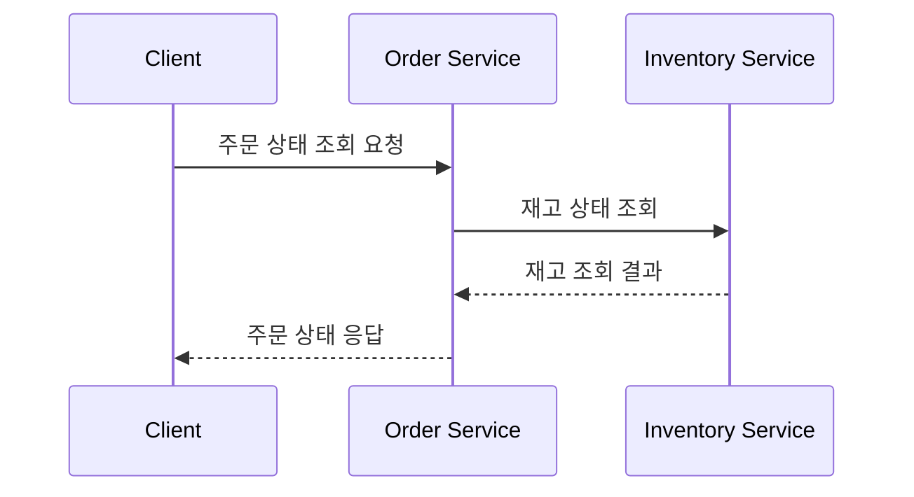

호출자는 서비스의 응답을 기다린다. 응답 시간이 짧고 즉시 결과가 필요한 요청에 적합하다.

### 2.2 비동기 알림 처리 흐름

[원문]

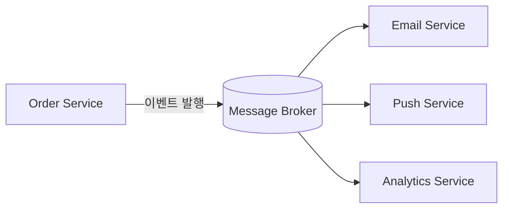

주문 서비스는 이벤트를 발행한 후 각 알림·분석 서비스의 처리가 끝날 때까지 직접 기다리지 않는다. 후속 소비자는 Broker에 저장된 이벤트를 각자 처리한다.

### 2.3 응답·중단·실패 처리의 차이

[원문]

- 동기 요청은 서비스 처리 완료 후 응답을 반환한다.
- 비동기 이벤트는 Broker 저장 후 응답할 수 있으며, 이후 소비자 처리는 별도로 진행된다.
- 동기 요청은 요청 처리 중 서비스 장애가 주요 중단 지점이다.
- 비동기 이벤트는 이벤트 발행, Broker 저장, 소비자 처리, 최종 저장 등 여러 중단 지점이 존재한다.
- 비동기 방식은 후속 조회나 알림을 통해 처리 상태를 확인해야 할 수 있다.

[보충 설명]

비동기 구조에서도 발행자와 Broker 사이의 통신은 네트워크 요청이다. 따라서 발행 요청 자체가 실패하거나 응답이 유실될 수 있다. 비동기라는 이유만으로 전송이 자동 보장되는 것은 아니다.

[출처: IMG-21, IMG-22]

---

## 3. Message · Command · Event의 구분

### 3.1 세 용어의 의미

[원문]

| 구분 | 의미 | 대상 | 응답 | 주요 특징 | 가상 예시 |
|---|---|---|---|---|---|
| Message | 전송되는 데이터 또는 통신 단위 | 임의 | 자체 의미로는 응답 규정 없음 | 여러 패턴에서 사용하는 포괄적 통신 단위 | JSON 메시지 |
| Command | 특정 작업을 수행하라는 명시적 의도 | 단일 책임자(서비스) | 성공·실패 응답 필요 | 실행 책임이 있고 멱등성·중복 처리 고려 필요 | `ReserveInventory` |
| Event | 이미 발생한 사실을 알림 | 관심 있는 여러 구독자 | 일반적으로 업무 명령의 성공 응답을 요구하지 않음 | 과거형 이름을 사용하고 재실행 명령으로 해석하지 않음 | `InventoryReserved` |

### 3.2 혼동했을 때 발생하는 문제

[원문]

메시지를 보내기만 하면 모든 서비스가 알아서 처리할 것이라고 가정하면 책임과 순서가 불분명해진다. 과거형 이름의 이벤트가 숨은 명령처럼 해석되면 의도하지 않은 작업이 실행될 수 있다.

예를 들어 `OrderCreated`는 주문이 생성되었다는 사실이다. 반면 `ReserveInventory`는 재고 예약을 수행하라는 명령이다.

### 3.3 주문·재고 예약 예시

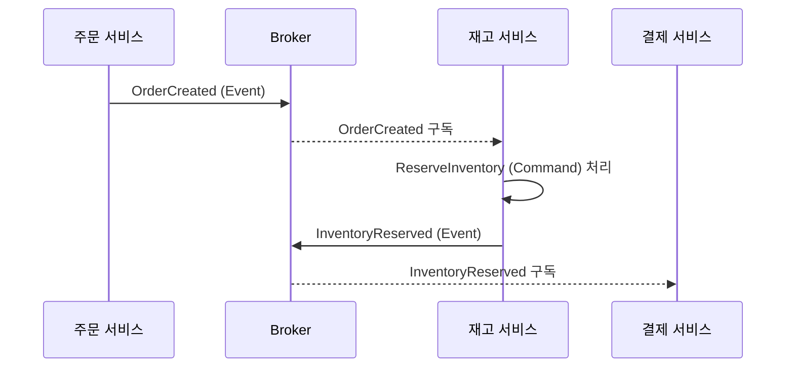

[원문]

주문 생성 후 재고 예약은 명령으로 수행하고, 예약 결과는 이벤트로 발행한다. 결제·배송 등 필요한 서비스는 `InventoryReserved` 이벤트를 구독할 수 있다.

[기술적 검토]

이벤트를 발행한 서비스가 모든 구독자의 실제 처리를 직접 통제하는 것은 아니다. 구독자의 처리 성공 여부를 확인해야 한다면 별도 상태·응답 이벤트·업무 프로세스 관리가 필요하다.

[출처: IMG-23]

---

## 4. Producer · Broker · Consumer 아키텍처

### 4.1 구성 요소와 책임

[원문]

| 구성 요소 | 역할 | 주요 동작 | 예시 설정·보장 |
|---|---|---|---|
| Producer | 업무 사실과 발행 의도 생성 | 메시지 전송 | 재시도, 타임아웃, idempotency key |
| Broker | 메시지 저장 및 라우팅 | Topic/Queue 저장, 구독자 전달 | Kafka 복제·보존 기간, RabbitMQ durable queue |
| Consumer | 수신 내용 검증 및 업무 처리 | 로컬 상태 변경, 처리 후 확인 전송 | Kafka offset commit, RabbitMQ consumer ack |
| 업무 커밋 | 최종 업무 상태 반영 | DB 트랜잭션 | 별도 업무 DB 트랜잭션 |

### 4.2 처리 단계는 서로 다른 성공 경계다

[원문]

Producer의 전송 성공, Broker 저장, Consumer 처리, 업무 DB 반영은 서로 다른 시점이다.

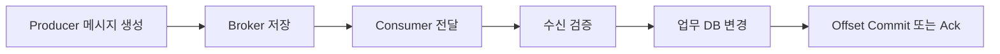

[보충 설명]

- Producer가 전송 성공 응답을 받았다는 사실은 Consumer의 업무 처리가 완료되었다는 뜻이 아니다.
- Broker에 저장되었다는 사실은 소비자가 처리했다는 뜻이 아니다.
- Consumer가 메시지를 읽었다는 사실은 DB 변경이 커밋되었다는 뜻이 아니다.
- Ack 또는 offset commit은 메시지 시스템에 처리 위치·완료를 알리는 동작이지, 외부 결제 시스템까지 포함한 전역 트랜잭션이 아니다.

### 4.3 Kafka와 RabbitMQ의 처리 확인 방식

| 항목 | Kafka | RabbitMQ |
|---|---|---|
| 저장·전달 모델 | Topic의 Partition에 기록 | Exchange에서 Queue로 라우팅 |
| 소비 확인 | Consumer offset commit | Consumer acknowledgement |
| 소비 방식 | 일반적으로 Consumer가 pull | Broker가 Consumer에게 push |
| 재처리 | offset을 되돌리거나 재설정해 재소비 | 미확인 메시지 재전달 등 |
| 중복 가능성 | 처리·커밋 경계에 따라 가능 | Ack·재전달 경계에 따라 가능 |

[기술적 검토]

Kafka와 RabbitMQ는 내부 모델과 API가 다르므로 `ack`와 `offset commit`을 같은 동작으로 단순 치환하면 안 된다. 둘 다 소비 완료를 표현하는 확인 수단이지만 처리 위치와 재전달 동작이 다르다.

[출처: IMG-24]

---

## 5. 이벤트 계약과 스키마 설계

### 5.1 이벤트 계약의 구성

[원문]

이벤트는 생산자와 소비자 사이의 계약이다. 공통 envelope에는 필수 항목을 포함하고, 업무 데이터만 payload에 담아 의미와 형식을 명확히 정의한다.

이미지의 예시:

```json
{
  "eventId": "evt-20250520-001",
  "eventType": "order.paid",
  "schemaVersion": "1.0",
  "occurredAt": "2025-05-20T10:15:30Z",
  "aggregateId": "order-123",
  "aggregateVersion": 3,
  "correlationId": "cmd-456",
  "payload": {
    "...": "..."
  }
}
```

### 5.2 필드별 의미

| 필드 | 필수 여부(이미지 기준) | 의미와 용도 |
|---|---|---|
| `eventId` | 예 | 중복 식별을 위한 고유 ID |
| `eventType` | 예 | 이벤트 의미를 나타내는 타입 |
| `schemaVersion` | 예 | 스키마 버전·호환성 관리 |
| `occurredAt` | 예 | 이벤트 발생 시각(UTC) |
| `aggregateId` | 예 | 업무 대상 식별자(예: 주문 ID) |
| `aggregateVersion` | 예 | 대상 엔티티의 버전 및 순서 판단 |
| `correlationId` | 권장 | 요청·업무 흐름 추적을 위한 상관 ID |
| `payload` | 예 | 업무에 필요한 최소 데이터 |

### 5.3 시간과 순서

[원문]

`eventId`는 중복을 식별하고, `aggregateVersion`은 같은 대상의 순서를 판단하는 데 활용한다. `occurredAt`은 발생 시각일 뿐 여러 호스트의 완전한 업무 순서를 보장하지 않는다.

[기술적 검토]

서로 다른 서버의 시계는 NTP 오차, 네트워크 지연, 큐 적체 등으로 실제 처리 순서와 다를 수 있다. 따라서 이벤트의 순서 판단을 `occurredAt`만으로 해결해서는 안 된다. 같은 Aggregate의 버전 번호, 파티션 키, 업무 상태 전이 규칙을 함께 사용해야 한다.

### 5.4 데이터 최소화와 민감정보 제외

[원문]

변경 가능한 엔티티 전체를 그대로 발행하지 않고 데이터 최소화 원칙을 지킨다.

| 구분 | 포함 예시 | 제외 예시 | 이유 |
|---|---|---|---|
| 업무 데이터 | 주문 ID, 금액, 상태 변경 정보 | 전체 주문 엔티티 | 변경 범위 최소화·페이로드 경량화 |
| 식별 정보 | 회원 ID(익명화), 상품 ID | 이름, 이메일, 전화번호 원문 | 개인정보 최소화 |
| 민감 정보 | 없음 | Secret, Access Token, 비밀번호 | 보안 위험 방지 |
| 참조 정보 | 코드 값, 상태 코드 | 큰 바이너리 파일, 상세 메시지 로그 | 메시지 크기·보관 비용 절감 |

[보충 설명]

이벤트 payload에는 소비자가 업무를 처리하는 데 필요한 최소 정보를 넣을지, 별도 API로 상세 정보를 조회하게 할지 선택해야 한다. API 조회 방식은 최신 정보를 얻을 수 있지만 서비스 가용성·권한·호출 부하에 의존한다.

[출처: IMG-25]

---

## 6. 팬아웃과 작업 분배

### 6.1 팬아웃(Fan-out)

[원문]

팬아웃은 여러 독립 구독자가 같은 이벤트를 각각 받아 각자의 업무를 수행하는 패턴이다.

예를 들어 주문 생성 이벤트를 다음 서비스가 각각 소비한다.

- 알림 서비스: 이메일·문자 발송
- 분석 서비스: 매출 통계 집계
- 주문 후속 처리 서비스: 재고 차감·배송 준비 등

각 서비스는 별도의 구독 위치와 처리 상태를 관리한다.

### 6.2 작업 분배(Work Sharing)

[원문]

작업 분배는 같은 논리 구독 내 여러 Consumer 인스턴스가 메시지를 나누어 처리하는 패턴이다. 같은 업무를 처리하는 인스턴스 사이에서 부하를 분산한다.

### 6.3 Kafka와 RabbitMQ 관점의 차이

| 구분 | Kafka | RabbitMQ |
|---|---|---|
| 팬아웃 | 서로 다른 Consumer Group이 같은 Topic을 독립 소비 | 서비스별 독립 Queue를 만들고 Exchange에서 각각 라우팅 |
| 작업 분배 | 같은 Group의 여러 Consumer가 Partition을 분담 | 하나의 Queue를 여러 Consumer가 경쟁 소비 |
| 진행 상태 | Group별 offset | Queue 메시지 상태와 Consumer ack |
| 주의점 | Partition 수와 Consumer 수에 따라 유휴 인스턴스 발생 | Prefetch·ack·Queue 설정이 분배와 처리량에 영향 |

### 6.4 Kafka 예시

```text
Topic: order.events
  ├─ Consumer Group: notification
  │    ├─ Notification Consumer A
  │    └─ Notification Consumer B
  ├─ Consumer Group: analytics
  │    ├─ Analytics Consumer A
  │    └─ Analytics Consumer B
  └─ Consumer Group: order-worker
       ├─ Worker 1
       ├─ Worker 2
       └─ Worker 3
```

`notification`, `analytics`, `order-worker`는 각자 독립적으로 같은 Topic을 소비한다. 같은 Group 안에서는 Partition을 나눠 처리한다.

### 6.5 실패 시 중복이 발생하는 예

[원문]

Kafka에서 처리 후 offset commit 전에 Consumer가 중단되면 재시작 후 같은 메시지가 다시 처리될 수 있다. RabbitMQ에서 업무 처리는 완료했지만 ack 전에 연결이 끊기면 메시지가 재전달될 수 있다.

따라서 알림·통계·주문 처리 등 목적이 다른 서비스는 독립 구독을 사용하고, 중복 처리와 재시도 정책을 각 소비자에 맞게 설계해야 한다.

[기술적 검토]

이미지의 도식은 개념 설명용이다. Kafka에서는 Partition 하나가 같은 Consumer Group 내 한 시점에 하나의 Consumer 인스턴스에 할당되는 것이 기본적인 소비 모델이다. RabbitMQ의 여러 Consumer는 하나의 Queue에서 메시지를 경쟁 소비하지만, 실제 분배는 prefetch·ack·Consumer 처리 속도 등의 영향을 받는다.

[출처: IMG-26]

---

## 7. Kafka의 Topic · Partition · Consumer Group

### 7.1 Topic과 Partition

[원문]

하나의 Topic은 여러 Partition으로 나뉘며 각 Partition은 독립된 로그다. Partition 안의 record는 offset으로 순서가 관리되지만 Partition 사이에는 전역 순서가 없다.

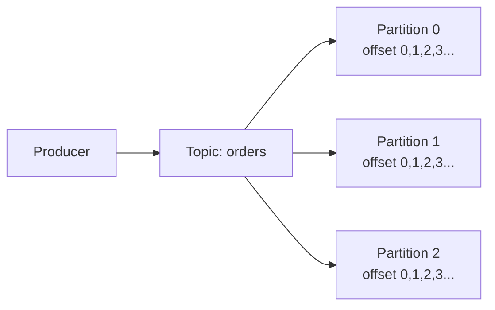

같은 업무의 key를 같은 Partition으로 보내면 해당 key의 이벤트 순서를 유지하는 데 유리하다. 다만 Partition 내부의 기록 순서가 업무 처리 완료 순서까지 자동 보장하지는 않는다.

### 7.2 같은 Consumer Group 안의 분배

[원문]

일반적인 Consumer Group에서는 여러 인스턴스가 Topic의 Partition을 나누어 소비한다. 같은 시점에 하나의 Partition은 Group 내 하나의 Consumer만 담당한다.

예시: Partition 3개, Consumer 4개

- Consumer A → P0
- Consumer B → P1
- Consumer C → P2
- Consumer D → 할당 없음(대기)

즉, Consumer 수가 Partition 수보다 많으면 일부 Consumer는 유휴 상태가 될 수 있다.

### 7.3 서로 다른 Consumer Group

[원문]

서로 다른 Consumer Group은 동일 Topic의 Partition을 각자 독립적으로 소비하며 offset도 독립적으로 관리한다.

- Group G1: 주문 처리
- Group G2: 분석 처리

같은 Group 내 인스턴스 추가는 작업 분배 목적이다. 다른 Group 추가는 같은 이벤트를 별도 업무 목적으로 전체 소비하려는 목적이다.

### 7.4 Rebalancing과 중단

[원문]

Consumer가 중단되면 Rebalancing이 발생해 Partition이 남은 Consumer에 재할당될 수 있다. 중단 시점과 offset 확정 시점에 따라 이미 처리한 record가 다시 처리될 수 있다.

[기술적 검토]

- Partition 내 offset은 로그 위치를 나타낸다.
- Consumer가 DB 처리를 완료했는지와 offset이 commit되었는지는 별개의 상태다.
- DB 처리 후 offset commit 전에 중단되면 중복 처리가 발생할 수 있다.
- offset을 먼저 commit한 뒤 DB 처리 전에 중단되면 메시지를 건너뛰어 업무 유실처럼 보일 수 있다.

[출처: IMG-27]

---

## 8. RabbitMQ의 Exchange · Queue · Binding · Ack

### 8.1 구성 요소

[원문]

| 구성 요소 | 역할 | 핵심 특징 |
|---|---|---|
| Exchange | 메시지 라우팅 시작점 | direct, fanout, topic, headers 타입 |
| Queue | 메시지 저장·전달 | durable, exclusive, TTL, DLQ 설정 가능 |
| Binding | Exchange와 Queue 연결 | routing key·패턴으로 라우팅 규칙 지정 |
| Ack | 메시지 처리 완료 통지 | 수동 ack 권장, `basic.ack` / `basic.nack` |

### 8.2 기본 흐름

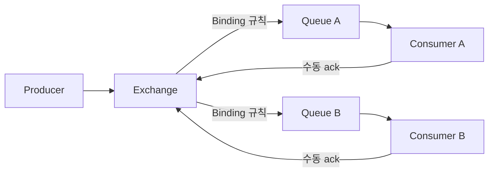

Producer는 Exchange로 메시지를 발행한다. Exchange는 Binding 규칙에 따라 Queue를 선택한다. Consumer는 Queue에서 메시지를 받아 처리한 후 ack로 완료를 알린다.

### 8.3 Exchange 타입

[원문]

- `direct`: routing key가 일치하는 Binding으로 라우팅
- `fanout`: 연결된 Queue에 브로드캐스트
- `topic`: routing key 패턴을 사용해 라우팅
- `headers`: 메시지 헤더 조건을 사용해 라우팅

### 8.4 Queue와 메시지 지속성

[원문]

이미지에서 다루는 운영 설정은 다음과 같다.

- Queue의 durable 설정
- 메시지 persistent 설정
- Publisher confirm
- Mandatory/return
- Queue 복제(Quorum)
- Consumer 수동 ack
- Dead Letter Exchange

[기술적 검토]

Durable Queue와 persistent message는 서로 다른 설정이다. Durable Queue는 브로커 재시작 이후 Queue 정의를 유지하기 위한 것이며, persistent message는 메시지의 영속성을 요청한다. 둘 중 하나만 설정했다고 모든 장애 상황에서 데이터가 절대 유실되지 않는다고 단정할 수 없다.

Publisher confirm은 Broker가 발행을 확인하는 메커니즘이며 Consumer의 업무 처리 완료를 의미하지 않는다. `mandatory`와 return은 라우팅되지 않은 메시지를 발행자에게 알리는 데 사용된다.

### 8.5 Ack와 재전달

[원문]

소비 처리 중 ack 전에 Consumer가 중단되면 메시지가 재전달될 수 있다. 처리 완료 후 ack를 전송하면 정상 완료로 처리된다.

[보충 설명]

`basic.ack`는 소비 완료 확인, `basic.nack`는 부정 확인이다. 재큐잉 여부(`requeue`) 설정에 따라 재전달 또는 DLX 라우팅 등 후속 동작이 달라질 수 있다. 재전달은 중복 실행 가능성을 만들므로 Consumer는 멱등성을 갖춰야 한다.

[출처: IMG-28]

---

## 9. 전달 보장 수준과 처리 경계

### 9.1 At-most-once · At-least-once · Exactly-once

[원문]

| 보장 유형 | 주요 특성 | 장점 | 단점 | 적합한 상황 |
|---|---|---|---|---|
| At-most-once | 최대 한 번 전달 | 중복 적음 | 유실 가능성 | 중복이 치명적이고 일부 유실을 감수할 수 있는 이벤트 |
| At-least-once | 최소 한 번 전달을 목표로 재전달 | 유실 가능성 감소 | 중복 발생 가능 | 주문·결제 등 핵심 업무의 메시지 처리 기반 |
| Exactly-once | 특정 처리 경계 안에서 정확히 한 번의 효과를 목표 | 해당 경계 내 중복·유실 억제 | 적용 범위·구현 복잡도 제한 | Kafka 내부 스트림 처리 등 지원되는 경계 |

### 9.2 Exactly-once의 범위

[원문]

Kafka의 idempotent producer는 동일 Producer의 중복 전송을 줄이는 데 사용된다. Kafka transaction은 Producer에서 Broker, Consumer의 offset 처리까지 특정 Kafka 처리 경계에서 원자성을 제공할 수 있다.

그러나 외부 DB 변경이나 결제 API 호출이 자동으로 같은 Exactly-once 경계에 포함되는 것은 아니다. 별도 설계가 필요하다.

### 9.3 중단 위치에 따른 결과

| 중단 지점 | 발생 가능한 결과 |
|---|---|
| Producer 발행 전 | 이벤트 미생성, 업무 이벤트 유실 가능 |
| Broker 저장 전·저장 실패 | 메시지 미도착 가능 |
| Broker 저장 후 Consumer 처리 전 | 재시작 후 정상 재소비 가능 |
| Consumer 처리 후 확인 전 | 중복 처리 가능 |
| 외부 시스템 호출 후 확인 전 | 외부 업무 중복 가능 |
| 업무 DB 반영 후 메시지 확인 전 | 메시지 재전달로 업무 중복 가능 |

### 9.4 중복 방지 설계

[원문]

- 멱등 키 사용
- 업무 결과 저장
- 대사 및 로그
- 외부 시스템의 멱등성 기능 활용
- 처리 경계와 보장 범위 명확화

[기술적 검토]

Exactly-once라는 용어는 제품·설정·트랜잭션 범위에 따라 의미가 다르다. “메시지가 네트워크를 통해 단 한 번만 전달된다” 또는 “모든 외부 부작용이 무조건 한 번만 발생한다”는 뜻으로 사용하면 안 된다.

[출처: IMG-29]

---

## 10. Consumer 커밋·Ack 순서

### 10.1 처리 전 커밋과 처리 후 커밋

[원문]

메시지를 처리하기 전에 commit 또는 ack하면 중단 시 아직 반영하지 않은 업무를 건너뛸 수 있다. 반대로 업무 처리 후 commit 또는 ack하면 중단 시 같은 record가 다시 전달되어 중복 처리될 수 있다.

| 방식 | 중단 시 가능성 | 메시지 관점 | 최종 업무 효과 |
|---|---|---|---|
| 처리 전 커밋/ack | 유실 위험 | 재전달되지 않을 수 있음 | 업무가 반영되지 않을 수 있음 |
| 처리 후 커밋/ack | 중복 위험 | 다시 전달될 수 있음 | 같은 업무가 여러 번 시도될 수 있음 |

### 10.2 Kafka와 RabbitMQ 비교

[원문]

| 시스템 | 처리 전 확인 | 처리 후 확인 |
|---|---|---|
| Kafka | offset을 먼저 commit | DB 커밋 후 offset commit |
| RabbitMQ | 업무 처리 전에 ack | DB 커밋 후 수동 ack |

이미지에서는 두 방식 모두 업무 변경과 중복 기록을 같은 로컬 DB 트랜잭션으로 묶어 재전달의 중복 효과를 줄이는 방향을 제시한다.

### 10.3 권장 처리 순서

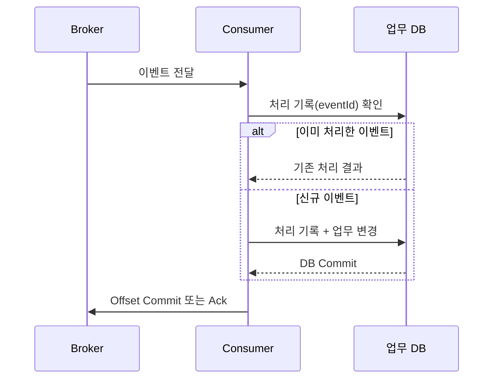

[보충 설명]

이 순서는 일반적인 at-least-once 소비에서 DB 업무 효과를 멱등하게 만드는 패턴이다. Kafka offset commit과 DB 트랜잭션은 별도 시스템이므로 두 동작을 하나의 원자적 트랜잭션으로 묶은 것은 아니다. DB 커밋 후 offset commit 전에 장애가 발생해도 재전달된 이벤트를 처리 기록으로 걸러낼 수 있도록 해야 한다.

[출처: IMG-30]

---

## 11. Duplicate Event와 Idempotent Consumer

### 11.1 중복 이벤트 발생 원인

[원문]

동일한 `eventId`가 여러 번 전달되는 원인은 다음과 같다.

- 네트워크 오류
- 재시도
- 타임아웃
- Consumer 재시작
- 처리 후 ack/offset commit 전 장애
- Broker 또는 클라이언트의 재전달

중복 이벤트가 걸러지지 않으면 금액 중복, 재고 과다 차감, 알림 중복 발송 등이 발생할 수 있다.

### 11.2 Idempotent Consumer

[원문]

Consumer는 처리한 `eventId`를 별도 테이블에 저장하고 Unique 제약으로 중복 수신을 제어한다. 처리 기록 저장과 실제 업무 변경은 같은 DB 트랜잭션으로 커밋한다.

예시 테이블:

| 컬럼 | 의미 |
|---|---|
| `consumer` | Consumer 식별자 |
| `event_id` | 이벤트 고유 ID |
| `processed_at` | 처리 시각 |

### 11.3 처리 흐름

1. 이벤트 수신
2. `eventId`와 Consumer 식별자로 처리 기록 조회
3. 이미 처리한 이벤트면 기존 결과를 반환하거나 무시
4. 신규 이벤트면 업무 변경 수행
5. 처리 기록과 업무 변경을 같은 트랜잭션으로 저장
6. DB 커밋 성공 후 offset commit 또는 ack

### 11.4 외부 결제 연동

[원문]

로컬 dedup 테이블만으로 외부 결제까지 중복을 완전히 막을 수는 없다. 결제 요청 시 Provider가 지원하는 멱등 키를 전달하고, 타임아웃 후에는 승인 조회를 통해 실제 결제 여부를 확인해야 한다.

```text
eventId: E2001
amount: 50,000
orderId: O-100
```

- 처리 기록 확인
- 외부 결제 요청에 idempotency key 전달
- 이미 승인된 요청인지 조회
- 업무 변경과 처리 기록 저장
- DB 트랜잭션 커밋

[기술적 검토]

외부 API의 멱등성 보장 기간, 키의 유효 범위, 같은 키에 다른 payload를 전달했을 때의 동작은 결제 제공자별로 다르다. 반드시 해당 제공자의 계약과 문서를 확인해야 한다.

[출처: IMG-31]

---

## 12. 이벤트 순서 역전과 버전 기반 처리

### 12.1 순서가 바뀌는 원인

[원문]

동일 주문의 이벤트가 발행 순서와 다른 순서로 도착할 수 있다.

- 서로 다른 Partition key
- Relay 처리 순서
- 재시도 경로
- 네트워크 지연
- 병렬 Consumer 처리
- 서로 다른 호스트의 시각 차이

예시 발행 순서:

```text
v1 OrderCreated
  → v2 PaymentApproved
  → v3 ShipmentStarted
  → v4 ShipmentCompleted
```

소비자 도착 순서가 `v3 → v2 → v4 → v1`이 될 수 있다.

### 12.2 Aggregate Version을 이용한 처리 정책

[원문]

각 이벤트는 `aggregateVersion`과 현재 상태를 비교하여 다음 중 하나를 선택한다.

| 관계 | 처리 정책 | 설명 |
|---|---|---|
| `version = current + 1` | 적용 | 다음 버전이 정상 도착 |
| `version <= current` | 무시 | 이전 버전 또는 중복 이벤트 |
| `version > current + 1` | 보류 | 중간 버전 누락 가능, 일정 시간 후 재조회 |
| 허용되지 않는 상태 전환 | 보상/대사 | 업무 규칙 위반 |

예시: 현재 버전 2인데 버전 3이 도착하면 적용한다. 현재 버전 3인데 버전 2가 늦게 도착하면 무시한다. 현재 버전 1인데 버전 3이 도착하면 중간 버전이 누락되었을 수 있으므로 보류한다.

### 12.3 CANCELLED 이후 늦은 PaymentApproved

[원문]

주문이 취소되어 `CANCELLED` 상태가 되었는데 네트워크 지연으로 `PaymentApproved` 이벤트가 늦게 도착할 수 있다. 이때 무조건 `CONFIRMED`로 덮어쓰지 않고 업무 정책에 따라 무시하거나 보상·대사를 진행한다.

예시 로그:

```text
[Consumer] 10:01:20 INFO eventId=E102 orderId=O123
            type=PaymentApproved version=2

[Business] 10:01:20 WARN currentStatus=CANCELLED version=3
           -> IGNORE (late event)
```

### 12.4 순서 보장을 위한 설계

- 같은 Aggregate의 이벤트에 같은 Partition key 사용
- 이벤트에 `aggregateVersion` 포함
- 상태 전이 규칙 정의
- 중간 버전 누락 시 보류·재조회 정책
- 늦은 이벤트의 무시·보상·대사 정책 정의
- 중복 제거와 순서 검증을 함께 적용

[기술적 검토]

Partition key는 같은 키의 이벤트가 같은 Partition으로 가도록 해 Kafka 로그 순서를 유지하는 데 도움을 준다. 그러나 서로 다른 Consumer 처리 작업의 완료 순서, 외부 API 호출 완료 순서까지 자동 보장하지 않는다.

[출처: IMG-32]

---

## 13. Retry · Backoff · Jitter · Dead Letter

### 13.1 일시적 오류와 영구 오류

[원문]

- **일시적 오류**: 네트워크 타임아웃, 순간적인 서버 오류 등 시간이 지나면 정상 처리될 수 있는 오류
- **영구 오류**: 잘못된 데이터, 계약 위반 등 같은 방식으로 재시도해도 성공하지 않을 가능성이 높은 오류

영구 오류를 같은 속도로 계속 재시도하면 불필요한 부하와 비용이 발생한다.

### 13.2 제한된 재시도와 지수 Backoff

[원문 가상 설정]

| 항목 | 예시 |
|---|---|
| 최대 재시도 횟수 | 5회 |
| Backoff 방식 | 지수형: 1s → 2s → 4s → 8s → 16s |
| Jitter | 전체 구간의 ±20% 무작위 지연 |
| 분류 기준 | 오류 코드, 예외 타입, 계약 검증 결과 |
| 원본 정보 | 원래 eventId, 최초 수신 시점, 재시도 횟수, 최근 오류 원인 |
| DLQ 보관 기간 | 30일(운영 정책에 따라 다름) |

Jitter 적용 예시(가상 수치):

| 시도 | 기본 지연 | Jitter 적용 예시 |
|---:|---:|---:|
| 1차 | 1초 | 0.8~1.2초 |
| 2차 | 2초 | 1.6~2.4초 |
| 3차 | 4초 | 3.2~4.8초 |
| 4차 | 8초 | 6.4~9.6초 |
| 5차 | 16초 | 12.8~19.2초 |

### 13.3 전체 처리 흐름

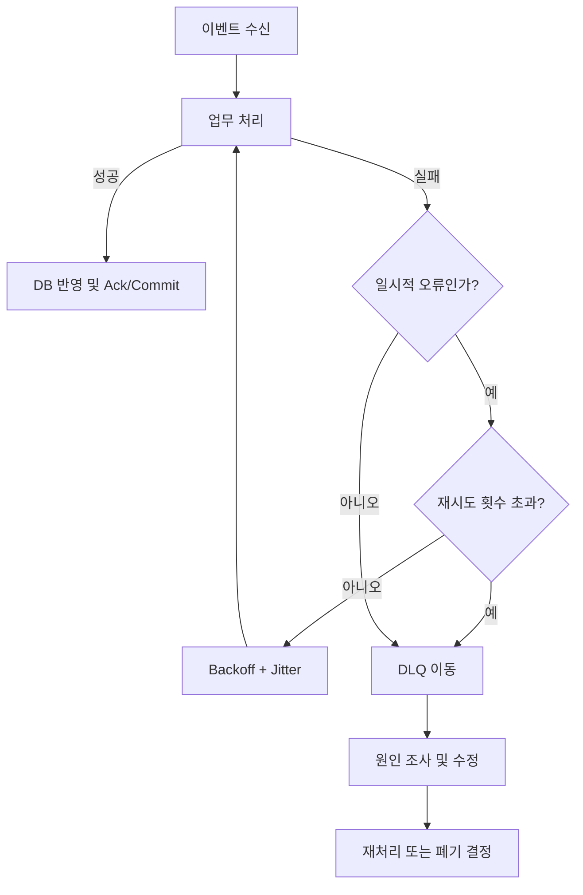

### 13.4 DLQ의 역할

[원문]

DLQ(Dead Letter Queue)는 영구 오류 또는 재시도 한도 초과 메시지를 별도 경로로 분리해 운영자가 조사·수정·재처리할 수 있게 한다.

메시지에는 원래 `eventId`, 최초 수신 시점, 재시도 횟수, 원인 분류, 최근 오류를 보존한다.

### 13.5 주의사항

- 재시도는 복구를 위한 수단이지 업무 성공을 보장하는 수단이 아니다.
- 재시도 전에 오류가 일시적인지 영구적인지 분류한다.
- 무한 재시도는 Broker·Consumer에 부하를 줄 수 있다.
- DLQ 이동 자체를 업무 성공으로 간주하지 않는다.
- 재처리 전 원인 해결과 멱등성·순서 검증이 필요하다.

[출처: IMG-33]

---

## 14. Transactional Outbox

### 14.1 문제: 업무 데이터와 이벤트 발행의 불일치

[원문]

업무 데이터는 DB에 저장되었지만 이벤트가 발행되지 않으면 다른 서비스가 변경 사실을 알지 못한다. 반대로 이벤트는 발행되었지만 업무 데이터가 반영되지 않으면 잘못된 이벤트가 전달될 수 있다.

DB와 Broker를 원자적으로 커밋할 수 없는 환경에서 발생하는 이중 쓰기 문제다.

### 14.2 핵심 원리

[원문]

업무 테이블 변경과 Outbox insert를 하나의 DB 로컬 트랜잭션으로 커밋한다. 별도 Relay가 Outbox의 미발행 레코드를 polling 또는 CDC로 읽어 메시지 Broker에 전달한다.

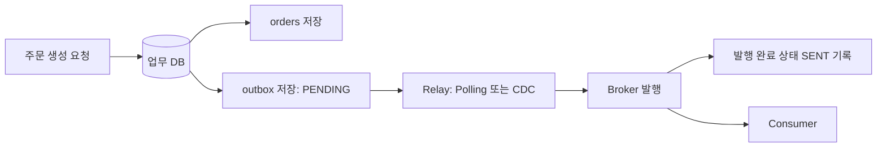

### 14.3 단계별 처리

1. **업무 트랜잭션**
   - `orders` 테이블에 주문 저장
   - `outbox` 테이블에 이벤트 발행 의도 저장
   - 두 작업을 같은 DB 트랜잭션으로 커밋

2. **Relay 발행**
   - 미발행 `PENDING` 레코드 조회
   - Broker로 발행
   - 발행 성공 후 `SENT` 등 완료 상태와 발행 시각 기록

3. **Consumer 처리**
   - 이벤트 수신
   - 멱등 처리
   - 업무 상태 반영

### 14.4 Outbox 예시

| 테이블 | 예시 값 |
|---|---|
| orders | `O42` 저장 |
| outbox | `E42 (PENDING)` 저장 |

두 레코드는 같은 트랜잭션으로 저장된다. Relay가 `PENDING` 레코드를 Broker로 전달한다.

### 14.5 Relay 방식

- **Polling**: 일정 주기로 미발행 Outbox 레코드를 조회
- **CDC**: DB 변경 로그를 읽어 Outbox 변경을 감지

이미지에는 polling 예시(1초)와 CDC 방식이 제시된다. 실제 주기와 구현 방식은 시스템 요구에 맞춰 정한다.

### 14.6 Outbox가 보장하지 않는 것

[원문]

Relay가 중단되거나 Broker 발행 후 완료 기록 전에 장애가 발생하면 동일 이벤트가 여러 번 발행될 수 있다. 따라서 Consumer 멱등성과 발행 지연·미발행 백로그 모니터링이 필수다.

[기술적 검토]

Transactional Outbox는 DB와 Broker 사이의 분산 트랜잭션을 없애는 대신, “업무 변경과 발행 의도 저장”을 DB 로컬 트랜잭션으로 원자화한다. Broker 발행은 별도 단계이므로 중복 가능성을 전제로 설계해야 한다.

[출처: IMG-34]

---

## 15. Eventual Consistency와 사용자 경험

### 15.1 최종 일관성의 의미

[원문]

이벤트 처리에는 시간이 걸리므로 주문 원장과 조회 모델, 알림 상태가 일시적으로 다를 수 있다. 이벤트가 정상적으로 전달·처리되고 재시도·복구가 완료되면 각 서비스의 상태가 최종적으로 수렴하도록 설계한다.

### 15.2 상태가 일시적으로 다른 예

- 주문 원장: 결제 완료
- 주문 조회 모델: 결제 대기(이벤트 반영 전)
- 알림 서비스: 알림 발송 대기
- 분석 서비스: 아직 집계 전

이것은 비동기 처리 중 발생할 수 있는 일시적 차이다. 다만 무한히 차이가 지속되면 정상적인 최종 일관성이 아니라 장애·유실·처리 정체일 수 있다.

### 15.3 사용자 경험 설계

[보충 설명]

- “요청 접수”, “처리 중”, “완료”, “실패” 상태를 구분한다.
- 사용자에게 보여주는 상태가 원장 데이터인지 조회 모델인지 명확히 한다.
- 완료 전 단계에서 확정적인 성공 문구를 표시하지 않는다.
- 처리 지연이 길어질 경우 재조회·알림·문의 경로를 제공한다.
- 결제·주문 취소처럼 상충하는 상태 전이는 업무 규칙으로 제어한다.

[출처: IMG-35]

---

## 16. 주문 업무의 이벤트 연결 사례

### 16.1 주문 생성부터 후속 처리까지

[원문]

이미지의 업무 흐름은 주문 서비스가 업무 이벤트를 발행하고 여러 서비스가 이를 구독하는 구조다. 이벤트 발행, 재고 예약, 결제, 배송·알림 등 단계별 업무 결과를 연결한다.

개념 흐름:

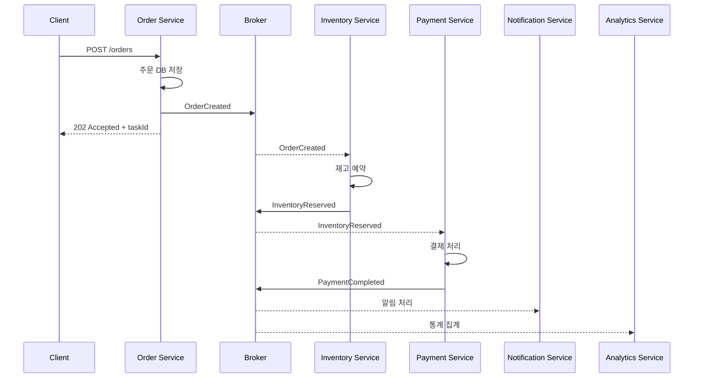

### 16.2 예시 이벤트

| 이벤트 | 예시 payload | 소비 대상 | 최종 업무 효과 |
|---|---|---|---|
| `OrderCreated` | `orderId`, `items`, `userId` | 재고·알림·분석 | 주문 생성 사실 전달 |
| `InventoryReserved` | `orderId`, `reservedItems` | 결제·배송 등 | 재고 예약 완료 사실 전달 |
| `PaymentCompleted` | `orderId`, `amount` | 주문·알림·분석 | 결제 완료 사실 전달 |

### 16.3 Saga와의 관계

[원문/연관 이미지]

이미지 21의 예시는 주문 생성 후 재고 예약과 결제까지를 Saga 패턴으로 단계별 상태를 관리하고, 실패 시 보상(취소) 이벤트로 일관성을 유지하는 흐름을 언급한다.

[보충 설명]

이벤트 기반 통신과 Saga는 같은 개념이 아니다.

- 이벤트 기반 통신: 서비스 간 메시지를 비동기로 전달하는 통신 방식
- Saga: 여러 서비스에 걸친 업무 트랜잭션을 단계와 보상 동작으로 관리하는 패턴

예를 들어 재고 예약 성공 후 결제가 실패하면 재고 예약을 취소하는 보상 동작이 필요할 수 있다. 보상은 이미 수행된 일을 데이터베이스 rollback처럼 되돌리는 것이 아니라, 업무적으로 상쇄하는 별도 동작이다.

### 16.4 운영상 필수 고려사항

- 각 단계의 성공·실패 상태 저장
- 동일 이벤트 중복 수신 방지
- 순서 역전 및 늦은 이벤트 처리
- 재시도·DLQ·수동 재처리 정책
- 사용자에게 노출할 진행 상태
- 보상 실패 시 운영자 개입 및 대사

[출처: IMG-21, IMG-23, IMG-36]

---

## 17. 스키마 진화와 이벤트 재생

### 17.1 스키마 진화

[원문]

이벤트 계약은 생산자와 소비자 사이의 장기적인 약속이다. 생산자 스키마가 변경되더라도 기존 소비자가 실패하지 않도록 호환성을 고려해야 한다.

[보충 설명]

일반적인 호환성 방향은 다음과 같이 구분한다.

- **Backward compatibility**: 새 Consumer가 이전 버전 이벤트를 읽을 수 있음
- **Forward compatibility**: 이전 Consumer가 새 버전 이벤트를 무시 가능한 방식으로 읽을 수 있음
- **Full compatibility**: 양방향 호환성 조건 충족

### 17.2 변경 시 권장 원칙

- 필드 추가는 기본값·선택 필드 여부를 검토한다.
- 기존 필드의 의미를 바꾸지 않는다.
- 필드 삭제·이름 변경은 소비자 영향 분석 후 단계적으로 진행한다.
- `schemaVersion`과 이벤트 타입을 관리한다.
- 필수 필드·타입·enum 값 변경을 신중하게 다룬다.
- 구버전 소비자와 신버전 생산자가 함께 동작하는 기간을 고려한다.

### 17.3 이벤트 재생(Event Replay)

[보충 설명]

Kafka처럼 보존된 로그를 다시 읽을 수 있는 시스템에서는 특정 offset 또는 시점부터 이벤트를 재생해 조회 모델을 다시 만들거나 장애 후 복구할 수 있다.

재생 전에 다음을 확인한다.

1. 대상 Consumer Group과 offset 범위
2. 재생으로 업무 DB가 다시 변경되는지 여부
3. 외부 결제·알림 등 부작용이 재실행되는지 여부
4. 멱등 처리·재생 전용 Consumer의 필요성
5. 스키마 버전 호환성
6. 재생 중 발생하는 신규 이벤트와의 경합

[기술적 검토]

이벤트 재생은 모든 메시지 브로커에서 같은 방식으로 제공되는 기능이 아니다. Kafka의 로그 재소비와 RabbitMQ의 재큐잉·DLQ 재처리는 동작 모델이 다르다. 원본 이벤트를 영구 보관할 수 있는지도 보존 정책에 달려 있다.

[출처: IMG-37]

---

## 18. Lag · Backpressure · 관측 가능성

### 18.1 Lag

[원문]

Lag는 생산된 메시지 또는 마지막 기록 위치와 Consumer가 처리한 위치 사이의 지연을 관찰하는 핵심 지표다.

Kafka에서는 Partition별 log end offset과 Consumer Group의 committed offset 차이 등을 이용해 lag를 관찰한다.

### 18.2 Backpressure

[보충 설명]

Producer가 메시지를 생성하는 속도보다 Consumer가 처리하는 속도가 느리면 대기 메시지가 누적된다. 이를 방치하면 저장 공간 증가, 처리 지연, 오래된 이벤트의 업무 가치 저하가 발생할 수 있다.

대응 방법:

- Consumer 인스턴스·처리량 확장
- Partition 수와 병렬성 검토
- 느린 외부 API 호출 분리
- 배치 처리 및 DB 쓰기 최적화
- 재시도 폭주 방지
- Producer 발행량 제한 또는 유입 제어
- 메시지 보존 기간·용량 정책 검토

### 18.3 주요 관측 지표

| 영역 | 지표 |
|---|---|
| Producer | 발행 성공·실패 수, 재시도 수, 발행 지연 |
| Broker | 저장량, Queue depth, Partition별 적체, 디스크 사용량 |
| Consumer | 처리량, 처리 지연, 오류율, 재시도 수 |
| Kafka | Consumer lag, rebalance 횟수, commit 지연 |
| RabbitMQ | Ready/Unacked 메시지 수, Consumer 수, redelivery 수 |
| Outbox | PENDING 건수, 가장 오래된 미발행 레코드 나이, Relay 오류 |
| DLQ | 유입량, 체류 시간, 재처리 성공률 |
| 업무 | 주문·결제 상태 불일치, 중복 효과, 보상 건수 |

### 18.4 추적성

[보충 설명]

`eventId`, `correlationId`, `aggregateId`, `aggregateVersion`을 로그와 분산 추적에 연결하면 이벤트의 발행부터 최종 업무 반영까지 흐름을 추적하기 쉽다.

[출처: IMG-38]

---

## 19. 실패 시나리오 검증

### 19.1 검증해야 하는 중단 지점

[원문]

- Producer 발행 전
- Producer 전송 후 Broker 저장 전
- Broker 저장 후 Consumer 처리 전
- Consumer 업무 처리 중
- 업무 DB 커밋 후 Ack/offset commit 전
- Ack/offset commit 후
- 외부 API 호출 후 응답 수신 전
- Relay가 Outbox 발행 후 완료 기록 전
- Consumer 재시작·Rebalancing 중
- DLQ 이동 및 재처리 중

### 19.2 실패 테스트 표

| 시나리오 | 기대되는 위험 | 검증할 결과 |
|---|---|---|
| Producer 장애 | 이벤트 미발행 | 업무 데이터와 Outbox 원자성 또는 재발행 확인 |
| Broker 저장 실패 | 메시지 유실 가능 | Producer confirm·재시도·오류 기록 |
| Consumer 처리 전 중단 | 처리 지연 | 재시작 후 이벤트 재소비 |
| DB 커밋 후 Ack 전 중단 | 중복 전달 | dedup으로 업무 효과 1회 반영 |
| Ack/commit 선행 후 DB 실패 | 업무 누락 | 처리 순서가 올바르게 설계되었는지 |
| 외부 결제 타임아웃 | 승인 여부 불명 | 멱등 키·승인 조회·대사 |
| 순서 역전 | 상태 역행 | aggregateVersion 기반 적용·보류·무시 |
| 영구 오류 | 반복 실패·적체 | DLQ 분리 및 원인 조사 |
| Relay 중복 발행 | 중복 이벤트 | Consumer 멱등성 |
| Consumer 처리량 저하 | Lag 증가 | Backpressure 대응·확장 정책 |

### 19.3 검증 로그 예시

```text
INFO  event received eventId=E1001 orderId=O123
INFO  dedup check result=NEW
INFO  business transaction committed orderId=O123
WARN  ack not confirmed eventId=E1001
INFO  event redelivered eventId=E1001
INFO  dedup check result=ALREADY_PROCESSED
INFO  duplicate ignored eventId=E1001
```

### 19.4 최종 업무 효과를 기준으로 테스트

메시지가 한 번 전달되었는지만 확인하지 않는다. 최종적으로 다음이 맞는지 확인한다.

- 주문 상태가 업무 규칙에 맞는가?
- 결제가 실제로 한 번만 승인되었는가?
- 재고가 한 번만 차감·예약되었는가?
- 취소 이후 늦은 승인 이벤트가 상태를 되돌리지 않는가?
- 알림이 중복 발송되지 않는가?
- 조회 모델이 원장 상태에 수렴하는가?
- DLQ에 들어간 이벤트가 누락 없이 추적되는가?

[출처: IMG-39]

---

## 20. 전체 아키텍처 흐름과 설계 체크리스트

### 20.1 전체 흐름

[원문 종합]

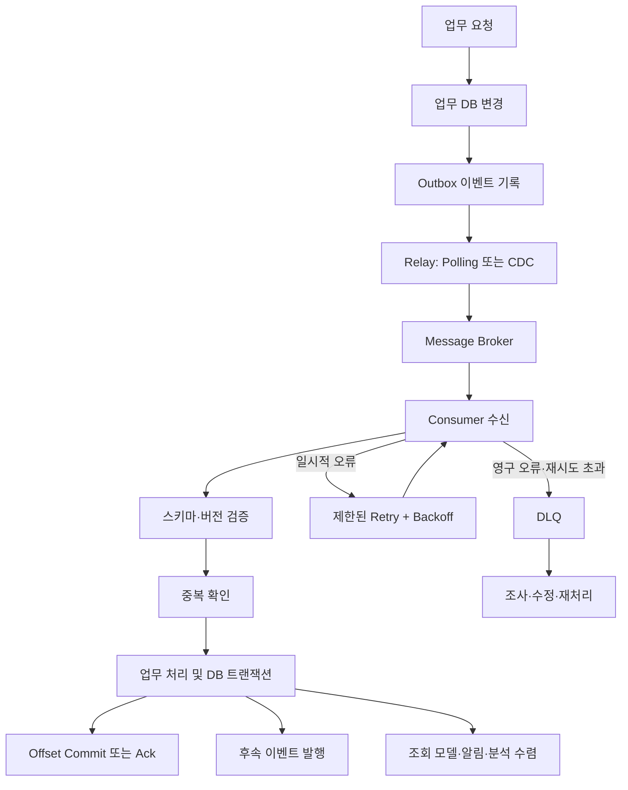

### 20.2 설계 체크리스트

#### 이벤트 계약
- [ ] 이벤트 이름이 이미 발생한 사실을 표현하는가?
- [ ] `eventId`가 고유한가?
- [ ] `eventType`, `schemaVersion`이 정의되어 있는가?
- [ ] `aggregateId`, `aggregateVersion`이 필요한 업무에 포함되는가?
- [ ] `occurredAt`과 상관관계 추적 ID가 있는가?
- [ ] 개인정보·Secret·불필요한 대용량 데이터가 제외되었는가?

#### Broker와 구독
- [ ] Kafka Topic/Partition 또는 RabbitMQ Exchange/Queue/Binding이 명확한가?
- [ ] 팬아웃과 작업 분배를 구분했는가?
- [ ] 구독자별 독립 처리 상태가 필요한가?
- [ ] 보존 기간·내구성·복제·확인 설정이 정의되어 있는가?

#### Consumer
- [ ] DB 변경과 중복 처리 기록이 같은 트랜잭션인가?
- [ ] DB 커밋 후 Ack/offset commit 순서인가?
- [ ] 외부 API의 멱등 키·승인 조회가 있는가?
- [ ] 순서 역전·늦은 이벤트 정책이 있는가?
- [ ] 재시도 횟수·Backoff·Jitter가 제한되어 있는가?
- [ ] DLQ의 운영 책임자·보관·재처리 절차가 있는가?

#### 운영
- [ ] Consumer lag·Queue depth를 관찰하는가?
- [ ] Outbox backlog와 Relay 지연을 관찰하는가?
- [ ] 중복·유실·순서 역전 테스트가 있는가?
- [ ] 이벤트 재생이 외부 부작용을 중복 실행하지 않는가?
- [ ] 최종 업무 상태를 대사할 수 있는가?

### 20.3 전체 아키텍처의 핵심

이벤트 기반 마이크로서비스는 단순히 Kafka나 RabbitMQ를 도입하는 작업이 아니다. 업무 이벤트의 의미와 계약을 정의하고, 발행 의도를 보존하며, Broker의 전달 특성을 이해하고, Consumer에서 중복·순서·실패를 제어하고, 최종 업무 상태가 수렴하는지 운영하는 전체 설계다.

[출처: IMG-40]

---

## 21. 핵심 내용 정리

1. 동기 API는 즉시 응답이 필요한 요청에, 비동기 이벤트는 후속 처리를 시간적으로 분리할 때 적합하다.
2. Message는 통신 단위, Command는 수행 의도, Event는 이미 발생한 사실이다.
3. Producer 전송 성공, Broker 저장, Consumer 처리, 업무 DB 반영은 서로 다른 성공 경계다.
4. 팬아웃은 여러 독립 구독자가 같은 이벤트를 각각 소비하는 것이고, 작업 분배는 같은 구독 내 인스턴스가 일을 나누는 것이다.
5. Kafka는 Topic·Partition·Consumer Group·offset을 중심으로, RabbitMQ는 Exchange·Queue·Binding·ack를 중심으로 이해한다.
6. At-least-once 전달에서는 중복을 전제로 Idempotent Consumer를 설계한다.
7. 처리 전 커밋은 유실 위험, 처리 후 커밋은 중복 위험이 있으므로 업무 DB 트랜잭션과 처리 기록을 결합한다.
8. `eventId`는 중복 식별, `aggregateVersion`은 같은 업무 대상의 순서 판단에 활용한다.
9. Retry는 제한하고 Backoff·Jitter를 적용하며, 영구 오류는 DLQ로 분리한다.
10. Transactional Outbox는 업무 변경과 발행 의도를 DB 로컬 트랜잭션으로 보존하지만 Broker 발행 중복은 여전히 고려해야 한다.
11. Eventual Consistency는 비동기 처리 중 상태가 일시적으로 다를 수 있음을 전제로 하며, 최종 수렴과 사용자 안내가 중요하다.
12. Lag·Backpressure·DLQ·Outbox backlog를 관찰하고 실제 업무 효과 기준으로 실패를 검증해야 한다.

---

# 부록 A. 이미지별 인벤토리 및 문서 위치

| 이미지 | 원본 주요 제목·주제 | 최종 문서 위치 | 이미지 유형 | 판독 상태 |
|---|---|---|---|---|
| IMG-21 | 이벤트로 연결되는 Microservices | 1, 16, 21 | 개념도·표·흐름도 | 정상 |
| IMG-22 | 동기 요청과 비동기 이벤트 | 2 | 비교도·시퀀스·표 | 정상 |
| IMG-23 | Message · Command · Event | 3 | 정의 표·흐름도 | 정상 |
| IMG-24 | Producer · Broker · Consumer | 4 | 아키텍처·비교표 | 정상 |
| IMG-25 | 이벤트 계약에는 무엇을 담을까? | 5 | JSON·필드 표 | 정상 |
| IMG-26 | 팬아웃과 작업 분배의 차이 | 6 | 패턴 비교·구조도 | 정상 |
| IMG-27 | Kafka — Topic · Partition · Group | 7 | Partition·Group 구조도 | 정상 |
| IMG-28 | RabbitMQ — Exchange · Queue · Ack | 8 | 라우팅 구조·설정 표 | 정상 |
| IMG-29 | 전달 보장은 어디까지일까? | 9 | 보장 수준 비교·경계도 | 정상 |
| IMG-30 | Consumer의 커밋 순서 | 10 | 처리 순서·Kafka/RabbitMQ 비교 | 정상 |
| IMG-31 | Duplicate Event와 Idempotent Consumer | 11 | 중복 처리 흐름·DB 표 | 정상 |
| IMG-32 | 순서가 바뀌어 도착한다면? | 12 | 버전 비교·상태 전이 | 정상 |
| IMG-33 | Retry · Backoff · Dead Letter | 13 | 재시도 표·처리 흐름 | 정상 |
| IMG-34 | Transactional Outbox로 발행 의도 보존 | 14 | DB·Relay·Broker 흐름 | 정상 |
| IMG-35 | Eventual Consistency와 사용자 경험 | 15 | 개념 설명·상태 비교 | 일부 세부 문구 확인 필요 |
| IMG-36 | 이벤트로 주문 업무 연결하기 | 16 | 업무 흐름·서비스 연계 | 일부 세부 문구 확인 필요 |
| IMG-37 | 스키마 진화와 이벤트 재생 | 17 | 호환성·재생 개념 | 일부 세부 문구 확인 필요 |
| IMG-38 | Lag · Backpressure · 관측 | 18 | 운영 지표·구조 설명 | 일부 세부 문구 확인 필요 |
| IMG-39 | 실패 시나리오로 검증하기 | 19 | 실패 테스트·검증 표 | 일부 세부 문구 확인 필요 |
| IMG-40 | Event-Driven Microservices 최종 지도 | 20, 21 | 전체 아키텍처 지도 | 정상 |

> 인벤토리의 제목은 각 이미지 상단 제목을 기준으로 기록했다. 일부 이미지의 세부 표·작은 글자는 원본 해상도에서 판독이 제한될 수 있어 본문에서는 확인 가능한 개념과 구조를 중심으로 반영했다.

# 부록 B. 중복 통합 내역

| 통합 개념 | 관련 이미지 | 통합 위치 | 처리 방식 |
|---|---|---|---|
| 동기 호출의 지연·장애 전파와 비동기 이벤트 | IMG-21, IMG-22 | 1, 2 | 개요와 상세 비교로 분리 |
| Producer·Broker·Consumer 역할과 처리 경계 | IMG-21, IMG-24 | 1, 4 | 개요와 구성 요소 설명으로 통합 |
| 중단 지점에 따른 유실·중복·순서 영향 | IMG-21~IMG-24, IMG-25~IMG-34 | 9, 10, 19 | 공통 원리를 통합하고 기술별 차이는 별도 유지 |
| Message·Command·Event | IMG-23 | 3 | 정의·비교·업무 예시로 통합 |
| 이벤트 계약·식별자·버전·시간 | IMG-25, IMG-32, IMG-37 | 5, 12, 17 | 계약 정의와 순서·호환성 주제로 분리 |
| 팬아웃·작업 분배 | IMG-26, IMG-27, IMG-28 | 6, 7, 8 | 패턴 개념과 제품별 구현을 분리 |
| Kafka offset과 RabbitMQ ack | IMG-24, IMG-26~IMG-30, IMG-32~IMG-34 | 4, 7~10, 12~14 | 공통 용어로 뭉뚱그리지 않고 제품별 의미 유지 |
| 중복 이벤트와 멱등 처리 | IMG-29~IMG-31, IMG-34 | 9~11, 14 | 전달 보장·처리 순서·Outbox 중복 발행으로 구분 |
| Retry·DLQ·복구 | IMG-33, IMG-39 | 13, 19 | 처리 정책과 검증 시나리오로 통합 |
| Outbox·Relay·Consumer 멱등성 | IMG-31, IMG-34 | 11, 14 | Consumer 처리 중복과 발행 중복을 구분 |
| 최종 일관성·운영 관측 | IMG-35, IMG-38, IMG-40 | 15, 18, 20 | 사용자 관점·운영 지표·전체 구조로 통합 |

# 부록 C. 기술적 검토 및 확인 사항

## C.1 원문 표현을 보완한 기술적 사항

1. **`202 Accepted`의 의미**  
   요청 접수 또는 비동기 작업 수락을 의미할 수 있으며, 모든 Consumer의 처리가 완료되었다는 뜻은 아니다.

2. **Exactly-once의 범위**  
   Kafka 내부 처리 경계에서 제공되는 보장과 외부 DB·결제 API 등 외부 부작용의 정확히 한 번 처리는 구분해야 한다.

3. **Kafka offset commit과 RabbitMQ ack**  
   둘 다 소비 확인 수단이지만 내부 모델과 재처리 방식이 다르므로 같은 API나 동일 의미로 간주하면 안 된다.

4. **Consumer 처리 순서**  
   업무 DB 커밋 후 offset commit/ack를 수행하면 중복 가능성이 남는다. 처리 기록과 업무 변경을 같은 DB 트랜잭션으로 묶어야 한다.

5. **Partition 순서**  
   Kafka는 Partition 내 로그 순서를 제공하지만 Partition 간 전역 순서, 여러 Consumer의 업무 완료 순서까지 자동 보장하지 않는다.

6. **RabbitMQ 내구성**  
   Durable Queue, persistent message, Publisher confirm, Consumer ack는 서로 다른 역할이며 각각의 설정과 장애 조건을 함께 검토해야 한다.

7. **Transactional Outbox**  
   DB 변경과 Outbox 기록은 원자적으로 저장할 수 있지만 Relay의 Broker 발행과 SENT 업데이트 사이에서 중복 발행이 가능하다.

8. **이벤트 발생 시각**  
   `occurredAt`은 이벤트의 발생 시각을 표현하는 필드이지, 여러 호스트의 전체 업무 순서를 보장하는 값이 아니다.

9. **DLQ**  
   DLQ에 메시지를 옮겼다는 사실은 업무 처리가 성공했다는 뜻이 아니다. 원인 조사·수정·재처리·폐기 정책이 필요하다.

## C.2 이미지 내 가상 수치

다음 값은 이미지의 설명용 예시이며 실제 운영 권장값이나 성능 측정값으로 단정하면 안 된다.

- IMG-21의 응답 시간·성공률·타임아웃 예시
- IMG-33의 최대 재시도 5회, 1~16초 지수 Backoff, ±20% Jitter, DLQ 30일 보관 예시
- IMG-34의 Relay polling 1초, Outbox backlog·지연 관측 예시

실제 값은 트래픽, 업무 중요도, Broker 설정, 외부 API 제한, 운영 비용을 바탕으로 결정해야 한다.

## C.3 추가 확인이 필요한 사항

- IMG-35~IMG-39의 작은 표·주석 중 일부는 세부 문자열을 완전하게 전사하지 못했을 수 있다.
- IMG-36의 주문 업무 예시는 개념 흐름으로 정리했으며, 실제 이미지의 모든 세부 이벤트 필드가 완전히 판독되었다고 보장하지 않는다.
- Kafka 및 RabbitMQ의 보장 수준은 버전·설정·클라이언트 라이브러리·운영 토폴로지에 따라 달라질 수 있으므로 실제 적용 시 공식 문서와 설정을 확인해야 한다.
- 이벤트 스키마 호환성 정책은 사용 중인 Schema Registry와 직렬화 포맷(예: Avro, Protobuf, JSON Schema)에 따라 세부 규칙이 달라진다.

## C.4 원본과 최종 문서의 차이

- 이미지에서 같은 주제가 여러 번 반복되는 경우 중복 문장을 그대로 복사하지 않고 개념별로 통합했다.
- 원본의 구조도는 Mermaid 또는 텍스트 흐름으로 재구성했다. 시각적 배치·색상은 보존하지 않았지만 확인 가능한 구성 요소와 연결 관계를 반영했다.
- 이미지에 있는 가상 로그·필드·수치는 학습에 필요한 범위에서 보존했다.
- 원문 설명과 구현 시 주의해야 할 기술적 범위는 `[기술적 검토]` 또는 `[보충 설명]`으로 구분했다.
- 원본 이미지에 없는 특정 제품 버전·실제 운영값·실제 성능 결과는 추가하지 않았다.

---

## 문서 검수 결과

| 검수 항목 | 결과 |
|---|---|
| IMG-21~IMG-40 이미지 존재 확인 | 완료 |
| 이미지별 주요 주제 인벤토리 | 완료 |
| 핵심 개념의 학습 순서 재구성 | 완료 |
| 분산된 개념 통합 | 완료 |
| 주요 구조·흐름도 재구성 | 완료 |
| 출처 이미지 번호 연결 | 완료 |
| 기술적 범위·오해 가능성 검토 | 완료 |
| 작은 글자·세부 주석의 완전 전사 | 일부 확인 필요 |

**주의:** 본 문서는 이미지의 주요 기술 개념과 구조를 통합한 학습용 분석본이다. 작은 글씨의 표·주석까지 원문과 100% 동일한 OCR 전사본이라고 주장하지 않는다. 원본 이미지의 모든 세부 문구가 반드시 필요한 경우 부록 C.3의 이미지들을 확대해 최종 대조해야 한다.
